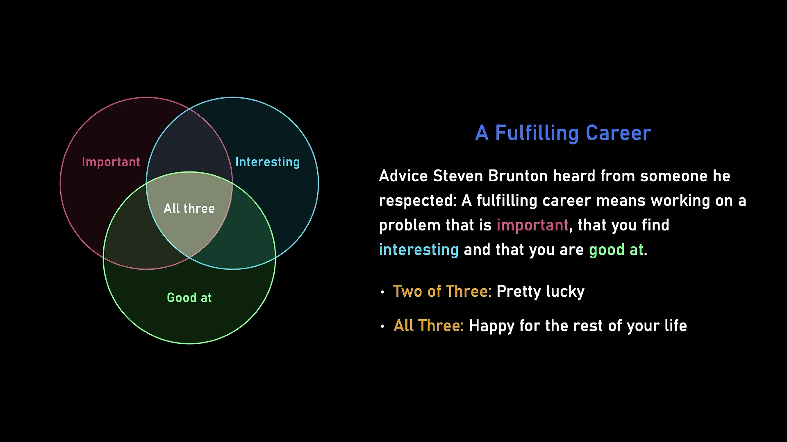

> **Lex Fridman**: This is a trickier question, but a lot of people listening to this are feeling a lot of anxiety and fear about the future. It's both about a job, but also a future that's meaningful. Can you look back to your own life when you had that uncertainty, that anxiety? What's the advice you can give to that guy to, when you're in that low point?
>
> **Ankur Moitra**: So let me, yeah, let me try to address that question. It's a very tough question. I'll tell a short story that you know, we spent our sabbatical in the Bay Area, and we were living in Palo Alto, which was kind of the epicenter of college stress. You know, you can just feel it. You go to the cafes, it's just in the water- … at that point. You know what extracurriculars are you doing right now- … that'll help you? And then right when I came back to MIT, they asked me to give the convocation speech there, and it was just interesting thinking through that speech. You know, what do you say to this entire auditorium filled with freshmen and their families who, if things are a game to optimize how good you look on paper as a seventeen-year-old kid, they've won. And I just kept thinking about when I was in that same situation, when I was starting college, how excited I was just to learn all of these different things. You know, I'd sit there and plan out you know, my four years and, you know, I had little notebooks where I'd figure out what my classes would be, and if I took these classes in just the right order, I could take photonics as a sophomore.
>
> And I had no idea what photonics was, but it sounded fun- … and fancy. And I think that aspect, you know, so much of our society now is geared towards winning and looking good on paper, and I always wonder to what end. You start off in high school and you can start, as soon as you walk in the door, optimizing your APs and your extracurriculars so that you can get to an elite school. And then when you get to that elite school, you might skip classes because, you know, maybe the important thing is to prepare for your interviews so that you can get a job at a frontier lab, and then you can get some nice, you know, restricted stock units and live out your life. And that's great. You won. You won at every stage, but so what?
>
> You know, for me, the, you know, the best way to live a rich and fulfilling life is just to pretend you've already won, and then figure out what you would do in that scenario. I remember the advice I got when I started at MIT as faculty. Sanjeev Arora told me, "You know, the easiest way to get tenure is just to pretend you already have it and do what you would have wanted to do all along."
>
> So I don't know if that advice applies to, you know, graduate students, to high schoolers too, but I think my advice stays the same. Pretend you already have tenure. What would you now do? 'Cause a lot of the people we're giving advice to have really so many different opportunities. Finding something that you really believe in is the only way I know to be fulfilled.
>
> **Steven Brunton**: I've heard career advice from someone I respected that a fulfilling career is something where you can work on a problem that is important, that you find interesting, and that you're good at. And if you can get two out of those three, you're pretty lucky. If you can get all three, you're gonna be, you know, happy for the rest of your life. And so having the right preparation, figuring out what you're good at, what's interesting, what's important, and then preparing yourself, you're not guaranteed to get all three of those, but you wanna be ready when that opportunity comes, and then continue doing the things you actually enjoy doing. I think that's great advice.
>
> **Lex Fridman**: I think we should also put into context and be quite honest. I do think a lot of the advice you gave applies, but we should be honest that I'm sitting with three world-class human brains not that have figured– found their path. You're survivor bias. So, you know, there's a lot of people listening to this that are like– it's like they're pretty sure they won't find their path. It's the fear, it's the anxiety, it's the uncertainty. It's stumbled a bunch of times. I think, to be fair, some of the most interesting people, right, stumble quite a bit in life, whether it's the external environment or the internal, whatever the universe brings. And in that, I just know a lot of people just feeling and monitoring it right now because of everything AI is doing to our society. There's a lot of people just terrified and really anxious.
>
> And I think there's a lot of wisdom in what Ankur says. You can be paralyzed by that fear, or you can imagine, "I've already won. What would the person who has won do in this situation?" And that alleviates the fear. It actually takes the– gives you the optimal path under uncertainty, under heavy uncertainty, under a lot of uncertainty. And don't use the old playbook. Try to be the person that figures out how to write the new, the next playbook.

From Lex Fridman Podcast #503 ([video, 3:26:23–3:31:39](https://www.youtube.com/watch?v=ZAzWPE9CItg&t=12383s)); text from the [official transcript](https://lexfridman.com/math-ai-crisis-transcript#chapter14_advice_for_young_people). The image is a frame from the video at 3:30:05.

What surprised me is that I've used this method myself before: imagine a goal has already been reached, and ask what you would do then. It's a very good way to think, because it helps you work out what you really want, instead of being pushed along by all kinds of constraints.
