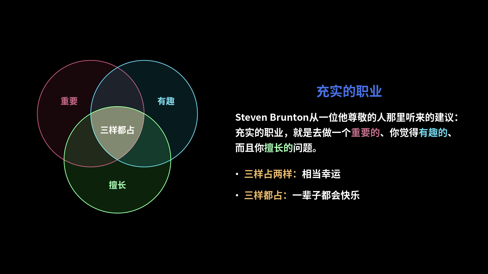

> **Lex Fridman**：这个问题更难一些。很多听众对未来感到非常焦虑和恐惧，既担心工作，也担心未来能不能过得有意义。你们能不能回想一下，自己人生中也有过那种不确定、那种焦虑的时候？对处在低谷的那个自己，你会给什么建议？
>
> **Ankur Moitra**：那我来，嗯，我来试着回答这个问题。这是个很难的问题。我讲个小故事。我们在湾区休过一次学术假，住在帕洛阿尔托，那里差不多是升学压力的中心。你能直接感觉到。去咖啡馆坐坐，那种压力就像溶在水里一样，无处不在。“你现在在参加哪些课外活动？对你有帮助的那种？”后来我一回到MIT，他们就请我去做开学典礼的演讲。构思那篇演讲的过程挺有意思：面对坐满整个礼堂的新生和他们的家人，你要说什么？如果说这一切就是一场比赛，比的是一个17岁的孩子在纸面上看起来有多好，那他们已经赢了。我一直在想自己当年处在同样的境地、刚上大学的时候，一想到能学这么多不同的东西就有多兴奋。我会坐在那里规划我的四年，我有几个小本子，在上面盘算要上哪些课：如果按恰好的顺序选这些课，大二就能上光子学。
>
> 我完全不知道光子学是什么，但听起来又好玩又高级。我觉得那种东西……如今我们的社会太多地围绕着赢、围绕着纸面上好看，而我总在想：图什么呢？你从高中开始，一进校门就可以开始优化你的AP课程和课外活动，好进名校。进了名校，你可能会逃课，因为也许更重要的是准备面试，好进一家前沿实验室，然后拿到一笔不错的限制性股票，过完这一生。这很好。你赢了。你每个阶段都赢了，可那又怎样？
>
> 对我来说，过上丰富而充实的人生，最好的办法就是假装你已经赢了，然后想想在那种情况下你会做什么。我记得刚到MIT当教员时得到的建议，Sanjeev Arora对我说：“拿到终身教职最简单的办法，就是假装你已经有了，然后去做你一直以来想做的事。”
>
> 我不知道这个建议是否也适用于研究生、高中生，但我觉得我的建议还是一样：假装你已经拿到终身教职了，你现在会做什么？因为我们在给建议的这些人，其实有非常多不同的机会。找到你真正相信的东西，是我所知道的获得充实感的唯一途径。
>
> **Steven Brunton**：我听一位我尊敬的人讲过一条职业建议：充实的职业，就是你能去做一个重要的、你觉得有趣的、而且你擅长的问题。三样里能占两样，你就很幸运了；三样都占，你这辈子都会很快乐。所以，做好准备，弄清楚你擅长什么、什么有趣、什么重要，然后让自己准备好。三样不一定都能得到，但机会来的时候，你要准备好，然后继续做你真正喜欢做的事。我觉得这是很好的建议。
>
> **Lex Fridman**：我觉得我们也应该把这些放回语境里，说得坦诚一点。我确实认为你们给的很多建议都适用，但我们得承认，我对面坐着的是三个世界级的头脑，都已经找到了自己的路。你们是幸存者偏差。所以，很多听众会觉得……他们很确定自己找不到自己的路。是恐惧，是焦虑，是不确定。跌倒过很多次。公平地说，一些最有意思的人，在人生中也跌跌撞撞，不管是因为外部环境还是内心，不管宇宙带来什么。在这种处境下，我知道现在很多人都正感受着、盯着这一切，因为AI正在给我们的社会带来的一切，很多人非常害怕、非常焦虑。
>
> 我觉得Ankur说的话里有很多智慧。你可以被这种恐惧压得动弹不得，也可以想象：“我已经赢了。一个已经赢了的人，在这种处境下会怎么做？”这会减轻恐惧，它实际上会给你不确定之下的最优路径，在高度不确定、非常不确定之下也是如此。还有，别照着旧剧本走，努力成为那个想出怎么写新剧本、下一个剧本的人。

摘自Lex Fridman播客第503期[视频（3:26:23–3:31:39）](https://www.youtube.com/watch?v=ZAzWPE9CItg&t=12383s)，英文原文见[官网转录稿](https://lexfridman.com/math-ai-crisis-transcript#chapter14_advice_for_young_people)，中文为本站译文，图为视频 3:30:05 的画面（图中文字由本站译成中文）。

让我惊讶的是，“假装某个目标已经达成，你会做什么”这个方法，我之前也用过。这是一个很好的思考方法，能够想清楚你真正想要什么，而不是被种种约束条件推着走。
