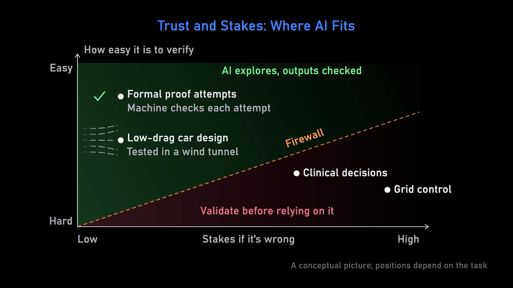

> **Alex Kontorovich**: But we also don't wanna outsource so much– nearly so much decision-making to these systems for exactly that reason.
>
> **Steven Brunton**: Yeah, we have infrastructure and protocols in place already for safety critical and high impact decisions. We have the FAA, we have the American Medical Association, the Bar Association for these things that affect humans. And I think of, you know, how do we incorporate AI into our general processes in the entire world on two axes. We have, you know, how much do we trust the output, so verifiability or trustworthiness, and on the other axis is how high stakes is it if it's wrong. If AI spits out a wrong proof, nobody goes without power. It's fine. So it's very low stakes. And it is actually extremely verifiable, so you know very quickly if it's right or wrong, and it's low stakes if it's wrong. So that's the perfect use case is this open-ended design space. Designing a better vehicle, you know, a better car design that's lower drag, more fuel efficient. Low stakes if it gets a wrong design because you can always test it in a wind tunnel and verify if it did or didn't work.
>
> So that, like, design optimization space is perfect for AI, and we as humans have to be very careful about not bleeding into– We need a firewall of what needs to actually be verified, and we have protocols, we have systems, legal systems, and infrastructure for verification. But it is something we need to think about. If we get lazy- … We can– It's a very slippery slope. We need to have that firewall.

From Lex Fridman Podcast #503 ([video, from 3:02:13](https://www.youtube.com/watch?v=ZAzWPE9CItg&t=10933s)); text from the [official transcript](https://lexfridman.com/math-ai-crisis-transcript#chapter11_why_llms_work_so_well). The image is a frame from the video at 3:03:30.

A good way to classify and think about where AI can be applied.
