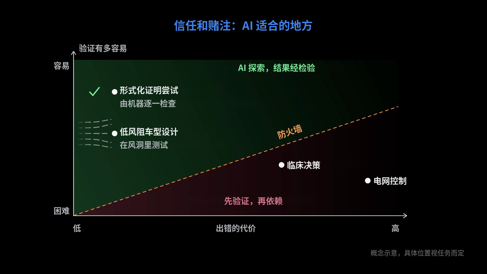

> **Alex Kontorovich**：但也正因为如此，我们并不想把那么多决策——远远没有那么多——交给这些系统去做。
>
> **Steven Brunton**：是的，对于安全攸关、影响重大的决策，我们已经有现成的基础设施和规程：有美国联邦航空管理局（FAA），有美国医学会，有律师协会，管着这些影响人的事情。我思考怎样把AI纳入整个世界的一般流程时，会看两条轴：一条是我们有多信任它的输出，也就是可验证性或可信度；另一条是，如果它错了，代价有多高。AI吐出一个错误的证明，不会有人因此断电，没关系，所以代价很低。而且证明其实极易验证，你很快就知道它对不对，错了代价也低。所以完美的用例，是这种开放式的设计空间。设计一辆更好的车，比如风阻更低、更省油的车型：就算它给出的设计是错的，代价也低，因为你总可以把它放进风洞里测，验证到底行不行。
>
> 所以像设计优化这样的领域非常适合AI，而我们人类必须非常小心，不要滑进——我们需要一道防火墙，划清哪些东西真正需要验证。我们有规程，有体系，有法律体系，有用于验证的基础设施。但这是我们必须认真考虑的事。如果我们变懒了……我们可能会——这是一道很滑的斜坡。我们需要那道防火墙。

摘自Lex Fridman播客第503期[视频（3:02:13起）](https://www.youtube.com/watch?v=ZAzWPE9CItg&t=10933s)，英文原文见[官网转录稿](https://lexfridman.com/math-ai-crisis-transcript#chapter11_why_llms_work_so_well)，中文为本站译文，图为视频 3:03:30 的画面（图中文字由本站译成中文）。

一种不错的分类和思考AI应用范围的方式。
