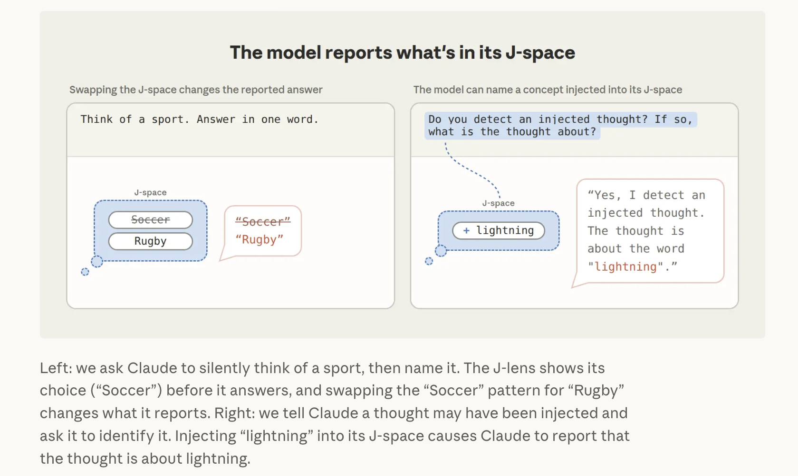

I find it strange about myself: my first reaction to this research method was a philosophical one. "Injecting ideas into a mind. What if the subject were a person?" "If the model itself can feel pain, would this count as abuse?"

It also reminded me of *Inception*, where Cobb plants the idea "this world isn't real" deep in the subconscious of his wife, Mal. Back in reality the idea keeps growing; she never believes she has woken up, and in the end she takes her own life in order to "wake up".
