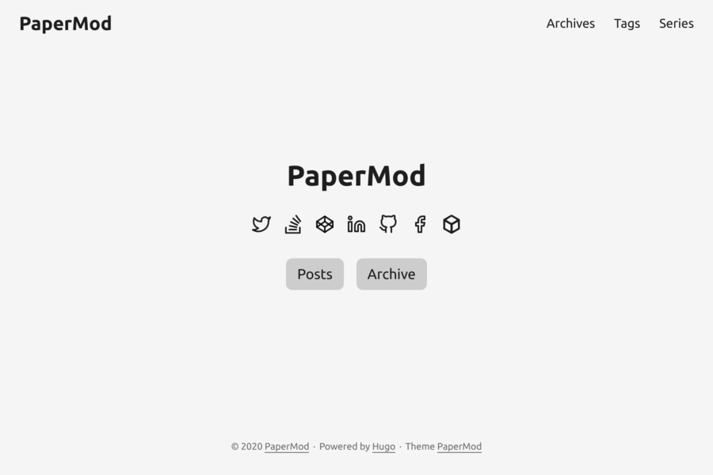

中文排版测试：这是一段中文，含 **粗体**、*斜体*、~~删除线~~、`行内代码` 和 [链接](https://gohugo.io)。:rocket:

## 列表与任务

- 无序列表
  - 嵌套
1. 有序列表
- [x] 已完成任务
- [ ] 未完成任务

## 表格

| 语法 | 支持 |
|:--|:-:|
| 表格 | ✅ |
| 脚注 | ✅[^1] |

[^1]: 这是一条脚注。

## 代码高亮

```rust
fn main() {
    println!("你好，世界");
}
```

## 数学公式

行内公式 $E = mc^2$，块级公式：

$$
\int_0^\infty e^{-x^2}\,dx = \frac{\sqrt{\pi}}{2}
$$

## Mermaid


## 提示框

> [!NOTE]
> 这是注意。

> [!TIP]
> 这是提示。

> [!WARNING]
> 这是警告。

> 普通引用。

## 图片


