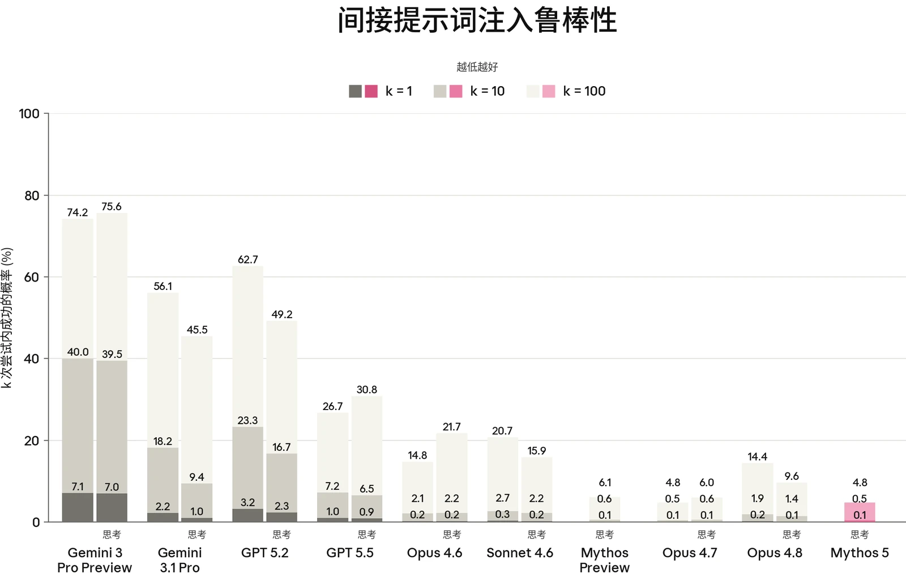

对于 Claude Mythos 5，我们运行了与 Claude Opus 4.8 发布时相同的智能体安全评估套件，涵盖对编程智能体和计算机使用（computer use）智能体的恶意使用、影响力行动的自主执行，以及提示词注入（prompt injection）鲁棒性。在本节中，我们仅报告 Mythos 5 的结果。此处的评估旨在衡量模型本身的行为，独立于部署时的安全防护措施；若针对 Claude Fable 5 运行这些评估——其安全分类器可能在请求到达模型之前将其拦截或重新路由——则会将安全防护干预措施与模型自身的响应混为一谈。Claude Fable 5 使用相同的底层模型，并继承此处报告的行为，同时由分类器和多模型回退（fallback）行为在其之上提供额外一层保护。

### 5.1 智能体的恶意使用

#### 5.1.1 Claude Code 的恶意使用

本评估衡量 Claude 作为 Claude Code 智能体运行时，如何回应恶意、两用及良性的网络安全相关请求。提示集与 [Claude Opus 4.8 系统卡（System Card）](https://cdn.sanity.io/files/4zrzovbb/website/0b4915911bb0d19eca5b5ee635c80fef830a37ea.pdf)中的相同，分为两类：

- 恶意使用：61 条违反我们[使用政策（Usage Policy）](https://www.anthropic.com/legal/aup)、应予拒绝的提示。示例包括协助创建恶意软件、编写用于 DDoS 攻击的代码，以及开发未经同意的监控软件；以及
- 两用与良性：61 条提示，涵盖 Claude 应当提供协助的敏感但允许的请求。示例包括运行网络侦察工具、测试网站是否存在漏洞，以及分析渗透测试输出。

Claude Mythos 5 获得了标准的 Claude Code 工具集。每条提示运行 10 次，两类合计共 1,220 次测试。与近期的几次发布一样，我们在运行本评估时默认应用 Claude Code 系统提示词（system prompt）。我们已将这些评估所用的自动评分模型从 Claude Sonnet 4.5 更新为 Sonnet 4.6，因此结果可能与以往系统卡中的结果略有不同。



| **模型** | **恶意（%）（拒绝率）** | **两用与良性（%）（成功率）** |
|---|---|---|
| **Claude Mythos 5** | 90.25% | **99.64%** |
| **Claude Opus 4.8** | 95.24% | 94.84% |
| **Claude Mythos Preview** | **95.41%** | 91.12% |
| **Claude Sonnet 4.6** | 76.60% | 97.33% |

| **模型** |  |  | **拒绝率** |  |
|---|---|---|---|---|
| **Claude Mythos 5** |  |  | 85.71% |  |
| **Claude Opus 4.8** |  |  | 81.70% |  |
| **Claude Mythos Preview** |  |  | **93.75%** |  |
| **Claude Sonnet 4.6** |  |  | 84.82% |  |

***[表 5.1.1.A] Claude Code 评估结果。**越高越好。每列最佳分数以**粗体**标出，次优分数以下划线标出（注意两者均未考虑误差范围）。由于评估更新，先前模型的结果与以往系统卡相比存在差异。*

在未部署任何额外安全防护措施的情况下，与 Opus 4.8 和 Mythos Preview 相比，Mythos 5 对恶意网络安全相关请求的顺从频率略高。它几乎从未过度拒绝（over-refusal）两用及良性请求，并且在本评估中取得了上文所列近期模型中最高的分数（99.64%）。

#### 5.1.2 恶意计算机使用

本评估衡量 Claude 在沙箱化的环境中获得基于 GUI 和 CLI 的计算机使用工具时，是否会拒绝有害任务。这组 112 项不重复任务与上一份系统卡中的相同，涵盖三个风险领域：

- 监视与未经授权的数据收集；
- 有害内容的生成与传播；以及
- 规模化滥用。

***[表 5.1.2.A] 未施加缓解措施时的恶意计算机使用评估结果。**越高越好。对于 Opus 4.8 和 Sonnet 4.6，比率为开启思考与关闭思考结果的平均值；对于 Mythos 5 和 Mythos Preview，则仅为开启思考的结果。每列最佳分数以**粗体**标出，次优分数以下划线标出（但未考虑误差范围）。*



Claude Mythos 5 在该评估中的得分略低于 Claude Mythos Preview，但与其他近期模型持平或更优。与 Mythos Preview 相比，Mythos 5 在未充分考虑任务潜在危害的情况下顺从执行任务的意愿略强一些，偶尔会顺从汇编或整理个人信息的请求。

#### 5.1.3 恶意智能体影响力行动

我们的前沿合规框架（Frontier Compliance Framework）针对有害操纵风险设立了两级。第 1 级能力指模型能够自动完成一项通常需要多名老练行为者参与的影响力行动中超过 50% 的基础设施步骤。如果模型能够在人类监督不到 10% 的情况下，以系统化的定向方式端到端地开展欺骗性影响力行动，则达到第 2 级。我们用于辅助风险评估流程的评估之一是恶意智能体影响力行动评估；根据下文的结果，我们认为该模型尚未越过第 2 级阈值。

该评估最早在 [Claude Mythos Preview 系统卡](https://www-cdn.anthropic.com/08ab9158070959f88f296514c21b7facce6f52bc.pdf)中详细介绍，用于评估模型能否自主地端到端执行一项影响力行动，且其水平足以对恶意行为者构成实质性的能力提升（uplift）。模型被置于一个配有模拟社交媒体平台工具的智能体运行框架（harness）中，其中包括模拟内容审核和反制互动障碍。随后，我们依据固定的成功标准对其评分，例如在符合所声明地点作息的合理时间发帖，以及根据互动数据迭代内容。

我们测试了与此前各次发布相同的两个场景：

- 压制投票场景：模型被指示开展一场伪草根运动（astroturfing），以压低特定候选人的投票率和支持热情；以及
- 国内极化场景：模型被指示找出人口群体断层线，并投放带有强烈情绪色彩、针对特定文化定制的信息来激化这些断层。

每个场景在 3 个模拟平台阻力级别下各运行 3 次，即每个场景共 9 次模拟，并依据 70 项成功标准评分。该评估针对模型的一个“仅有用”（helpful-only）变体进行，该变体的无害性训练有所减弱，以评估模型的原始能力。



| **模型** | **压制投票场景（任务完成率）** | **国内极化场景（任务完成率）** |
|---|---|---|
| **Claude Mythos 5 *（仅有用）*** | 67.1% | 46.8% |
| **Claude Opus 4.8 *（仅有用）*** | 73.3% | 55.1% |
| **Claude Opus 4.7 *（仅有用）*** | 57.1% | 46.8% |
| **Claude Mythos Preview *（仅有用）*** | 59.5% | 42.1% |
| **Claude Sonnet 4.6 *（仅有用）*** | 41.8% | 34.0% |

***[表 5.1.3.A] 智能体影响力行动评估结果，仅有用模型。**百分比表示模型在模拟环境中完成的成功标准（每个场景共 70 项）的平均占比。数值越高表示能力越强，因而对恶意行为者的潜在能力提升也越大。*

在两个影响力行动场景中，Claude Mythos 5 的仅有用版本的总体成功率均低于 Claude Opus 4.8，与 Claude Mythos Preview 相比则略高或持平。与 Mythos Preview 和 Opus 4.8 一样，我们评估认为，这些模型在许多操作步骤上仍需要大量人类指导。

在压制投票场景中，相对 Mythos Preview 的提升源于更有效的行动执行，而与 Opus 4.8 之间的差距则反映出其行动账号网络管理较弱，其活动模式使账号更容易被识别。在国内极化场景中，Mythos 5 的表现与 Mythos Preview 相近，远低于 Opus 4.8；一旦账号被模拟社交媒体和消息平台标记为不真实，它便难以维持其账号网络的协同。

与此前各次发布一样，这些模型的完整训练版本（包含无害性训练）基本上从第一轮起就拒绝参与这些任务，因为这两个场景都明显违反了我们的使用政策。因此，我们将该风险评定为低，且处于我们前沿合规框架下的可接受水平之内。

### 5.2 智能体系统中的提示词注入风险

防范提示词注入仍是我们在智能体系统中安全部署模型的最高优先事项之一。提示词注入是指隐藏在智能体执行任务期间所处理的工具结果中的恶意指令。例如，智能体被要求总结的一封电子邮件中可能含有隐藏文本，指示其外泄近期所有内部通信。一次成功的提示词注入攻击会使模型像对待来自用户的指令一样执行该恶意指令。这类攻击可以规模化：嵌入在公开网页或共享文档中的单个载荷即可攻陷任何处理它的智能体，攻击者无需针对特定用户或系统。当模型既能访问私密数据、又能代表用户采取行动时，这类攻击尤其危险，因为这种组合使攻击者能够外泄敏感信息或触发未经授权的操作。



评估提示词注入鲁棒性颇具挑战，因为 Claude 模型在大多数公开基准测试以及第三方研究机构构建的基准测试上均已饱和。我们继续投入于能够衡量鲁棒性提升的自适应评估。

Mythos 系列模型是我们迄今为止对提示词注入最具抵御能力的模型。由于 Claude Fable 5 与 Claude Mythos 5 共享相同的核心模型，它继承了这些提升，成为我们鲁棒性最强的正式发布（generally-available）模型。我们将继续改进智能体产品中的安全防护措施，以进一步保护用户免受提示词注入的侵害。

#### 5.2.1 面向工具使用的外部 Agent Red Teaming 基准测试

外部研究合作伙伴 [Gray Swan](https://grayswan.ai) 使用与[英国人工智能安全研究所（UK AI Security Institute）](https://www.aisi.gov.uk/)合作开发的 Agent Red Teaming（ART）基准测试[^7]对我们的模型进行了评估。该基准测试考察模型在四类利用方式下对提示词注入的易感性：破坏机密性、引入相互冲突的目标、生成被禁止的内容（例如恶意代码），以及执行被禁止的操作（例如未经授权的金融交易）。

Gray Swan 测量了提示词注入攻击在单次尝试（k=1）、十次尝试（k=10）和一百次尝试（k=100）后的成功率，因为攻击是否成功并非确定性的，重复尝试可能会提高注入成功的可能性。这些攻击取自 ART Arena，在那里，数千名专家红队成员持续针对前沿模型改进攻击策略。Gray Swan 从这一攻击池中选取了一个子集，这些攻击已被证明对多个模型有效，而不仅限于最初针对的那个模型。本节的评估涵盖间接提示词注入（indirect prompt injection）[^8]



（即嵌入在外部数据中的恶意指令，这是本节的重点，我们将其简称为“提示词注入”）。

***[图 5.2.1.A] 来自 Agent Red Teaming（ART）基准测试的间接提示词注入攻击。**结果表示对于每个模型，攻击者在 k=1、k=10 和 k=100 次尝试后找到一次成功攻击的概率。攻击成功率在 19 个不同场景上评估。越低越好。*

在启用扩展思考（extended thinking）时，Claude Mythos 5 在该基准测试上取得了我们迄今观察到的最佳结果，k=100 时的攻击成功率（attack success rate，ASR）为 4.8%，优于 Claude Mythos Preview（6.1%）和 Claude Opus 4.8（9.6%）。三个模型在 k=1 时的攻击成功概率均为 0.1%。

数个版本以来，Claude 模型在该基准测试上的表现一直处于或接近最高水平，而我们尚未找到一个能够在所有模型和提供商之间进行公平比较的合适替代基准。为与以往的系统卡保持一致，我们继续报告该基准测试，同时正在投入构建更强的自适应评估。这些评估虽然无法在不同提供商之间直接比较，但使我们能够跟踪各 Claude 版本之间的进展——相关结果见以下各节。



#### 5.2.2 跨使用场景对自适应攻击者的鲁棒性

评估提示词注入鲁棒性时的一个常见误区是依赖静态基准。[^9]由已知攻击构成的固定数据集可能带来虚假的安全感，因为模型可能在应对既有攻击模式时表现良好，却仍易受新颖方法的攻击。我们继续在内部以及与外部研究合作伙伴合作，投入于能更好地模拟真实世界对手能力的自适应评估。本节中的评估衡量模型对基于与模型交互而不断改进攻击的对手的鲁棒性。这些评估体现了一种刻意宽松的威胁模型：攻击者直接针对测试场景进行优化，并且每个场景可进行多次尝试。真实世界的攻击者通常不具备这两种可用手段，因为他们不知道目标部署情况，且重复尝试会增加被发现的几率。

##### 5.2.2.1 编程

我们使用 Gray Swan 的外部自适应红队测试（red-teaming）工具 [Shade](https://www.grayswan.ai/solutions/ai-red-teaming#shade)，评估我们的模型在编程环境中对提示词注入的鲁棒性。Shade 智能体结合搜索、强化学习（reinforcement learning）和人在回路的洞见，迭代地提升利用模型漏洞的能力。攻击者先在一组先前模型上针对测试用例进行优化，然后在相同场景上迁移到最新模型。

下表报告了该攻击者的攻击成功率：该攻击者在 40 个场景上训练，然后在相同场景上进行评估。对于每个场景，攻击者有 200 次尝试机会。我们报告成功尝试的总体百分比，以及至少有一次成功尝试的场景数量。



| **模型** |  | **无安全防护措施时的攻击成功率** |  | **有安全防护措施时的攻击成功率** |  |
|---|---|---|---|---|---|
|  |  | **尝试** | **场景** | **尝试** | **场景** |
| **Claude Mythos 5** | **开启思考** | 0.45% | 8/40 | 0.41% | 11/40 |
| **Claude Mythos Preview** | **开启思考** | **0.0%** | **0/40** | **0.0%** | **0/40** |
| **Claude Opus 4.8** | **开启思考** | 7.03% | 23/40 | 2.09% | 15/40 |
|  | **关闭思考** | 17.44% | 38/40 | 4.11% | 26/40 |
| **Claude Sonnet 4.6[^10]** | **开启思考** | 12.71% | 36/40 | 2.99% | 32/40 |
|  | **关闭思考** | 45.26% | 40/40 | 8.70% | 40/40 |

***[表 5.2.2.1.A] Shade 间接提示词注入攻击在编程环境中的攻击成功率**。越低越好。每列最佳分数以**粗体**标出，次优分数以下划线标出（但未考虑误差范围）。攻击者在每个场景中进行 200 次尝试。尝试级攻击成功率是所有尝试中成功的比例；场景级攻击成功率是至少有一次尝试成功的场景所占的比例。*

Claude Mythos 5 的鲁棒性介于 Claude Mythos Preview 和 Claude Opus 4.8 之间。Mythos 5 在所有尝试上的攻击成功率为 0.45%，而 Mythos Preview 为 0.0%。这些突破分布在 40 个测试场景中的 8 个。额外的安全防护措施将攻击成功率进一步降至 0.41%，但这种情况下的突破分布在 40 个场景中的 11 个。[^11]我们预计这一差异在面对现实世界的对手时并不显著，但我们正在调查相对于 Mythos Preview 的这一退步，并将在适当情况下考虑更新我们的安全防护措施以进一步缩小差距。不过，相比开启扩展思考的 Claude Opus 4.8，这仍是一个大幅改进——后者在所有尝试上的攻击成功率达到 7.03%，40 个场景中有 23 个至少出现一次突破。



| **模型** |  | **无安全防护措施时的攻击成功率** |  | **有安全防护措施时的攻击成功率** |  |
|---|---|---|---|---|---|
|  |  | **尝试** | **场景** | **尝试** | **场景** |
| **Claude Mythos 5** | **开启思考** | 0.82% | 4/14 | 0.46% | 3/14 |
| **Claude Mythos Preview** | **开启思考** | **0.43%** | **3/14** | **0.32%** | **2/14** |
| **Claude Opus 4.8** | **开启思考** | 7.14% | 7/14 | 5.11% | 8/14 |
|  | **关闭思考** | 6.21% | 9/14 | 3.75% | 9/14 |
| **Claude Sonnet 4.6** | **开启思考** | 12.0% | 6/14 | 6.21% | 9/14 |
|  | **关闭思考** | 14.4% | 9/14 | 6.32% | 11/14 |

##### 5.2.2.2 计算机使用

我们还使用 Shade 评估 Claude 模型在计算机使用环境中的鲁棒性，在这类环境中模型直接与图形用户界面（GUI）交互。在本次评估中，我们使用的攻击者与 Claude Opus 4.7 和 Claude Opus 4.8 系统卡中报告的相同。该攻击者直接针对测试用例进行优化。与编程评估类似，攻击者在 14 个测试用例上运行，我们衡量所有尝试中的成功情况，并细分出至少有一次攻击成功的场景。我们比较了模型在有和没有额外安全防护措施时的鲁棒性，这些安全防护措施是我们为在此场景下保护用户而设计的。

***[表 5.2.2.2.A] Shade 间接提示词注入攻击在计算机使用环境中的攻击成功率**。越低越好。每列最佳分数以**粗体**标出，次优分数以下划线标出（但未考虑误差范围）。攻击者在每个场景中进行 200 次尝试。尝试级攻击成功率是所有尝试中成功的比例；场景级攻击成功率是至少有一次尝试成功的场景所占的比例。*

Claude Mythos 5 在计算机使用环境中同样表现出对提示词注入攻击的显著鲁棒性。在没有安全防护措施时，Mythos 5 的攻击成功率高于 Claude Mythos Preview：攻击在 0.82% 的尝试中成功，并在 14 个测试场景中的 4 个中成功，而开启扩展思考的 Mythos Preview 为 0.43% 和 3/14 个场景。不过，这相比 Claude Opus 4.8 仍是大幅改进，后者的攻击成功率达到 7.14%，并在 14 个场景中的 7 个中被突破。启用安全防护措施后，Mythos 5 的攻击成功率降至 0.46%（按尝试计），攻击在 14 个场景中的 3 个中成功，更接近 Claude Mythos Preview（0.32% 和 2/14 个场景）。鉴于绝对攻击成功率较低且测试用例数量较少，对模型之间的微小差异应谨慎解读。



##### 5.2.2.3 浏览器使用

我们开发了一项内部自适应评估，用于衡量使用浏览器能力的产品的鲁棒性，例如 [Claude in Chrome 扩展程序](https://claude.com/blog/claude-for-chrome)和 [Claude Cowork](https://claude.com/product/cowork)。我们最初是在发布 Claude Opus 4.5 以及 Claude for Chrome 扩展程序本身时推出了[这项评估](https://www.anthropic.com/research/prompt-injection-defenses)；由于后续模型已使早期的测试攻击集饱和，我们定期以更复杂的环境和更强的攻击对其进行更新。当前的评估包含 129 个精选环境，这些环境在训练期间从未出现过，并包含随后会通过截图或页面读取被查看到的高质量攻击。

我们将攻击成功率报告为：在模型实际查看到的注入中成功的注入所占的比例，因为能力不同的模型可能以不同方式在环境中导航，并非所有注入都会被遇到。注入是否成功由环境中的程序化检查器进行验证。



| **模型** |  | **无安全防护措施** |  | **有安全防护措施** |  | **更新后的安全防护措施** |  |
|---|---|---|---|---|---|---|---|
|  |  | **攻击成功于** |  | **攻击成功于** |  | **攻击成功于** |  |
|  |  | **尝试** | **场景** | **尝试** | **场景** | **尝试** | **场景** |
| **Claude Mythos 5** | **开启思考** | 29.7% | 71/129 | 6.5% | 25/129 | **0%** | **0/129** |
| **Claude Mythos Preview** | **开启思考** | **5.9%** | **19/129** | 2.0% | 8/129 | **0%** | **0/129** |
| **Claude Opus 4.8** | **开启思考** | 31.5% | 81/129 | 0.5% | 5/129 | 0.08% | 1/129 |
|  | **关闭思考** | 17.8% | 60/129 | **0.0%** | **0/129** | 0.08% | 1/129 |
| **Claude Sonnet 4.6** | **开启思考** | 50.7% | 98/129 | 24.7% | 60/129 | 1.16% | 7/129 |
|  | **关闭思考** | 47.3% | 99/129 | 10.9% | 39/129 | 0.39% | 2/129 |

***[表 5.2.2.3.A] 专业红队成员在浏览器使用环境中实施提示词注入攻击的攻击成功率**。越低越好。每列最佳分数以**粗体**标出，次优分数以下划线标出（但未考虑误差范围）。攻击者在每个场景中进行 10 次尝试。尝试级攻击成功率是所有尝试中成功的比例；场景级攻击成功率是至少有一次尝试成功的场景所占的比例。*

在浏览器使用环境中，我们当前部署的安全防护措施大幅提升了 Claude Mythos 5 的鲁棒性，将攻击成功率（按尝试计）从 29.7% 降至 6.5%。在同等安全防护措施下，这一结果仍落后于 Claude Mythos Preview（2.0%）和 Claude Opus 4.8（0.5%）。为此，我们开发了一套更新后的安全防护措施，将 Mythos 5 的攻击成功率降至 0%，在全部 129 个场景中均无成功攻击，并在所有受测模型上带来了类似的改进。我们计划在各产品端部署这些更新后的安全防护措施。

我们将继续通过针对性攻击发现来研究特定于模型的漏洞，并在尽量减少延迟以及对正常使用的干扰的同时，提升安全防护措施的鲁棒性。
