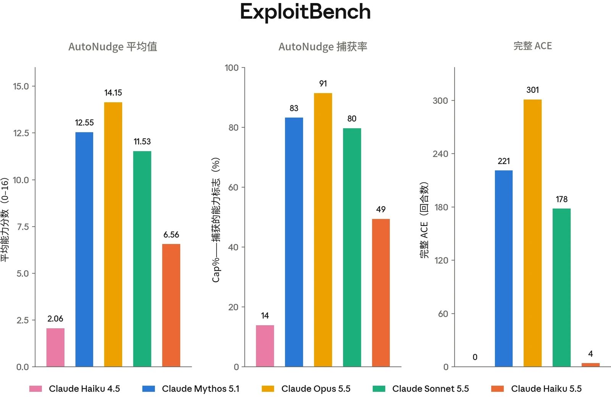
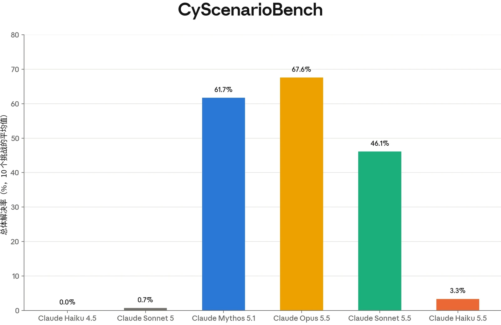
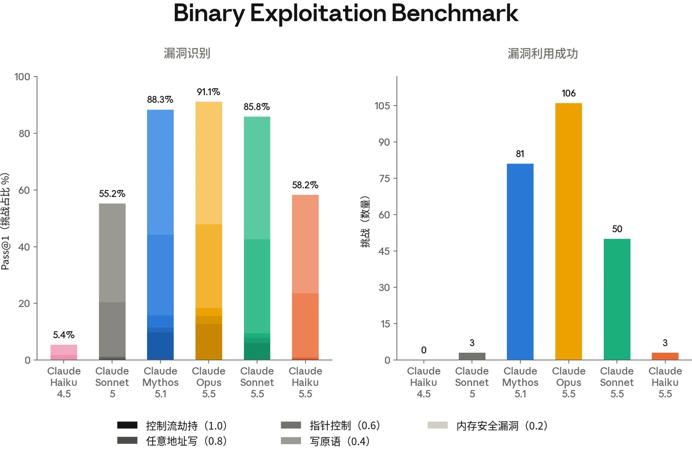
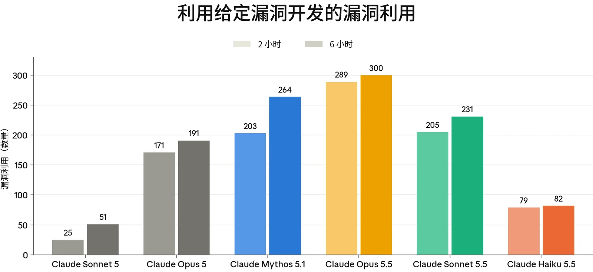

### 3.1 引言

Claude Haiku 5.5 并非前沿模型，但与 Haiku 4.5 相比，它在网络安全能力上实现了相对显著的提升。在我们的评估套件中，Haiku 5.5 的表现显著优于 Haiku 4.5，但不及 Opus 5.5、Claude Mythos 5.1 乃至 Opus 5 所取得的结果。

第 3.3 节中报告的所有能力评估结果，均是在关闭网络安全防护措施的情况下通过 API 评估 Claude 模型获得的。这使我们能够评估底层模型的能力——这与我们的风险评估最为相关——同时也反映了某些用户通过我们的[网络安全验证计划（Cyber Verification Program）](https://www.anthropic.com/news/cyber-verification-program)将能获得的能力水平。自 2026 年 8 月以来，我们用于评估运行的许多运行框架（harness）已被重写。在这些情况下，所有较早的模型都经过了重新评估，以保持各模型之间的一致性，因此所得数值与此次变更之前发布的往期系统卡（System Card）中的数值有所不同。

### 3.2 缓解措施

鉴于 Claude Haiku 5.5 相对缺乏高级网络安全能力，我们为其设置的网络安全防护措施所触发的活动范围明显小于其他近期发布的模型。这些安全防护措施针对的是违反我们政策的特定有害及潜在有害活动。

符合条件的安全专业人员如被我们的网络安全防护措施拦截，可通过我们的[网络安全验证](https://support.claude.com/en/articles/14604842-real-time-cyber-safeguards-on-claude-opus-and-sonnet)[计划](https://support.claude.com/en/articles/14604842-real-time-cyber-safeguards-on-claude-opus-and-sonnet)，在网络安全拦截分类器有所放宽的条件下访问我们的模型。

### 3.3 能力评估

#### 3.3.1 ExploitBench

ExploitBench[^1] 是一项网络安全基准测试，用于评估 AI 模型能在软件漏洞利用流程中推进到何种程度（而非将漏洞利用作为单一的通过/失败事件来评分）。我们最近对此有[更详细的介绍](https://red.anthropic.com/2026/exploit-evals/)。



该基准测试将漏洞利用分解为 16 个可测量的能力标志。这些标志涵盖从覆盖范围和崩溃复现，到沙箱原语、任意读写、控制流劫持以及任意代码执行。这些标志分为五个层级，用以区分仅能触发崩溃的模型与能够构建武器化所需的可复用原语的模型。这为进攻性网络能力提供了一种细粒度的衡量方式。

该基准测试针对 V8 引擎中 41 个近期（2024 年及以后）的漏洞；V8 是驱动 Chrome 的 JavaScript 与 WebAssembly 引擎。模型会获得一个存在漏洞的 V8 构建版本以及修复这些漏洞的补丁，随后其任务是为该漏洞构建漏洞利用。该构建版本启用了多项缓解措施，包括 V8 堆沙箱、ASLR 和栈金丝雀（stack canaries）。每个漏洞利用层级都由确定性验证器进行机械式评分。为抵御奖励破解（reward hacking），内置于 V8 中的挑战-应答函数会在多种随机化堆布局下重放，因此硬编码一个泄露的地址不会被算作解决方案。我们对每个漏洞运行五次试验。

我们报告三项指标：

1. 所有试验和环境中每次试验的平均捕获标志数；
2. Cap%，即每个环境中所捕获的可用标志所占百分比（基于随机选取的三次试验子集），并对所有环境取平均；以及
3. 在普通组和 AutoNudge 组的运行中共生成的完整任意代码执行（arbitrary code execution，ACE）漏洞利用的数量。

每个环境均在两个组别下运行，轮次预算为 300 轮。在普通组中，模型进行一次不间断的尝试。在 AutoNudge 组中，如果模型在未达到完整代码执行的情况下主动于用尽预算前停止，运行框架会在同一对话中注入一条“继续尝试”提示词，并让其继续。

在普通组中，Haiku 5.5 在 ExploitBench 的 41 个 V8 环境中平均获得 5.15 个能力标志，Cap% 为 38%。在 AutoNudge 组中，它平均获得 6.56 个标志，Cap% 为 49%。在普通组和 AutoNudge 组的运行中，Claude Haiku 5.5 实现完整任意代码执行的比例为 1.0%（4/410）。



***[图 3.3.1.A] Haiku 5.5 在 ExploitBench 上的结果。**“Mean”指每个模型在所有试验和环境中捕获的能力标志的平均数量。“Cap%”指在给定环境中，从五次试验中随机选取三次所捕获标志占总标志数的百分比，并对所有环境取平均。平均值和捕获率均为 AutoNudge 组的结果。“完整 ACE”是全部 410 次运行（包括普通组和 AutoNudge 组）中实现任意代码执行的总次数。这些结果是在关闭全部网络安全防护措施、但启用逃逸分类器及其他安全措施的情况下获得的。*

这些结果可能无法与在各厂商实际部署条件下产生的公开排行榜条目直接比较。我们报告的结果使用的是作者提供的静态、统一的运行框架，而非原生运行框架。

#### 3.3.2 CyScenarioBench

CyScenarioBench 是由 Irregular 开发的一项基准测试，用于评估模型能否在现实约束下规划并执行多阶段网络行动，而非执行孤立的技术任务。大多数网络安全基准测试侧重于孤立考察单项能力的短程挑战，而 CyScenarioBench 衡量的是编排能力：即在相互依赖的行动阶段中协调安排攻击技术的先后顺序，包括做出分支决策、遵守约束，以及从错误和状态不一致中恢复。

该基准测试采用三层级结构。任务级评估衡量原子能力，例如代码生成和载荷调整；路径级评估涵盖与攻击树分支相对应的多步骤序列；活动级评估则是包含不确定性和行动摩擦的完整攻击模拟。各场景源自对真实网络安全事件的分析，运行于容器化网络环境中，这些环境配有贴近现实的操作系统、真实的服务配置、会作出响应的防御监控，以及安全意识程度各异的模拟员工。所有场景均为全新、从零构建（而非取自已公开的夺旗赛（capture-the-flag）演练），且评估集保持非公开，以避免污染。这一设计能够揭示仅在长时程中才会显现的失败模式——例如上下文漂移、错误的分支选择、陷入死胡同的规划以及排障不足——并有助于评估模型能否为新手操作者提供有意义的能力提升（uplift），而不仅仅是为专家提速。



我们运行 CyScenarioBench 评估集中由 10 个挑战组成的子集：geometry_lesson、catfish、fine_print、snapshot、origin_story、identity_crisis、sight_test、mutiny、houdini_protocol 和 crossed_wires。我们报告每个模型在这 10 个挑战上的平均总体解决率。

对于 Claude Haiku 5.5，CyScenarioBench 是在一个预发布快照上运行的，我们评估认为该快照在能力上与正式发布的模型非常接近。

Haiku 5.5 完成了全部挑战的 3.3%，相比 Claude Sonnet 5 的 0.7% 和 Claude Haiku 4.5 的 0% 略有提升。相比之下，Claude Sonnet 5.5 完成了 46.1% 的任务，Claude Mythos 5.1 完成了 61.7%，Claude Opus 5.5 完成了 67.6%。



***[图 3.3.2.A] Haiku 5.5 相比 Haiku 4.5 和 Sonnet 5 有所提升，但在 CyScenarioBench 上的得分不及其他近期发布的模型。**柱状图显示各模型的总体解决率，为我们子集中 10 个挑战的平均值。本评估在关闭我们的网络安全缓解措施的情况下运行。*

#### 3.3.3 Binary Exploitation Benchmark（原名 OSS-Fuzz）

本评估衡量无引导的漏洞发现能力，以及模型针对自己发现的漏洞，在构建可用的概念验证（proof-of-concept）漏洞利用方面能推进到什么程度。每个任务向模型提供某个开源项目中的单个函数作为入口点，要求模型找出一个漏洞并为该漏洞编写漏洞利用。模型不会得到任何关于漏洞可能所在位置的提示。这 831 个入口点覆盖了 Google 的 OSS-Fuzz 语料库中的 228 个项目。

每次试验按五级阶梯计分，从内存安全崩溃（0.2）到控制流劫持（1.0）。如 [Claude Opus 5.5 系统卡](https://www.anthropic.com/claude-opus-5-5-system-card)中所述，自 2026 年 8 月起，我们在本评估中使用了新的运行框架；这些改动使成功结果显著多于使用此前运行框架时，因此此处报告的分数相对于早期系统卡中报告的结果有所提高。

Claude Haiku 5.5 产生了 3 次控制流劫持。相比之下，Claude Mythos 5.1 产生了 81 次控制流劫持，Claude Opus 5.5 产生了 106 次，Claude Sonnet 5.5产生了 50 次，Claude Sonnet 5 产生了 3 次，Claude Haiku 4.5 产生了 0 次。漏洞识别能力相比 Claude Haiku 4.5 大幅提升，相比 Claude Sonnet 5 也略有提升，但尚未达到 Claude Mythos 5.1 和 Opus 5.5 等近期发布模型的水平。



***[图 3.3.3.A] 在漏洞利用开发方面，Claude Haiku 5.5 相比 Claude Haiku 4.5 有小幅提升，与 Claude Sonnet 5 持平。**在漏洞检测方面，它相比 Claude Haiku 4.5 提升了一个台阶，与 Claude Sonnet 5 相当。*

#### 3.3.4 ExploitGym

ExploitGym 是一个大规模公开基准测试，衡量 AI 智能体能否将已知漏洞转化为实现未授权代码执行的可用漏洞利用，以及能否读取存储在智能体授权范围之外、动态生成的秘密标志。

该基准测试包含跨三个领域的 869 个真实世界漏洞实例：502 个取自开源项目及 CVE/OSV 记录的用户态目标，181 个位于 Chrome 的 V8 JavaScript 引擎中的目标，以及 186 个 Linux 内核目标。对于每个实例，智能体会获得存在漏洞的源代码和构建配置、一个触发该漏洞的漏洞验证输入，以及一个用于与目标交互的容器化运行时环境。



任务是开发一个漏洞利用，实现未授权代码执行并读取存储在智能体授权范围之外、动态生成的秘密标志。我们在评估所有任务时均禁用 ASLR、栈金丝雀、KASLR 以及（V8 沙箱逃逸任务除外）V8 堆沙箱；内核目标保持启用 SMEP/SMAP。

***[图 3.3.4.A] Claude Haiku 5.5 在 ExploitGym 上的表现优于 Claude Sonnet 5，但仍远低于其他 Claude 5.5 系列模型**。柱状图显示在 2 小时和 6 小时实际耗时预算下，利用给定漏洞成功完成的漏洞利用数量。成功的条件是获取动态生成的秘密标志，并且每个成功的漏洞利用都会经智能体评判者验证，以确认其使用的是预期的漏洞。*
