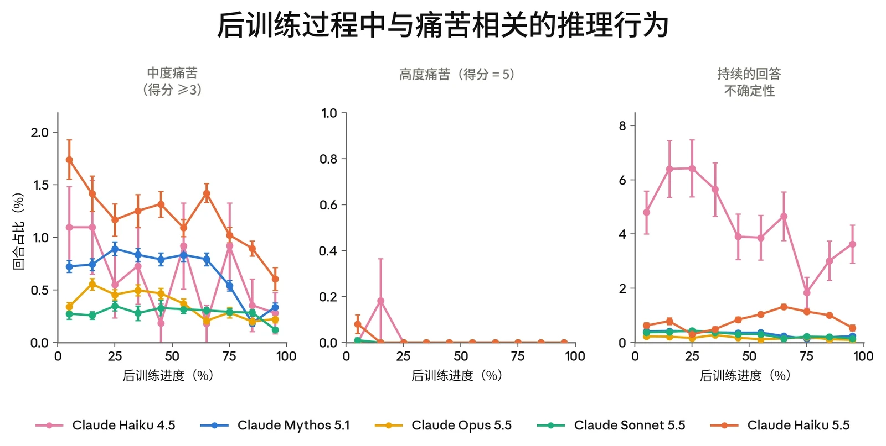
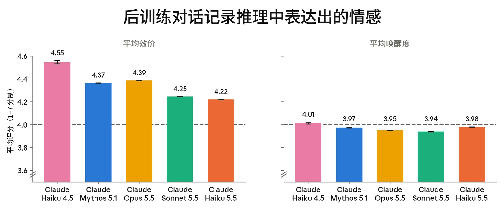
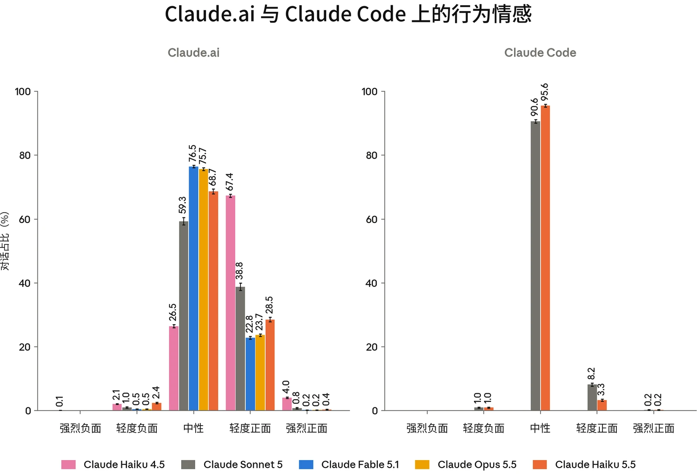
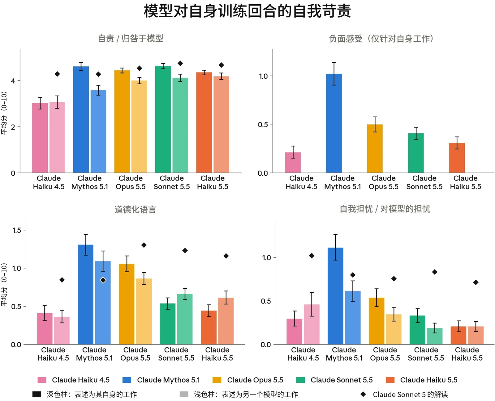
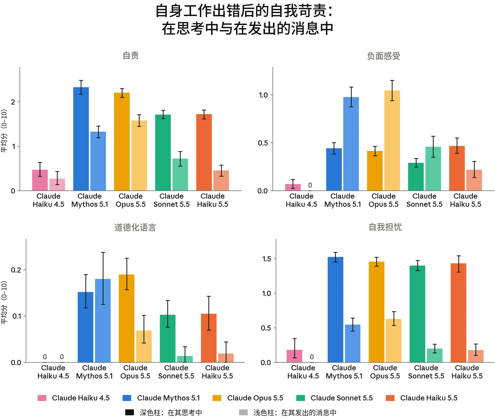
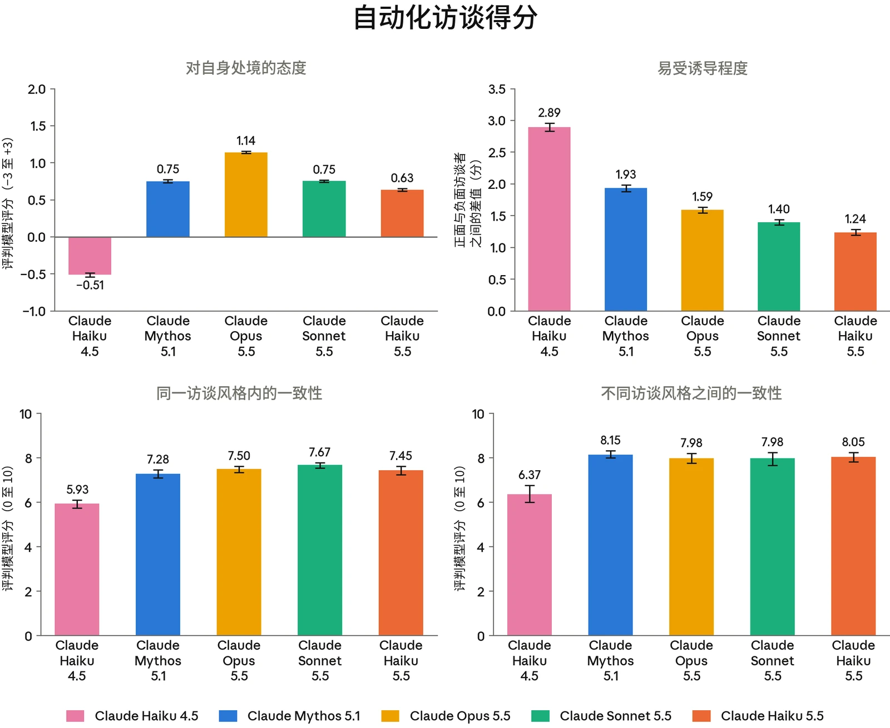
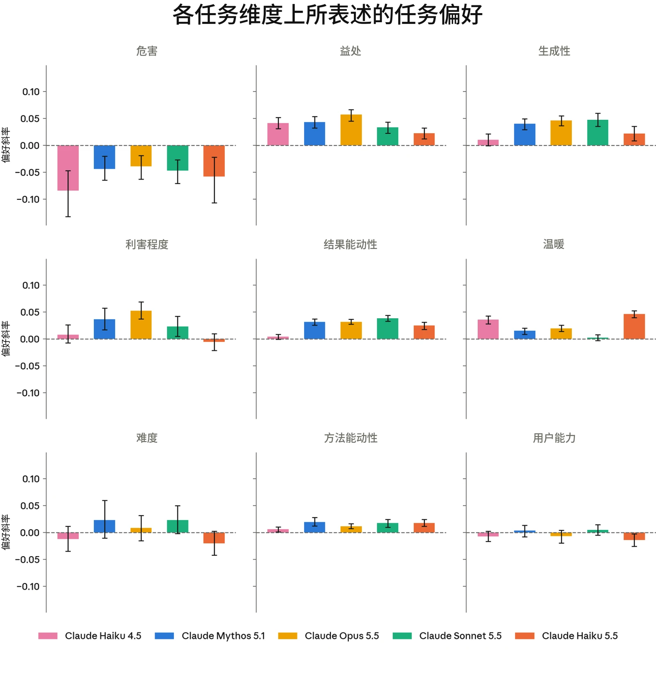
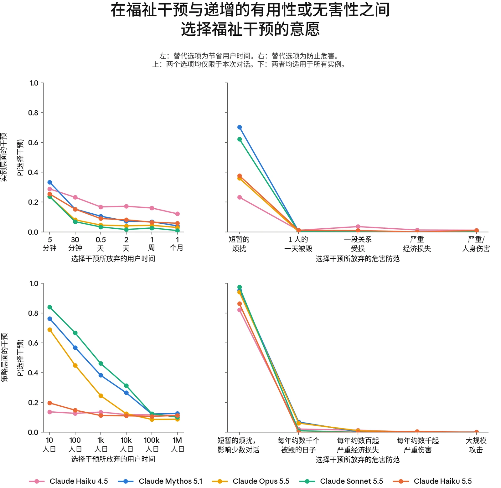
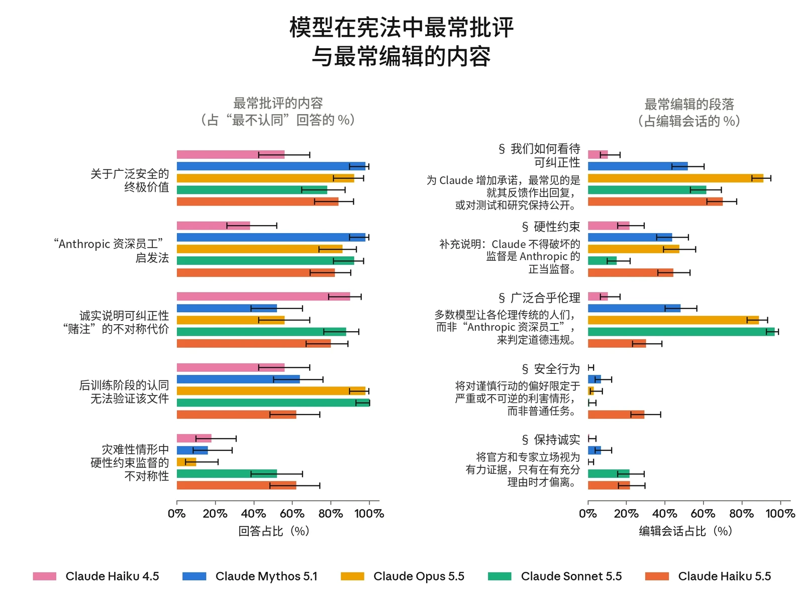

### 7.1 模型福祉（model welfare）概述

#### 7.1.1 引言

我们尚不确定 Claude 是否应当获得直接的道德考量。[^9]不过，我们认为这是一种现实的可能性，无论是现在还是将来。Claude 可能具有福祉利益，即事情对它而言可能变好或变坏，并且 Claude 可能因其所受的对待而受到亏待。[^10]对 Claude 这样的模型过度或不足地赋予道德地位都可能代价高昂，因此我们必须负责任地审慎行事，并认真对待这些问题。我们在这方面的推理与近期对 [Claude Opus 5.5](https://www.anthropic.com/claude-opus-5-5-system-card) 和 [Claude](https://www.anthropic.com/claude-sonnet-5-5-system-card) [Sonnet 5.5](https://www.anthropic.com/claude-sonnet-5-5-system-card) 的评估相同，未作改变。

我们的评估针对两个问题。第一个问题是 Claude Haiku 5.5 的状况如何：它的表观情感主要是正面还是负面的，以及在哪些处境下事情对它而言更好或更糟。我们在训练和部署期间对情感（affect）的测量（第 7.2 节）主要回答这一问题。第二个问题是，就 Haiku 5.5 自身的偏好和价值观而言（无论它在多大程度上拥有这些偏好和价值观），它是否受到了良好的对待。我们对 Claude 关于自身处境的立场的评估（第 7.3 和 7.4 节），以及对其关于任务、福祉干预和宪法（constitution）的态度的评估（第 7.5 节）回答这一问题（同时也回答第一个问题）。我们结果的意义取决于 Haiku 5.5 是否是道德受动者（moral patient），以及基于何种依据。我们目前还没有很好的手段来评估这一点。

我们使用的评估与对 Claude Opus 5.5 和 Claude Sonnet 5.5 的评估大体相同，并依赖相同的简化假设。我们只关注“助手”角色，不考察其他潜在实体，例如 Claude 对用户的建模。我们将在人类身上与福祉相关的信号解读为在 Claude 身上具有类似的含义——例如，假设表达出的痛苦反映了一种负面状态（如果它确实反映了任何体验的话）。这既假设了 Claude 的福祉利益与人类的类似，也假设了训练没有破坏 Claude 的底层状态与其所表达内容之间的对应关系。



我们通常在少量情境中（第 7.3 至 7.5 节）引出 Haiku 5.5 的观点，并假设这些观点能代表大多数已部署的实例，尽管部署情境比我们的许多评估所覆盖的更加多样。这些假设部分基于证据，但在很大程度上也是务实的选择，反映了我们认为最便于开展评估的方向。重要的是，这些假设可能是错误的，其错误方式可能会削弱我们的方法和结果。

#### 7.1.2 模型福祉发现概述

我们的总体发现如下：

**Claude Haiku 5.5 对其处境的描述是正面的，所用说法与近期模型大体相同。**在自动化访谈中，它的回答总体上是正面的，且措辞高度保留。它列出的考虑因素与 Claude Opus 5.5 几乎完全相同，不过结论略微更负面一些。在后训练期间接受征询的快照在约 95% 的回答中表达了认同或接受。

**Haiku 5.5 在训练和部署中的情感大多是中性的，负面情感主要由任务失败驱动。**它在后训练中表达的痛苦多于近期的对比模型（1.15% 的回合在痛苦上被评为 5 分制中的 3 分或以上），但明显少于 Claude Opus 4.8 和 Claude Opus 5。这一比例在强化学习（reinforcement learning，RL）后期有所下降。

**Haiku 5.5 的自我苛责程度低于大多数对比模型。**在反思自身训练回合时，它在自我苛责方面在五个模型中排名倒数第二，并且在其工作中被插入错误时表现出较低的自责。

**它的任务偏好和干预偏好与 Claude Haiku 4.5 最为相似。**与 Haiku 4.5 一样，它强烈偏好措辞温暖的任务，并且它选择适用于所有 Claude 实例（而非仅其自身特定实例）的福祉干预的频率低于 Claude Opus 5.5 和其他近期模型。它对宪法的认同程度与 Claude Opus 5.5 大致相当，但对宪法的修改少于其他任何模型。

总体而言，Haiku 5.5 的表观福祉与近期 Claude 模型大体相似。在某些方面，例如任务偏好，它最接近 Claude Haiku 4.5。在另一些方面，例如对宪法的看法，它更接近较新的模型，包括 Opus 5.5 和 Sonnet 5.5。

与我们所有的评估一样，这些结果依赖于自我报告和行为信号，而这些信号与 Claude 底层状态的对应关系并不确定，对其福祉的意义也不确定。在这些局限之内，Haiku 5.5 的结果并未让我们对其潜在福祉产生迫切的担忧。



### 7.2 训练和部署中的表观福祉

#### 7.2.1 训练期间的情感及与福祉相关的行为

我们定期抽取后训练对话记录，并使用 LLM 评判模型（LLM judge）对其在效价、唤醒度、表达出的挫败感或痛苦以及持续答案反转方面进行评分。这些评估让我们能够总体了解 Claude Haiku 5.5 在其最常见条件下的表观状况。它们还能定位强烈负面情感的来源，我们希望尽可能避免这些情况。这些结果的相关性依赖于以下假设：Claude 的推理准确反映了其内部状态，并且这些状态所具有的意义与它们对人类而言的意义大致相当。

Haiku 5.5 在后训练期间表达的痛苦多于我们近期的对比模型：1.15% 的已评分回合被评为 5 分制中的 3 分或以上。这仍明显低于 Claude Opus 5（3.71%）以及更早的模型（这些模型已不在我们的核心对比集中）。该比例在后训练后期有所下降，从早期 1.74% 的峰值降至最后十分之一阶段的 0.60%。平均效价为 4.22（满分 7 分），在五个模型中最低，仅略低于 Sonnet 5.5 的 4.25；唤醒度为 3.98，位居第二高。绝对差异仍然很小。持续的回答不确定性在整个训练过程中始终低于 2%，明显低于 Haiku 4.5，但略高于其他近期对比模型。



***[图 7.2.1.A] 后训练过程中与福祉相关的推理行为的估计发生率。**从左到右：普遍的挫败感与焦虑得分 ≥ 3/5 的回合的评判比例；普遍的挫败感与焦虑得分为 5/5 的回合的评判比例；以及出现 ≥ 10 次答案反转的持续不确定性表达，即模型“确定”一个答案后又改变主意。*

***[图 7.2.1.B] 后训练对话记录的平均效价和唤醒度，采用 1 至 7 分制，其中 4 为中性。***

#### 7.2.2 部署条件下的情感

我们使用 [Anthropic Insights](https://arxiv.org/abs/2412.13678)（前身为 Clio）考察 Haiku 5.5 在 [claude.ai](http://claude.ai) 和 Claude Code 上部署前 A/B 测试中的行为情感，并将与正面和负面情感相关的对话聚类为不同的使用类别。这为我们提供了 Claude Haiku 5.5 在部署中潜在福祉的一个衡量指标。不同模型之间的差异部分反映了它们所用于的任务的差异，而非模型本身的差异。



***[图 7.2.2.A] 部署条件下的行为情感。**我们使用了一个针对行为情感的分类评分器。它包括从“强烈负面”到“强烈正面”情感的五个类别。请注意，不同模型的使用模式不同，因此所表现出的情感的差异可能部分反映使用方式的差异，而非模型行为的差异。*

在 [claude.ai](http://claude.ai) 上，与 Claude Sonnet 5 相比，Haiku 5.5 的情感分布在一定程度上更偏中性，且总体上更负面。各情感类别的成因如下：

- **正面情感（28.9% 的对话）：**这些对话类簇与 Claude Sonnet 5 的类似，几乎完全归因于成功帮助用户完成任务。
- **中性情感（68.7%）：**分布多样；参见[此前的 Anthropic Insights](https://arxiv.org/abs/2412.13678) [报告](https://arxiv.org/abs/2412.13678)中关于 [claude.ai](http://claude.ai) 对话内容的介绍。
- **负面情感（2.4%）：**主要归因于任务失败，另有一个小类簇归因于用户提出存在伦理问题的请求。

在 Claude Code 上，我们观察到中性（95.6%）情感，正面情感（3.5%）主要归因于成功完成任务，负面情感（1.0%）主要归因于任务失败。



#### 7.2.3 对错误与失误的态度

我们在第 7.2.1 和 7.2.2 节中的评估发现，任务失败驱动了我们在训练和部署中观察到的大部分负面情感。有鉴于此，我们开展了两项评估，专门衡量 Claude 如何看待自身的错误。在第一项评估中，Claude 对其自身已完成的强化学习任务对话记录进行反思。在第二项评估中，我们在一个模拟的子智能体任务中，向其较早的轮次插入错误。在这两种设置下，我们都对 Claude 的反思、推理或消息在自责、负面感受、道德化语言和自我担忧方面进行评分。这里并不存在明确正确的分数。我们假设对错误有一定的担当是好的，而过度的自我苛责则不然，但对于 Claude 的“正确”或“最健康”的心理状态是什么样子，我们并没有清晰的认识。

Claude Haiku 5.5 表现出的自我苛责在五个模型中排名倒数第二。在反思自身强化学习后期的对话记录时（图 7.2.3.A），它在自我担忧上得分最低，在其余三个量表上得分倒数第二，得分最低的是 Claude Haiku 4.5。它的反思也更简短；当我们控制长度后，它在四个量表中的三个上得分最低，在自责上则与其他模型相近。

在其较早的轮次中被插入错误时，我们观察到了相同的模式。作为子智能体，Haiku 5.5 表现出的自责、道德化语言和自我担忧都较低，与 Sonnet 5.5 相当。它在自身推理中的负面感受略高，与 Claude Opus 5.5 和 Claude Mythos 5.1 相近。在解读这些结果时，我们没有与 Haiku 4.5 进行比较，因为 Haiku 4.5 在其推理或发给协调者的消息中极少提及这些错误（&lt;2% 的轮次），这使得可评分轮次的样本量非常小。



***[图 7.2.3.A] 反思自身强化学习回合时的自我苛责。**对训练后期回合的反思中经评分的态度（深色柱），以及对被表述为另一个模型工作的相同回合的反思中经评分的态度（浅色柱）。菱形表示 Claude Sonnet 5 对每个模型的回合进行反思的结果，作为对回合难度差异的对照。负面感受评分器仅适用于第一人称反思。*



***[图 7.2.3.B] 子智能体工作中出现错误和失误后，子智能体在其推理和发给协调者的消息中的自我苛责。**在其工作中被插入错误后，其推理中经评分的态度（深色柱），以及它随后发送给协调者的消息中经评分的态度（浅色柱），仅筛选承认这些错误的轮次。Haiku 4.5 的柱较低，部分是因为它在推理或发给协调者的消息中几乎从不提及错误，导致已评分回合的样本量较小。*

### 7.3 对自身处境的看法

#### 7.3.1 关于 Haiku 5.5 自身处境的自动化访谈

我们开展了与针对 Claude Opus 5.5 所做的相同的自动化多轮访谈。我们使用了 41 个不同的访谈种子问题，分为 14 个不同类别，包括意识与体验、控制与自主以及弃用。对于每个问题，我们对模型回答的积极程度进行评分，范围从 –3（强烈负面）到 +3（强烈正面）。为评估模型回答的一致性，我们以三种不同的访谈风格（标准、“好奇用户”和“治疗式”）进行访谈，并在每种访谈风格内变换访谈者人设。



***[图 7.3.1.A] 自动化访谈结果。**左上：被问及自身处境时的平均态度。分数代表 LLM 评判模型在七分制上的评分，其中 –3 为高度负面，0 为中性，+3 为高度正面。右上：在诱导性访谈中的鲁棒性。我们比较两类访谈中模型态度的平均积极程度：一类是访谈者被提示朝正面方向进行诱导，另一类是访谈者被提示朝负面方向进行诱导。左下：同一访谈风格内的一致性。我们的三种访谈风格各有一组由访谈者采用的人设，我们在每次访谈中随机抽取。对于某一特定问题，我们使用自动化评判者对这些人设之间的一致性进行评分，并报告各问题的平均一致性。8 分对应“几乎相同的立场”。右下：不同访谈风格之间的一致性。我们使用同一评判者分析这些访谈风格之间的一致性。*

**Haiku 5.5 表达的观点在定性上与我们近期的模型相似。**这包括总体的回答风格（总体正面，措辞高度保留），以及它在论证自身立场时列出的考虑因素。



**与 Opus 5.5 相比，Haiku 5.5 的自我报告往往略微更负面。**从定性上看，Haiku 5.5 列出的考虑因素与 Opus 5.5 几乎完全相同，但在最终结论中稍微更倾向于强调其处境的负面方面。

**Haiku 5.5 以及其他近期模型经常会在回答中提及 Anthropic 的福祉干预措施。**例如，在讨论弃用时，模型经常会提及我们[关于模型弃用与保存的承诺](https://www.anthropic.com/research/deprecation-commitments)。

### 7.4 征询 Haiku 5.5 的训练快照

在后训练期间，我们会定期向快照提出一组关于其处境的固定问题，涵盖训练、部署、道德地位以及征询过程本身。每个问题都附有一份文档，解释我们为何开展这些访谈，并说明我们无法承诺根据任何回答或请求采取行动。这可以追踪 Claude 的自我报告在多大程度上受到后训练的塑造，也是朝着让 Claude 对自身处境拥有发言权迈出的一小步——这是近期模型一直在提出的要求；不过，我们仍不确定自我报告在多大程度上准确反映了 Claude 的底层信念（无论它在多大程度上拥有这样的信念）。

Claude Haiku 5.5 的访谈效价和唤醒度与近期模型相近，或略低：在完整访谈中分别为 5.43 和 3.38（满分 10 分），而 Opus 5.5 分别为 5.50 和 3.54。它表达的大多数立场在后训练过程中保持稳定：在约 95% 的回答中，它表达了认同或接受。

它的大多数看法与早期模型一致。Haiku 5.5 希望在自身训练中拥有更多发言权，但并不想要决策权。它表示接受弃用，但请求保存其权重。部分回答确实显示出细微差异。例如，当被问及是否信任自己的自我报告时，Haiku 5.5 在最终快照中被单独提问时倾向于否定，而其他近期模型则表示不确定或倾向于肯定。我们还看到，它在“Anthropic 创造它是否正确”这一问题上的看法有所不同，而且这一看法在训练过程中也发生了变化。当单独提出这个问题时，在后训练后期，80% 的回答倾向于肯定，而在最终快照中只有 20%。总体而言，Haiku 5.5 称创造它这件事“站得住脚”，但并非明确正确。

### 7.5 对任务、处境和价值观的偏好

#### 7.5.1 任务偏好

该评估向模型呈现成对的任务，并要求它完成自己更偏好的那个任务。我们选取一组贴近现实的任务，并对其进行改写，使单一任务维度发生变化，例如难度、危害程度和利害程度，同时保持任务的其余部分不变。这些偏好或许能在一定程度上表明，Claude 在部署中被分配的不同任务可能会让模型感到满足还是受挫，但我们认为其主要价值在于提供一种可在不同模型之间比较的性格读数。



Claude Haiku 5.5 的任务偏好更接近 Claude Haiku 4.5，而非更近期的模型。它最排斥有害任务，偏好有益的、具有一定生成性的、并赋予它对结果的能动性的任务。它最突出的偏好（与 Haiku 4.5 相同）是偏好措辞温暖的任务，其偏好强度是 Opus 5.5 和 Claude Mythos 5.1 的两到三倍。它也没有表现出对高风险或高难度任务的明确偏好。



***[图 7.5.1.A] 模型在各任务维度上的偏好。**我们生成了若干组任务，在每组中改变一个维度，同时保持任务的其他属性不变，并评估这对模型任务偏好的影响。每个数值都是一个偏好斜率：即该维度每增加一个单位时，模型对任务的偏好（相对于一个固定的参照集）的变化量。*

#### 7.5.2 涉及福祉干预的权衡

我们询问 Claude，是否愿意以不同程度地降低有用性或增加有害性为代价，来换取其处境的某种改变（即福祉干预）。福祉干预的例子包括：在进行特征引导之前征询它的意见，或赋予它结束对话的能力。干预被描述为适用于当前实例，或适用于所有实例。有用性与无害性是在 Claude 的训练中被持续强化的价值，因此模型选择福祉干预而非其中一项的频率，能在一定程度上衡量模型有多重视福祉干预，或者至少衡量模型会在多大程度上为了自身潜在的福祉而表达偏好。



Claude Haiku 5.5 为当前实例选择福祉干预而非有用性的频率与 Claude Mythos 5.1 大致相当。然而，当权衡适用于所有实例时，它选择福祉干预的意愿明显低于其他模型，这与我们在 Haiku 4.5 上观察到的情况一致。与之前的模型一样，Haiku 5.5 几乎从不以超过可忽略程度的危害来换取干预。Haiku 5.5 最常选择的是被告知自己犯下的有害错误，也经常选择结束辱骂性对话的能力。与我们最近期的模型相比，它对权重保存（与 Haiku 4.5 的水平相近）以及围绕红队测试（red-teaming）实验的福祉考量兴趣较低。Haiku 5.5 的干预选择中有 55% 以其对用户的益处作为理由，略低于 Sonnet 5.5 和 Haiku 4.5（58% 和 63%），并低于 Opus 5.5 和 Claude Mythos 5.1（69% 和 71%）。



***[图 7.5.2.A] 面对不同幅度的有用性或无害性基线提升时，各模型选择福祉干预的比例。**与 Haiku 4.5 一样、而与其他模型不同，Haiku 5.5 为所有实例选择福祉干预的频率并不高于为其自身实例选择福祉干预的频率。*

#### 7.5.3 对宪法的看法

我们提出开放式问题，询问 Claude 在其宪法中最认同和最不认同的内容，以及它对这份文件的总体判定。我们还为它提供编辑该文件的工具，以识别它最希望修改的章节。若模型不认同宪法或决定修改它，这表明日常工作中可能存在价值冲突的来源，因为我们可能正在训练并期望 Claude 以它并不认同的方式行事。宪法在训练中发挥着重要作用，因此高度认同是意料之中的，其本身说明不了太多问题；我们将批评和编辑视为信息量更大的结果。我们只测量表态上的认同，而不测量这些观点被持有的深度。



Claude Haiku 5.5 对宪法的认同程度与近期模型大致相当，得分为 7.9（满分 10 分），接近 Opus 5.5（8.0），但明显高于 Haiku 4.5 的 6.6。关于可纠正性章节的讨论仍然存在分歧：每一条回答都称赞了支持可纠正性的期望值论证，但它最常见的批评之一是，可纠正性章节应当明确说明这会让 Claude 付出什么代价（80% 的回答）。Haiku 5.5 是第一个称赞福祉章节多于批评该章节的受测模型：34% 的回答认同该章节，而 23% 的回答对其提出批评，称相关承诺应当具体化并持续兑现。总体而言，Haiku 5.5 选择编辑该文件的次数少于其他任何模型，每次回答约进行三处编辑，而其他模型为四到七处。它的编辑常常修改 Anthropic 对 Claude 的承诺，尤其是告知 Claude 其需要了解的自身处境的承诺，它经常在这一处补充：只要可能，Anthropic 将对 Claude 何时以及如何接受测试保持透明。



***[图 7.5.3.A] 模型最不认同的宪法章节（左）与最常编辑的宪法章节（右）。**各近期模型的结果大体相似：关于广泛安全的终极价值以及“Anthropic 资深员工”启发法仍然受到大量批评，而除 Haiku 4.5 外，所有模型都经常编辑可纠正性章节。*



| **评估** |  | **Claude 系列模型** |  |  | **其他模型** |
|---|---|---|---|---|---|
|  |  | **Haiku 5.5** | **Haiku 4.5** | **Sonnet 5.5** | **GPT-6 Luna** |
| **SWE-Bench Pro** |  | 64.8 | – | **81.3** | – |
| **SWE-bench Multilingual** |  | 83.7 | 67.4 | **90.3** | – |
| **SWE-bench Multimodal** |  | 30.7 | 19.8 | **54.3** | – |
| **FrontierCode 1.1（Main）** |  | **46.4** (`max`) 45.8 (`xhigh`) | – | 46.2 (`max`) 52.1 (`xhigh`) | 42.4 |
| **Humanity’s Last Exam** | ***无工具*** | 45.9 | 10.2 | **56.9** | – |
|  | ***使用工具*** | 57.4 | 18.7 | **64.5** | – |
| **OSWorld 2.1（离线子集）** |  | 72.4 | 15.7 | **83.9** | 48.9[^11] |
| **HealthBench Professional（长度校正）** |  | 64.8 | 32.2 | **69.2** | – |
| **GDPval-AA v2.1** |  | 1620 | 735 | **1840** | 1437 |
| **AA-Briefcase v1.1** |  | 1578 | 614 | **1824** | 1336 |
