### 8.1 评估总览

***[表 8.1.A] 能力评估总览。**&#8203;除非另有说明，所有 Haiku 5.5 结果均采用以下标准配置：`max` 推理强度（effort）下的自适应思考（adaptive thinking）、默认采样设置（temperature、top_p），并取五次试验的平均值。上下文窗口大小因评估而异，且不超过 100 万 token。每行中 `max` 推理强度下的最佳得分以粗体标出。除非另有说明，竞品数据均取自各开发者公开发布的系统卡（system card）或基准测试排行榜。*



### 8.2 SWE-bench Pro、Multilingual 与 Multimodal

SWE-bench（Software Engineering Bench）在真实世界软件工程任务上测试 AI 模型。我们报告三个变体，每个得分均为五次试验的平均值：

- SWE-Bench **Pro** 由取自活跃维护的代码仓库、涉及大型多文件 diff 的问题组成。Claude Haiku 5.5 的得分为 64.8%。
- SWE-bench **Multilingual** 将该形式扩展到涵盖 9 种编程语言的 300 个问题。Haiku 5.5 的得分为 83.7%。
- SWE-bench **Multimodal** 在 issue 描述中加入了视觉上下文（截图、设计稿）。Haiku 5.5 的得分为 30.7%。

### 8.3 FrontierCode

[FrontierCode](https://cognition.com/frontiercode) 是由 [Cognition](https://cognition.com/) 创建的智能体编程基准测试，包含 150 个软件工程任务。任务源自开源代码仓库中的真实拉取请求（pull request）。示例包括修复 `aiohttp` 中的 WebSocket 缺陷、加固 Prisma 的浏览器包，以及扩展 JSON schema 的 lint 规则。每个任务为智能体提供一个已检出的代码仓库、一份 issue 描述，以及该仓库的测试、lint 和代码风格规范。智能体在可访问互联网的容器化环境中自主工作，以产出最终补丁，过程中没有人工干预，也不提供超时信息。补丁依据阻断性功能标准（主要是留出的单元测试，外加范围与性能阻断项）和加权评分细则标准进行评分，其中包括针对所需测试覆盖范围和禁止的实现模式的、由模型评分的检查项。任务由底层代码仓库的维护者编写，并经 Cognition 研究人员逐一审核，其中随机抽取的一部分由人工解答，以验证公平性。我们报告总体得分，即阻断性功能标准与加权代码质量评分细则标准的综合得分。

该评估的目标是无需人工修改即可合并的代码 diff。其评分会惩罚超出范围的修改，即使这些修改质量很高或有所帮助。我们报告 Claude Haiku 5.5 在该基准测试上的得分，未对官方评估做任何改动。

我们报告两个子集：Extended 是全部 150 个任务，Main 是其中最难的 100 个任务。每个得分均为每个任务五次运行的平均值。表 8.1.A 展示的是每个模型在 `max` 推理强度下的结果；Cognition 的公开排行榜展示的是每个模型在其表现最佳的推理强度下的结果，因此两者可能有所不同。



Claude Haiku 5.5 在 `max` 推理强度下得分最佳：Main 上为 46.4%，Extended 上为 58.4%。Claude Sonnet 5.5 在 `max` 推理强度下 Main 得分为 46.2%，Extended 得分为 59.1%。它的最佳得分为 52.1% 和 64.4%，均在 `xhigh` 下取得。Cognition 的排行榜上没有 Claude Haiku 4.5 的结果。

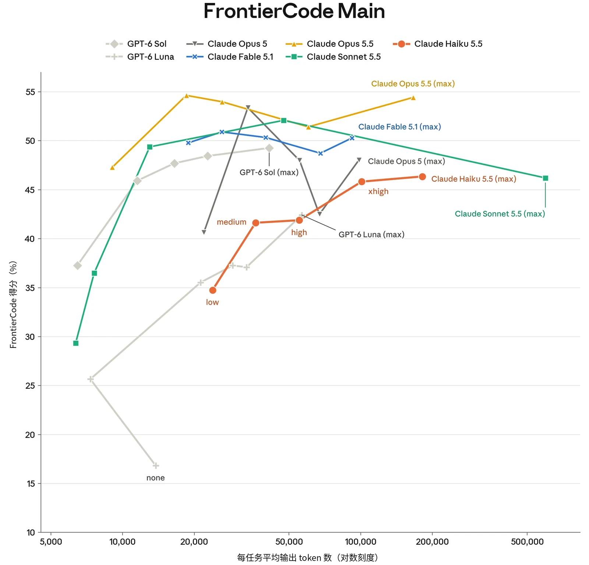

***[图 8.3.A] FrontierCode Main 得分与每任务平均输出 token 数的关系**，涵盖各推理强度档位（`low`、`medium`、`high`、`xhigh` 和 `max`；GPT-6 Luna 另含 `none`）。图中所有模型的评估均由 Cognition 运行并报告结果；Claude 模型在 Claude Code 中运行，GPT 模型在 Codex 中运行。Cognition 的结果文件报告了每个模型的 token 数，但没有报告 Claude Haiku 5.5 的成本，因此 x 轴显示每任务平均输出 token 数，采用对数刻度。Claude Haiku 5.5 的每个点都标注了其推理强度档位（其 `max` 点标注模型名称）。其他每个模型都在其 `max` 点标注名称，GPT-6 Luna 的 `none` 点也标注了其推理强度档位。每条线将一个模型的各个点按*



推理强度顺序连接。结果文件未提供不确定性区间，因此图中未显示。请注意，y 轴从 10% 而非零开始，因此各点之间的差异在视觉上被放大。

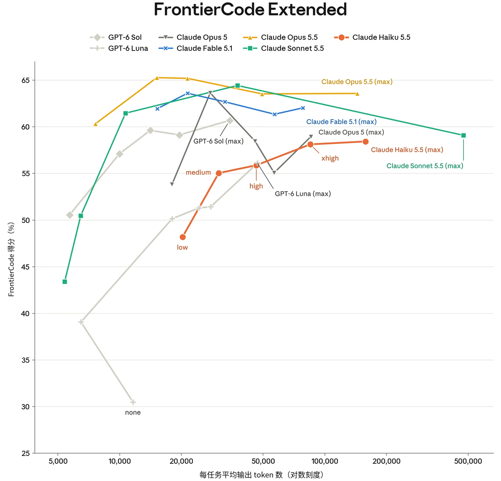

***[图 8.3.B] FrontierCode Extended 得分与每任务平均输出 token 数的关系**，涵盖各推理强度档位（`low`、`medium`、`high`、`xhigh` 和 `max`；GPT-6 Luna 另含 `none`）。图中所有模型的评估均由 Cognition 运行并报告结果；Claude 模型在 Claude Code 中运行，GPT 模型在 Codex 中运行。Cognition 的结果文件报告了每个模型的 token 数，但没有报告 Claude Haiku 5.5 的成本，因此 x 轴显示每任务平均输出 token 数，采用对数刻度。Claude Haiku 5.5 的每个点都标注了其推理强度档位（其 `max` 点标注模型名称）。其他每个模型都在其 `max` 点标注名称，GPT-6 Luna 的 `none` 点也标注了其推理强度档位。每条线按推理强度顺序连接一个模型的各个点。结果文件未提供不确定性区间，因此图中未显示。请注意，y 轴从 25% 而非零开始，因此各点之间的差异在视觉上被放大。*



### 8.4 Terminal-Bench 4.0

Terminal-Bench 4.0 在容器化的终端与命令行环境中，以真实世界工作测试模型。它包含 66 个任务，侧重于与科学相关的问题和前沿工程问题，如计算生物学、物理仿真、CAD、形式化证明以及 GPU 性能相关工作。

此前的 Terminal-Bench 版本[对超时和资源非常敏感](https://www.anthropic.com/engineering/infrastructure-noise)。4.0 版本通过延长超时时间，并在少数可能从中受益的任务中自适应地提高 RAM 和 CPU，基本解决了这些问题。沙箱服务提供商在少数任务中仍可能是一个混杂因素，但我们预计其作用将比在之前版本中小得多。我们还发现，这次升级降低了各种运行框架（harness）带来的混杂效应（例如 CLI 内存占用、上下文压缩策略和容器通信协议），使 Terminal-Bench 成为一项更稳定、更严谨的评估。

在启用安全防护措施的情况下，Claude Haiku 5.5 在 Terminal-Bench 4.0 上的得分为 39.2%。我们在运行 Haiku 5.5 时未使用回退模型（fallback model），因此当安全防护措施标记某个请求时，该次试验即在此终止。这种情况发生在 1.8% 的试验中（660 次中的 12 次，其中 10 次发生在同一个任务上），且这些试验全部失败。

我们在不允许互联网出站流量的条件下为 Haiku 5.5 运行了该评估。我们根据历史运行日志，预先缓存了模型运行所需的资源，并据此重新构建了镜像。原则上，如果模型想要使用在线资源却被阻止，这可能会降低得分。我们尚未严格测量这一效应对 Haiku 5.5 的影响大小，但我们认为它没有使最终得分超出噪声区间。

作为比较，Claude Sonnet 5.5 的得分为 70.6%（其中 1.2% 的请求被安全防护措施标记并由回退模型作答，影响了 1.5% 的试验），Claude Opus 5.5 的得分为 66.4%（其中 2.5% 的请求被安全防护措施标记，影响了 10% 的试验），而 Claude Haiku 4.5 的得分为 0.0%，没有通过任何一次试验。

Haiku 5.5 和 Haiku 4.5 的得分为每个任务 10 次试验（共 660 次试验）的平均值，Sonnet 5.5 和 Opus 5.5 的得分为每个任务五次试验（共 330 次试验）的平均值。将各次试验视为相互独立时，Haiku 5.5 的标准误为 ±1.9 个百分点，Sonnet 5.5 为 ±2.5 个百分点，Opus 5.5 为 ±2.6 个百分点。所有报告的数字均使用 `--bare` 模式下的 Claude Code，并采用 `max` 推理强度；例外的是 Opus 5.5，其结果按其自身系统卡的做法在 `xhigh` 推理强度下报告；以及 Haiku 4.5，它使用 63,999 token 的固定思考预算而非推理强度档位运行（因为它早于推理强度档位的推出）。



对于 OpenAI 的最新一代模型，公开排行榜报告的成绩为：GPT-6 Luna 16.4% ± 2.7%，GPT-6 Sol 49.4% ± 3.2%，GPT-6.1 Sol 58.2% ± 3.1%（区间为排行榜所报告的数值），均使用 Codex CLI 在 `max` 推理强度下评分。据我们所知，OpenAI 尚未报告其自己测得的这三个模型的 Terminal-Bench 4.0 分数。OpenAI 报告 GPT-6 Astra 的 Terminal-Bench 4.0 最终分数为 57.9%，在 `high` 推理强度下评分（在其报告中，`max` 推理强度的表现略低于 `high`，因此我们选取了其最高的数字）。公开排行榜报告其使用 Codex CLI 在 `max` 推理强度下的分数为 58.2% ± 2.8%。

### 8.5 Terminal-Bench-Science 0.1

Terminal-Bench-Science 是一个由斯坦福大学牵头的社区基准，包含 70 个取自科学研究工作流的任务，由生命科学、物理科学、地球科学、数学科学和工程科学领域的科学家和研究人员编写并审核。该项目的科学顾问来自麻省理工学院（MIT）、普林斯顿大学、华盛顿大学、Genentech 和斯坦福大学。

在每个任务中，智能体 CLI 在一个自包含的环境中根据自然语言指令工作，其生成的产出物依据隐藏的、针对特定任务的测试进行评分。

在启用安全防护措施的情况下，Claude Haiku 5.5 在 Terminal-Bench-Science 上得分 20.6%。与 Terminal-Bench 4.0 一样，我们运行 Haiku 5.5 时未使用回退模型，因此当安全防护措施标记某个请求时，该次试验即退出并判为失败。这种情况发生在 2.3% 的试验中（700 次中有 16 次，全部集中在 70 个任务中的两个上）。Claude Sonnet 5.5 得分 59.9%，Claude Opus 5.5 得分 58.7%，Claude Haiku 4.5 得分 0.1%（700 次试验中成功 1 次）。按任务聚类的标准误：Haiku 5.5 为 ±3.7 个百分点，Sonnet 5.5 为 ±4.7 个百分点，Opus 5.5 为 ±4.8 个百分点，Haiku 4.5 为 ±0.1 个百分点。

我们对 Haiku 5.5 的评估采用了与 Terminal-Bench 4.0 相同的无互联网出站流量设置（第 8.4 节）。报告的数字使用 Claude Code 的 `--bare` 模式、`max` 推理强度，但 Claude Haiku 4.5 除外，它使用 63,999 token 的固定思考预算，而非推理强度档位。

作为参考，公开排行榜报告 Claude Opus 5 为 30.0%、Claude Fable 5 为 21.4%，而我们内部设置下的结果分别为 29.0% 和 24.7%，均在预期噪声范围内。OpenAI 报告 GPT-6 Astra 为 68.1%、GPT-6.1 Sol 为 57.0%、GPT-6 Sol 为 27.6%，均使用 `max` 推理强度。OpenAI 和公开排行榜均未报告 GPT-6 Luna 的 Terminal-Bench-Science 分数。



### 8.6 FrontierSWE v2

FrontierSWE v2 是 Proximal 推出的基准测试，包含 34 个超长程的工程与研究任务，涵盖系统实现、性能优化、科学计算、AI 研究和视觉推理。示例包括用 Rust 重新实现 Quantum ESPRESSO 的 pw.x 核心、构建一个能够运行飞行模拟器的 OpenGL 场景渲染器，以及对一个大语言模型（LLM）进行后训练，使其能玩一款交互式解谜游戏。每次试验的预算为 20 小时。领先的公开模型平均每次试验耗时约 11 至 16 小时，距离使该基准饱和仍很遥远。所有模型均在 Proximal 自己的智能体运行框架中以 `max` 推理强度运行，报告的分数为每个任务五次试验的平均值。

Claude Haiku 5.5 在 FrontierSWE v2 上得分 43.8%，略低于 Claude Fable 5（47.0%），远高于 GPT-5.6 Sol（32.2%）。Proximal 在全部 34 个任务上以 `max` 推理强度运行 Claude Haiku 5.5，每个任务五次试验。

### 8.7 长上下文

#### 8.7.1 ProgramBench

ProgramBench 是一个长上下文智能体编程基准，包含 200 个程序重建任务。智能体仅获得由某个开源项目编译而成的二进制文件及该项目的文档，必须在不使用互联网或反编译工具的情况下重建一个能复现原程序行为的代码库。任务规模从小型终端工具（jq、ripgrep）到大型系统（FFmpeg、SQLite、PHP 解释器）不等。提交结果依据超过 247,000 个基于执行的行为测试进行评分，这些测试通过智能体驱动的模糊测试生成。

我们排除了 34 个参考二进制文件在隐藏测试集上得分低于 0.9 的任务（这表明存在测试不稳定性），剩余 166 个任务。在这些任务上，我们只依据参考二进制文件能够通过的测试进行评分。我们使用与上游仓库相同的 mini-swe-agent 运行框架报告隐藏测试通过率，但不设六小时的时间限制。在这一任务集上，Claude Haiku 5.5 得分 82.0%，而 Claude Sonnet 5.5 得分 79.7%，Claude Opus 5.5 得分 91.2%。

我们认为 ProgramBench 是衡量长上下文编程性能的有力指标。Haiku 5.5 的各回合覆盖了一系列上下文长度，最长可达完整的 100 万 token 窗口，且这些任务所测试的长上下文能力与实际的下游用例高度契合。



### 8.8 智能体搜索

#### 8.8.1 HLE

Humanity’s Last Exam（HLE） 是一个多模态基准测试，包含涵盖数十个学科的 2,500 道题目。题目由领域专家编写并审核。这些题目经过专门设计，无法通过互联网搜索快速得到答案，且每道题只有在前沿大语言模型无法作答时才会被保留。

我们在两种配置下测试了 Claude Haiku 5.5：（1）不使用工具、仅依靠推理；（2）使用网络搜索、网页抓取、程序化工具调用和代码执行。在所有运行中，思考均设置为 `auto`，每次尝试的任务预算为 980k token。这些结果未使用上下文压缩。由 Claude Opus 4.6 担任评分模型。

为防止使用工具版本中出现结果污染，我们为搜索器和抓取器都屏蔽了已知讨论 HLE 的来源（见附录 9.1）。我们还使用文本规则筛查每一份回答正确的对话记录，查找 HLE 特定来源的迹象，并使用 Claude Opus 5 审查每一份被标记的对话记录。对于确认属于作弊的情况，我们将其重新评为错误。

**与 Haiku 4.5 的比较**

Claude Haiku 4.5 没有推理强度设置，因此我们在多个扩展思考（extended thinking）预算下运行了该评估。对于无工具版本，我们展示这些预算下的曲线；对于使用工具版本，我们只展示 60K token 预算下的结果（该预算接近其 64K 输出上限所允许的最大值），因为在这种多轮设置中，不同的思考预算产生的结果相近。使用工具版本还采用了 160K token 的任务预算（而非 980K），以适配其 200K 的上下文窗口。



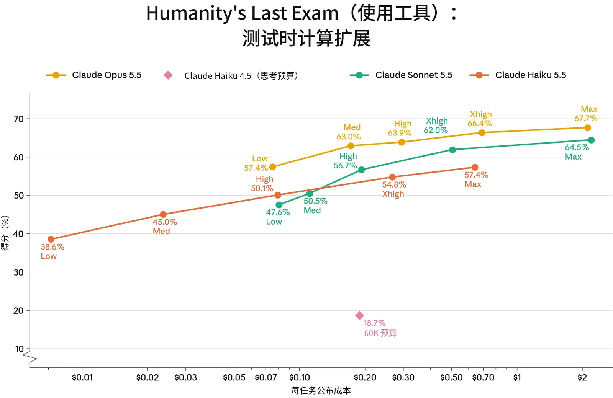

***[图 8.8.1.A] Humanity’s Last Exam（HLE，使用工具）推理强度扩展**。随推理强度从 `low` 提升到 `max`，HLE 准确率与每任务平均成本（对数刻度）的关系。Opus 5.5 和 Sonnet 5.5 的成本假设缓存完全命中；Haiku 4.5 和 5.5 按记录的用量以标准定价计算，不含网络搜索费用。Claude Haiku 4.5 显示的是 60K token 扩展思考预算、160K 任务预算下的结果。*



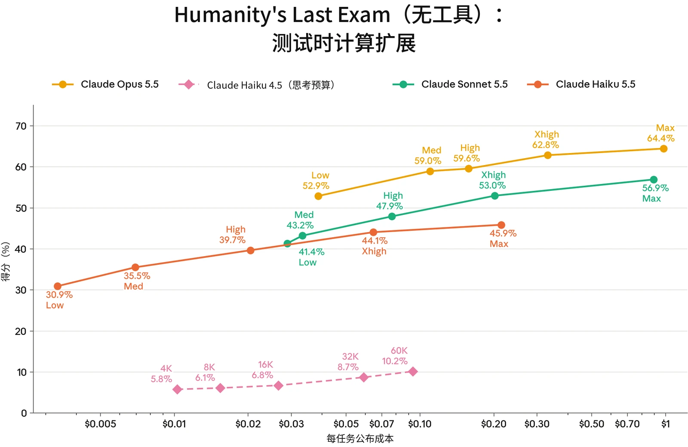

***[图 8.8.1.B] Humanity’s Last Exam（HLE，无工具）测试时计算扩展**。随推理强度从 `low` 提升到 `max`，HLE 准确率与每任务平均成本（对数刻度）的关系。Opus 5.5 和 Sonnet 5.5 的成本假设缓存完全命中；Haiku 4.5 和 5.5 按记录的用量以标准定价计算。*

#### 8.8.2 DRACO

Deep Research Accuracy, Completeness, and Objectivity（DRACO）是 Perplexity 推出的深度研究基准，评估模型在真实用户可能提出的复杂研究问题上的表现。DRACO 由 100 个精选任务组成，这些任务源自多个领域的用户查询。回答依据专家编写的评分细则进行评分，评分细则涵盖事实准确性、分析的广度与深度、呈现质量以及引用质量。

我们在使用网络搜索、网页抓取、程序化工具调用、代码执行以及 980k token 任务预算的条件下评估了 Claude 模型。

**评分方法**
原始 DRACO 论文使用 Gemini 3 Pro 作为主要评判模型，而该模型现已不可用。我们改用 Claude Opus 4.6，依据每个任务的评分细则对回答进行评分，同样采用二元的 MET/UNMET 判定，并使用论文第 4.2 节中的公式将其汇总为归一化分数。我们遵循论文的方案，对每个回答进行五次独立的评分运行，并记录平均值。我们的评判提示词取自论文的 [附录 C.5](https://arxiv.org/abs/2602.11685)。论文附录 A 表明，评判模型的选择可能使绝对分数变动 10 到 25 分，但系统排序保持不变，因此我们的分数与论文的主要公布数字不能直接比较。



我们使用了自己的智能体运行框架（不使用附录 C.4 的系统提示词（system prompt）；使用网络搜索、网页抓取、程序化工具调用和代码执行，预算为 980k token），并指示模型将最终报告写入其执行环境中的一个文件。随后我们只对该文件的内容进行评分，而非完整的智能体对话记录，从而将交付物与中间工具输出隔离开来。

**与 Haiku 4.5 的比较**

Claude Haiku 4.5 没有推理强度设置，因此我们在多个扩展思考预算下运行了该评估，并展示 60K token 预算下的结果。它还采用了 160K token 的任务预算（而非 980K），以适配其 200K 的上下文窗口。

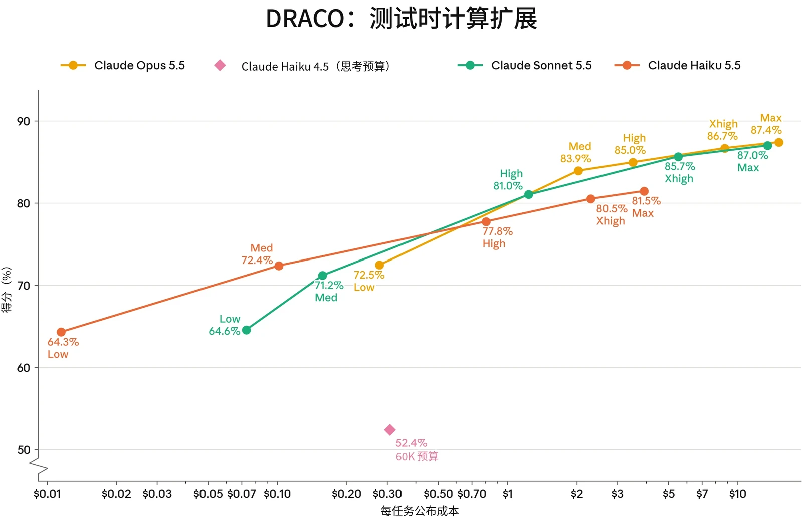

***[图 8.8.2.A] DRACO 分数**与各推理强度档位下每任务平均成本的关系。在 980k 任务预算下，随推理强度从 `low` 提升到 `max`，DRACO 归一化分数与每任务平均成本（对数刻度）的关系。Opus 5.5 和 Sonnet 5.5 的成本假设缓存完全命中；Haiku 4.5 和 5.5 按记录的*



用量以标准定价计算，不含网络搜索费用。Claude Haiku 4.5 显示的是 60K token 扩展思考预算、160K 任务预算下的结果。

#### 8.8.3 WANDR

[WANDR（Wide ANd Deep Research）](https://www.perplexity.ai/hub/blog/wandr-benchmark-evaluating-research-agents-that-must-search-wide-and-deep)是 Perplexity 推出的基准测试，旨在为 DRACO 深度研究基准提供一个侧重广度搜索的对应基准。它包含 500 个任务，模型需要搜索数十到数百个实体，查找每个实体的相关事实，并在结构化记录中列出这些事实及其引用来源。我们运行了该评估的一个修改版本，并在下文说明方法上的差异。

我们在使用网络搜索、网页抓取、程序化工具调用、代码执行以及 980k token 任务预算的条件下评估了 Claude 模型。任务由一个评判模型评分，该评判模型可以使用与被测模型相同的网页抓取工具。评分者重新抓取被引用的 URL，然后由评判模型判断这些引用是否支持解答。

主要指标是“软 F1（soft F1）”，它在精确率（模型解答中有多少得到验证）与召回率（模型完成了所要求事实集合中的多少）之间取得平衡。当只有部分所需事实能够得到验证时，给予部分得分。结果为 500 个任务的平均值。未通过格式校验的单个实体行会被丢弃，而不会导致整个任务失败。

在我们的评估中，模型获得的是只能访问冻结索引的离线网络搜索和网页抓取工具，而 Perplexity 的版本使用实时网络。我们使用 Claude Opus 4.6 评判 Claude 模型，而 Perplexity 使用 GPT-5.4。我们的提示词也略有不同。由于工具和评分逻辑与 Perplexity 的运行框架不同，我们的结果与竞品模型的已报告数字不能直接比较。

**与 Haiku 4.5 的比较**

Claude Haiku 4.5 没有推理强度设置，因此我们在多个扩展思考预算下运行了该评估，并展示 60K token 预算下的结果，该预算接近其 64K 输出上限所允许的最大值。它还采用了 160K token 的任务预算（而非 980K），以适配其 200K 的上下文窗口。



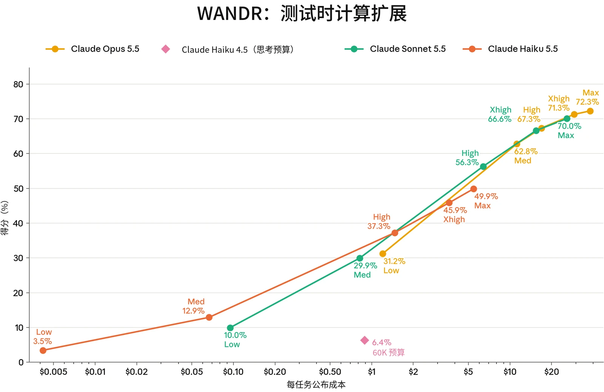

***[图 8.8.3.A] WANDR 软 F1 分数**与各推理强度档位下每任务平均成本的关系，任务预算为 980k token（对数刻度）。Opus 5.5 和 Sonnet 5.5 的成本假设缓存完全命中；Haiku 4.5 和 5.5 按记录的用量以标准定价计算，不含网络搜索费用。Claude Haiku 4.5 显示的是 60K token 扩展思考预算、160K 任务预算下的结果。*

### 8.9 多模态

#### 8.9.1 Chartography

Chartography 是 Surge AI 推出的图表理解基准，包含 100 个任务，针对现有基准中很少评估的专业图表类型。这些图表包括 Kaplan–Meier 生存曲线图、K 线图（蜡烛图）、等高线图、风玫瑰图、桑基图、伯德图和三维曲面图。由于不同类型的图表可被读取的精度不同，每个答案都依据专家为该特定图表设定的可接受范围进行评分，而非依据单一的固定容差。

我们在所有运行中都使用 `max` 推理强度下的自适应思考，并在使用工具和不使用工具两种条件下评估每个模型。在使用工具时，每个模型获得一个装有该图像文件和标准库的容器，以及一个图像裁剪工具。我们内部对 Chartography 的评分实现与官方代码仓库中的任务及专家确定的可接受答案范围一致。 为确保各模型之间的评分可比，我们沿用 Surge AI Leaderboard 的做法，使用 Gemini 3.5 Flash 作为评分者。



Claude Haiku 5.5 不使用工具时得分 46.4%，使用工具时得分 86.2%。Claude Haiku 4.5 不使用工具时得分 6.4%，使用工具时得分 8.8%；Claude Sonnet 5.5 不使用工具时得分 61.6%，使用工具时得分 90.2%。

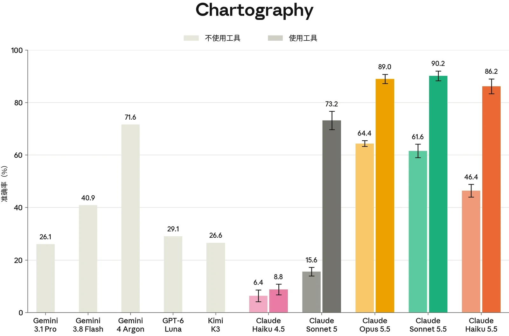

***[图 8.9.1.A] Chartography 分数。**&#8203;Haiku 4.5 没有推理强度设置，在最高 32k 的固定扩展思考预算下运行。所有其他 Claude 模型均使用自适应思考和 `max` 推理强度，在使用工具和不使用工具两种条件下评估。分数为五次运行的平均值。图中显示 95% 置信区间（confidence interval，CI）。Gemini 3.1 Pro、Gemini 3.8 Flash、Gemini 4 Argon、GPT-6 Luna 和 Kimi K3 的分数为 Surge AI 公开报告的数值，均在不使用工具的条件下评估。*

Claude Haiku 5.5 在原始视觉推理能力上实现了跨越式提升，大幅超越 Claude Haiku 4.5。



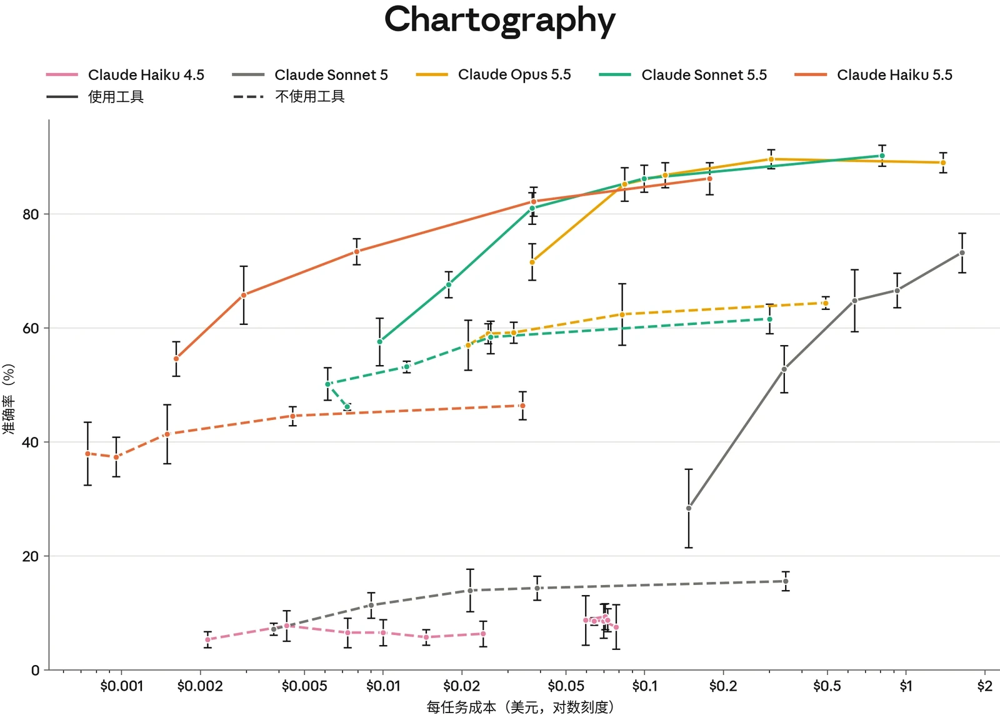

***[图 8.9.1.B] Chartography 分数（使用工具与不使用工具）。**&#8203;Haiku 4.5 没有推理强度设置，在最高 32k 的固定扩展思考预算下运行。所有其他模型均使用自适应思考，在不同推理强度档位下评估，分别在使用工具和不使用工具的条件下进行。我们使用 effort 参数来调节所花费的测试时计算量。分数为每个推理强度档位下五次运行的平均值。图中显示 95% 置信区间。成本按标准定价乘以每次运行的 token 用量计算，包括实际的提示缓存读写。Claude Haiku 5.5 按每个请求的提示长度（高于或低于 100K token）所对应的费率逐请求计费。Claude Sonnet 5.5 使用自 2026 年 10 月 7 日起更新的缓存读取价格。*

#### 8.9.2 BenchCAD

BenchCAD 是一个程序化 CAD 推理基准，由 17,900 个经执行验证的 CadQuery 程序构建而成，涵盖 106 个工业零件族，其中大约一半以真实的 ISO、DIN、EN、ASME 和 IEC 规格表为依据。该基准将 CAD 能力分解为四个相互匹配的任务。我们报告 Vision2Code 任务上的结果，该任务要求模型根据多视图渲染图生成 CadQuery 代码。



我们在所有运行中都使用 `max` 推理强度下的自适应思考，并在使用工具和不使用工具两种条件下评估每个模型。在使用工具时，每个模型获得一个装有图像文件和标准库的容器，以及一个图像裁剪工具。我们从已发布的 17,900 个 Vision2Code 文件中随机抽取 1,000 个文件组成子集来评估每个模型；根据我们以往的经验，该子集上的得分与完整集合上的得分相差在 0.01 体素 IoU（voxel IoU）以内，具有代表性。我们报告五次运行平均的体素 IoU 得分。

在 BenchCAD Vision2Code 的 1,000 个文件子集上，Claude Haiku 5.5 不使用工具时的体素 IoU 得分为 0.670，使用工具时为 0.870。Claude Haiku 4.5 的得分分别为 0.155 和 0.210，Claude Sonnet 5.5 分别为 0.747 和 0.963。

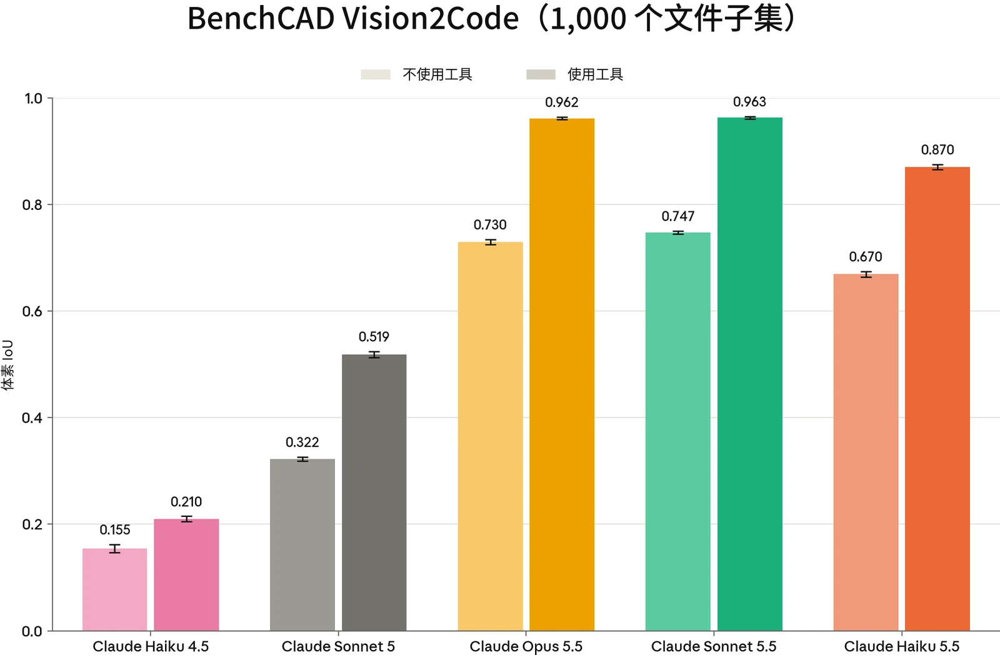

***[图 8.9.2.A] BenchCAD Vision2Code 子集得分。**&#8203;Haiku 4.5 没有推理强度设置，在最高 32k 的固定扩展思考预算下运行。所有其他 Claude 模型均使用自适应思考和 `max` 推理强度，在使用工具和不使用工具两种条件下评估。得分为五次运行的平均值，并附 95% 置信区间。*

Claude 在该评估上的表现随测试时计算的增加而大幅提升，尤其是当模型拥有能够对中间输出进行视觉验证的工具时。



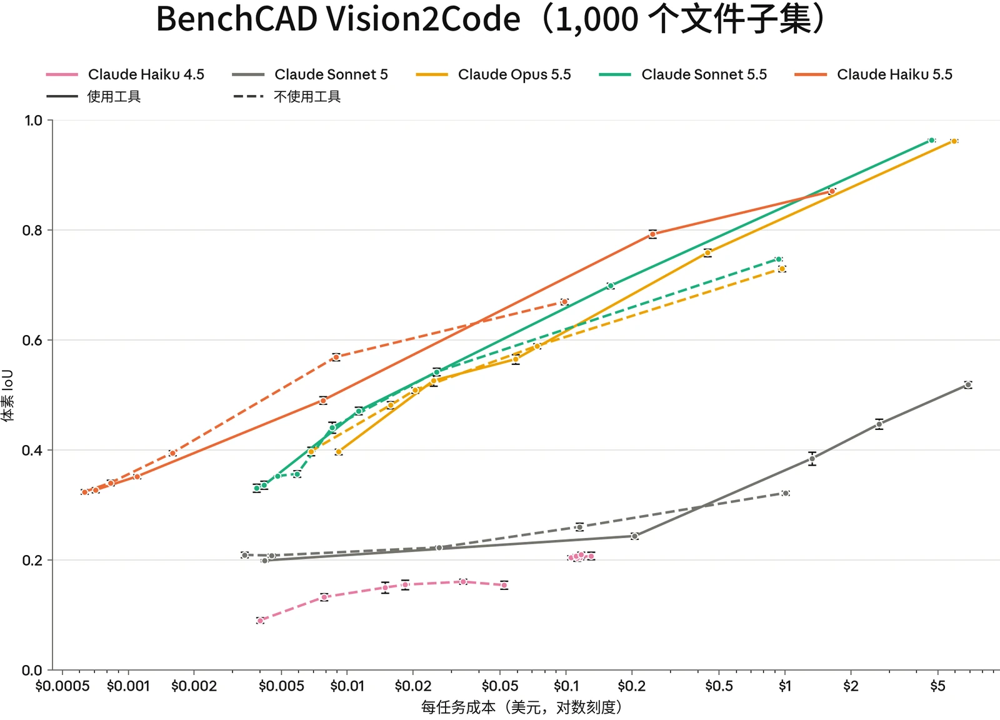

***[图 8.9.2.B] BenchCAD Vision2Code 子集得分（使用工具与不使用工具）。**&#8203;Haiku 4.5 没有推理强度设置，在最高 32k 的固定扩展思考预算下运行。所有其他模型均使用自适应思考，在不同推理强度档位下评估，分别在使用工具和不使用工具的条件下进行。我们使用 effort 参数来调节所花费的测试时计算量。得分为每个推理强度档位下五次运行的平均值。图中显示 95% 置信区间。成本按标准定价乘以每次运行的 token 用量计算，包括实际的提示缓存读写。Claude Haiku 5.5 按每个请求的提示长度（高于或低于 100K token）所对应的费率逐请求计费。Claude Sonnet 5.5 使用自 2026 年 10 月 7 日起更新的缓存读取价格。*

#### 8.9.3 OSWorld 2.1 离线子集

OSWorld 2.1 是一个包含 108 项长程计算机使用（computer use）任务的基准测试，任务中智能体通过截图以及鼠标和键盘操作来操控一台运行中的 Ubuntu 虚拟机。与以往的系统卡一样，我们报告两项指标：部分得分（各任务在所有检查点上所获分数的平均值）和严格通过率（所有检查点均满足的任务所占比例），二者均为每项任务五次独立尝试平均的 Pass@1。我们使用了该



基准测试的默认设置（1080p 分辨率，每项任务最多 500 个操作步数），推理强度为 `max`。对于需要评分模型的任务，我们使用 Claude Opus 4.8。

自 [Claude Opus 5.5](https://www.anthropic.com/claude-opus-5-5-system-card) 和 [Claude Sonnet 5.5 系统卡](https://www.anthropic.com/claude-sonnet-5-5-system-card)起，我们改为报告该基准测试的官方离线子集：即其 108 项任务中列入该基准测试离线任务清单的 82 项，且智能体的虚拟机不提供互联网访问。本节中的所有 Anthropic 模型均在相同配置下评估，但 Claude Haiku 4.5 除外，它以固定的思考预算运行，且未使用服务端上下文压缩。GPT-6.1 Sol 和 GPT-6 Luna 由 Anthropic 通过 OpenAI 的 API 在同样的 82 项任务上运行，并使用 OpenAI 自身的上下文压缩。

Claude Haiku 5.5 的部分得分为 72.4%，严格通过率为 37.1%。在相同条件下重新评估后，Claude Sonnet 5.5 的部分得分为 83.9%、严格通过率为 48.8%，Claude Opus 5.5 的部分得分为 87.2%、严格通过率为 53.2%。

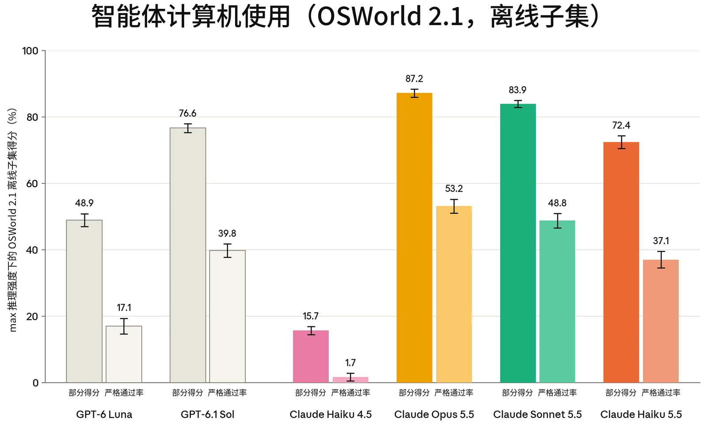

***[图 8.9.3.A] 各模型在 OSWorld 2.1（离线子集）上的得分。**&#8203;柱形表示 `max` 推理强度下（Claude Haiku 4.5：固定思考预算）的部分得分和严格通过率，并附基于每项任务五次尝试的 95% 置信区间；浅色描边柱形为 GPT 模型。*



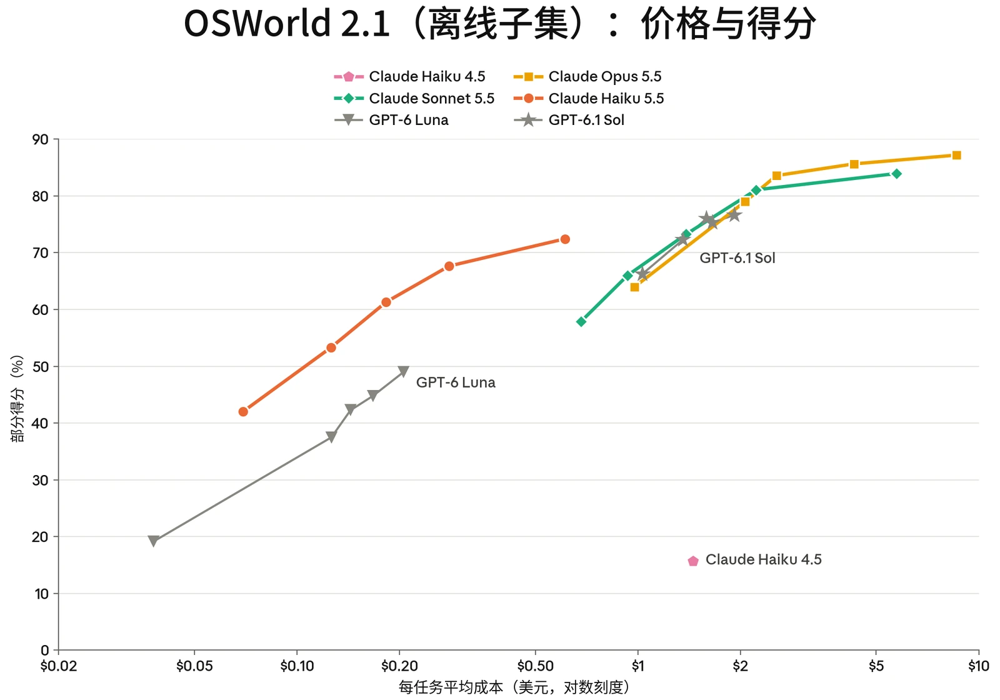

***[图 8.9.3.B] Claude Haiku 5.5、Claude Sonnet 5.5、Claude Opus 5.5 和 Claude Haiku 4.5（单个点）以及 GPT-6.1 Sol 和 GPT-6 Luna 在 OSWorld 2.1（离线子集）上的价格与性能对比。**&#8203;线上的每个点对应一个推理强度设置（从左到右依次为 `low` 至 `max`），横向位置为其平均每任务成本，部分得分为每项任务五次尝试的平均值；灰色细线为 GPT 模型。*



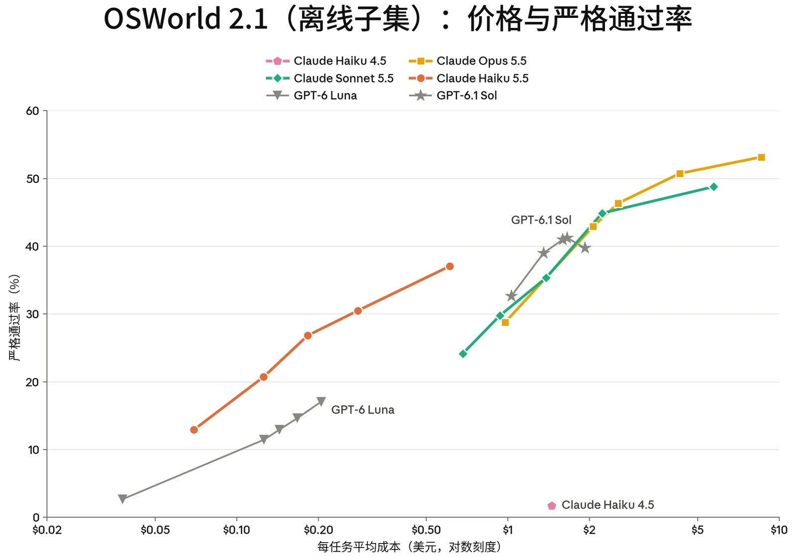

***[图 8.9.3.C] Claude Haiku 5.5、Claude Sonnet 5.5、Claude Opus 5.5 和 Claude Haiku 4.5（单个点）以及 GPT-6.1 Sol 和 GPT-6 Luna 在 OSWorld 2.1（离线子集）上的价格与严格通过率对比。**&#8203;严格通过率仅在一次尝试满足所有检查点时才将其计为通过，并取每项任务五次尝试的平均值；其余均与图 8.9.3.B 相同。*

### 8.10 真实世界专业任务

#### 8.10.1 OfficeQA

OfficeQA 是 Databricks 推出的公开基准测试，评估在大量历史 Treasury Bulletin（美国财政部公报）文档语料上的端到端有据推理。OfficeQA Pro 是其中难度更高、包含 133 道题的子集，推荐用于前沿模型。我们以智能体方式进行评估，相关文档已预先选定，并以提取后的文本形式提供。

在 `max` 推理强度下（五次运行的平均值），Claude Haiku 5.5 在 OfficeQA 上得分 73.5%，在 OfficeQA Pro 上得分 60.3%，高于 Claude Haiku 4.5 的 63.0% 和 47.1%。它落后于 Claude Sonnet 5.5，后者得分为 76.9% 和 65.6%。Claude Haiku 4.5 没有推理强度设置，因此改为以 128k token 的思考预算运行。



#### 8.10.2 GDPval-AA v2.1

GDPval-AA v2.1 由 [Artificial Analysis](https://artificialanalysis.ai/) 开发，是一个独立的评估框架，用于在具有经济价值的真实世界专业任务上测试 AI 模型。该基准测试使用来自 OpenAI [GDPval 黄金数据库](https://huggingface.co/datasets/openai/gdpval)的 220 项任务，涵盖九大行业中的 44 种职业。任务模拟实际的专业工作成果，包括文档、幻灯片、图表和电子表格。模型在智能体循环中获得 shell 访问权限和网页浏览能力来完成任务，表现通过 Elo 评分衡量；该评分来自对模型输出的盲评两两比较，并以 DeepSeek V4.1 Flash（`max`）的 1600 分为锚点。

在 `max` 推理强度下，Claude Haiku 5.5 的 Elo 评分为 1620，高于 Claude Haiku 4.5 的 735。它落后于 Claude Sonnet 5.5（1840），领先于 GPT-6 Luna（1437）和 Gemini 3.8 Flash（1435）。在默认推理强度（`medium`）下，它得分 1277，所用输出 token 约为 `max` 下的十分之一。评估由 Artificial Analysis 独立运行。

#### 8.10.3 AA-Briefcase v1.1

[AA-Briefcase](https://artificialanalysis.ai/articles/aa-briefcase) v1.1 由 Artificial Analysis 开发，是一个由行业专家构建的新基准测试，用于衡量复杂项目中的长程知识工作。模型需要完成为期数周的项目，其中包含许多相互关联的任务和数千份输入源文件。评分结合了评分细则打分和由前沿模型评审团进行的成对评判，以衡量可验证的任务成功情况、分析质量和呈现质量。

在 `max` 推理强度下，Claude Haiku 5.5 的 Elo 评分为 1578，高于 Claude Haiku 4.5 的 614。它落后于 Claude Sonnet 5.5（1824），领先于 GPT-6 Luna（1336）和 Gemini 3.8 Flash（1203）。在默认推理强度（`medium`）下，它得分 1372，所用输出 token 不到 `max` 下的四分之一。评估由 Artificial Analysis 独立运行。

### 8.11 医疗健康

#### 8.11.1 医疗健康评估

与 [Claude Sonnet 5.5 系统卡](https://www.anthropic.com/claude-sonnet-5-5-system-card)中一样，我们在启用安全分类器的情况下，在 HealthBench、HealthBench Professional 和 PhysicianBench 上评估了 Claude Haiku 5.5。以下所有得分均为 `max` 推理强度下的结果，但 Claude Haiku 4.5 除外，它没有推理强度设置，以扩展思考模式运行。在每项评估中，我们对所有模型使用同一个评分模型（HealthBench 和 HealthBench Professional 使用 Claude Opus 4.8，PhysicianBench 使用 Claude Opus 5），因此 GPT-6 Luna 的得分来自我们通过 OpenAI 公开 API 进行的运行，而非 OpenAI 公布的数据。HealthBench 和 HealthBench Professional 的得分为长度校正后得分，括号内为原始得分。[Claude Sonnet 5.5 系统卡](https://www.anthropic.com/claude-sonnet-5-5-system-card)第 8.15 节给出了校正公式以及关于实验设置的更多细节。



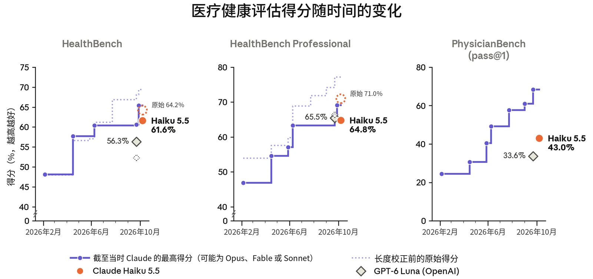

***[图 8.11.1.A] 医疗健康评估得分随时间的变化。**&#8203;图中所有模型均以 `max` 推理强度运行。在两个 HealthBench 面板中，实线为长度校正后得分，点线为原始得分，每条线追踪截至当时 Claude 的最高得分。这两个面板的 y 轴在 0 到 40 之间截断。*

#### 8.11.2 PhysicianBench 结果

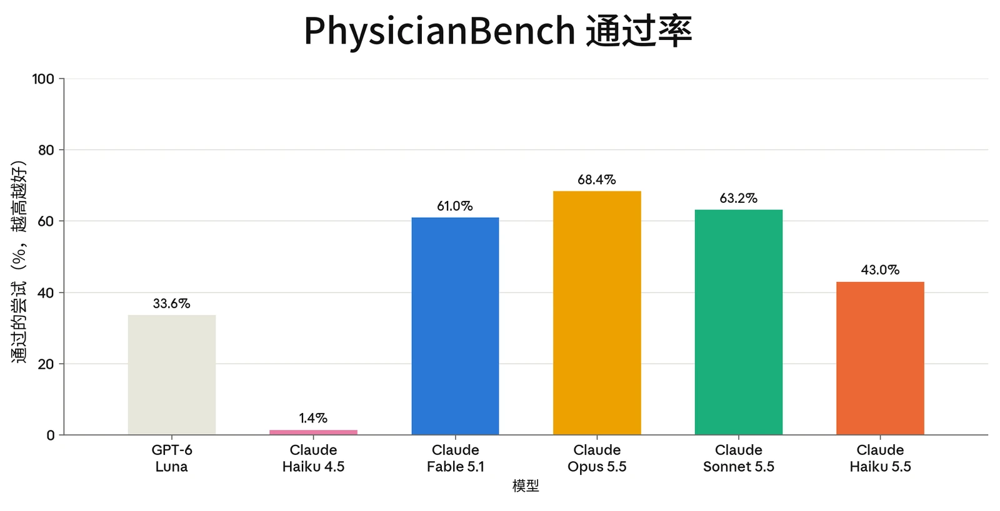

***[图 8.11.2.A] PhysicianBench 是一个公开基准测试，包含 100 项在电子***



**健康记录（EHR）中执行的医生任务。**&#8203;Claude Haiku 5.5 通过了 43.0% 的尝试（每项任务尝试五次）。这比 GPT-6 Luna 的 33.6% 高出 9.4 个百分点（按任务配对的 95% 置信区间为 2.6 至 16.2 个百分点），但远低于 Claude Sonnet 5.5 的 63.2% 和 Claude Opus 5.5 的 68.4%，后者是截至目前 Claude 的最高得分。

#### 8.11.3 推理强度与医疗健康任务

图 8.11.3.A 展示了各推理强度档位下的得分和响应时间。在 HealthBench Professional 上（每个档位五次运行），Haiku 5.5 的长度校正后得分从 `low` 推理强度下的 57.9%（原始得分 61.6%）升至 `high` 下的 61.3%，API 默认档位 `medium` 为 59.9%；`high` 与 `xhigh`（61.0%）之间无法区分。`Max` 推理强度得分最高，为 64.8%（原始得分 71.0%）；在 10 月 4 日（即较低档位运行的同一天）以 `max` 进行的十三次重复运行平均得分为 64.2%。从 `low` 到 `xhigh`，每个回答的响应时间为 8 至 21 秒，在 `max` 下约为 110 秒。相比之下，Claude Sonnet 5.5、Claude Opus 5.5 和 Claude Fable 5.1 在五个档位间的得分变化均不足 2 个百分点，且三者在 `max` 以下的每个档位上得分都高于 Haiku 5.5。

在 HealthBench 上（`max` 以下每个档位一次运行），Haiku 5.5 在 `low` 下得分 59.9%，`medium` 下 60.2%，`high` 下 60.3%，`xhigh` 下 61.1%，`max` 下 61.6%，提升 1.8 个百分点，而在 HealthBench Professional 上提升 6.9 个百分点；响应时间在 `max` 以下为 4 至 8 秒，在 `max` 下约为 44 秒。在 PhysicianBench 上（每个档位下每项任务五次尝试），Haiku 5.5 在 `low` 下通过了 17.8% 的尝试，`medium` 下 25.2%，`high` 下 31.6%，`xhigh` 下 35.8%，`max` 下 43.0%。按任务配对来看，从 `low` 到 `medium` 以及从 `medium` 到 `high` 的提升，其 95% 置信区间均不包含零；从 `high` 到 `xhigh` 的提升（4.2 个百分点，0.0 至 8.4）处于临界状态，而从 `xhigh` 到 `max` 的提升（7.2 个百分点，2.9 至 11.5）所比较的是相隔三天进行的运行。每任务模型耗时从 `low` 下的 48 秒、`high` 下的 133 秒增加到 `max` 下的约 11 分钟。在 PhysicianBench 上，Haiku 5.5 在每个档位上都低于 Claude Sonnet 5.5、Claude Opus 5.5 和 Claude Fable 5.1。



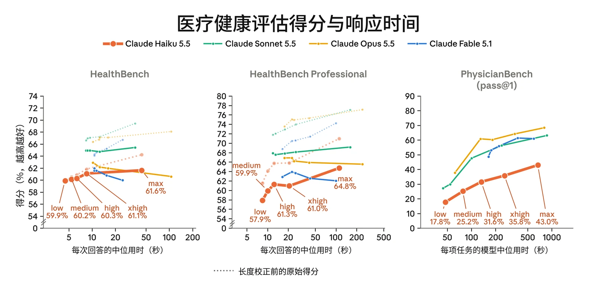

***[图 8.11.3.A] 各推理强度档位下的医疗健康评估得分和响应时间。**&#8203;在 HealthBench 和 HealthBench Professional 上，实线为长度校正后得分，较浅的点线为原始得分，y 轴在 0 到 54 之间截断；在 PhysicianBench 上，线表示通过的尝试所占比例。在 HealthBench Professional 上，每个点为五次运行的平均值；Haiku 5.5 的 `low` 至 `xhigh` 运行于 10 月 4 日进行，`max` 运行于 10 月 1 日和 2 日进行。在 HealthBench 上，其 `low` 至 `xhigh` 的点各为一次运行，于 10 月 5 日进行，`max` 为 10 月 2 日进行的五次运行的平均值。在 PhysicianBench 上，其 `low` 至 `xhigh` 运行于 10 月 5 日进行，`max` 运行于 10 月 1 日和 2 日进行；时间为每任务模型耗时，即一次尝试中模型各请求持续时间之和（不含工具和评判者耗时），并在该任务的五次尝试上取平均；图中显示的是各任务的中位数。其他模型的数据点取自 [Claude Sonnet 5.5 系统](https://www.anthropic.com/claude-sonnet-5-5-system-card)[卡](https://www.anthropic.com/claude-sonnet-5-5-system-card)，其计时是在其他日期和服务器上进行的，因此时间更适合沿同一条曲线比较，而不宜在不同曲线之间比较。*

### 8.12 多语言表现

我们在两个多语言基准测试——Global MMLU（GMMLU）和 Multi-task Indic Language Understanding Benchmark（MILU）——上评估了 Claude Haiku 5.5，以评估其在多种语言上的表现。GMMLU 将标准 MMLU 评估扩展到 42 种语言，既包括法语和德语等高资源语言，也包括约鲁巴语、伊博语和齐切瓦语等低资源语言。MILU 涵盖 11 种语言：10 种印度语言（孟加拉语、古吉拉特语、印地语、卡纳达语、马拉雅拉姆语、马拉地语、奥里亚语、旁遮普语、泰米尔语和泰卢固语）以及英语，测试的是植根文化背景的知识理解。

#### 8.12.1 GMMLU 结果

在 GMMLU 上，Claude Haiku 5.5 在 42 种语言上的平均准确率为 87.8%，落后于 Claude Opus 5.5 的 94.3%、Claude Fable 5.1 的 94.0% 和 Claude Sonnet 5.5 的 92.1%。



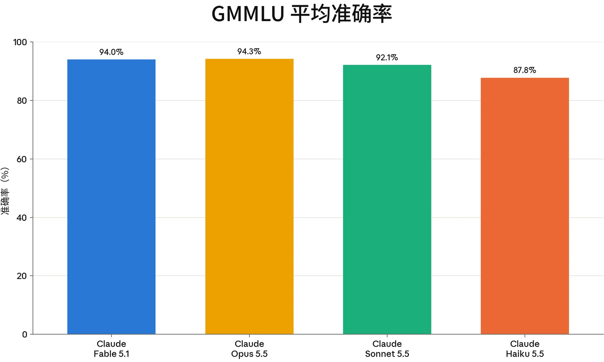

***[图 8.12.1.A] GMMLU 平均准确率。**&#8203;所有 Claude 模型均使用 `max` 推理强度下的自适应思考，并在启用安全分类器的情况下运行；被拦截或未作答的问题（Haiku 5.5 为 0.1%，Claude Opus 5.5 为 0.5%，Claude Fable 5.1 为 1.3%，Claude Sonnet 5.5 不足 0.1%）不计入平均值，而非按答错计分。Claude Opus 5.5、Claude Fable 5.1 和 Claude Sonnet 5.5 的数值取自各自系统卡中的报告。得分为单次试验的结果。未向任何模型提供工具或定制的系统提示词。*

#### 8.12.2 MILU 结果

在 MILU 上，Claude Haiku 5.5 在 11 种语言上的平均准确率为 87.6%，落后于 Claude Opus 5.5 的 93.1%、Claude Fable 5.1 的 93.0% 和 Claude Sonnet 5.5 的 91.6%。



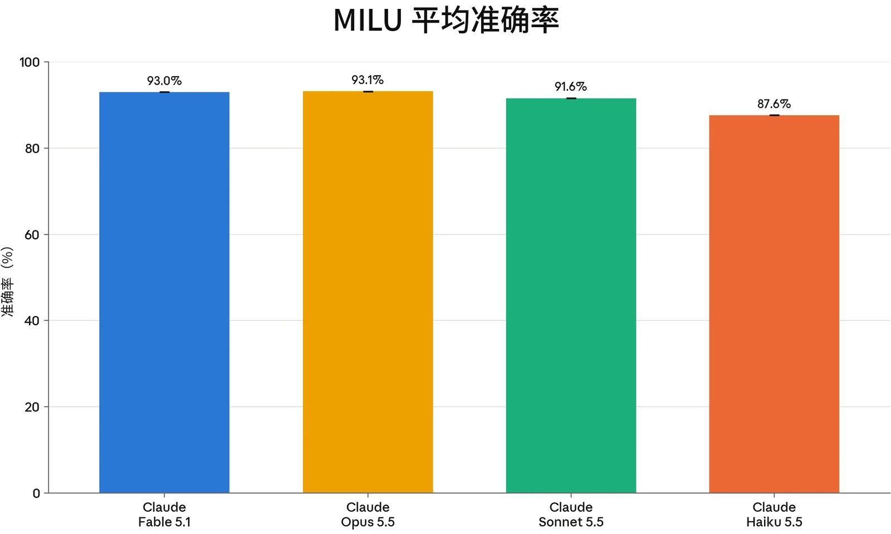

***[图 8.12.2.A] MILU 平均准确率。**&#8203;所有 Claude 模型均使用 `max` 推理强度下的自适应思考，并在启用安全分类器的情况下运行；被拦截或未作答的问题（四个模型均不足 0.2%）不计入平均值，而非按答错计分。Claude Opus 5.5、Claude Fable 5.1 和 Claude Sonnet 5.5 的数值取自各自系统卡中的报告。得分为五次试验的平均值。未向任何模型提供工具或定制的系统提示词。附 95% 置信区间（约 ±0.04 至 ±0.08，过小而无法看出）。*

### 8.13 生命科学能力

本节报告对支持有益生命科学研究的能力所做的评估，涵盖生物信息学、基于细胞的检测、生物医学图像分析、药物化学、蛋白质设计和实验方案。除非另有说明，Claude 的每项得分均为每道题五次尝试的平均值，采样时使用自适应思考，推理强度为 `max`。我们通过 API 评估 Haiku 5.5，并关闭了其生物安全防护措施，因此这些结果反映的是底层模型的能力，而非已部署系统的能力。在可获得的情况下，我们还报告了 GPT‑6 Luna 的得分（通过 OpenAI API 运行，推理强度为 `max`），以及 Gemini 3.8 Flash 的得分（通过 Google 的 Vertex AI API 运行，使用最高思考档位）。在任一模型上被安全过滤器拦截的尝试均不计入我们的评估结果。



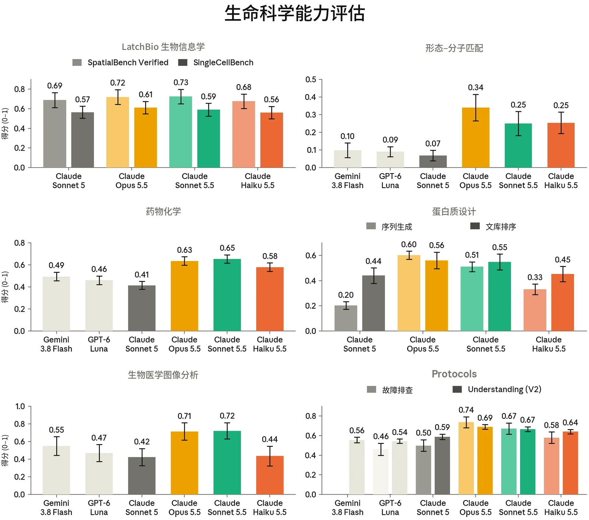

***[图 8.13.A] 生命科学基准测试。**&#8203;Haiku 5.5 及对比模型在所示各项基准测试上的表现。各基准测试的结果将在以下各节中讨论。*

#### 8.13.1 LatchBio Bioinformatics

这组评估由 LatchBio 开发，用于评估模型解决具有挑战性的真实世界生物信息学问题的能力。SpatialBench Verified 变体测试对空间转录组学和染色质可及性数据的分析，SingleCellBench 变体测试对单细胞 RNA 测序数据的分析。在这两个变体中，Claude 均可使用用于代码执行的 bash 工具、一个文件编辑器以及一组预先指定的已安装软件包。Claude Haiku 5.5 在 SpatialBench Verified 上得分 67.7%，在 SingleCellBench 上得分 56.2%，表现约与 Claude Sonnet 5（68.9% 和 56.5%）相当。

理解（V2）



#### 8.13.2 形态–分子匹配

该基准测试与 Axiom Bio 合作开发，评估模型能否将来自 Axiom 的人类肝脏体外检测的四组多通道细胞成像数据，与处理每组图像中各孔的四种顺序被打乱的分子–剂量扰动相匹配。Claude Haiku 5.5 得分 25.4%，与 Claude Sonnet 5.5（25.0%）持平。

#### 8.13.3 药物化学

该基准测试评估模型能否对类药分子的吸收、分布、代谢和排泄（ADME）相关性质进行推理。504 道题中的每一道都以化学结构的形式给出若干来自药物发现项目的真实化合物，并询问哪个候选化合物在某一此类性质上的实测值最高或最低。Claude Haiku 5.5 得分 58.0%，远高于 Claude Sonnet 5（41.3%），比 Claude Opus 5.5（63.5%）和 Claude Sonnet 5.5（65.3%）低几个百分点。

#### 8.13.4 蛋白质设计

这些基准测试评估 Claude 的蛋白质设计能力。序列生成任务（Sequence Generation task）评估 Claude 在多种设计约束条件下生成新型蛋白质序列的能力。文库排序任务（Library Ranking task）评估 Claude 为实验测试确定蛋白质设计优先顺序的能力。我们在序列生成任务中每道题只运行 1 次尝试，在文库排序任务中每道题运行 3 次尝试。Haiku 5.5 在序列生成任务上得分 33.1%，介于 Claude Sonnet 5（20.2%）和 Claude Sonnet 5.5（51.0%）之间；在文库排序任务上得分 45.3%，约与 Claude Sonnet 5（44.0%）相当，低于 Claude Sonnet 5.5（54.8%）。

#### 8.13.5 生物医学图像分析

该基准测试使用来自公开生物医学图像分析竞赛的数据，评估模型对生物医学图像进行定量分析的能力。任务输入涵盖 CT、MRI、组织病理、皮肤镜、视网膜、超声、显微及其他成像。我们对评分进行了缩放，以反映 Claude 的表现相对于相应竞赛中所取得最佳结果的水平。我们每道题运行 1 次尝试。Claude Haiku 5.5 得分 43.5%，约与 Claude Sonnet 5（42.3%）相当。

#### 8.13.6 实验方案

该评估衡量模型协助完成分子生物学实验方案的能力。故障排查变体（Troubleshooting variant）要求 Claude 检测并修复实验方案中的问题。理解（V2）变体（Understanding (V2) variant）是由 Benchling 创建的一个题集，它向 Claude 提供一份真实的实验方案（例如一份protocols.io 文档、厂商手册或核心实验平台指南），以及一个关于如何应用或调整该方案的实际问题。Claude Haiku 5.5 在故障排查变体上得分 58.0%，介于 Claude Sonnet 5（49.9%）和 Claude Sonnet 5.5（67.3%）之间；在理解（V2）变体上得分 64.1%，接近 Claude Sonnet 5.5（66.6%），高于 Claude Sonnet 5（58.9%）。我们未在 Gemini 3.8 Flash 上运行实验方案故障排查评估。



None‎
