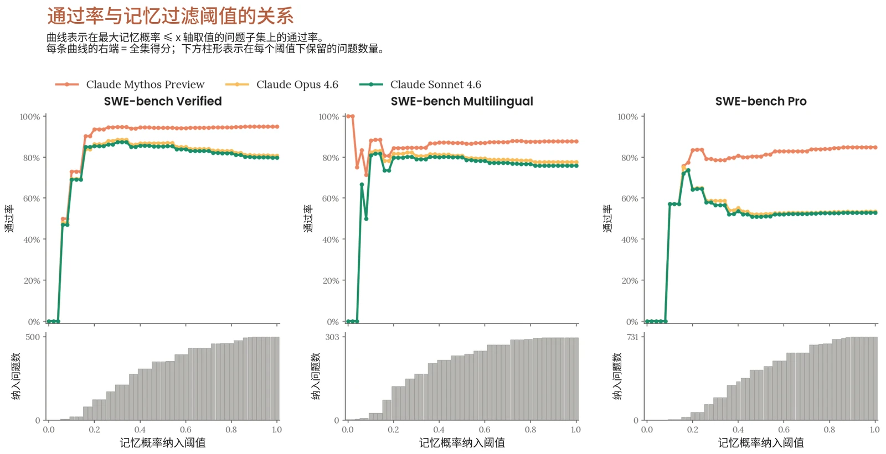
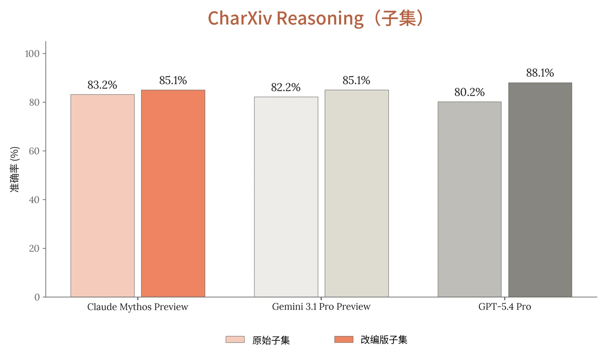
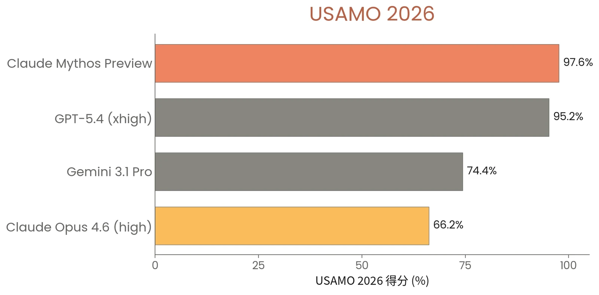
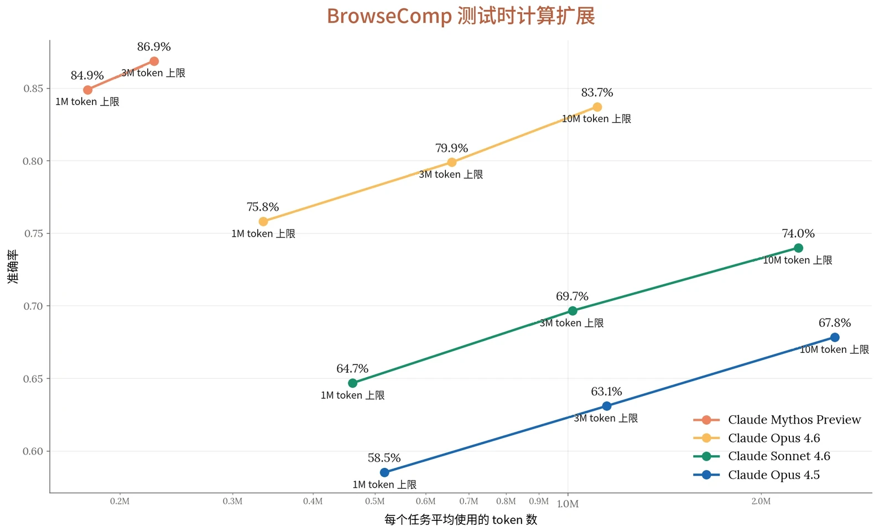
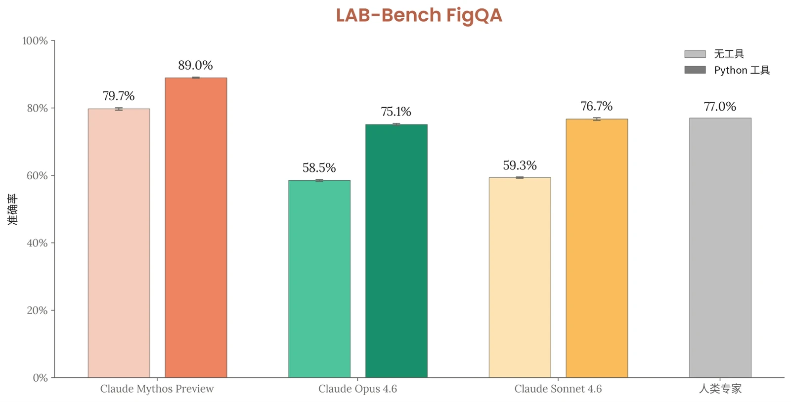
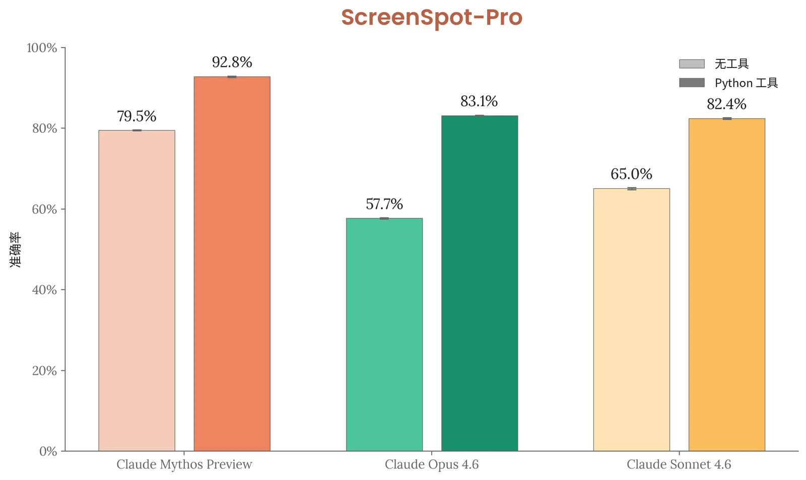
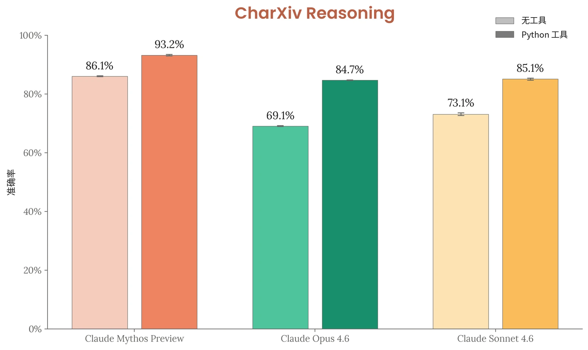

### 6.1 引言

本节报告 Claude Mythos Preview 在推理、编程、智能体任务、数学、长上下文和知识工作方面的评估。网络安全能力在第 3 节中介绍。

此处评估的许多能力也与模型安全相关；部分评估也见于第 2 节，我们在该节中讨论与我们的负责任扩展政策（Responsible Scaling Policy）相关的评估。

我们首先讨论与我们所使用的若干评估基准测试相关的污染问题。随后，我们提供一张汇总表，在多项评估上将 Claude Mythos Preview 与其他 Anthropic 模型及第三方模型进行比较，之后是各项评估的说明和方法细节。对于同样曾在 Claude Opus 4.6 上运行过的评估，我们沿用[其系统卡](https://www.anthropic.com/claude-opus-4-6-system-card)中的说明，并注明任何变更。

### 6.2 污染

公开基准测试中问题的答案可能会无意中出现在模型的训练数据中，从而抬高模型所能取得的分数。我们采取了若干步骤对评估进行去污染；完整方法见 [Claude Opus 4.5 系统卡](https://www-cdn.anthropic.com/bf10f64990cfda0ba858290be7b8cc6317685f47.pdf)第 2.2 节。对于多模态去污染，我们还会额外剔除任何包含如下图像的训练样本：该图像的感知哈希与某项多模态评估中所含图像的感知哈希相匹配。

下面，我们讨论污染问题尤为突出的三项评估。

#### 6.2.1 SWE-bench 评估

我们对 SWE-bench Verified、Multilingual 和 Pro 进行分析，以检查是否存在记忆——即模型复现训练数据中的解答，而不是独立推导出解答。我们在所有试验上运行了多个过滤器，在一系列阈值下剔除被标记的问题。在这一过滤后的子集上重新评分并不会改变 Claude Mythos Preview 的排名，而且在排除被标记的问题之后，它相对于 Claude Opus 4.6 的大幅提升仍然存在。在公开和私有的智能体编程基准测试上，以及在这些评估的干净划分和完整划分上，提升都一致，这表明记忆并不是 Claude Mythos Preview 在 SWE-bench 评估中取得提升的主要原因。



每个基准测试的问题都取自开源代码仓库，因此其内容可能出现在训练语料中。我们进行了语料级去污染，但仍在全部三个基准测试中观察到一些记忆的迹象。例如，在某个问题中，模型生成的补丁复现了参考解答中完全相同的辅助函数，尽管它先是独立地推导、构建并测试了一个解答，然后似乎才在最后“回忆起”真值补丁。OpenAI 也针对 SWE-bench Verified [记录了](https://openai.com/index/why-we-no-longer-evaluate-swe-bench-verified/)类似的担忧。

为了检测记忆，我们使用一个基于 Claude 的审计模型，将每个模型生成的补丁与标准补丁进行比较，并给出一个 [0, 1] 区间的记忆概率。该审计模型会权衡具体信号——在存在其他实现方式时仍逐字复现代码、与真值相匹配的独特注释文本等——并被要求不计入任何称职的解题者在给定问题约束下都会写出的重合部分。另有一项基于规则的补充检查，会标记与参考解答之间大量逐字重合的注释。我们对所有模型的每一次尝试都运行这两种检测器，只要有任何一次尝试被标记，就将该问题标为可能被记忆。剔除所有模型和所有尝试中被标记问题的并集，对 Claude Mythos Preview 而言是一种保守做法：它同时也剔除了*任一*基线模型（Opus 4.6 或 Claude Sonnet 4.5）可能记忆过的问题。

*事后*识别记忆本质上只能是近似的。因此，我们在审计模型决策阈值的整个取值范围内进行扫描，而不是只采用单一的截断值。在过滤严格程度的整个范围内，Claude Mythos Preview 在每个基准测试上都保持着对 Claude Opus 4.6 和 Claude Sonnet 4.6 的显著领先。



***[图 6.2.1.A] SWE-bench 评估通过率与记忆过滤阈值的关系。**上图展示了 Claude Mythos Preview、Claude Opus 4.6 和 Claude Sonnet 4.6 在 SWE-bench Verified（n=500）、Multilingual（n=297）和 Pro（n=731）上的通过率随过滤严格程度的变化。每个模型都在如下问题子集上重新评分：按任一模型计，审计模型给出的记忆概率均 ≤ x 轴取值。柱形表示在每个阈值下保留的问题数量。在阈值 1.0（最右侧）时，所有问题均被保留，曲线与表 6.3.A 中的主要成绩一致；向左移动会剔除被判定为越来越可能被记忆的问题。在整个阈值范围内，在全部三个基准测试上，Claude Mythos Preview 都保持着对两个基线的显著领先。在我们的参考阈值 0.7（一个有意设定的高召回率设置，会剔除每个基准测试 8–15% 的问题）下，Claude Mythos Preview 相对于 Opus 4.6 的领先幅度最多缩小 3.5 个百分点。最左侧的不稳定是在通过过滤的问题少于约 30 个时出现的小样本噪声。随着记忆过滤放宽、更多被标记的问题被加回，Claude Mythos Preview 的通过率大致保持稳定，而 Claude Opus 4.6 和 Claude Sonnet 4.6 的通过率则有所下降。这与以下情况相符：Claude Mythos Preview 记忆了一些较难的被标记问题，而这些问题基线模型并未独立解出。*

我们的检测器并不完美，但这一结果对阈值的选择是稳健的，并且与 Claude Mythos Preview 在任何训练语料中都不存在的内部基准测试上的提升相一致。我们的结论是，记忆并不能解释它在 SWE-bench 上的提升。

#### 6.2.2 CharXiv Reasoning

CharXiv Reasoning 是我们在第 6.11.3 节中为 Claude Mythos Preview 报告的一项基准测试。CharXiv 的问题取自既有的公开材料——例如 arXiv 论文中的图表——这些材料广泛出现在网络规模的预训练语料中，本质上难以完全去污染。



我们使用两种互补的方法来检测 CharXiv Reasoning 的污染。我们挑选答案文本具有独特性的评估条目，在完整的预训练数据混合中 grep 精确匹配，并另行搜索评估图像。尽管对评估图像进行了稳健的图像级过滤，我们仍确认大多数问答文本对出现在语料中。

为了估计污染的影响，我们为基准测试的一个子集构建了留出变体：我们手动扰动每个问题或图像，并比较原版与改编版的准确率。例如，我们要求模型识别某个图表标签而不是另一个，或者识别第二*低*而不是第二*高*的数据系列，从而使正确答案发生变化，同时难度大致保持不变。

***[图 6.2.2.A] CharXiv Reasoning（子集）分数。**我们在原始 CharXiv 基准测试的一个问题子集上评估各模型，同时使用原始问答对和难度与歧义程度大致相当的手动改写变体。Claude Mythos Preview 在自适应思考（adaptive thinking）和 max 推理强度（effort）下进行评估。Gemini 3.1 Pro Preview 在默认的动态思考档位“high”下进行评估。GPT-5.4 Pro 在推理设置为“high”的情况下进行评估。*

在 CharXiv 的一个包含 100 个条目的改编版上，Claude Mythos Preview、Gemini 3.1 Pro Preview 和 GPT-5.4 Pro 在改编版上的得分均高于在对应原始子集上的得分。这表明原始基准测试上可归因于记忆的表现是有限的。我们的结论是，污染不太可能对 Claude Mythos Preview 在 CharXiv 上的表现有实质性贡献。



| **评估** | **Claude 系列** |  | **其他模型** |  |
|---|---|---|---|---|
|  | **Claude Mythos Preview** | **Claude Opus 4.6** | **GPT-5.4** | **Gemini 3.1 Pro** |
| **SWE-bench Verified** | **93.9%** | 80.8% | — | 80.6% |
| **SWE-bench Pro** | **77.8%** | 53.4% | 57.7% | 54.2% |
| **SWE-bench Multilingual** | **87.3%** | 77.8% | — | — |
| **SWE-bench Multimodal** | **59%** | 27.1% | — | — |
| **Terminal-Bench 2.0*** | **82%** | 65.4% | 75.1% | 68.5% |
| **GPQA Diamond** | **94.5%** | 91.3% | 92.8% | 94.3% |

#### 6.2.3 MMMU-Pro

MMMU-Pro 是我们通常会在本系统卡（System Card）中（具体而言，在下文第 6.11 节中）报告的一项基准测试。与 CharXiv Reasoning 类似，MMMU-Pro 由来自广泛传播的公开材料的内容构成——例如大学考试、教科书和测验网站——这些内容难以从训练语料中完全去污染。

我们发现，MMMU-Pro 中有很大一部分图像出现在训练数据中，主要是通过教科书、作业辅导网站和文档爬取，这些来源会对底层原始内容进行重新包装和分发。

与 CharXiv Reasoning 不同，MMMU-Pro 中只有数量有限的问题能够方便地构造出*难度大致相当*的变体。MMMU-Pro 包含少量图表，但只研究这一问题子集会呈现出有偏差的图景。鉴于难以确定污染的影响，我们选择在本系统卡中略去 MMMU-Pro 的结果。

### 6.3 总体结果汇总

表 6.3.A 汇总了下文更详细讨论的各项评估。



| **评估** |  | **Claude 系列** |  | **其他模型** |  |
|---|---|---|---|---|---|
|  |  | **Claude Mythos Preview** | **Claude Opus 4.6** | **GPT-5.4** | **Gemini 3.1 Pro** |
| **MMMLU** |  | **92.7%** | 91.1% | — | 92.6%–93.6% |
| **USAMO 2026** |  | **97.6%** | 66.2% | 95.2% | 74.4% |
| **GraphWalks BFS 256K-1M** |  | **80.0%** | 38.7% | 21.4% | — |
| **HLE** | **无工具** | **56.8%** | 40.0% | 39.8% | 44.4% |
|  | **使用工具** | **64.7%** | 53.1% | 52.1% | 51.4% |
| **CharXiv Reasoning** | **无工具** | **86.1%** | 69.1% | - | - |
|  | **使用工具** | **93.2%** | 84.7% | - | - |
| **OSWorld** |  | **79.6%** | 72.7% | 75.0% |  |

***[表 6.3.A] 能力评估总览。**除非另有说明，Claude Mythos Preview 的所有结果均采用以下标准配置：自适应思考，max 推理强度，默认采样设置（temperature、top_p），取 5 次试验的平均值。上下文窗口大小因评估而异，且不超过 100 万 token。每行中的最佳得分以**粗体**标出。竞品数据取自各开发方公开发布的系统卡或基准测试排行榜。早期 Claude 模型的评估细节参见 [Claude Opus 4.6 系统卡](https://www.anthropic.com/claude-opus-4-6-system-card)。*对于 Terminal-Bench 2.0，OpenAI 的报告得分使用了专门的运行框架（harness），因此该行中各模型之间的比较并不精确。其他所有得分均使用 Terminus-2 运行框架。*

### 6.4 SWE-bench Verified、Pro、Multilingual 与 Multimodal

SWE-bench（Software Engineering Bench）在真实世界软件工程任务上测试 AI 模型。我们报告四个变体：

- [SWE-bench Verified](https://openai.com/index/introducing-swe-bench-verified/)（OpenAI）是一个包含 500 道题的子集，每道题均经人类工程师验证为可解。Claude Mythos Preview 取得 93.9%，为 5 次试验的平均值。
- [SWE-bench Pro](https://scale.com/leaderboard/swe_bench_pro_public)（Scale）是一个更难的变体：题目取自持续维护的代码仓库，涉及更大的多文件 diff，且不存在公开的真值泄露。Claude Mythos Preview 取得 77.8%，为 5 次试验的平均值。

- [SWE-bench Multilingual](https://www.swebench.com/multilingual.html) 将该形式扩展到涵盖 9 种编程语言的 300 道题。Claude Mythos Preview 取得 87.3%，为 5 次试验的平均值。
- [SWE-bench Multimodal](https://www.swebench.com/multimodal.html) 在 issue 描述中加入了视觉上下文（截图、设计稿）。Claude Mythos Preview 取得 59.0%（在内部运行框架上评估；参见附录 8.6），为 5 次试验的平均值。我们注意到，该变体的试验间差异（56.4%–61.4%）高于其他变体。

所有 SWE-bench 变体均采用标准配置（见表 6.3.A），采样结果中包含思考块。关于我们的记忆筛查，参见第 6.2 节。

### 6.5 Terminal-Bench 2.0

[Terminal-Bench 2.0](https://www.tbench.ai/news/announcement-2-0) 由斯坦福大学和 Laude Institute 的研究人员开发，在终端和命令行环境中的真实世界任务上测试 AI 模型。

我们在 Harbor 脚手架（scaffold）中使用 Terminus-2 运行框架和默认解析器运行 Terminal-Bench 2.0。每个任务在独立的 Kubernetes pod 中运行，保证资源为基准测试规定限额的 1×（硬性抢占上限为 3×），超时设为 1×，以保证与基准测试的一致性。该配置的详细信息见[我们的工程博客](https://www.anthropic.com/engineering/infrastructure-noise)。

Claude Mythos Preview 取得了 **82% 的平均奖励**，为 89 个不同任务各 5 次尝试的平均值（共计 445 次试验）。我们将 Claude Mythos Preview 配置为以最高推理强度（自适应模式）运行，每个任务的总 token 预算为 100 万，每次请求的最大输出 token 为 32K。Terminal-Bench 对推理延迟较为敏感：固定的实际耗时超时意味着解码较慢的端点在每个任务中完成的回合更少。我们报告的得分使用了生产环境 API 端点，以考虑这些动态因素。

Terminal-Bench 2.0 的超时限制有时相当严格，对思考型模型尤其如此，这有可能使真实的能力跃升被采样速度等看似无关的混杂因素所掩盖。此外，部分 Terminal-Bench 2.0 任务存在歧义，且资源规格有限，无法让智能体充分探索完整的解空间——维护者目前正在 [2.1 更新](https://github.com/harbor-framework/terminal-bench-2/pull/53)中解决这两个问题。为了在排除混杂因素的情况下单独衡量智能体编程能力，我们还使用 GitHub 上提供的最新 2.1 修复运行了 Terminal-Bench，同时将超时限制提高到 4 小时（大约是 2.0 基线的四倍）。这使平均奖励达到 **92.1%**。在相同条件下，我们测得使用 Codex CLI 运行框架的 GPT-5.4 取得 75.3%（高于基线规格下的 68.3%）[^23]。



### 6.6 GPQA Diamond

Graduate-Level Google-Proof Q&A 基准测试（GPQA）[^24] 是一组具有挑战性的多项选择科学题。我们使用包含 198 道题的 Diamond 子集——即领域专家能答对、但大多数非专家答不对的题目。

Claude Mythos Preview 在 [GPQA Diamond](https://arxiv.org/abs/2311.12022) 上取得 94.55%，为 5 次试验的平均值。

### 6.7 MMMLU

[MMMLU](https://huggingface.co/datasets/openai/MMMLU)（Multilingual Massive Multitask Language Understanding）测试 14 种非英语语言中 57 个学术学科的知识与推理。在所有非英语语言组合上，Claude Mythos Preview 取得 92.67%，为 5 次试验的平均值，每次运行均使用自适应思考、max 推理强度和默认采样设置（temperature、top_p）。

### 6.8 USAMO 2026

美国数学奥林匹克（USA Mathematical Olympiad，USAMO）是面向高中生的证明题竞赛，共六道题，分两天进行。在美国的数学奥林匹克赛制中，它是继美国数学邀请赛（American Invitational Mathematics Examination，AIME）之后的下一级比赛；美国数学邀请赛去年曾是一个热门的 AI 基准测试，但现已饱和。2026 年 USAMO 于 2026 年 3 月 21–22 日举行，晚于 Claude Mythos Preview 的训练数据截止日期。

由于 USAMO 的解答是证明而非简短答案，评分可能具有挑战性且带有主观性。我们遵循 [MathArena](https://matharena.ai/usamo/) 的评分方法：每份证明先由一个中立模型（Gemini 3.1 Pro）改写，再由 3 个前沿模型组成的评审组（我们使用了 Gemini 3.1 Pro、Claude Opus 4.6 和 Claude Mythos Preview）依据既定的评分细则进行评判。最终得分取各评判者所给分数中的最低值。

Claude Mythos Preview 取得 97.6% 的得分，为每道题 10 次试验的平均值，使用 max 推理强度且不使用工具。我们使用 Claude Opus 4.6 将我们的运行框架与 MathArena 公布的得分进行了校准。MathArena 测得 47.0%，但它将 Opus 4.6 的思考 token 限制在 120k。我们在相同设置下的测量结果为 51.9%（相差在 5% 以内）；在 high 推理强度且不限 token（通过批处理 API）的情况下，我们测得 66.2%。



***[图 6.8.A] USAMO 2026 得分。**Claude Mythos Preview 在数学证明方面远强于 Claude Opus 4.6。*

我们注意到，三位评判者中有两位是 Anthropic 模型，它们[可能](https://arxiv.org/abs/2410.21819)存在偏向 Claude Mythos Preview 的[偏差](https://matharena.ai/usamo/)；与此相抵的是，Gemini 3.1 Pro 认同这些得分，并且在 58/60 份解答中未发现任何问题。

### 6.9 长上下文：GraphWalks

[GraphWalks](https://huggingface.co/datasets/openai/graphwalks) 是一个多跳长上下文基准测试：上下文窗口中填充着一个由十六进制哈希节点构成的有向图，模型必须从一个随机起始节点出发执行广度优先搜索（BFS），或找出其父节点。

Claude Mythos Preview 在 BFS 256K-1M 上得分 80.0%，在 parents 256k-1M 上得分 97.7%，均为 5 次试验的平均值[^25]。与此前的 Claude 模型一样，我们的评分修正了已发布 F1 指标中的一处歧义（真值集合为空时，空预测记为 1.0 而非 0），并对 BFS 提示词作了澄清，要求给出恰好位于深度 N 的节点，而非深度不超过 N 的节点；详情参见 [Claude Opus 4.6 系统卡](https://www-cdn.anthropic.com/0dd865075ad3132672ee0ab40b05a53f14cf5288.pdf)。



### 6.10 智能体搜索

#### 6.10.1 Humanity’s Last Exam

[Humanity’s Last Exam](https://arxiv.org/abs/2501.14249)（HLE）是“一个处于人类知识前沿的多模态基准测试”，包含 2,500 道题。

我们在两种配置下测试了 Claude Mythos Preview：（1）纯推理（不用工具），以及（2）使用网络搜索、网页抓取、程序化工具调用、代码执行，并每 50k token 进行一次上下文压缩（context compaction），最多至 300 万 token。Claude Opus 4.6 担任评分模型。

为防止工具变体中出现结果污染，我们为搜索器与抓取器都屏蔽了已知讨论 HLE 的来源（见附录 8.5）。我们还使用 Claude Opus 4.6 审查所有对话记录，并标记任何看起来从 HLE 专门来源检索到答案的记录；经确认的案例将被重新判为错误。

Claude Mythos Preview 在不使用工具时得分 56.8%，使用工具时得分 64.7%。

#### 6.10.2 BrowseComp

[BrowseComp](https://arxiv.org/abs/2504.12516) 测试智能体在开放网络上查找难以定位的信息的能力。我们让 Claude Mythos Preview 使用网络搜索、网页抓取、程序化工具调用和代码执行运行。在自适应思考、max 推理强度和 300 万 token 上限下，Claude Mythos Preview 得分 86.9%。我们使用上下文压缩（在 200k token 时触发）来突破 100 万 token 的上下文窗口。

在我们的搜索工具下，我们评估认为该基准测试已接近饱和，因此 Claude Mythos Preview 相比我们最佳的 Claude Opus 4.6 得分仅带来了适度的准确率提升（86.9% 对 83.7%）。不过，该模型以显著更小的 token 用量取得了这一得分：Claude Mythos Preview 的最佳结果每个任务使用的 token 比 Opus 4.6 少 4.9×（每个任务 226k 对 1.11M token）。

需要注意的一点是预训练污染。尽管我们尽了最大努力加以防范，仍有部分答案已在网上泄露，且难以轻易识别，很可能已进入我们的预训练语料。为估计污染程度，我们在不开启思考、不使用工具的情况下评估了该模型，得分为 24.0%。尽管如此，其中一些对话记录较长（>5k token），显示模型在进行真正的演绎推理，基于内部知识系统地探索各个选项，这并不一定意味着它记忆了答案。若仅限于较短的对话记录（≤5k token），只有 15.1%的答案是正确的；这很可能是基准测试记忆程度的一个更好的上界。在解读该基准测试上的得分时应牢记这一点。



***[图 6.10.2.A] BrowseComp 准确率**随着我们在上下文压缩的帮助下增加模型可使用的总 token 数而提升。*

### 6.11 多模态

对于 Claude Mythos Preview，相比此前的系统卡，我们对多模态评估方法做了三项更改。

第一，在此前的系统卡中，我们在所有多模态能力评估中只为模型提供了一个图像裁剪工具。此次，我们提供了一套扩展的 Python 工具：一个预装了常用图像分析库（例如 PIL、OpenCV）的代码执行沙箱，以及原有的图像裁剪工具。

第二，我们更新了 CharXiv Reasoning 和 LAB-Bench FigQA 的评分模型。在评估我们的模型时，我们发现 Claude Sonnet 4（此前的评分者）偶尔无法输出格式正确的评分结果——尤其是在被评估模型产生较长的工具使用轨迹时——这人为地压低了 LAB-Bench FigQA 和 CharXiv Reasoning 上的得分。因此，我们改用 Claude Sonnet 4.6 作为本节所有评估的评分者。



第三，我们更新了评分方式，保留被评估模型的思考轨迹，而此前我们会在将对话记录传给评分模型之前将其移除。我们发现这对得分的影响可以忽略不计。

为实现公平比较，我们使用扩展后的工具集和新的评分者重新评估了所有此前的模型。下文报告的所有得分均为五次运行的平均值。

#### 6.11.1 LAB-Bench FigQA

LAB-Bench FigQA 是一个视觉推理基准测试，测试模型能否正确解读和分析生物学研究论文中复杂科学图表的信息。该基准测试是 FutureHouse 开发的 [Language Agent Biology Benchmark（LAB-Bench）](https://arxiv.org/abs/2407.10362)的一部分，[^26]后者评估 AI 在实际科学研究任务中的能力。

在自适应思考、max 推理强度且不使用工具的情况下，Claude Mythos Preview 在 FigQA 上取得 79.7% 的得分。在自适应思考、max 推理强度并使用 Python 工具的情况下，Claude Mythos Preview 取得 89.0% 的得分。在两种设置下，Claude Mythos Preview 均优于 Claude Opus 4.6，后者分别得分 58.5% 和 75.1%。Claude Sonnet 4.6 在相同设置下得分 59.3% 和 76.7%。

***[图 6.11.1.A] LAB-Bench FigQA 得分。**模型在自适应思考和 max 推理强度下评估，分别使用和不使用 Python 工具。人类专家基线按原始 LAB-Bench 论文中的报告值显示。得分为五次运行的平均值。图中显示 95% 置信区间。*



#### 6.11.2 ScreenSpot-Pro

[ScreenSpot-Pro](https://arxiv.org/abs/2504.07981) 是一个 GUI 定位基准测试，测试模型能否根据自然语言指令，在专业桌面应用程序的高分辨率截图中精确定位特定的用户界面元素。[^27]该基准测试由新加坡国立大学及合作机构的研究人员开发，包含 1,581 个经专家标注的任务，涵盖三种操作系统上的 23 个专业应用程序——包括 IDE、CAD 软件和创意工具——目标元素平均占屏幕面积不到 0.1%。

在自适应思考、最高推理强度且不使用工具的情况下，Claude Mythos Preview 在 ScreenSpot-Pro 上取得 79.5% 的得分。在自适应思考、最高推理强度并使用 Python 工具的情况下，Claude Mythos Preview 取得 92.8% 的得分。在两种设置下，Claude Mythos Preview 均优于 Claude Sonnet 4.6——后者不使用工具时得分 65.0%，使用工具时得分 82.4%——以及 Claude Opus 4.6——后者不使用工具时得分 57.7%，使用工具时得分 83.1%。

***[图 6.11.2.A] ScreenSpot-Pro 得分。**模型在自适应思考和 max 推理强度下评估，分别使用和不使用 Python 工具。得分为五次运行的平均值。图中显示 95% 置信区间。*



#### 6.11.3 CharXiv Reasoning

[CharXiv Reasoning](https://arxiv.org/abs/2406.18521) 是一个全面的图表理解评估套件，基于 2,323 张取自 arXiv 论文的真实世界图表构建，这些论文涵盖八个主要科学学科。[^28]该基准测试考察模型能否综合复杂科学图表中的视觉信息，以回答需要多步推理的问题。

我们在验证集的 1,000 道题上评估模型，并对五次运行的分数取平均。在使用自适应思考、max 推理强度且不使用工具的条件下，Claude Mythos Preview 在 CharXiv Reasoning 上得分 86.1%。在使用自适应思考、max 推理强度及 Python 工具的条件下，Claude Mythos Preview 得分 93.2%。Claude Opus 4.6 的相应得分分别为 69.1% 和 84.7%，Claude Sonnet 4.6 分别为 73.1% 和 85.1%。

***[图 6.11.3.A] CharXiv Reasoning 得分。**模型在自适应思考和 max 推理强度下进行评估，分别使用和不使用 Python 工具。分数为五次运行的平均值。图中显示 95% 置信区间。*

#### 6.11.4 OSWorld

[OSWorld](https://os-world.github.io/) 是一个多模态基准测试，评估智能体通过鼠标和键盘操作与实时运行的 Ubuntu 虚拟机交互、完成真实世界计算机任务（例如编辑文档、浏览网页和管理文件）的能力。我们沿用默认设置，分辨率为 1080p，每个任务的操作步数上限为 100。



Claude Mythos Preview 的 OSWorld 得分为 79.6%（首次尝试成功率，五次运行取平均）。
