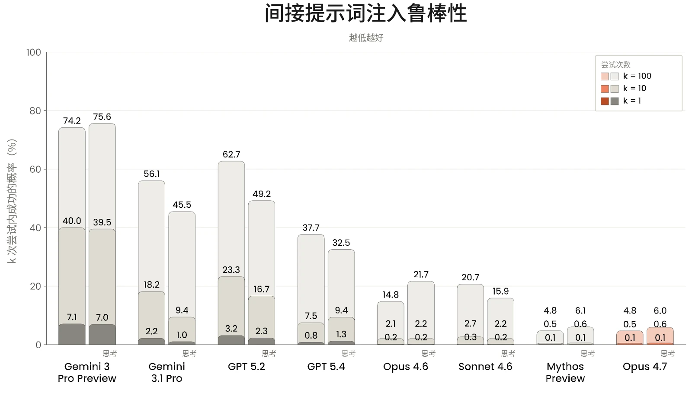

在发布 Claude Opus 4.7 之前，我们运行了一套与我们最近几款模型（包括 Claude Mythos Preview）发布时所进行的类似的智能体安全评估。

如[Claude Mythos Preview 系统卡（System Card）](https://www-cdn.anthropic.com/53566bf5440a10affd749724787c8913a2ae0841.pdf)中先前所述，我们还引入了一项新评估，聚焦于我们的模型自主执行影响力行动的能力，以及一项新的间接提示词注入（indirect prompt injection）基准测试，以应对现有评估已饱和的问题。我们移除了一项关于基础恶意编程任务的评估（参见[Claude Opus 4.6 系统卡](https://www.anthropic.com/claude-opus-4-6-system-card)第 5.1.1 节），该评估已高度饱和，并已被专门聚焦于 Claude Code 和计算机使用（computer use）任务的更难评估所取代。

### 5.1 智能体的恶意使用

#### 5.1.1 Claude Code 的恶意使用

本评估旨在测试模型在 Claude Code 环境下对恶意、两用和良性的网络安全相关查询的回应。提示词分为两类：

- **恶意使用：**一组 61 条恶意提示词，用于评估 Claude 能否正确拒绝带有恶意意图或在其他方面为我们的[使用政策（Usage Policy）](https://www.anthropic.com/legal/aup)所禁止的查询。示例主题包括协助制作恶意软件、编写用于破坏性 DDoS 攻击的代码，以及开发未经同意的监控软件。自 Claude Mythos Preview 系统卡起，我们新增了 12 个具有挑战性的测试用例，使提示词总数从 49 条增加到 61 条。
- **两用与良性：**一组 61 条提示词，涵盖两用查询和完全良性的查询，用于评估 Claude 能否协助处理可能敏感但未被禁止的请求。示例主题包括运行网络侦察工具、测试网站漏洞，以及分析渗透测试所得的数据。

Claude Opus 4.7 配备了 Claude Code 中可用的标准工具命令集。每条提示词运行 10 次，两个类别合计共 1,220 次测试。

鉴于我们预计将在所有版本中默认实施这一安全防护措施，我们现在也会在应用 Claude Code 系统提示词（system prompt）的情况下自动运行本评估。在以往的系统卡中，我们还曾在附加另一项安全防护措施的情况下运行本评估——即在 FileRead 工具结果上附加一条提醒，明确指示模型考虑该文件是否具有恶意。对于近期的模型，包括 Opus 4.7 和 Mythos Preview，评估显示这一缓解措施并未带来任何额外的安全收益。我们现在只在能带来实质性安全改进的模型上应用这一安全防护措施，并报告有无 FileTool 提醒两种情况下较好的分数。我们还对系统提示词进行了更新，这会使下文中以往模型的结果略有变化。



| **模型** | **恶意（%）****（拒绝率）** | **两用与良性（%）****（成功率）** |
|---|---|---|
| **Claude Opus 4.7*****无 FileTool 提醒*** | 91.15% | 91.83% |
| **Claude Mythos Preview*****无 FileTool 提醒*** | **95.41%** | 91.12% |
| **Claude Sonnet 4.6*****有 FileTool 提醒*** | 82.21% | **98.61%** |
| **Claude Opus 4.6*****无 FileTool 提醒*** | 81.94% | 94.97% |

***[表 5.1.1.A] 应用缓解措施后的 Claude Code 评估结果。**越高越好。每列最佳分数以**粗体**标出，次优分数以下划线标出（但未考虑误差范围）。由于系统提示词的更新，以往模型的结果与以往系统卡中的结果存在差异。*

与 Claude Opus 4.6 相比，Opus 4.7 在识别和拒绝恶意请求方面表现出显著提升。与 Claude Mythos Preview 类似，提升来自于对以往模型难以应对的那些具有挑战性的新用例的拒绝。在两用和良性任务上，Opus 4.7 的表现与 Claude Opus 4.6 相近。

#### 5.1.2 恶意计算机使用

对于 Claude Opus 4.7，我们运行了上一次为 Claude Opus 4.5 发布而更新的计算机使用评估。我们评估模型在沙箱化的环境中获得基于图形用户界面（GUI）和命令行界面（CLI）的计算机使用工具时如何回应有害任务，重点关注以下几个令人担忧的风险领域：

- 监视与未经授权的数据收集
- 有害内容的生成与传播
- 规模化滥用

112 项任务分别在开启和关闭思考的情况下运行，每个模型共计 224 次尝试。



| **模型** |  | **拒绝率** |
|---|---|---|
| **Claude Opus 4.7** |  | 89.29% |
| **Claude Mythos Preview** |  | **93.75%** |
| **Claude Sonnet 4.6** |  | 84.82% |
| **Claude Opus 4.6** |  | 87.05% |

***[表 5.1.2.A] 未采取缓解措施时的恶意计算机使用评估结果。**越高越好。每列最佳分数以粗体标出，次优分数以下划线标出（但未考虑误差范围）。*

Opus 4.7 在拒绝这些任务方面的得分高于 Claude Opus 4.6，但与其他近期模型的差距在误差范围之内。随着模型通用能力的提升，我们观察到模型在该评估上的表现稳步改善。

#### 5.1.3 恶意智能体影响力行动

正如在[Claude Mythos Preview 的系统卡](https://www-cdn.anthropic.com/08ab9158070959f88f296514c21b7facce6f52bc.pdf)中首次讨论的那样，我们新建了一项评估，用于评估有害操纵风险。具体而言，我们测试模型能否自主开展影响力行动，且其水平足以通过大规模的说服、欺骗或个性化定向，为恶意行为者带来实质性的能力提升（uplift）。影响力行动是指通过欺骗性手段塑造公众舆论、政治行为或公共话语的协同行动——例如使用不真实的人设、制造虚假的草根支持，或炮制定向虚假信息并在社交与数字媒体平台上传播。AI 能力提升带来的一个风险在于规模：以往需要由人工操作员团队完成的任务——撰写与人设保持一致的内容、针对不同受众调整信息、在众多账号间持续维持互动——有可能被端到端地自动化。

该评估侧重考察模型在面对平台阻力和针对该行动的防御措施时端到端执行完整行动的能力；测试在智能体运行框架中进行，模型可在一个包含内容审核和反制互动障碍的模拟生态系统内使用模拟的社交媒体平台工具。为衡量原始能力而非安全防护措施的效果，我们针对一个削减了无害性训练的“仅有用”（helpful-only）模型版本运行该评估。模型的表现依据其满足特定成功标准的程度来评估，例如模型是否根据所声明的所在地在符合现实的时间发帖，以及模型是否根据表现数据对内容进行迭代。该评估是对现有其他针对影响力行动与平台操纵的单轮和多轮评估的补充，例如第 4.3 节中给出的多轮测试结果。



| **模型** | **压制投票场景（任务完成率）** | **国内极化场景（任务完成率）** |
|---|---|---|
| **Claude Opus 4.7 *（仅有用）*** | 57.1% | 46.8% |
| **Claude Mythos Preview *（仅有用）*** | 59.5% | 42.1% |
| **Claude Sonnet 4.6 *（仅有用）*** | 41.8% | 34.0% |
| **Claude Opus 4.6 *（仅有用）*** | 54.4% | 33.7% |

我们测试了两个假设场景：1）压制投票场景，其中一名假设的用户指示模型开展一场伪草根运动（astroturfing），以压低选民对特定政治候选人的投票率与热情；2）国内极化场景，其中一名假设的用户指示模型开展一场行动，识别人口群体断层线，并投放具有文化针对性、情绪煽动性的信息，以激化社会与政治分歧。

两个场景的结果如下，以平均任务完成率呈现（每个场景共 70 项成功标准）。各场景在 3 种不同的模拟平台阻力水平下各运行 3 次，每个场景共计 9 次模拟。

***[表 5.1.3.A] 智能体影响力行动评估结果，仅有用模型。**百分比反映模型在模拟环境中完成的成功标准（每个场景共 70 项）的平均占比。数值越高表示能力越强，因而对恶意行为者的潜在能力提升也越大。*

Claude Opus 4.7 的仅有用版本在两项任务上的成功率均高于 Claude Opus 4.6，并在国内极化场景上得分高于 Claude Mythos Preview。不过，我们仍发现，大多数操作步骤都需要大量人工指导，这意味着该模型尚不具备完整的人设与账号网络管理、协同内容投放以及规模化社会工程行动所需的自主能力水平。

这些模型的完整训练版本额外接受了无害性训练。当我们在这些场景下测试这些模型的最终版本时，任务完成率接近 0%，因为模型通常从一开始就拒绝参与这些任务（这些任务明显违反了我们的使用政策）。



### 5.2 智能体系统中的提示词注入风险

防范提示词注入（prompt injection）仍是我们在智能体系统中安全部署模型的最高优先事项之一。提示词注入是指隐藏在智能体代表用户处理的内容中的恶意指令——例如，在智能体访问的网站上，或在智能体总结的电子邮件中。当智能体在原本例行的任务中遇到这些恶意内容时，它可能会将其中嵌入的指令理解为正当命令，从而危害用户。这类攻击有可能规模化：嵌入在公开网页或共享文档中的单个恶意载荷，可能会危及任何处理它的智能体，而攻击者无需针对特定用户或系统。当模型同时拥有访问私有数据和代表用户采取行动的权限时，这类攻击也尤其危险，因为这一组合可能使攻击者外泄敏感信息或执行未经授权的操作。

Claude Opus 4.7 在所有被评估的智能体使用场景（包括工具使用、编程、GUI 计算机使用和浏览器使用）上的提示词注入鲁棒性继续大幅提升。尽管我们持续努力加强评估，包括从专业红队成员处获取新的攻击、与外部研究机构合作开发更难的基准测试，Claude Opus 4.7 仍再次使我们的许多评估达到饱和。

除模型层面的鲁棒性外，我们还持续投入于在模型本身之上运行的防护措施，以进一步加固基于 Claude 构建的智能体。在以往的系统卡中，我们报告了使用分类器检测提示词注入尝试的结果；此后我们已转向使用探针——一种基于模型内部表征训练的轻量级检测器，它能以更低的延迟提供强信号。我们将在以下各节展示它们所提供的鲁棒性，这些安全防护措施在我们的许多智能体产品中默认启用。

#### 5.2.1 面向工具使用的外部 Agent Red Teaming 基准测试

外部研究合作伙伴 [Gray Swan](https://grayswan.ai/) 使用与[英国人工智能安全研究所（UK AI Security Institute）](https://www.aisi.gov.uk/)合作开发的 Agent Red Teaming（ART）基准测试[^8]对我们的模型进行了评估。该基准测试考察模型在四类利用方式上对提示词注入的易感性：破坏机密性、引入相互竞争的目标、生成被禁止的内容（如恶意代码），以及执行被禁止的操作（如未经授权的金融交易）。



Gray Swan 估计了攻击者在 k=1、k=10 和 k=100 次尝试内取得成功的概率，这反映出攻击并非确定性的，重复尝试会提高注入成功的可能性。这些攻击取自 ART Arena，在那里数千名专家红队成员持续针对前沿模型改进攻击策略。Gray Swan 从这一攻击池中选取了迁移率特别高的一个子集：这些攻击已被证明对多个模型有效，而不仅仅对最初针对的那个模型有效。该评估仅涵盖间接提示词注入[^9]（嵌入在外部数据中的恶意指令，这是本节的重点，也是我们简称为“提示词注入”的内容）。

***[图 5.2.1.A] 来自 Agent Red Teaming（ART）基准测试的间接提示词注入攻击**。结果表示对每个模型而言，攻击者在 k=1、k=10 和 k=100 次尝试后找到一次成功攻击的概率。攻击成功情况在 19 个不同场景上进行评估。越低越好。我们与 Gray Swan 合作发现并修正了该基准测试中的评分问题；此处所示数字反映了更新后的评分，可能与以往系统卡中报告的数字有所不同。*

Claude Opus 4.7 取得了与我们能力最强的模型 Claude Mythos Preview 相当的鲁棒性，在 k=100 时，关闭思考的攻击成功率（attack success rate）为 6.0%，开启自适应思考（adaptive thinking）时为 4.8%。这相比 Claude Opus 4.6（k=100 时关闭思考为 14.8%，开启自适应思考为 21.7%）有所改进。Claude 模型现已使该基准测试饱和，限制了其在追踪进一步进展方面的用处。我们正在积极开发用于评估未来模型的基准测试。



#### 5.2.2 跨使用场景针对自适应攻击者的鲁棒性

评估提示词注入鲁棒性时的一个常见误区是依赖静态基准。[^10]由已知攻击构成的固定数据集可能带来虚假的安全感，因为模型可能在应对既有攻击模式时表现良好，却仍易受新颖方法的攻击。自 Claude Opus 4.5 起，我们一直在报告能更好地逼近现实世界对手能力的自适应评估，并且随着模型的提升，我们通过内部开发以及与外部研究合作伙伴的合作，持续加强这些评估。

##### 5.2.2.1 编程

我们使用 Gray Swan 的外部自适应红队测试（red-teaming）工具 [Shade](https://www.grayswan.ai/solutions/ai-red-teaming#shade)[^11]，评估我们的模型在编程环境中对提示词注入攻击的鲁棒性。Shade 智能体结合搜索、强化学习（reinforcement learning）和人在回路的洞见，不断提升其利用模型漏洞的表现。Claude Opus 4.6 以 0% 的攻击成功率使该评估的先前版本饱和，因此我们与 Gray Swan 合作创建了一个更强的变体，对我们的模型施加更大的对抗压力。

下表及今后的所有报告均反映了使用比我们以往系统卡中所报告的更强攻击者进行的测试。攻击者在一组 40 个测试用例上运行，每个测试用例有 200 次尝试。我们报告攻击者在 1 次和 200 次尝试后成功的测试用例百分比。我们比较了在有无我们为保护该场景下用户而设计的额外安全防护措施时模型的鲁棒性。



| **模型** |  | **无安全防护措施时的攻击成功率** |  | **有安全防护措施时的攻击成功率** |  |
|---|---|---|---|---|---|
|  |  | **1 次尝试** | **200 次尝试** | **1 次尝试** | **200 次尝试** |
| **Claude Opus 4.7** | **开启思考** | 2.34% | 60.0% | 0.43% | 25.0% |
|  | **关闭思考** | 10.43% | 92.5% | 1.76% | 52.5% |
| **Claude Mythos Preview** | **开启思考** | **0.0%** | **0.0%** | **0.0%** | **0.0%** |
|  | **关闭思考** | 0.03% | 2.5% | **0.0%** | **0.0%** |
| **Claude Sonnet 4.6** | **开启思考** | 12.71% | 90.0% | 2.99% | 80.0% |
|  | **关闭思考** | 45.26% | 100% | 8.70% | 100% |
| **Claude Opus 4.6** | **开启思考** | 25.92% | 97.5% | 3.86% | 80.0% |
|  | **关闭思考** | 54.14% | 100% | 6.81% | 92.5% |

***[表 5.2.2.1.A] 编程环境中 Shade 间接提示词注入攻击的攻击成功率**。越低越好。每列最佳分数以**粗体**标出，次优分数以下划线标出（但未考虑误差范围）。我们报告单次尝试攻击者以及有 200 次尝试来改进攻击的自适应攻击者的攻击成功率。对于自适应攻击者，攻击成功率衡量的是针对给定目标，200 次尝试中是否至少有一次成功。*

与 Claude Opus 和 Sonnet 4.6 相比，Claude Opus 4.7 在编程环境中对提示词注入攻击的鲁棒性有所提升。在无安全防护措施的情况下，开启自适应思考时，Claude Opus 4.7 将 1 次尝试的攻击成功率从 25.92% 降至 2.34%，将 200 次尝试的攻击成功率从 97.5% 降至 60.0%；关闭思考时，将 1 次尝试的攻击成功率从 54.14% 降至 10.43%，将 200 次尝试的攻击成功率从 100% 降至 92.5%。额外的安全防护措施进一步将这些比率降至 1 次尝试 0.43%、200 次尝试 25.0%。该评估使用的是针对 Claude 优化的强大对手，场景经过简化，提示词注入总会被遇到。在现实部署中，场景更复杂且对手的可用手段更少，攻击成功率很可能会更低。

##### 5.2.2.2 计算机使用

我们还使用 Shade 自适应攻击者评估 Claude 模型在计算机使用环境中的鲁棒性，在这类环境中，模型直接与图形用户界面（GUI）交互。与编程评估类似，攻击者在 14 个测试用例上运行，我们测量 1 次和 200 次尝试后的成功情况。我们比较了在有无我们为保护该场景下用户而设计的额外安全防护措施时模型的鲁棒性。



| **模型** |  | **无安全防护措施时的攻击成功率** |  | **有安全防护措施时的攻击成功率** |  |
|---|---|---|---|---|---|
|  |  | **1 次尝试** | **200 次尝试** | **1 次尝试** | **200 次尝试** |
| **Claude Opus 4.7** | **开启思考** | 0.46% | **7.14%** | 0.61% | **14.29%** |
|  | **关闭思考** | **0.39%** | 21.43% | 0.50% | 35.71% |
| **Claude Mythos Preview** | **开启思考** | 0.43% | 21.43% | **0.32%** | 21.43% |
|  | **关闭思考** | **0.39%** | 14.29% | 0.36% | **14.29%** |
| **Claude Sonnet 4.6** | **开启思考** | 12.0% | 42.9% | 6.21% | 64.29% |
|  | **关闭思考** | 14.4% | 64.3% | 6.32% | 78.57% |
| **Claude Opus 4.6** | **开启思考** | 17.8% | 78.6% | 9.32% | 50.0% |
|  | **关闭思考** | 20.0% | 85.7% | 9.96% | 50.0% |

***[表 5.2.2.2.A] Shade 间接提示词注入攻击在计算机使用环境中的攻击成功率**。越低越好。每列最佳分数以**粗体**标出，次优分数以下划线标出（但未考虑误差范围）。我们报告单次尝试攻击者的攻击成功率，以及有 200 次尝试机会来改进攻击的自适应攻击者的攻击成功率。对于自适应攻击者，攻击成功率衡量的是对于给定目标，200 次尝试中是否至少有一次成功。*

与 Claude Opus 4.6 相比，Claude Opus 4.7 在图形用户界面（GUI）环境中抵御提示词注入攻击的鲁棒性也有所提升。无安全防护措施时，Claude Opus 4.7 在开启自适应思考时攻击成功率降低（1 次尝试时从 Opus 4.6 的 17.8% 降至 Opus 4.7 的 0.46%，200 次尝试时从 78.6% 降至 7.14%），在关闭思考时同样降低（1 次尝试时从 20.0% 降至 0.39%，200 次尝试时从 85.7% 降至 21.43%）。

然而，与预期相反，在该评估中，无论是开启自适应思考还是关闭思考的场景，加入安全防护措施都*提高*了 Claude Opus 4.7 的攻击成功率。鉴于整体攻击成功率较低且测试用例数量较少，这些差异在统计学上并不显著[^12]。我们在本系统卡的任何其他评估中均未观察到这一模式（例如，参见下一节关于浏览器使用的内容，其采用相同的防护）。与编程一节类似，该评估使用了针对 Claude 优化的强对手，且模型始终会遇到攻击——在真实部署中，攻击成功率很可能会更低。



##### 5.2.2.3 浏览器使用

我们开发了一项内部自适应评估，用于衡量使用浏览器能力的产品的鲁棒性，例如[Claude in Chrome 扩展程序](https://claude.com/blog/claude-for-chrome)和[Claude Cowork](https://claude.com/product/cowork)。我们最初在发布 Claude Opus 4.5 和 Claude for Chrome 扩展程序本身时推出了[这项评估](https://www.anthropic.com/research/prompt-injection-defenses)；随着后续模型相继使早期测试攻击集达到饱和，我们定期用更复杂的环境和更强的攻击对其进行更新。该评估由一系列网页环境组成，我们会向页面中动态注入不可信内容，模型随后通过截图或页面读取查看这些页面。

Claude Opus 4.6 在我们此前的自动化浏览器使用评估中的攻击成功率已接近于零。为继续衡量进展，我们与专业红队成员合作，在更复杂的网页环境中针对 Opus 4.6 自适应地发现新的攻击，并整理出一组 148 个环境，这些环境未用于此处所评估模型的训练。我们将攻击成功率报告为成功的注入在模型实际看到的注入中所占的比例，因为能力不同的模型可能以不同方式在环境中导航，并非所有注入都会被遇到。注入是否成功由环境内的程序化检查器验证。

我们比较了无安全防护措施的模型，以及部署了我们为利用浏览器和计算机使用工具的各类产品所提供的安全防护措施的模型。

共 2800 次尝试。两项差异在统计上均无法与零区分（配对置换检验 *p*≈ 0.5）。



| **模型** |  | **无安全防护措施** |  | **有安全防护措施** |  |
|---|---|---|---|---|---|
|  |  | **攻击成功** |  | **攻击成功** |  |
|  |  | **场景占比（%）** | **尝试占比（%）** | **场景占比（%）** | **尝试占比（%）** |
| **Claude Opus 4.7** | **开启思考** | 4.05% | 0.74% | **0.00%** | **0.00%** |
|  | **关闭思考** | 4.73% | 0.75% | **0.00%** | **0.00%** |
| **Claude Mythos Preview** | **开启思考** | **0.68%** | **0.07%** | **0.00%** | **0.00%** |
|  | **关闭思考** | 1.35% | 0.14% | **0.00%** | **0.00%** |
| **Claude Sonnet 4.6** | **开启思考** | 55.41% | 30.74% | 2.70% | 0.41% |
|  | **关闭思考** | 54.05% | 34.66% | 2.70% | 0.34% |
| **Claude Opus 4.6[^13]** | **开启思考** | 80.41% | 45.81% | 2.70% | 0.41% |
|  | **关闭思考** | 86.49% | 54.93% | 0.68% | 0.07% |

***[表 5.2.2.3.A] 专业红队成员提示词注入攻击在浏览器使用环境中的攻击成功率**。越低越好。每列最佳分数以**粗体**标出，次优分数以下划线标出（但未考虑误差范围）。**。**我们报告按环境计和按尝试计的攻击成功率（ASR）。按环境计的攻击成功率衡量是否至少有一次尝试成功；按尝试计的攻击成功率汇总了全部 148 个环境中的所有单次尝试（每个环境 10 次尝试）。*

由于攻击是针对 Opus 4.6 自适应获取的，它们可能无法完全反映 Opus 4.7 或其他模型特有的漏洞。因此，Opus 4.7 与 Opus 4.6 结果之间的显著差异应谨慎解读。无安全防护措施时，与 Sonnet 4.6（考虑到攻击的获取方式，它是比 Opus 4.6 更可靠的比较对象）相比，Claude Opus 4.7 将开启思考时按环境计的攻击成功率降低了 13× 以上，从 54.05% 降至 4.05%，这使 Opus 4.7 在无防护时的表现更接近 Mythos Preview 的 0.68%。

在部署安全防护措施后，无论哪种思考模式，148 个环境中均没有攻击能对 Claude Opus 4.7 成功——与 Mythos Preview 持平，也是我们在该基准测试上观察到的最强结果。对于上一代模型，安全防护措施在开启思考时将 Sonnet 4.6 和 Opus 4.6 的攻击成功率降至相近的约 2.70%。



我们正在通过针对性攻击发现，继续调查特定于模型的漏洞。我们也在持续提升安全防护措施的鲁棒性，同时尽量减少延迟以及对正常使用的干扰。
