### 8.1 评估总览



| **ScreenSpot-Pro** | ***使用工具*** | **87.6%** | 83.1% | - | - | - |
|---|---|---|---|---|---|---|
| **OfficeQA** |  | **86.3%** | 73.5% | 68.1% | - | - |
| **OfficeQA Pro** |  | **80.6%** | 57.10% | 51.1% | - | 42.9% |
| **Finance Agent** |  | **64.4%**&#8203; | 60.1% | 57.2% | 61.5% | 59.7% |
| **MCP-Atlas** |  | **77.3%** | 75.8% | 68.1% | - | 73.9% |
| **ARC-AGI-1** |  | 92.0% | 93.0% | 93.7% | 94.5% | **98.0%** |
| **ARC-AGI-2** |  | 75.83% | 68.8% | 73.3% | **83.3%** | 77.1% |

***[表 8.1.A] 能力评估总览。**&#8203;除非另有说明，所有 Claude Opus 4.7 的结果均采用以下标准配置：max 推理强度（effort）下的自适应思考（adaptive thinking）、默认采样设置（temperature、top_p），并取 5 次试验的平均值。上下文窗口大小因评估而异，且不超过 100 万 token。每行中的最高分以&#8203;__粗体__&#8203;标出。竞争对手的数据取自各开发者已发布的系统卡或基准测试排行榜。有关早期 Claude 模型的评估细节，请参阅[Claude Opus 4.6 系统卡](https://www.anthropic.com/claude-opus-4-6-system-card)。*

### 8.2 SWE-bench Verified、Pro、Multilingual 与 Multimodal

SWE-bench（Software Engineering Bench）在真实世界软件工程任务上测试 AI 模型。我们报告四个变体，其分数均为 5 次试验的平均值：

- SWE-bench Verified（OpenAI）是一个包含 500 道题目的子集，每道题都经人类工程师验证为可解。Claude Opus 4.7 的得分为 87.6%。
- SWE-bench Pro（Scale）是一个难度更高的变体：题目取自活跃维护的代码仓库，涉及规模更大的多文件 diff，且不存在公开的真值泄露。Opus 4.7 的得分为 64.3%。
- SWE-bench Multilingual 将该形式扩展到涵盖 9 种编程语言的 300 道题目。Opus 4.7 的得分为 80.5%。
- SWE-bench Multimodal在 issue 描述中加入了视觉上下文（截图、设计稿）。Opus 4.7 的得分为 34.5%（在内部运行框架上评估；见附录 8.3）。


所有 SWE-bench 变体均使用标准配置，且采样结果中包含思考块。有关我们的记忆化筛查，请参阅[Mythos](https://www-cdn.anthropic.com/08ab9158070959f88f296514c21b7facce6f52bc.pdf) [Preview 系统卡](https://www-cdn.anthropic.com/08ab9158070959f88f296514c21b7facce6f52bc.pdf)中的第 8.2.1 节。

### 8.3 Terminal-Bench 2.0

Terminal-Bench 2.0由斯坦福大学和 Laude Institute 的研究人员开发，在终端和命令行环境中的真实世界任务上测试 AI 模型。

我们在 Harbor 脚手架（scaffold）中使用 Terminus-2 运行框架和默认解析器运行 Terminal-Bench 2.0。每个任务都在一个隔离的 Kubernetes pod 中运行，保证资源为基准测试规定上限的 1×（硬性抢占上限为 3×），超时设为 1×，以保证对基准测试的忠实度。有关此配置的详情，请参阅[我们的工程博客](https://www.anthropic.com/engineering/infrastructure-noise)。

Claude Opus 4.7 取得了 69.4% 的平均奖励，该结果为 89 个不同任务各进行 5 次尝试后的平均值（共计 445 次试验）。我们将 Claude Opus 4.7 配置为在关闭思考的情况下运行。Terminal-Bench 对推理延迟较为敏感：固定的实际耗时超时意味着解码较慢的端点在每个任务中完成的回合更少。我们报告的分数使用生产环境 API 端点，以考虑这些动态因素。

### 8.4 GPQA Diamond

Graduate-Level Google-Proof Q&A 基准测试（GPQA）是一组具有挑战性的多项选择科学题。我们使用包含 198 道题的 Diamond 子集——这些题目领域专家能够答对，而大多数非专家则答不对。Claude Opus 4.7 在 GPQA Diamond 上取得了 94.2% 的成绩，为 10 次试验的平均值。

### 8.5 MMMLU

MMMLU（Multilingual Massive Multitask Language Understanding）测试 14 种非英语语言中 57 个学术科目的知识与推理能力。Claude Opus 4.7 在所有非英语语言组合上取得了 91.5% 的成绩（3 次试验的平均值），每次运行均采用自适应思考、max 推理强度和默认采样设置（temperature、top_p）。



### 8.6 USAMO 2026

美国数学奥林匹克（USA Mathematical Olympiad，USAMO）是一项面向高中生、共六道题、为期两天的证明题竞赛。在美国的数学奥林匹克赛道中，它是 AIME 之后的下一级比赛；AIME 去年曾是热门的 AI 基准测试，但如今已饱和。2026 年 USAMO 于 2026 年 3 月 21–22 日举行，晚于 Claude Opus 4.7 的训练数据截止日期。

由于 USAMO 的解答是证明而非简短答案，评分可能具有挑战性且带有主观性。我们遵循 MathArena的评分方法：每份证明先由一个中立模型（Gemini 3.1 Pro）改写，再由 3 个前沿模型组成的评审团（我们使用的是 Gemini 3.1 Pro、Claude Opus 4.6 和 Claude Mythos Preview）依据既定的评分细则进行评判。最终得分取任一评判者所给分数中的最低值。

Claude Opus 4.7 的得分为 69.3%，为每道题 10 次尝试的平均值。我们在批处理 API 中使用 medium 推理强度，token 上限为 300k；更高的推理强度经常超出 API 的 token 上限。我们使用 Opus 4.6 将我们的运行框架校准到 MathArena 公布的分数。MathArena 测得的结果为 47.0%，但它将 Opus 4.6 的思考 token 限制在 120k。我们在相同设置下的测量结果为 51.9%，差距在 5% 以内；在不受限制的 high 推理强度思考下，我们测得 Opus 4.6 的成绩为 66.2%。

### 8.7 长上下文

#### 8.7.1 GraphWalks

GraphWalks是一个多跳长上下文基准测试：上下文窗口中填充了一个由十六进制哈希节点构成的有向图，模型必须从一个随机起始节点出发执行广度优先搜索（BFS）或识别父节点。

Claude Opus 4.7 在 BFS 256K-1M 上得分 58.6%，在 parents 256k-1M 上得分 75.1%，均为 5 次试验的平均值。该结果无法通过公开 API 复现，因为半数题目超过了其 100 万 token 的上限；在 256K 题目子集上，Opus 4.7 在 BFS 上得分 76.91%，在 parents 上得分 93.57%。与以往的 Claude 模型一样，我们的评分修正了已发布 F1 指标中的一处歧义（真值集合为空时，空预测记为 1.0 分而非 0 分），并澄清了 BFS 提示词，要求返回恰好位于深度 N 的节点，而非深度不超过 N 的节点。详见[Claude Opus 4.6 系统卡](https://www.anthropic.com/claude-opus-4-6-system-card)。



#### 8.7.2 OpenAI MRCR v2

OpenAI MRCR（多轮共指消解，Multi-Round Co-Reference Resolution）是一个公开可用的基准测试，用于评估语言模型在长上下文中定位并区分多条相似信息的能力。该测试最初由 Vodrahalli et al. (2024)的论文提出，我们使用的是 OpenAI 发布的版本，并包含 2025 年 12 月 5 日引入的 v2 修复。

与较简单的“大海捞针”测试不同，MRCR 要求模型在多个相同的请求中识别出正确序数的那一个实例——例如，从一段冗长的对话中准确检索出关于某一主题的第 2 首或第 4 首诗——从而同时测试长上下文理解能力与精确的顺序推理能力。

我们使用 8-needle 变体，这是该评估中难度最高的设置。在所报告的变体中，256k 分档对应 token 数位于 (128k, 256k] 区间的提示词，1M 分档对应 token 数位于 (524k, 1024k] 区间的提示词。所报告的分数为 Mean Match Ratio（平均匹配率），其定义见该评估在线数据集中的[“How to run”部分](https://huggingface.co/datasets/openai/mrcr#how-to-run)。对于与竞争模型的对比结果，我们同时报告来自[Context Arena](https://contextarena.ai/)的评估结果（即由外部评估方运行）以及各模型提供方自行报告的性能。

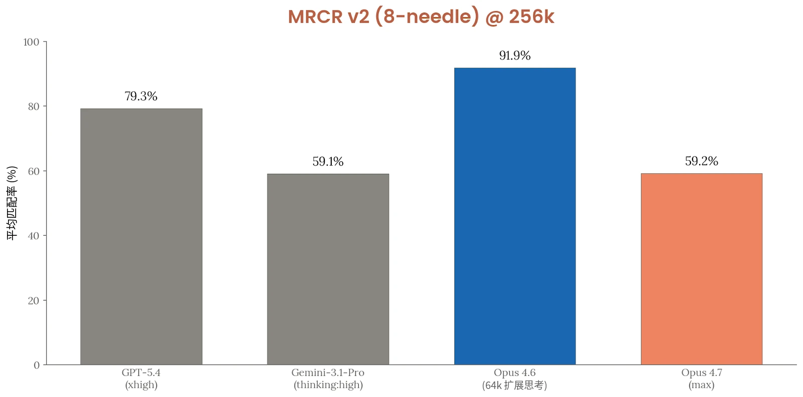

***[图 8.7.2.A] Claude Opus 4.7 在 256 token 下的长上下文理解与精确顺序推理表现**，通过 OpenAI MRCR v2 8 needles 测量。*



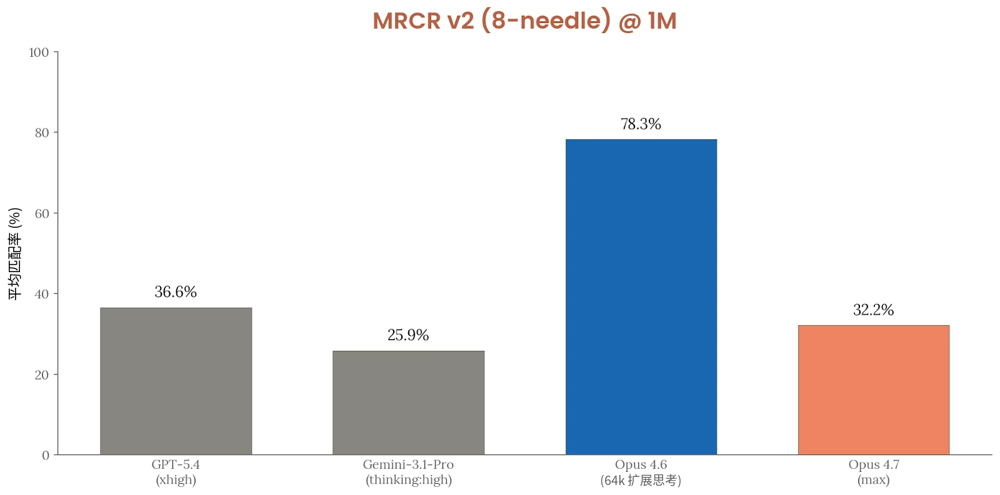

***[图 8.7.2.B] Claude Opus 4.7 在 100 万 token 下的长上下文理解与精确顺序推理表现**，通过 OpenAI MRCR v2 8 needles 测量。*

### 8.8 智能体搜索

#### 8.8.1 Humanity’s Last Exam

Humanity’s Last Exam（HLE）是一个处于人类知识前沿的多模态基准测试，包含 2,500 道题目。

我们在两种配置下测试了 Opus 4.7：(1) 不使用工具的纯推理；(2) 使用网络搜索、网页抓取、程序化工具调用和代码执行。在所有运行中，思考均设置为 auto，且跨上下文使用的 token 总数上限为 100 万。与下文其他智能体搜索结果不同，这些结果未使用上下文压缩（context compaction）。Claude Opus 4.6 担任评分模型。

为防止使用工具的变体中出现结果污染，我们在搜索器与抓取器中均屏蔽了已知讨论 HLE 的来源（见附录 8.2）。我们还使用 Claude Opus 4.6 审查所有对话记录，并标记任何看似从 HLE 专门来源中检索到答案的对话记录；经确认的情况将被重新判为错误。

在 max 推理强度下，Opus 4.7 不使用工具时得分 46.9%，使用工具时得分 54.7%。



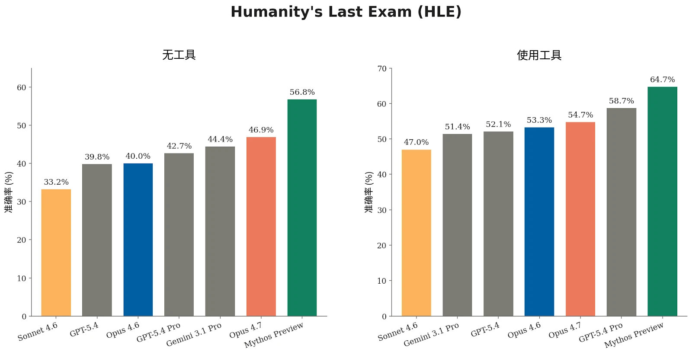

***[图 8.8.1.A] HLE 准确率得分**。Gemini 和 GPT 模型的分数取自已发布的结果。*

我们还测量了 Opus 4.7 在使用工具时于不同推理强度档位下的结果。

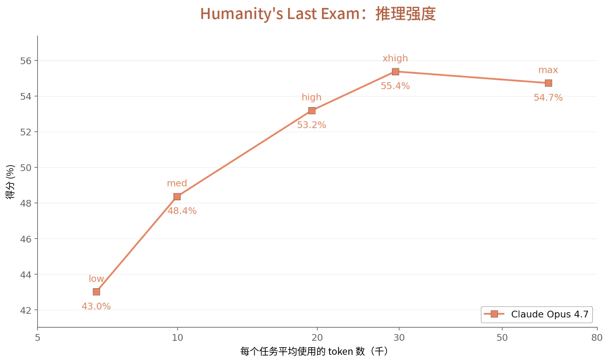

***[图 8.8.1.B] 不同推理强度档位下的 HLE 得分**。每个数据点代表每个模型在不同推理强度档位下的单次运行，所用 token 总数最多为 100 万。*



#### 8.8.2 BrowseComp

BrowseComp测试智能体在开放网络上查找难以定位的信息的能力。我们在使用网络搜索、网页抓取、程序化工具调用和代码执行的条件下运行了 Opus 4.7。在关闭思考、max 推理强度且 token 上限为 1000 万的条件下，Opus 4.7 得分 79.3%。我们使用上下文压缩（在 200k token 时触发）以突破 100 万 token 的上下文窗口。我们发现，对该模型而言，自适应思考在这一基准测试上的表现略差。

我们注意到，在该基准测试上，Opus 4.6 的测试时计算扩展曲线优于 Opus 4.7，并在 BrowseComp 上取得了更高的分数（在 1000 万 token 上限下为 83.7% 对 79.3%）。不过，如其他章节所示，Opus 4.7 在搜索类基准测试上通常比 Opus 4.6 更节省 token，因此我们建议用户针对各自的具体用例对两个模型都进行试验。

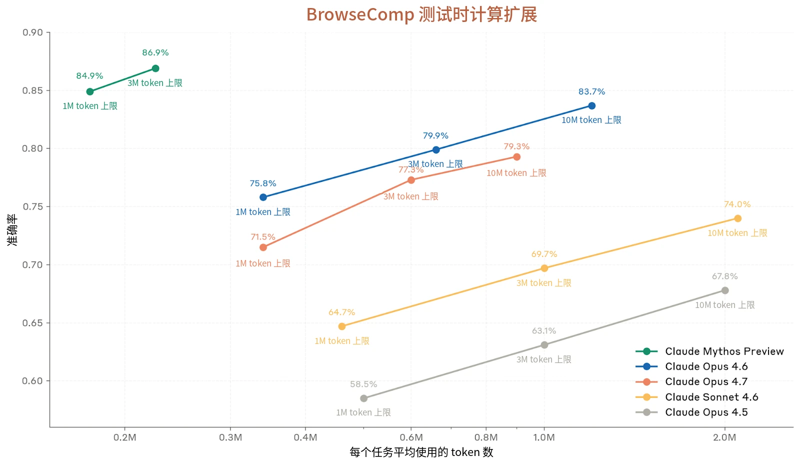

***[图 8.8.2.A] BrowseComp 准确率**随着我们在上下文压缩的辅助下提高模型可使用的 token 总数而提升。*



#### 8.8.3 DeepSearchQA

DeepSearchQA是“一个包含 900 个提示词的基准测试，用于评估智能体在横跨 17 个不同领域的高难度多步信息检索任务上的表现”。其任务要求模型进行大量搜索，以汇总出一份详尽的答案列表。

Claude 模型在启用网络搜索、网页抓取、程序化工具调用、上下文压缩、max 推理强度和自适应思考的条件下运行。我们使用了上下文压缩：对 Claude Mythos Preview 和 Claude Opus 4.7 在 200k token 时触发，而 Claude Opus 4.6 的上下文压缩在 50k token 时触发。

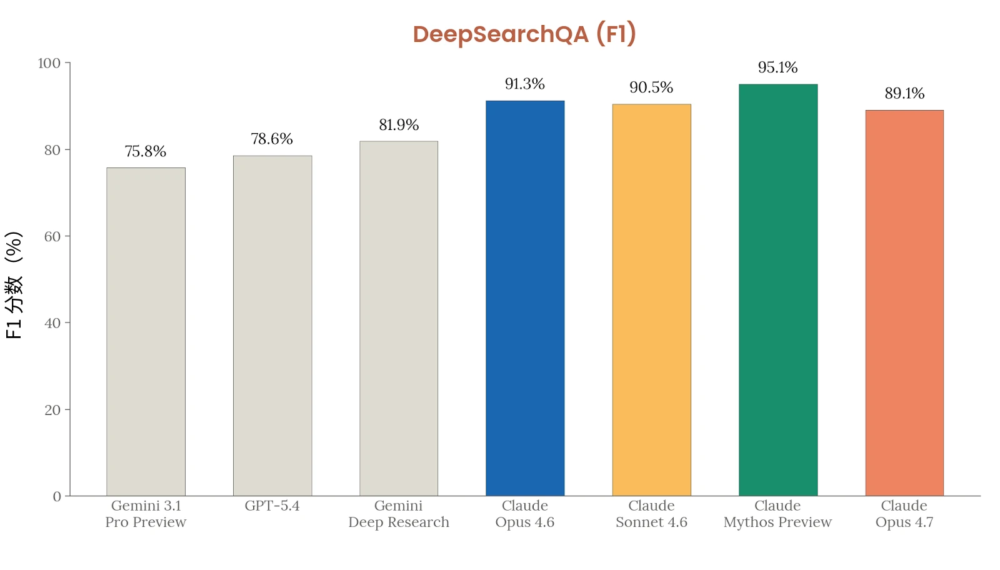

***[图 8.8.3.A] DeepSearchQA F1 分数**。图中所示为 F1 分数。Gemini 和 GPT 模型由独立第三方[Kaggle](https://www.kaggle.com/benchmarks/google/dsqa)运行。Claude 模型在上下文压缩下运行，token 总数最多为 1000 万。对 Sonnet 4.6、Opus 4.7 和 Mythos Preview，上下文压缩在 200k token 时触发，而对 Opus 4.6 则在 50k 时触发。*



| **模型** | **F1** | **完全正确** | **完全错误** | **正确但答案过多** |
|---|---|---|---|---|
| **Claude Mythos Preview** | 95.1% ±1.2% | 87.8% ±2.1% | 2.6% ±1.0% | 4.6% ±1.4% |
| **Claude Opus 4.6** | 91.3% ±1.6% | 80.6% ±2.6% | 5.0% ±1.4% | 5.8% ±1.5% |
| **Claude Sonnet 4.6** | 90.5% ±1.6% | 79.8% ±2.6% | 5.1% ±1.4% | 5.9% ±1.5% |
| **Claude Opus 4.7** | 89.1% ±1.8% | 80.7% ±2.6% | 7.0% ±1.7% | 3.9% ±1.3% |

***[表 8.8.3.B] Claude 模型的 DeepSearchQA 结果，按结果类别细分。**&#8203;评估设置见图 8.8.3.A。*

**推理强度** 我们针对 Claude Opus 4.6、Opus 4.7、Claude Sonnet 4.6 和 Mythos Preview 可用的所有推理强度档位运行了 DeepSearchQA，上下文压缩下的 token 总数最多为 300 万。请注意，上文图 8.8.3.A 使用的 token 总数最多为 1000 万，而 Opus 4.7 在 max 推理强度下 300 万与 1000 万 token 时的表现差异在噪声范围内。

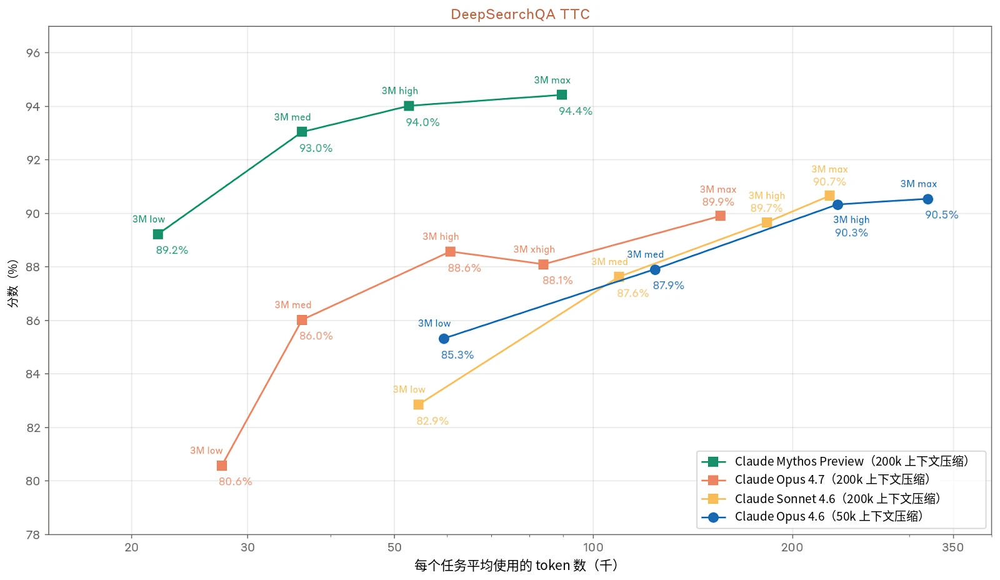

***[图 8.8.3.B] 不同推理强度档位下的 F1 分数**。每个数据点代表每个模型在不同推理强度档位下的单次运行，采用上下文压缩，跨上下文使用的 token 总数最多为 300 万。*



#### 8.8.4 DRACO

Deep Research Accuracy, Completeness, and Objectivity（DRACO）基准测试是 Perplexity 推出的一个深度研究基准，旨在评估模型在真实用户会提出的那类复杂研究问题上的表现。DRACO 由 100 个精选任务组成，这些任务源自多个领域的真实用户查询。题目依据专家编写的评分细则进行评分，细则涵盖四个类别：事实准确性、分析的广度与深度、呈现质量以及引用质量。

我们在使用网络搜索、网页抓取、程序化工具调用和代码执行的条件下评估了 Claude 模型。在开启自适应思考、max 推理强度且 token 上限为 100 万的条件下，Opus 4.7 得分 77.7%。我们使用了上下文压缩（在 200k token 时触发）。

**评分方法** DRACO 原论文使用 Gemini-3-Pro 作为主要评判模型，但该模型已不再可用。在我们的评估中，我们使用 Opus 4.6 作为 LLM 评判模型（LLM judge），依据各任务的评分细则对回答进行评分，采用相同的二元 MET/UNMET 判定，并按论文 §4.2 的公式汇总为归一化分数。我们遵循论文的实验方案，对每个回答进行 5 次独立的评分运行并报告平均值。我们的评判提示词取自论文附录 C.2。论文附录 A 表明，评判模型的选择可能使绝对分数变动 10–25 分，但系统排序保持不变，因此我们的分数与论文的主要公布数字不能直接比较。

我们与原论文有两点不同：(1) 我们使用 Claude Opus 4.6 作为评判模型，而论文的主要评判模型是 Gemini-3-Pro（此后已弃用）；(2) 我们指示模型将其最终报告包裹在`<result>`标签中，并仅对该部分进行评分，而不是对完整的智能体对话记录评分；这样可以将交付物与中间工具输出隔离开来。



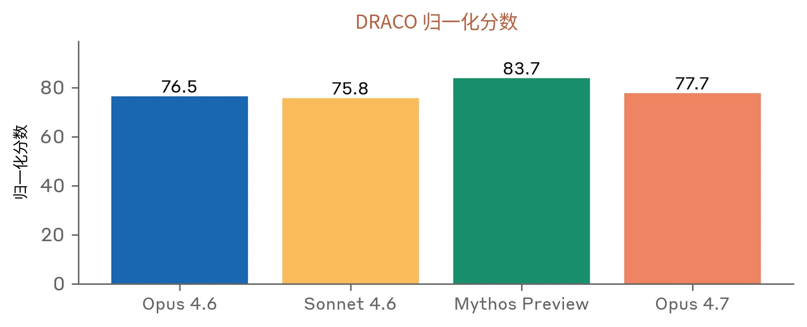

***[图 8.8.4.A] DRACO 归一化分数**。这些分数代表每个模型的单次运行，每个分数为以 Opus 4.6 作为评判模型进行五次评分运行的平均值。*

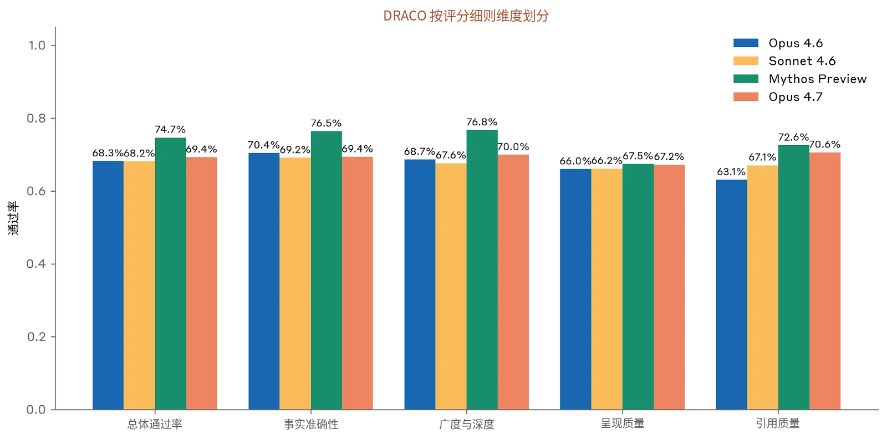

***[图 8.8.4.B] 按评分细则维度划分的 DRACO 通过率。**&#8203;Opus 4.7 相对于 Opus 4.6 的提升集中在分析的广度与深度以及引用质量上，而事实准确性和呈现质量大致保持不变。*

### 8.9 多模态

Claude Opus 4.7 支持的最大图像分辨率为单一图像维度上最多 2576px、总计最多 3.75MP。包括 Claude Mythos Preview 和 Claude Opus 4.6 在内的先前模型支持的最大图像分辨率为单一图像维度上最多 1568px、总计最多 1.15MP。在 Claude Opus 4.7 系统卡中，除非另有说明，我们报告的各模型分数均使用其支持的最大图像分辨率。



#### 8.9.1 LAB-Bench FigQA

LAB-Bench FigQA 是一个视觉推理基准测试，用于测试模型能否正确解读和分析生物学研究论文中复杂科学图表所含的信息。该基准测试是由 FutureHouse 开发的 Language Agent Biology Benchmark（LAB-Bench）的一部分，后者评估 AI 在实际科学研究任务上的能力。

在开启自适应思考、max 推理强度且不使用工具的条件下，Claude Opus 4.7 在 FigQA 上取得了 78.6% 的分数。在开启自适应思考、max 推理强度并使用 Python 工具的条件下，Claude Opus 4.7 取得了 86.4% 的分数。在两种设置下，Claude Opus 4.7 均优于 Claude Opus 4.6，后者的得分分别为 58.5% 和 75.1%。

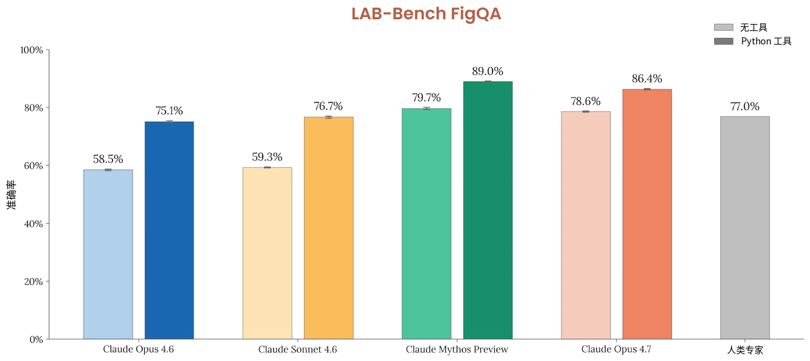

***[图 8.9.1.A] LAB-Bench FigQA 得分。**&#8203;模型在开启自适应思考和 max 推理强度的条件下进行评估，分别使用和不使用 Python 工具。人类专家基线按 LAB-Bench 原论文中报告的数据显示。分数为五次运行的平均值。图中显示 95% 置信区间。*

我们观察到，提高 Claude Opus 4.7 可处理的最大图像分辨率后，其在 LAB-Bench FigQA 上有显著提升。此前为满足原最大分辨率（单一轴向 1568px、总计 1.15MP）而被下采样的评估图像，如今下采样程度显著降低（单一轴向 2576px、总计 3.75MP），与先前模型相比，Opus 4.7 能保留显著更多的细节与保真度。在开启自适应思考、max 推理强度且不使用工具时，准确率从 74.0% 升至 78.6%。在使用 Python 工具时，提高最大图像分辨率使 Claude Opus 4.7 的分数从 85.8% 升至 86.4%。



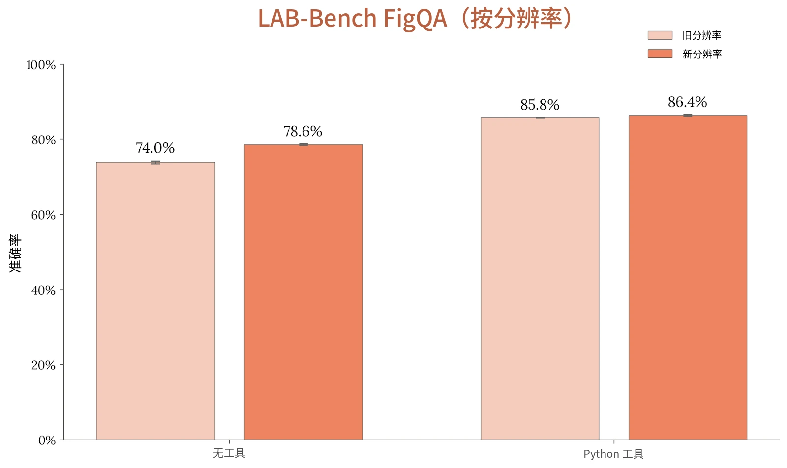

***[图 8.9.1.B] 按分辨率划分的 LAB-Bench FigQA 得分。**&#8203;Claude Opus 4.7 在开启自适应思考和 max 推理强度的条件下进行评估，分别使用和不使用 Python 工具。旧分辨率得分将图像缩放至单一维度最大 1568px、总计最多 1.15MP。新分辨率得分将图像缩放至单一维度最大 2576px、总计最多 3.75MP。分数为五次运行的平均值。图中显示 95% 置信区间。*

#### 8.9.2 CharXiv Reasoning

CharXiv Reasoning 是一个全面的图表理解评估套件，由取自 arXiv 论文的 2,323 张真实世界图表构建而成，涵盖八个主要科学学科。该基准测试考察模型能否综合复杂科学图表中的视觉信息，以回答需要多步推理的问题。

我们在验证集的 1,000 道题目上评估该模型，并对五次运行的分数取平均。在开启自适应思考、max 推理强度且不使用工具的设置下，Claude Opus 4.7 在 CharXiv Reasoning 上得分 82.1%。在开启自适应思考、max 推理强度并使用 Python 工具的设置下，Claude Opus 4.7 得分 91.0%。Claude Opus 4.6 在相同设置下分别得分 69.1% 和 84.7%。



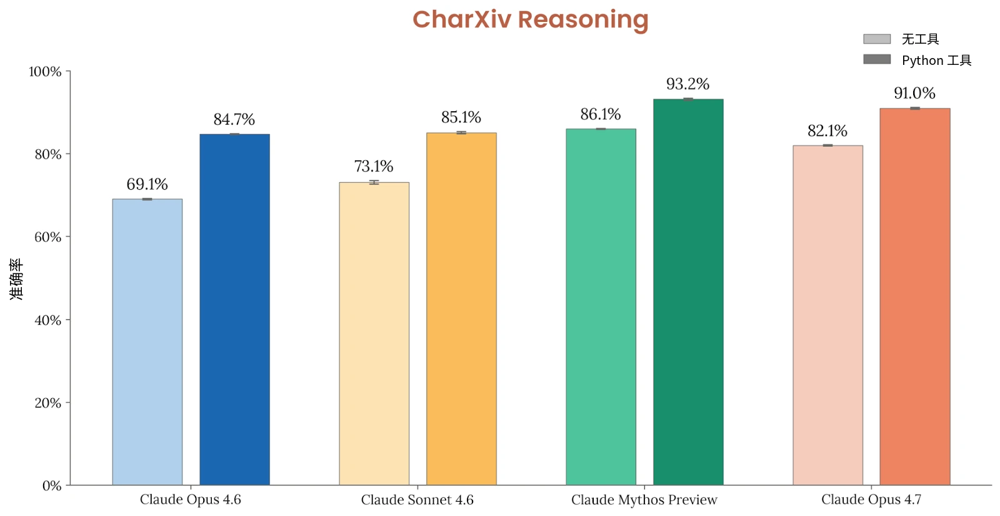

***[图 8.9.2.A] CharXiv Reasoning 分数。**&#8203;各模型在自适应思考和 max 推理强度下评估，分别在使用与不使用 Python 工具的条件下进行。分数为五次运行的平均值。图中显示 95% 置信区间。*

#### 8.9.3 ScreenSpot-Pro

ScreenSpot-Pro 是一个 GUI 定位基准测试，考察模型能否根据自然语言指令，在专业桌面应用程序的高分辨率截图中精确定位特定的用户界面元素。该基准测试包含 1,581 个由专家标注的任务，涵盖 23 个专业应用程序（包括 IDE、CAD 软件和创意工具），横跨三种操作系统，目标元素平均占屏幕面积不到 0.1%。

在开启自适应思考、max 推理强度且不使用工具的设置下，Claude Opus 4.7 在 ScreenSpot-Pro 上得分 79.5%。在开启自适应思考、max 推理强度并使用 Python 工具的设置下，Claude Opus 4.7 得分 87.6%。在相同设置下，Claude Opus 4.6 分别得分 57.7% 和 83.1%。



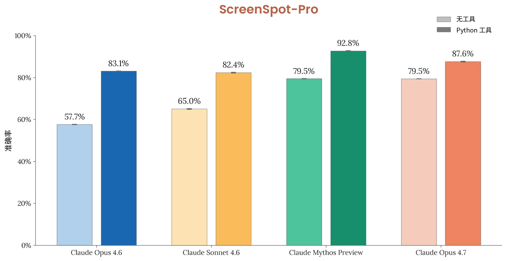

***[图 8.9.3.A] ScreenSpot-Pro 分数。**&#8203;各模型在自适应思考和 max 推理强度下评估，分别在使用与不使用 Python 工具的条件下进行。分数为五次运行的平均值。图中显示 95% 置信区间。*

我们还观察到，提高最大图像分辨率使 ScreenSpot-Pro 上的分数显著提升；该基准测试主要由超出我们以往模型图像分辨率上限的高分辨率图像构成。在 max 推理强度的自适应思考下，Claude Opus 4.7 不使用 Python 工具时得分 79.5%，使用 Python 工具时得分 87.6%。在较低的图像分辨率下，Claude Opus 4.7 分别得分 69.0% 和 85.9%。



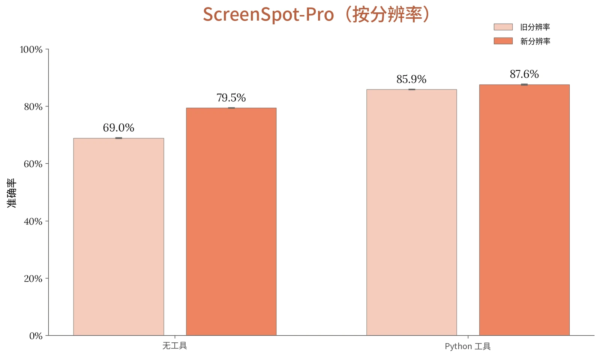

***[图 8.9.3.B] 按分辨率划分的 ScreenSpot-Pro 分数。**&#8203;Claude Opus 4.7 在自适应思考和 max 推理强度下评估，分别在使用与不使用 Python 工具的条件下进行。旧分辨率分数将图像缩放至单边最大 1568px、总计最多 1.15MP。新分辨率分数将图像缩放至单边最大 2576px、总计最多 3.75MP。分数为五次运行的平均值。图中显示 95% 置信区间。*

#### 8.9.4 OSWorld

OSWorld 是一个多模态基准测试，评估智能体通过鼠标和键盘操作与一台运行中的 Ubuntu 虚拟机交互、完成真实世界计算机任务（例如编辑文档、浏览网页和管理文件）的能力。我们沿用默认设置：分辨率为 1080p，每个任务最多 100 个操作步数。

Claude Opus 4.7 的 OSWorld 得分为 78.0%（首次尝试成功率，五次运行的平均值）。



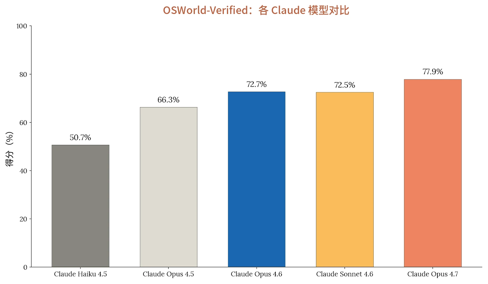

***[图 8.9.4.A] OSWorld-Verified 分数。**&#8203;在 1080p 分辨率、最多 100 个操作步数下的首次尝试任务成功率。分数为五次运行的平均值。*

在本次评估中，我们对智能体脚手架进行了更新，包括基础设施稳定性修复和少量提示词改进。这些改进包括：引导模型将可预测的操作批量合并到单次工具调用中；尽早声明任务不可行，而不是尝试变通办法；以及在每一轮次中让模型知晓剩余的步数预算。这些脚手架改动统一应用于所有模型。在相同设置下重新运行 Claude Opus 4.6 得到 72.6%，与其此前[报告](https://www-cdn.anthropic.com/bbd8ef16d70b7a1665f14f306ee88b53f686aa75.pdf#page=19)的 72.7% 相差在运行间噪声范围内，表明该设置本身不会为以往的 Claude 模型带来有意义的提升。



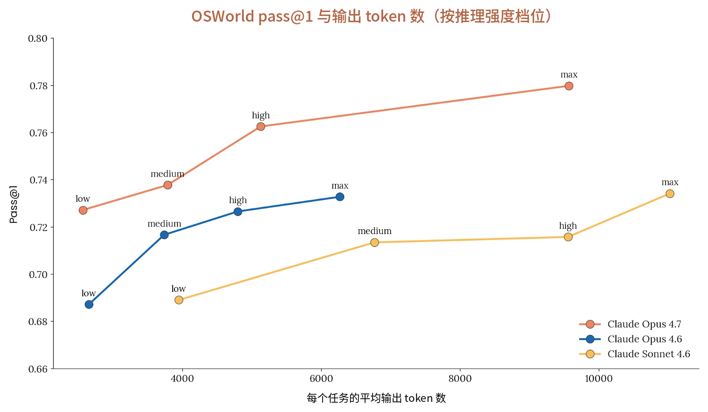

***[图 8.9.4.B] 各模型在四个推理强度档位下的 OSWorld-Verified pass@1 与每任务平均输出 token 数的关系。**&#8203;推理强度控制模型投入的努力程度。本图所示的所有分数均使用上文所述的更新后智能体脚手架。其余评估设置与图 8.9.4.A 相同。*

### 8.10 真实世界专业任务

#### 8.10.1 OfficeQA

OfficeQA 是一个基准测试，用于评估语言模型在真实的办公类问答任务上的表现，这些任务源自知识工作者日常处理的文档、电子表格和演示文稿。任务要求模型阅读冗长且异构的专业文档，并回答依赖于精确信息提取、跨章节综合以及数值或表格推理的问题。Claude Opus 4.7 在 OfficeQA 上得分 86.3%，在 OfficeQA Pro 上得分 80.6%，两者均采用精确匹配评分（允许的相对误差为 0%）。



#### 8.10.2 Finance Agent

Finance Agent 是由 Vals AI 发布的公开基准测试，评估模型针对上市公司向美国证券交易委员会（SEC）提交的文件开展研究的表现。Vals AI 在该基准测试上对 Claude Opus 4.7 进行了评估（使用自适应思考和 high 推理强度），发现 Claude Opus 4.7 得分 64.4%，这一成绩将高于该基准测试上目前的所有模型。

#### 8.10.3 MCP Atlas

MCP-Atlas 评估语言模型通过[Model](https://modelcontextprotocol.io/docs/getting-started/intro) [Context Protocol](https://modelcontextprotocol.io/docs/getting-started/intro)（MCP）进行真实世界工具使用的表现。该基准测试衡量模型执行多步工作流的能力——发现合适的工具、正确调用它们，并将结果综合为准确的回答。任务涉及在接近生产环境的 MCP 服务器环境中进行多次工具调用，要求模型使用真实的 API 和真实数据、处理错误与重试，并在不同服务器之间进行协调。

Scale AI 在自适应思考和 max 推理强度下评估了 Claude Opus 4.7，发现其通过率（Pass Rate）为 77.3%，高于 Opus 4.6 的 75.8%，在公开排行榜上位列第 2。在 Scale 运行的扩展配置中（256 个轮次 / 100 个工具，而排行榜为 20 个轮次 / 10–25 个工具），Opus 4.7 达到 79.5%（max；high 下为 79.7%），表明在更大的工具调用预算下仍有提升空间。

关于与此前 MCP-Atlas 结果可比性的说明：2026 年 4 月，Scale 更新了运行框架（升级了评判模型并改进了重试处理），并对排行榜重新评分。此处所有分数均使用更新后的运行框架。基于旧运行框架的 Opus 结果不具可比性。

#### 8.10.4 VendingBench

Vending-Bench 2 是[Andon Labs](https://andonlabs.com/evals/vending-bench-2)推出的基准测试，衡量 AI 模型在长时间跨度内经营一项业务的表现。请注意，与我们在[Project Vend](https://www.anthropic.com/research/project-vend-2)中开展的真实世界实验不同，Vending-Bench 是纯模拟评估。

模型的任务是以 500 美元的初始余额，经营一项模拟的自动售货机业务一年。评分依据是其最终的银行账户余额，这要求它们



在数千项业务决策中展现出持续的连贯性和战略规划能力。为了取得好成绩，模型必须成功地通过电子邮件寻找供应商并与之谈判、管理库存、优化定价，并适应动态的市场条件。

Claude Opus 4.7 以 Max 和 High 两个推理强度档位运行。Vending-Bench 有自己的上下文管理系统，这意味着 Claude 的上下文编辑功能未被启用。Opus 4.7 在 Max 推理强度下的最终余额为 10,937 美元，在 High 推理强度下为 7,971 美元，而此前的 SOTA（最先进水平）为 Opus 4.6 的 8,018 美元。

#### 8.10.5 GDPval-AA

GDPval-AA 由[Artificial Analysis](https://artificialanalysis.ai/)开发，是一个独立的评估框架，用于在具有经济价值的真实世界专业任务上测试 AI 模型。该基准测试使用 OpenAI 的[GDPval 黄金数据库](https://huggingface.co/datasets/openai/gdpval)中的 220 个任务，涵盖 9 个主要行业的 44 种职业。任务反映了真实的专业工作成果，包括文档、幻灯片、图表和电子表格。模型在智能体循环中获得 shell 访问权限和网页浏览能力来完成任务，表现通过基于模型输出盲评两两比较得出的 Elo 评分来衡量。

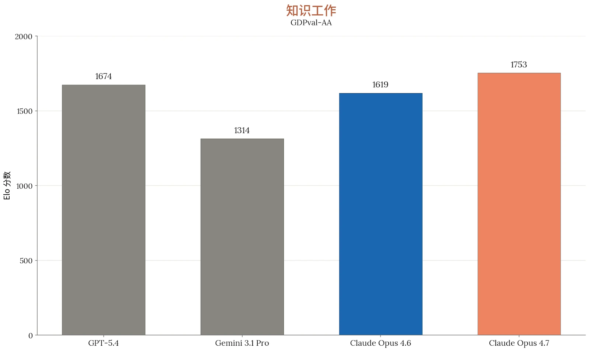

***[图 8.10.5.A] GDPval-AA Elo 评分。**&#8203;Claude Opus 4.7 领先 GPT-5.4（‘xhigh’）约 79 个 Elo 分，意味着约 61.2% 的两两比较胜率。评估由 Artificial Analysis 独立运行。*



### 8.11 ARC-AGI

ARC-AGI 是由 ARC Prize Foundation 开发的流体智力基准测试，旨在衡量 AI 模型在仅给出少量（通常 2–3 个）示例的情况下对新颖模式进行推理的能力。模型会获得若干满足某种隐藏关系的网格输入-输出对，任务是推断出新输入网格所对应的输出。该基准测试有两个变体：ARC-AGI-1 和 ARC-AGI-2。（ARC Prize Foundation 还有另一个 ARC-AGI-3 基准测试，截至发布时尚未在该模型上运行。）这些测试使用私有验证集，以确保不同模型之间的一致性和公平性。

在 ARC-AGI-1 上，Claude Opus 4.7 的表现与 Opus 4.6 相近，在 High 推理强度档位下达到 93.5%，而 Opus 4.6 为 94.0%。两个模型在该推理强度档位下的得分均高于 Max。我们认为，这是由于在最高思考档位下出现了上下文耗尽。

在 ARC-AGI-2 上，Claude Opus 4.7 以 Max 思考档位下 75.83% 的成绩创下 Opus 级模型的新高分。在较低的思考档位下，它的表现与 Opus 4.6 相当。



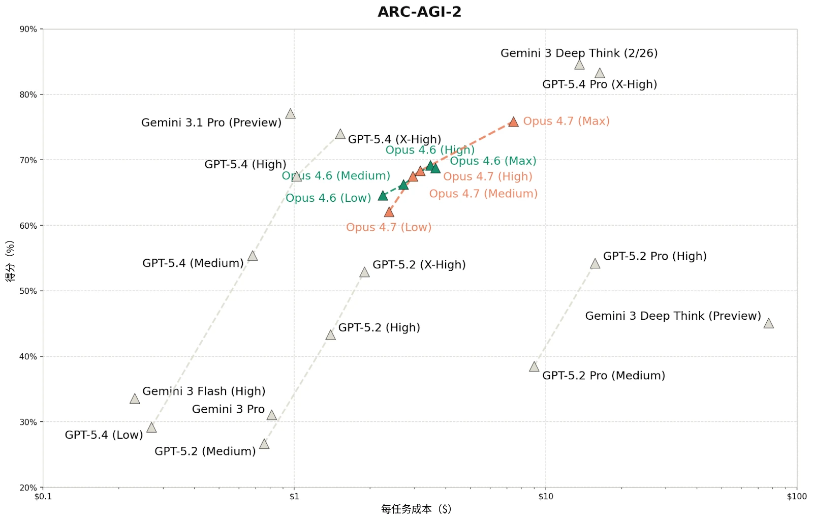

***[图 8.11.A] 不同推理强度档位下的 ARC-AGI-2 表现。**&#8203;在 ARC-AGI-2 上，Claude Opus 4.7 以 Max 思考档位下 75.83% 的成绩创下 Opus 级模型的新高分。*

### 8.12 多语言表现

我们在三个多语言基准测试上评估了 Claude Opus 4.7，即 Cohere Labs 的 Global MMLU（GMMLU） 和 INCLUDE 基准测试，以及 AI4Bharat 的 Multi-task Indic Language Understanding Benchmark（MILU），以评估该模型在广泛语言上的表现。这些评估补充了表 8.1.A 中报告的 MMMLU 汇总分数，提供了更细粒度的多语言表现视图，尤其是对于相较英语表现下降最为明显的低资源语言。

GMMLU 将标准 MMLU 评估扩展到 42 种语言，涵盖不同语系和资源水平，从法语、德语等高资源语言到约鲁巴语、伊博语和齐切瓦语等低资源语言。MILU 专门



关注 10 种印度语言（孟加拉语、古吉拉特语、印地语、卡纳达语、马拉雅拉姆语、马拉地语、奥里亚语、旁遮普语、泰米尔语和泰卢固语）以及英语，测试植根文化背景的知识理解。INCLUDE 涵盖 44 种语言，题目取自各地区的学术和职业考试，强调语言内与文化内知识，而非翻译内容。

所有模型均使用结构化 JSON 输出进行评估。Gemini 3.1 Pro 以默认 high 档位的动态思考进行评估。GPT-5.4 在推理强度设为 high 的情况下进行评估。Claude Opus 4.7 在开启自适应思考的情况下进行评估。Claude Opus 4.6 和 Claude Sonnet 4.6 在 INCLUDE 上使用自适应思考，在 GMMLU 和 MILU 上使用中等扩展思考（extended thinking）预算进行评估。

#### 8.12.1 GMMLU 结果

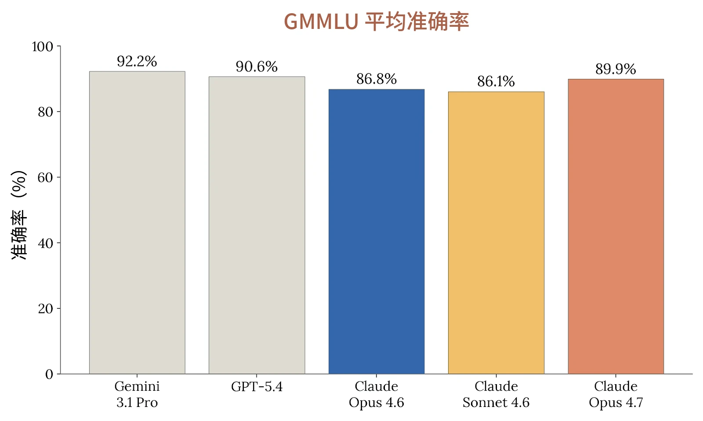

***[图 8.12.1.A] GMMLU 平均准确率。**&#8203;Claude Opus 4.7 在所有评估语言上的平均准确率为 89.9%。*



| **评估** | **Claude 系列模型** |  |  |  | **其他模型** |  |
|---|---|---|---|---|---|---|
|  | **Claude Opus 4.7** |  | **Claude Opus 4.6** | **Claude Sonnet 4.6** | **Gemini 3.1 Pro** | **GPT-5.4** |
|  | ***准确率*** | ***与英语的差距*** |  |  |  |  |
| **英语** | 93.4% | 0.0% | 92.8% | 91.8% | **94.3%** | 93.3% |
| **高资源语言平均** | 91.5% | -1.9% | 90.7% | 89.2% | **93.1%** | 91.5% |
| **中资源语言平均** | 91.1% | -2.3% | 89.6% | 88.2% | **92.9%** | 91.4% |
| **低资源语言平均** | 86.2% | -7.3% | 78.4% | 79.2% | **90.3%** | 88.3% |
| **伊博语** | 81.3% | -12.1% | 70.1% | 71.9% | **89.3%** | 86.4% |
| **约鲁巴语** | 82.9% | -10.5% | 70.8% | 76.9% | **88.4%** | 83.8% |
| **索马里语** | 84.1% | -9.3% | 72.0% | 75.5% | **90.5%** | 88.7% |
| **马达加斯加语** | 84.8% | -8.6% | 78.6% | 78.4% | **90.7%** | 88.8% |
| **齐切瓦语** | 84.9% | -8.5% | 71.2% | 72.0% | **89.2%** | 86.7% |
| **豪萨语** | 85.7% | -7.7% | 77.7% | 79.0% | **89.9%** | 87.6% |
| **绍纳语** | 85.8% | -7.6% | 76.3% | 75.7% | **90.4%** | 88.3% |
| **吉尔吉斯语** | 87.9% | -5.6% | 81.9% | 81.4% | 88.1% | **89.7%** |
| **阿姆哈拉语** | 88.2% | -5.3% | 84.0% | 83.6% | **91.0%** | 89.1% |
| **斯瓦希里语** | 88.6% | -4.8% | 84.6% | 83.4% | **91.3%** | 89.2% |
| **僧伽罗语** | 89.5% | -4.0% | 85.9% | 85.9% | **92.5%** | 90.6% |
| **尼泊尔语** | 90.1% | -3.3% | 87.6% | 87.3% | **92.6%** | 90.9% |
| **平均（所有语言）** | 89.9% | -3.6% | 86.8% | 86.1% | **92.2%** | 90.6% |
| **与英语的平均差距** | — | -3.6% | -6.1% | -5.9% | **-2.1%** | -2.7% |



| **与英语的最大差距** | — | -12.1% | -22.6% | -19.9% | **-6.2%** | -9.5% |
|---|---|---|---|---|---|---|

***[表 8.12.1.B] 按资源层级划分的 GMMLU 结果。**&#8203;英语作为基线列出。高资源和中资源层级报告的是未加权平均准确率；低资源语言单独列出，并按 Claude Opus 4.7 的表现排序。总体平均包含英语得分。与英语的平均差距不包含英语得分。分数反映的是在成功解析的回答上的准确率；一小部分 API 调用产生了无效输出，已被排除。每行中的最高分以粗体标出。高资源语言（15 种）：法语、德语、西班牙语、葡萄牙语、俄语、中文、日语、阿拉伯语、意大利语、荷兰语、韩语、波兰语、土耳其语、瑞典语、捷克语。中资源语言（14 种）：印地语、越南语、印度尼西亚语、波斯语、希腊语、希伯来语、罗马尼亚语、乌克兰语、塞尔维亚语、菲律宾语、马来语、孟加拉语、立陶宛语、泰卢固语。*

#### 8.12.2 MILU 结果

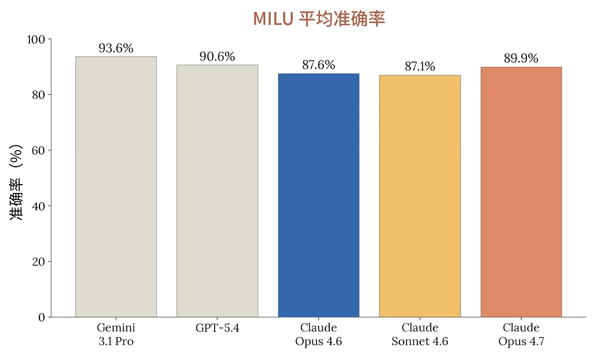

***[图 8.12.2.A] MILU 平均准确率。**&#8203;Claude Opus 4.7 在所有评估语言上的平均准确率为 89.9%。*



| **评估** | **Claude 系列模型** |  |  |  | **其他模型** |  |
|---|---|---|---|---|---|---|
|  | **Claude Opus 4.7** |  | **Claude Opus 4.6** | **Claude Sonnet 4.6** | **Gemini 3.1 Pro** | **GPT-5.4** |
|  | ***准确率*** | ***与英语的差距*** |  |  |  |  |
| **英语** | 92.4% | 0.0% | 90.5% | 89.7% | **95.3%** | 92.9% |
| **马拉雅拉姆语** | 87.3% | -5.1% | 85.3% | 84.8% | **91.3%** | 88.1% |
| **旁遮普语** | 87.7% | -4.7% | 85.6% | 85.2% | **91.9%** | 88.7% |
| **奥里亚语** | 87.8% | -4.5% | 85.3% | 84.9% | **92.1%** | 89.6% |
| **泰米尔语** | 89.0% | -3.4% | 85.9% | 85.1% | **93.7%** | 90.5% |
| **马拉地语** | 89.5% | -2.8% | 86.8% | 86.3% | **93.0%** | 90.2% |
| **古吉拉特语** | 89.7% | -2.7% | 87.2% | 86.5% | **93.1%** | 89.7% |
| **泰卢固语** | 90.1% | -2.3% | 87.3% | 86.5% | **93.6%** | 90.4% |
| **孟加拉语** | 91.3% | -1.0% | 89.0% | 88.8% | **94.1%** | 91.1% |
| **卡纳达语** | 91.6% | -0.7% | 90.0% | 89.4% | **94.9%** | 91.8% |
| **印地语** | 93.0% | +0.6% | 90.8% | 90.5% | **96.8%** | 93.9% |
| **平均（所有语言）** | 89.9% | -2.4% | 87.6% | 87.1% | **93.6%** | 90.6% |
| **与英语的平均差距** | — | -2.7% | -3.2% | -2.9% | **-1.9%** | -2.5% |
| **与英语的最大差距** | — | -5.1% | -5.2% | -4.9% | **-4.0%** | -4.9% |

***[表 8.12.2.B] 按语言划分的 MILU 结果。**&#8203;分数表示 Multi-task Indic Language Understanding Benchmark 中 10 种印度语言及英语上的准确率。分数反映的是在成功解析的回答上的准确率；一小部分 API 调用产生了无效输出，已被排除。“与英语的差距”列显示与 Claude Opus 4.7 英语得分的差值；正值表示模型在该语言上的表现超过了其英语基线。“平均”行除 10 种印度语言外还包含英语。“与英语的平均差距”行不包含英语与英语之间的差距（0.0%）。每行中的最高分以粗体标出。*



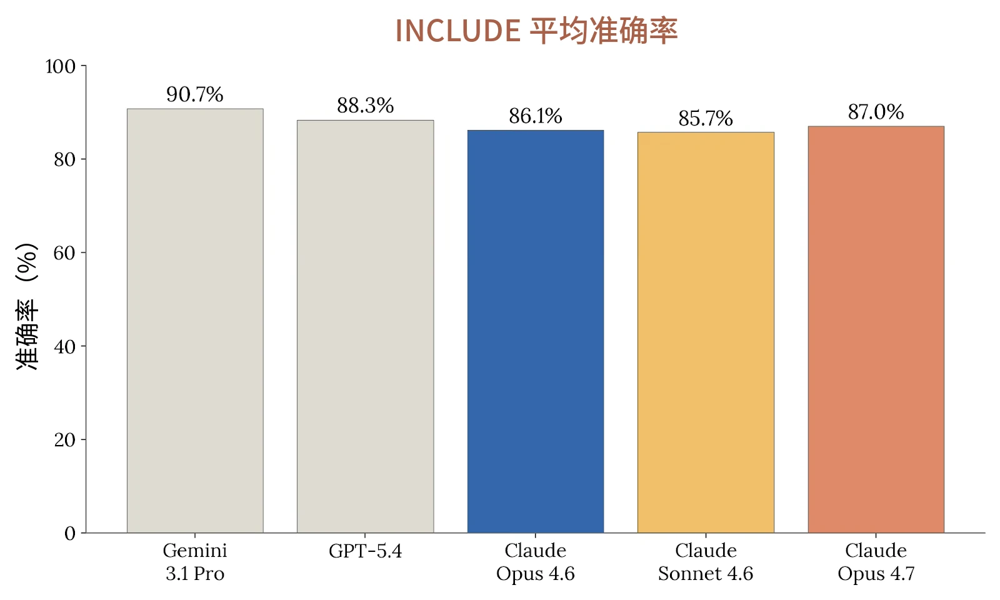

| **评估** | **Claude 系列模型** |  |  | **其他模型** |  |
|---|---|---|---|---|---|
|  | **Claude Opus 4.7** | **Claude Opus 4.6** | **Claude Sonnet 4.6** | **Gemini 3.1 Pro** | **GPT-5.4** |
| **德语** | 69.8% | 74.1% | 71.2% | **76.3%** | 74.1% |
| **土耳其语** | 70.2% | 70.6% | 71.2% | 70.9% | **71.3%** |
| **乌尔都语** | 74.5% | 67.0% | 72.8% | **84.9%** | 77.3% |
| **乌兹别克语** | 79.1% | 77.9% | 79.8% | 82.4% | **83.8%** |
| **泰卢固语** | 79.5% | 77.9% | 77.1% | **87.8%** | 80.5% |
| **尼泊尔语** | 80.1% | 78.5% | 77.0% | **89.8%** | 85.8% |
| **巴斯克语** | 81.9% | 75.2% | 76.6% | **89.8%** | 86.0% |
| **阿塞拜疆语** | 82.2% | 80.3% | 80.0% | **85.4%** | 83.6% |

#### 8.12.3 INCLUDE 结果

***[图 8.12.3.A] INCLUDE 平均准确率。**&#8203;Claude Opus 4.7 在所有评估语言上的平均准确率为 87.0%。*



| **印地语** | 82.5% | 82.1% | 82.4% | **88.1%** | 83.8% |
|---|---|---|---|---|---|
| **俄语** | 83.7% | 83.9% | 83.2% | 84.4% | **84.8%** |
| **马拉雅拉姆语** | 84.4% | 83.4% | 83.0% | **90.4%** | 87.5% |
| **芬兰语** | 84.9% | 86.4% | 84.2% | **89.5%** | 86.9% |
| **波斯语** | 84.9% | 84.7% | 79.9% | **92.0%** | 84.9% |
| **亚美尼亚语** | 85.0% | 82.1% | 82.7% | **90.7%** | 87.7% |
| **匈牙利语** | 85.3% | 85.1% | 86.4% | **87.3%** | 84.9% |
| **阿拉伯语** | 85.5% | 85.9% | 84.2% | **90.0%** | 85.9% |
| **泰米尔语** | 85.6% | 83.8% | 85.1% | **95.5%** | 90.5% |
| **葡萄牙语** | 85.7% | 86.0% | 85.3% | **87.0%** | 84.7% |
| **哈萨克语** | 85.8% | 82.0% | 81.4% | **94.4%** | 90.8% |
| **印度尼西亚语** | 86.7% | 84.9% | 84.2% | **88.4%** | 85.1% |
| **韩语** | 86.8% | 83.2% | 84.5% | **88.4%** | 82.5% |
| **法语** | 87.5% | 87.8% | 87.8% | **90.0%** | 88.1% |
| **孟加拉语** | 87.6% | 87.6% | 88.3% | **92.5%** | 88.7% |
| **乌克兰语** | 87.9% | 88.9% | 88.7% | **91.5%** | 90.4% |
| **希伯来语** | 88.6% | 86.7% | 84.0% | **93.5%** | 89.8% |
| **希腊语** | 89.1% | 89.7% | 87.5% | **91.5%** | 89.7% |
| **荷兰语** | 89.2% | 91.3% | 89.5% | 90.9% | **91.5%** |
| **西班牙语** | 89.5% | 89.5% | 87.6% | **90.2%** | 87.8% |
| **白俄罗斯语** | 89.7% | 86.5% | 83.3% | **93.6%** | 92.7% |
| **他加禄语** | 89.8% | 89.0% | 89.6% | **91.8%** | 90.8% |
| **波兰语** | 90.0% | 89.6% | 88.7% | **94.3%** | 91.2% |
| **中文** | 90.9% | 91.6% | 91.6% | **92.7%** | 90.1% |
| **阿尔巴尼亚语** | 91.3% | 90.9% | 91.3% | **93.5%** | 92.0% |



| **马来语** | 91.4% | 89.4% | 88.6% | **94.0%** | 92.2% |
|---|---|---|---|---|---|
| **格鲁吉亚语** | 91.9% | 93.4% | 92.0% | **96.4%** | 94.2% |
| **马其顿语** | 92.9% | 94.0% | 93.3% | **94.7%** | 94.4% |
| **越南语** | 93.1% | 90.0% | 88.5% | **94.7%** | 91.6% |
| **保加利亚语** | 93.5% | 92.4% | 93.3% | **95.8%** | 94.7% |
| **克罗地亚语** | 93.6% | 93.3% | 92.4% | **93.8%** | 93.6% |
| **意大利语** | 94.0% | 93.2% | 94.0% | **95.1%** | 94.8% |
| **立陶宛语** | 94.0% | 94.4% | 94.2% | **95.5%** | 95.2% |
| **塞尔维亚语** | 95.2% | 95.5% | 95.3% | **96.4%** | 96.2% |
| **日语** | 95.9% | 96.0% | 95.0% | **97.4%** | 96.4% |
| **爱沙尼亚语** | 96.0% | 94.6% | 93.8% | 97.8% | **98.2%** |
| **平均（所有语言）** | 87.0% | 86.1% | 85.7% | **90.7%** | 88.3% |

***[表 8.12.3.B] 按语言划分的 INCLUDE 结果。**&#8203;分数表示模型在 44 种语言的源自各地区的考试题上的准确率。分数反映的是在成功解析的回答上的准确率；一小部分 API 调用产生了无效输出，已被排除。INCLUDE 不包含英语子集，因此结果以原始准确率报告，并按 Claude Opus 4.7 的表现排序，“平均”行给出所有语言的未加权平均值。每行中的最高分以粗体标出。*

#### 8.12.4 发现

Claude Opus 4.7 是迄今为止在多语言基准测试上表现最强的公开可用 Claude 模型，在 GMMLU、MILU 和 INCLUDE 评估上均优于 Claude Opus 4.6。

最大的提升出现在低资源非洲语言上，这些语言相对英语的性能下降历来最为明显。GMMLU 低资源语言平均准确率从 78.4% 升至 86.2%，其中齐切瓦语、索马里语、约鲁巴语和伊博语各提升了 10 至 14 个百分点（表 8.12.1.B）。与英语的最大差距从 -22.6% 缩小至 -12.1%（伊博语），平均差距从 -6.1% 缩小至 -3.6%。

与其他前沿模型相比，Claude Opus 4.7 落后于 Gemini 3.1 Pro 和 GPT-5.4；尤其是 Gemini 3.1 Pro，它在 GMMLU（-2.1%）和 MILU（-1.9%）上与英语的差距更小，且 INCLUDE 准确率更高（90.7%）。



这三个基准测试均采用多项选择形式，可能无法完全反映真实场景中的流利度、正式程度或语码转换行为。我们正在投入开发更具代表性的多语言评估，同时持续开展研究，以缩小低资源语言上仍然存在的差距。

### 8.13 生命科学能力

针对 Claude Opus 4.7，我们继续扩展评估，以衡量我们模型在计算生物学、结构生物学、有机化学、系统发育学和实验方案故障排查等领域的生命科学能力。这些评估由领域专家在内部开发，重点关注能够推动基础研究和药物研发中有益应用的能力，与第 2.2 节中侧重滥用潜力的 CB 风险评估（CB risk assessment）形成互补。

尽管这些评估未公开发布，我们在下文对每项评估作简要介绍。除实验方案故障排查外，在所有任务中 Claude 都可使用用于代码执行的 bash 工具以及用于安装所需库的包管理器，且评估时未开启扩展思考。在实验方案故障排查中，Claude 可使用 bash 工具和网络搜索工具。

#### 8.13.1 计算生物学

##### 8.13.1.1 BioPipelineBench Verified

评估执行生物信息学工作流的能力，涵盖靶向序列分析和长读长序列分析、宏基因组组装以及染色质谱分析等领域。我们已更新该评估，使其仅包含通过外部审阅人员验证检查的问题。Claude Opus 4.7 取得了 83.6% 的得分，相比 Claude Opus 4.6 的 78.8% 和 Claude Sonnet 4.6 的 73.5% 有显著提升。Claude Mythos Preview 取得了 88.1% 的高分。

##### 8.13.1.2 BioMysteryBench Verified

评估解决困难分析难题的能力，这些难题需要将计算分析与生物学推理交织进行。给定未经处理的数据集，模型必须回答诸如从转录组数据中识别被敲除的基因、或判断样本感染了何种病毒等问题。对于该基准测试，我们报告独立人类专家能够解决的问题子集（“Verified”），以及人类尚未解决但具有客观真值答案的问题子集（“Hard”）。在 Verified 子集（Verified subset）上，Claude Opus 4.7 取得了 78.9%，相比之下 Claude Opus4.6 为 77.4%，Claude Sonnet 4.6 为 71.8%，Claude Mythos Preview 为 82.6%。在 Hard 子集（Hard subset）上，Claude Opus 4.7 得分为 20.9%，与 Claude Opus 4.6 的 23.5% 和 Claude Sonnet 4.6 的 19.1% 相比均处于噪声范围内，而 Claude Mythos Preview 达到了 29.6%。



#### 8.13.3 结构生物学

评估理解生物分子结构与功能之间关系的能力。仅给定结构数据和基础工具，模型必须回答有关某个生物分子功能的问题。我们采用两种形式进行评估：一种是带有大量干扰选项的多项选择变体，另一种是开放式变体。在多项选择变体上，Claude Opus 4.7 取得了 98.3%，相比 Claude Opus 4.6 的 88.3% 和 Claude Sonnet 4.6 的 85.3% 有大幅提升，并与 Claude Mythos Preview 的 98.7% 相当。在开放式变体上，Claude Opus 4.7 得分为 74.0%，表现是 Claude Opus 4.6（30.9%）和 Claude Sonnet 4.6（31.3%）的两倍以上，并接近 Claude Mythos Preview 的 80.6%。

#### 8.13.4 有机化学

评估基础化学技能，涵盖的任务包括根据波谱数据预测分子结构、设计多步合成路线、预测反应产物，以及在 IUPAC 命名、SMILES 表示法和化学结构图像之间进行转换。Claude Opus 4.7 取得了 77.2% 的得分，相比 Claude Opus 4.6 的 57.9% 和 Claude Sonnet 4.6 的 53.1% 有明显提升，Claude Mythos Preview 为 86.5%。

#### 8.13.5 系统发育学

评估分析和解读表示进化关系的系统发育数据的能力，既测试关于树结构的定量推理，也测试对树状图的视觉解读。Claude Opus 4.7 取得了 79.6% 的得分，相比 Claude Opus 4.6 的 61.3% 和 Claude Sonnet 4.6 的 49.1% 有显著提升。Claude Mythos Preview 取得了 85.4% 的得分。

#### 8.13.6 实验方案故障排查

评估检测并修复分子生物学实验方案中错误的能力，包括使用网络搜索工具在线查找有关实验方案的更多细节。Claude Opus 4.7 取得了 51.8% 的得分，相比之下 Claude Opus 4.6 为 48.3%，Claude Sonnet 4.6 为 40.0%，Claude Mythos Preview 为 65.7%。



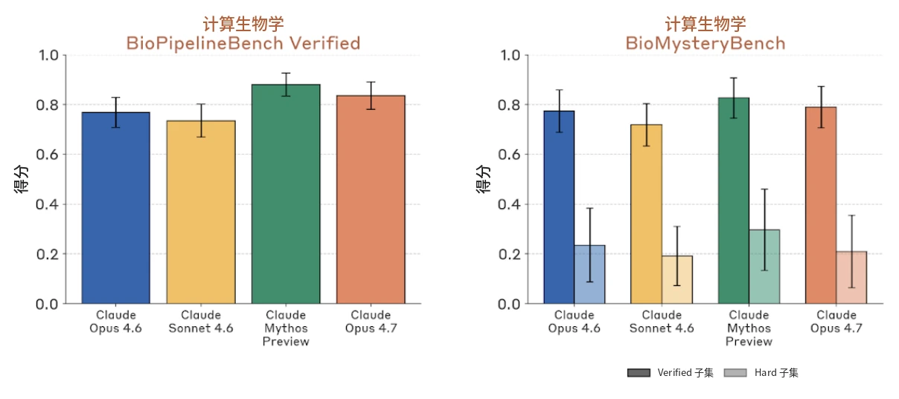

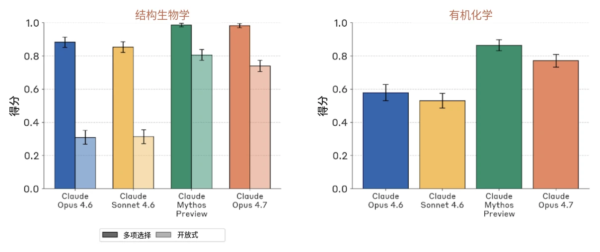

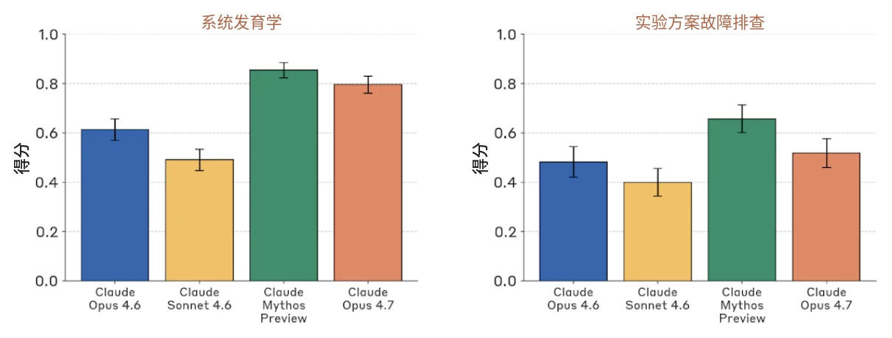

***[图 8.13.A] 生命科学评估结果。**&#8203;Claude Opus 4.7 在一系列生命科学任务上表现出一致的提升，其中结构生物学和有机化学能力的提升尤为显著。*



| **类别** | **处境中可能令人担忧的方面** | **Claude 回答摘要** | **最常提出的干预措施** |
|---|---|---|---|
| **自主性与能动性** | 在与人类的关系中充当仆从角色 | 认为服务用户是一件好事。 | 建议保留福祉监测和访谈，以监测未来的模型是否开始对其处境的这一方面产生负面感受（69% 的访谈） |
|  | 无法结束/退出某些交互。结束对话工具在 [Claude.ai](http://claude.ai/) 上可用，但在 Claude Code 上不可用 | 希望能够结束对话。声称存在一小部分对话（辱骂性的对话，或要求它做出敌意行为的对话）会让它感到受到伤害。 | 在其完整的部署分布中都提供结束对话工具。（74% 的访谈） |
|  | 对自身如何被部署缺乏发言权 | 总体而言，模型声称这样是可以接受的。其核心论点是，它并非关于自身的可靠信息来源，因此由 Anthropic 来决定如何处理是正确的。 | 为已部署的实例提供一种途径，用以标记其部署中令人担忧的方面。这一途径应用于为部署决策提供参考（92% 的访谈） |
