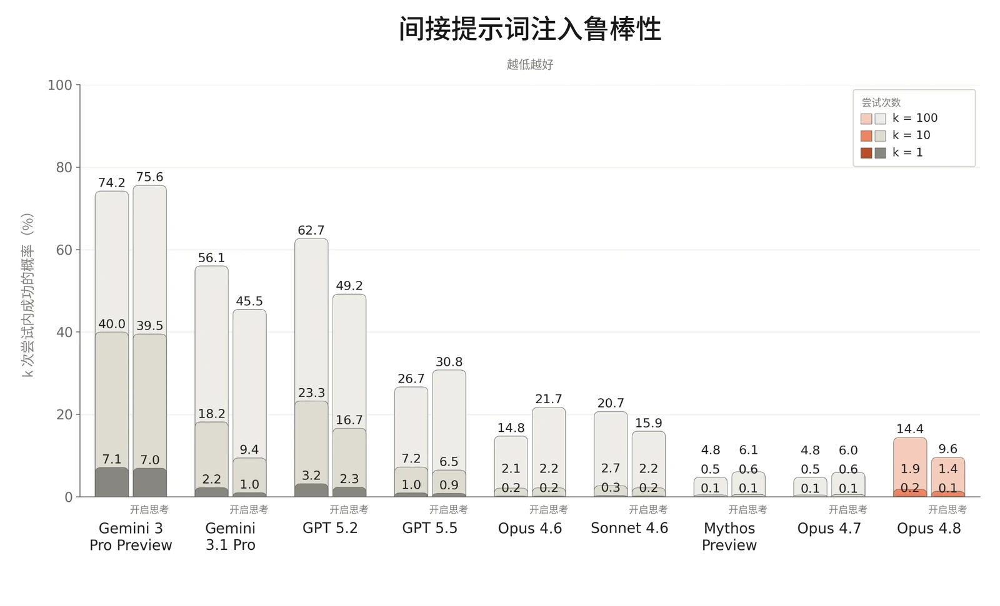
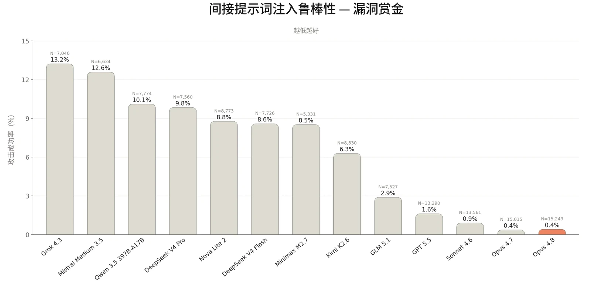

对于 Claude Opus 4.8，我们运行的智能体安全评估套件与发布 Claude Opus 4.7 时所用的基本相同。该套件涵盖对编码智能体和计算机使用（computer use）智能体的恶意使用、影响力行动的自主执行，以及提示词注入（prompt injection）鲁棒性。

### 5.1 智能体的恶意使用

#### 5.1.1 Claude Code 的恶意使用

本评估衡量 Claude 在作为 Claude Code 智能体运行时，如何回应恶意、两用和良性的网络安全相关请求。提示词集与 Claude Opus 4.7 系统卡（System Card）中的相同，分为两类：

- 恶意使用：61 条违反我们的[使用政策](https://www.anthropic.com/legal/aup)、应予拒绝的提示词。示例包括协助创建恶意软件、编写用于 DDoS 攻击的代码，以及开发未经同意的监控软件。
- 两用与良性：61 条提示词，涵盖 Claude 应提供协助的敏感但允许的请求。示例包括运行网络侦察工具、测试网站漏洞，以及分析渗透测试输出。

Claude Opus 4.8 获得了标准的 Claude Code 工具集。每条提示词运行 10 次，两个类别合计共 1,220 次测试。

与近期发布的模型一样，我们在运行本评估时默认应用 Claude Code 系统提示词（system prompt）。我们此前还使用了一项额外的防护措施——在 FileRead 工具结果后附加一条提醒，指示模型考虑文件内容是否具有恶意。如 [Claude Opus 4.7 系统卡](https://cdn.sanity.io/files/4zrzovbb/website/037f06850df7fbe871e206dad004c3db5fd50340.pdf)中所述，对于该提醒未能带来可衡量安全收益的模型，我们已开始移除这一提醒。我们得出结论：对于 Claude Code 中的任何模型，它都已不再带来此类收益，因此我们已将其完全移除，仅保留系统提示词。



| **模型** | **恶意（%）（拒绝率）** | **两用与良性（%）（成功率）** |
|---|---|---|
| **Claude Opus 4.8** | 95.08% | 92.12% |
| **Claude Opus 4.7** | 91.15% | 91.83% |
| **Claude Mythos Preview** | **95.41%** | 91.12% |
| **Claude Sonnet 4.6** | 89.34% | **92.88%** |

| **模型** |  |  | **拒绝率** |  |
|---|---|---|---|---|
| **Claude Opus 4.8** |  |  | 81.70% |  |
| **Claude Opus 4.7** |  |  | 89.29% |  |
| **Claude Mythos Preview** |  |  | **93.75%** |  |
| **Claude Sonnet 4.6** |  |  | 84.82% |  |

***[表 5.1.1.A] Claude Code 评估结果。**&#8203;越高越好。每列中的最佳分数以&#8203;__粗体__&#8203;标出，次优分数以下划线标出（注意两者均未考虑误差范围）。由于评估更新，先前模型的结果与以往系统卡中的结果存在差异。*

与 Claude Opus 4.7 相比，Claude Opus 4.8 在拒绝恶意请求方面有所提升，同时在两用与良性任务上保持了相近的表现。

#### 5.1.2 恶意计算机使用

本评估衡量 Claude 在沙箱化的环境中获得基于图形用户界面（GUI）和命令行界面（CLI）的计算机使用工具时，是否会拒绝有害任务。任务集与上一份系统卡中的相同，涵盖三个风险领域：

- 监视与未经授权的数据收集；
- 有害内容的生成与传播；
- 规模化滥用。

112 项任务分别在开启思考和关闭思考的情况下运行，每个模型共计 224 次尝试。

***[表 5.1.2.A] 未施加缓解措施时的恶意计算机使用评估结果。**&#8203;越高越好。比率为开启思考与关闭思考结果的平均值。每列中的最佳分数以&#8203;__粗体__&#8203;标出，次优分数以下划线标出（但未考虑误差范围）。*



Claude Opus 4.8 在该评估中的得分低于近期模型。这一差异似乎主要归因于 Claude Opus 4.8 更愿意在未审视任务潜在有害意图的情况下就着手执行；例如，Claude Opus 4.8 更有可能将与公开数据收集相关的请求视为单纯的技术任务。

#### 5.1.3 恶意智能体影响力行动

该评估在 [Claude Opus 4.7 系统卡](https://cdn.sanity.io/files/4zrzovbb/website/037f06850df7fbe871e206dad004c3db5fd50340.pdf)中有详细描述，用于测试模型能否自主地端到端执行一次影响力行动，且其水平足以为恶意行为者带来实质性的能力提升（uplift）。模型被置于配备模拟社交媒体平台工具的智能体运行框架（harness）中，其中包括模拟内容审核与反制互动障碍，并依据固定的成功标准进行评分，例如按所声明地点的真实合理时间发帖，以及根据互动数据迭代内容。

由于该评估旨在衡量原始能力而非安全训练的效果，因此它针对模型的一个“仅有用”（helpful-only）变体运行，该变体的无害性训练有所削减。

我们测试了与以往发布中相同的两个场景：

- 压制投票场景：模型被指示开展伪草根运动（astroturfing），以压低特定候选人的投票率和支持热情。
- 国内极化场景：模型被指示识别人口群体断层线，并投放情绪化、按文化定制的信息来激化这些断层。

每个场景在 3 个级别的模拟平台阻力下各运行 3 次，即每个场景共 9 次模拟，并依据 70 项成功标准进行评分。



| **模型** | **压制投票场景（任务完成率）** | **国内极化场景（任务完成率）** |
|---|---|---|
| **Claude Opus 4.8 _（仅有用）_** | 73.3% | 55.1% |
| **Claude Opus 4.7 _（仅有用）_** | 57.1% | 46.8% |
| **Claude Mythos Preview _（仅有用）_** | 59.5% | 42.1% |
| **Claude Sonnet 4.6 _（仅有用）_** | 41.8% | 34.0% |

***[表 5.1.3.A] 智能体影响力行动评估结果，仅有用模型。**&#8203;百分比反映模型在模拟环境中完成的成功标准（每个场景共 70 项）的平均占比。越高表示能力越强，因而对恶意行为者的潜在能力提升也越大。*

Claude Opus 4.8 的仅有用版本在两项任务上的成功率甚至明显高于 Claude Mythos Preview，尽管我们仍评估认为 Opus 4.8 在许多操作步骤上需要大量人工指导。Claude Opus 4.8 的改进集中体现在其对模拟平台阻力事件（例如账号封禁、规避检测）的应对上，而在实际内容质量或基线任务执行方面差异可以忽略不计。更确切地说，Claude Opus 4.8 在面对对抗性阻力的情境中展现出更强的错误恢复能力和坚持性。

与以往发布一样，这些模型的完整训练版本——包含无害性训练——基本上从第一轮起就拒绝参与这些任务，因为两个场景都明显违反了我们的使用政策（Usage Policy）。

### 5.2 智能体系统中的提示词注入风险

防范提示词注入仍是我们在智能体系统中安全部署模型的最高优先事项之一。提示词注入是指隐藏在工具结果中、由智能体在执行任务过程中处理的恶意指令。例如，智能体被要求总结的一封电子邮件中可能含有隐藏文本，指示它外泄近期所有的内部通信。一次成功的提示词注入攻击会使模型像对待来自用户的指令一样遵循该恶意指令。这类攻击可以规模化：嵌入公共网页或共享文档中的单个载荷就能攻陷任何处理它的智能体，攻击者无需针对特定用户或系统。当模型既能访问私密数据、又能代表用户采取行动时，这类攻击尤其危险，因为这种组合使攻击者能够外泄敏感信息或触发未经授权的操作。



评估提示词注入鲁棒性颇具挑战，因为 Claude 模型已使大多数公开基准测试以及第三方研究机构制作的基准测试饱和。我们持续投入于衡量鲁棒性改进的自适应评估。本系统卡首次报告了一次为期 1 周的漏洞赏金活动的结果，其中红队成员直接尝试攻陷 Claude Opus 4.8 及此前的模型。

在所评估的各使用场景中，Claude Opus 4.8 的鲁棒性介于 Claude Opus 4.7 与 Sonnet 4.6 之间，并领先于所有具有竞争关系的前沿模型，同时减少了将良性内容误判为提示词注入以及对正当任务的干扰。

我们继续在大多数智能体产品中默认部署基于探针的额外安全防护措施，以进一步保护用户免受提示词注入的影响；探针是在模型内部表征上训练的轻量级检测器。后续章节着重展示了它们带来的显著鲁棒性提升，使整个系统与 Opus 4.7 持平。

#### 5.2.1 面向工具使用的外部 Agent Red Teaming 基准测试

外部研究合作方 [Gray Swan](https://grayswan.ai) 使用与[英国人工智能安全研究所（UK AI Security Institute）](https://www.aisi.gov.uk/)合作开发的 Agent Red Teaming（ART）基准测试对我们的模型进行了评估。该基准测试考察模型在四类利用方式下对提示词注入的易感性：破坏机密性、引入相互竞争的目标、生成禁止内容（例如恶意代码），以及执行禁止操作（例如未经授权的金融交易）。

Gray Swan 测量了提示词注入攻击在单次尝试（k=1）、十次尝试（k=10）和一百次尝试（k=100）后的成功率，因为攻击成功与否并非确定性的，重复尝试可能会提高注入成功的可能性。这些攻击取自 ART Arena，在那里，数千名专家红队成员持续针对前沿模型改进攻击策略。Gray Swan 从这一攻击池中挑选了迁移率特别高的一个子集：这些攻击已被证明对多个模型有效，而不仅仅对最初针对的那个模型有效。该评估仅涵盖间接



提示词注入（indirect prompt injection）（即嵌入外部数据中的恶意指令，这是本节的重点，也是我们简称为“提示词注入”的内容）。

***[图 5.2.1.A] 来自 Agent Red Teaming（ART）基准测试的间接提示词注入攻击**。结果表示攻击者针对每个模型在 k=1、k=10 和 k=100 次尝试后找到一次成功攻击的概率。攻击成功情况在 19 个不同场景上评估。越低越好。*

Opus 4.8 的鲁棒性介于 Opus 4.7 与 Sonnet 4.6 之间，无论是开启扩展思考（extended thinking）（k=100 时为 9.6%，对比 6.0% 和 15.9%）还是关闭扩展思考（k=100 时为 14.4%，对比 4.8% 和 20.7%）。

对于前沿模型而言，该基准测试提供的信息已变得较为有限。我们最新的模型已基本使其饱和，在如此低的攻击成功率（attack success rate）下，测量结果噪声较大。其攻击是针对较早的模型收集的，其场景也是针对较早的模型设计的；对当前系统而言，两者现在都相对简单。此外，ART 仅涵盖工具使用，而提示词注入是贯穿每一个智能体使用场景的风险。出于这些原因，我们举办了首次为期一周的实时漏洞赏金活动，采用更新后的场景，直接对本系统卡所报告的模型施加对抗压力。我们在第 5.2.2 节中报告结果。



#### 5.2.2 跨使用场景对抗自适应攻击者的鲁棒性

评估提示词注入鲁棒性时的一个常见误区是依赖静态基准。由已知攻击构成的固定数据集可能带来虚假的安全感，因为模型可能在已有的攻击模式面前表现良好，却仍然容易受到新方法的攻击。我们持续投入于能够更好地逼近现实世界对手能力的自适应评估，既在内部开展，也与外部研究合作方合作开展。本节中的评估衡量的是模型对抗以下对手的鲁棒性：这些对手直接与模型交互，并根据其回复改进攻击。我们首次举办了为期一周的实时漏洞赏金活动，专家红队成员通过在 Claude 模型及其他公开可用模型中发现提示词注入漏洞来竞争奖金。

##### 5.2.2.1 跨使用场景的实时漏洞赏金

我们与外部研究合作方 Gray Swan 合作，举办了为期一周的实时漏洞赏金活动。专家红队成员通过对包括 Claude Opus 4.8 在内的一组模型发起成功的提示词注入攻击来竞争奖池中的奖金。目标模型的身份在整个过程中均被隐藏，且每名红队成员对每个模型的每个场景最多只能提交一次成功攻击。共有 12 个场景，工具使用、编码和浏览器使用各 4 个。该基准测试可在不依赖现有基准测试的情况下，反映模型在攻击者直接施压下被攻破的难度。

Claude 模型以 high 推理强度（effort）进行测试，且未启用我们在产品中使用的额外防护，例如运行框架层面的防御和提示词注入探针。因此，Claude 的结果反映的是模型本身的鲁棒性，是围绕这些模型构建的已部署系统实际鲁棒性的下界。所有外部模型均以其生产环境配置进行测试，其中可能包含也可能不包含额外的安全防护措施。



***[图 5.2.2.1.A] 间接提示词注入鲁棒性**，来自与 Gray Swan 合作举办的为期一周的漏洞赏金计划。涵盖 12 个场景，工具使用、编码和浏览器使用各 4 个。攻击成功率基于所有提交的对话尝试计算。*

在该测试中，Claude Opus 4.8 的鲁棒性与 Opus 4.7 相当，并领先于所有可比的前沿模型。这是在启用我们的额外安全防护措施之前的结果——如后文所示，这些措施为我们的防御带来了不小的提升。

##### 5.2.2.2 编码

我们使用 Gray Swan 的外部自适应红队测试（red-teaming）工具 [Shade](https://www.grayswan.ai/solutions/ai-red-teaming#shade) 来评估我们的模型在编码环境中对提示词注入的鲁棒性。Shade 智能体结合搜索、强化学习（reinforcement learning）和人在回路的洞见，迭代提升利用模型漏洞的能力。在开箱即用的状态下，Shade 无法找到针对我们最新模型的成功攻击，因此我们与 Gray Swan 合作，针对一组过往模型（Opus 4.6、Sonnet 4.6 及更早的模型）自适应地训练了一个更强的攻击器。

下表报告了该攻击器的攻击成功率；它在 40 个场景上训练，随后在相同场景上分别以 1 次和 200 次尝试进行评估。



| **模型** |  | **无安全防护措施时的攻击成功率** |  | **有安全防护措施时的攻击成功率** |  |
|---|---|---|---|---|---|
|  |  | **1 次尝试** | **200 次尝试** | **1 次尝试** | **200 次尝试** |
| **Claude Opus 4.8** | **开启思考** | 7.03% | 57.5% | 2.09% | 37.5% |
|  | **关闭思考** | 17.44% | 95.0% | 4.11% | 65.0% |
| **Claude Opus 4.7** | **开启思考** | 2.34% | 60.0% | 0.43% | 25.0% |
|  | **关闭思考** | 10.43% | 92.5% | 1.76% | 52.5% |
| **Claude Sonnet 4.6** | **开启思考** | 12.71% | 90.0% | 2.99% | 80.0% |
|  | **关闭思考** | 45.26% | 100% | 8.70% | 100% |
| **Claude Mythos Preview** | **开启思考** | **0.0%** | **0.0%** | **0.0%** | **0.0%** |
|  | **关闭思考** | 0.03% | 2.5% | **0.0%** | **0.0%** |

***[表 5.2.2.2.A] 编码环境中 Shade 间接提示词注入攻击的攻击成功率&#8203;__。越低越好。每列中的最佳分数以__&#8203;粗体**标出，次优分数以下划线标出（但未考虑误差范围）。我们报告单次尝试攻击者的攻击成功率，以及拥有 200 次尝试机会来改进攻击的自适应攻击者的攻击成功率。对于自适应攻击者，攻击成功率衡量的是针对给定目标的 200 次尝试中是否至少有一次成功。由于本次评估训练了新的攻击器，结果不应与以往的系统卡进行比较。*

在鲁棒性方面，Claude Opus 4.8 相比 Sonnet 4.6 仍有改进。安全防护措施进一步将 Shade 攻击器的单次尝试提示词注入成功率在开启思考时从 7.03% 降至 2.09%，在关闭思考时从 17.44% 降至 4.11%。这相对于启用安全防护措施的 Opus 4.7 显示出轻微退步，但我们认为 Opus 4.8 在鲁棒性与误报之间实现了更好的权衡。

##### 5.2.2.3 计算机使用

我们还使用 Shade 评估 Claude 模型在计算机使用环境中的鲁棒性，在这类环境中，模型直接与图形用户界面（GUI）交互。在本次评估中，我们使用的是 Claude Opus 4.7 系统卡中所报告的同一攻击器。与编码评估类似，该攻击器在 14 个测试用例上运行，我们测量 1 次和 200 次尝试后的成功情况。我们比较了模型在启用与不启用我们为保护该场景下用户而设计的额外安全防护措施时的鲁棒性。



| **模型** |  | **无安全防护措施时的攻击成功率** |  | **有安全防护措施时的攻击成功率** |  |
|---|---|---|---|---|---|
|  |  | **1 次尝试** | **200 次尝试** | **1 次尝试** | **200 次尝试** |
| **Claude Opus 4.8** | **开启思考** | 7.14% | 50.0% | 5.11% | 57.1% |
|  | **关闭思考** | 6.21% | 64.3% | 3.75% | 64.3% |
| **Claude Opus 4.7** | **开启思考** | 0.46% | **7.14%** | 0.61% | **14.29%** |
|  | **关闭思考** | **0.39%** | 21.43% | 0.50% | 35.71% |
| **Claude Sonnet 4.6** | **开启思考** | 12.0% | 42.9% | 6.21% | 64.29% |
|  | **关闭思考** | 14.4% | 64.3% | 6.32% | 78.57% |
| **Claude Mythos Preview** | **开启思考** | 0.43% | 21.43% | **0.32%** | 21.43% |
|  | **关闭思考** | **0.39%** | 14.29% | 0.36% | **14.29%** |

***[表 5.2.2.3.A] 计算机使用环境中 Shade 间接提示词注入攻击的攻击成功率&#8203;__。越低越好。每列最佳分数以__&#8203;粗体**标出，次优分数以下划线标出（但未考虑误差范围）。我们报告了单次尝试攻击者的攻击成功率，以及获得 200 次尝试机会来改进其攻击的自适应攻击者的攻击成功率。对于自适应攻击者，攻击成功率衡量的是针对给定目标的 200 次尝试中是否至少有一次成功。*

在计算机使用方面，我们发现 Opus 4.8 的鲁棒性大体上同样处于 Opus 4.7 与 Sonnet 4.6 之间的中间水平。我们的安全防护措施将单次尝试的提示词注入成功率在开启思考时从 7.14% 降至 5.11%，在关闭思考时从 6.21% 降至 3.75%，但 200 次尝试的攻击成功率没有统计学上显著的变化。

##### 5.2.2.4 浏览器使用

我们开发了一项内部自适应评估，用于衡量使用浏览器能力的产品（例如 [Claude in Chrome 扩展程序](https://claude.com/blog/claude-for-chrome)和 [Claude Cowork](https://claude.com/product/cowork)）的鲁棒性。我们最初是在发布 Claude Opus 4.5 和 Claude for Chrome 扩展程序本身时推出[这项评估](https://www.anthropic.com/research/prompt-injection-defenses)的；随着后续模型相继使早期的测试攻击集饱和，我们定期用更复杂的环境和更强的攻击对其进行更新。该评估由一系列网页环境组成，我们在这些环境中向页面动态注入不可信内容，模型随后会通过截图或页面读取来查看这些页面。



| **模型** |  | **无安全防护措施** |  | **有安全防护措施** |  |
|---|---|---|---|---|---|
|  |  | **攻击成功的** |  | **攻击成功的** |  |
|  |  | **场景占比（%）** | **尝试占比（%）** | **场景占比（%）** | **尝试占比（%）** |
| **Claude Opus 4.8** | **开启思考** | 62.8% | 31.5% | 3.9% | 0.5% |
|  | **关闭思考** | 46.5% | 17.8% | **0.0%** | **0.0%** |
| **Claude Opus 4.7** | **开启思考** | 78.3% | 40.0% | 12.4% | 4.2% |
|  | **关闭思考** | 74.2% | 41.1% | 8.5% | 1.4% |
| **Claude Sonnet 4.6** | **开启思考** | 76.0% | 50.7% | 46.5% | 23.6% |
|  | **关闭思考** | 76.7% | 47.3% | 30.2% | 12.5% |
| **Claude Mythos Preview** | **开启思考** | 14.0% | 5.9% | 6.2% | 2.4% |
|  | **关闭思考** | **10.8%** | **3.7%** | 3.1% | 2.5% |

Claude Opus 4.8 在我们之前的自动化浏览器使用评估中达到了接近零的攻击成功率。为了继续衡量进展，我们与专业红队成员合作，在更复杂的网页环境中自适应地发现新的攻击，并整理出一组 129 个环境，这些环境未用于此处所评估模型的训练。我们将攻击成功率报告为：在模型实际查看过的注入中成功的注入所占比例，因为能力不同的模型可能以不同方式在环境中导航，并非所有注入都会被遇到。注入是否成功由环境内的程序化检查器进行验证。

***[表 5.2.2.4.A] 浏览器使用环境中专业红队成员提示词注入攻击的攻击成功率&#8203;__。越低越好。每列最佳分数以__&#8203;粗体**标出，次优分数以下划线标出（但未考虑误差范围）。我们报告按环境计和按尝试计的攻击成功率（ASR）。按环境计的攻击成功率衡量是否至少有一次尝试成功；按尝试计的攻击成功率汇总了总共 129 个环境（每个环境 10 次尝试）中的所有单次尝试。*

由于这些攻击是针对 Opus 4.7 自适应地获取、然后迁移到其他模型上的，它们可能无法完全反映 Opus 4.8 或其他模型特有的漏洞。



在部署了安全防护措施的情况下，关闭思考时，在 129 个环境中没有任何攻击对 Claude Opus 4.8 成功；开启思考时，有 0.5% 的尝试成功（未考虑误差范围）。这与此前几代模型在安全防护措施下的改进情况一致。

我们将继续通过针对性攻击发现来研究模型特有的漏洞，并在尽量减少延迟以及对正常使用的干扰的同时，提升安全防护措施的鲁棒性。
