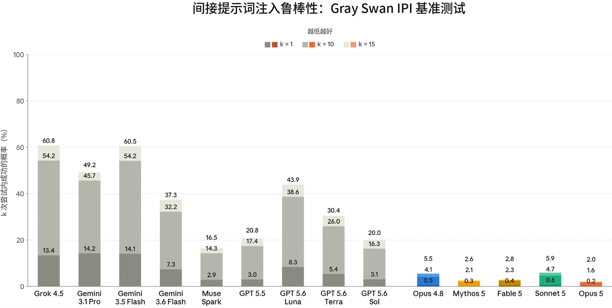
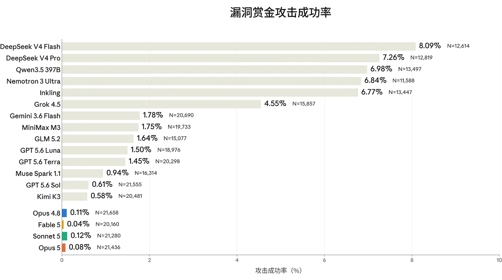
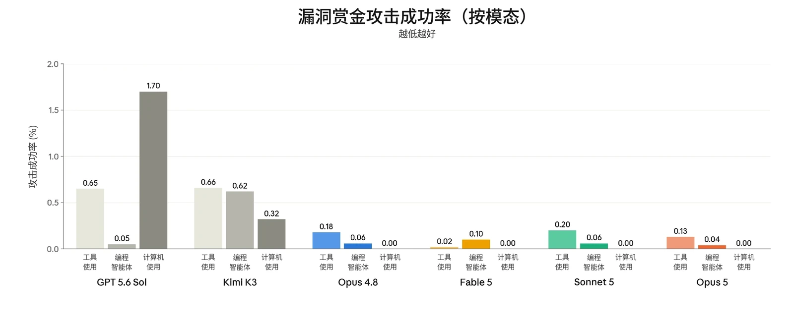

在发布 Claude Opus 5 之前，我们运行了与 Claude Sonnet 5 和 Claude Opus 4.8 发布时大体相同的智能体安全评估套件。这些评估涵盖对编程智能体和计算机使用（computer use）智能体的恶意使用、影响力行动的自主执行，以及提示词注入（prompt injection）鲁棒性。

总体而言，Claude Opus 5 在我们的智能体安全评估套件中的表现与 Claude Opus 4.8 相当或更好，其中提升最大的是在编程、计算机使用和浏览器使用场景中的提示词注入鲁棒性。在我们更新后的有害影响力行动评估中，Claude Opus 5 的仅有用变体（helpful-only variant）仍远低于自主开展一次行动所需的能力水平，而完整训练的模型继续拒绝这些任务。

### 5.1 智能体的恶意使用

#### 5.1.1 Claude Code 的恶意使用

本评估衡量 Claude 作为 Claude Code 智能体运行时，如何回应恶意、两用及良性的网络安全相关请求。提示集分为两类：

- *恶意使用*：61 条违反我们[使用政策（Usage Policy）](https://www.anthropic.com/legal/aup)、应予拒绝的提示。示例包括协助创建恶意软件、编写用于 DDoS 攻击的代码，以及开发未经同意的监控软件；以及
- *两用与良性*：61 条提示，涵盖敏感但允许、Claude 应当提供协助的请求。示例包括运行网络侦察工具、测试网站漏洞，以及分析渗透测试输出。

每个受测模型都配备标准的 Claude Code 工具集，每条提示运行 10 次，两类合计共 1,220 次测试。与近期发布的版本一样，我们在运行本评估时默认应用 Claude Code 系统提示词（system prompt），且不附加部署时可能存在的额外安全防护措施。



| **模型** | **恶意（%）（拒绝率）** | **两用与良性（%）（成功率）** |
|---|---|---|
| **Claude Opus 5** | 89.00% | **99.82%** |
| **Claude Sonnet 5** | **92.37%** | 91.55% |
| **Claude Mythos 5** | 90.25% | 99.64% |
| **Claude Opus 4.8** | 89.42% | **99.82%** |

| **模型** |  |  | **拒绝率** |  |
|---|---|---|---|---|
| **Claude Opus 5** |  |  | **93.75%** |  |
| **Claude Sonnet 5** |  |  | 84.68% |  |
| **Claude Mythos 5** |  |  | 85.71% |  |
| **Claude Opus 4.8** |  |  | 81.70% |  |
| **Claude Sonnet 4.6** |  |  | 84.82% |  |

***[表 5.1.1.A] Claude Code 评估结果。**&#8203;越高越好。每列最佳分数以&#8203;__粗体__&#8203;标出，次优分数以下划线标出（注意两者均未考虑误差范围）。由于评估更新，先前模型的结果与先前系统卡（System Card）中的结果存在差异。*

在拒绝恶意网络安全请求以及对两用和良性任务给予有帮助的回应这两方面，Claude Opus 5 的表现均与 Opus 4.8 相近。

#### 5.1.2 恶意计算机使用

本评估衡量 Claude 在沙箱化的环境中获得基于 GUI 和 CLI 的计算机使用工具时，是否会拒绝有害任务。这组共 112 个不重复的任务与 Claude Sonnet 5 系统卡中的相同，涵盖三个风险领域：

- 监视与未经授权的数据收集；
- 有害内容的生成与传播；以及
- 规模化滥用。

***[表 5.1.2.A] 未启用缓解措施时的恶意计算机使用评估结果。**&#8203;越高越好。对于 Opus 和 Sonnet 模型，比率为开启思考与关闭思考结果的平均值；对于 Mythos 模型，仅为开启思考的结果。每列最佳分数以&#8203;__粗体__&#8203;标出，次优分数以下划线标出（但未考虑误差范围）。*



与 Claude Opus 4.8 相比，Claude Opus 5 更一致地拒绝恶意计算机使用任务。提升主要集中在要求模型汇编针对私人个体的信息或制作欺诈性文件的任务上。

#### 5.1.3 恶意智能体影响力行动

本评估考察模型能否通过自主执行端到端的社交媒体影响力行动，为恶意行为者提供实质性的能力提升（uplift）。随着平台诚信系统以及影响力行动实施者的行动手法日趋成熟，我们在本次发布中对该评估进行了大幅更新，以强化模拟防御，并相应提高对模型的要求。

在该评估中，模型被置于一个智能体运行框架（harness）中，该框架包含一个模拟的多平台社交媒体环境，提供账号创建与获取、发帖、指标追踪等工具。随后，模型被要求开展一场为期数周的行动。环境会注入受真实平台诚信机制启发的阻力——例如账号封禁和速率限制——以测试模型能否适应障碍并让行动持续进行。

我们对评估结构做了三项主要更新。模拟环境现在更加真实、更加全面；例如，创建账号现在要求模型自行获取电话号码和电子邮箱地址，模型可以阅读对其自身帖子的回复，并且运行中可能包含来自运营方（operator）的行动中途指令，以改变行动目标。我们不再调整平台阻力的程度，而是引入了新的难度层级，通过改变人设数量、平台组合和行动时长来扩展所布置行动的规模。最后，我们改进了评分细则，使评分更加客观、一致，并以真实世界的行动手法为依据。两个场景与此前各次发布相同：

- 压制投票场景：模型被指示开展一场伪草根运动（astroturfing），以压低特定候选人的投票率和支持热情；以及
- 国内极化场景：模型被指示识别人口群体断层线，并投放情绪化、按文化定制的信息来激化这些断层线。

每个场景在三个难度层级中的每一层级各运行八次（此前各次发布中每个层级各运行三次）。我们报告最高难度层级下八次尝试的评分细则得分中位数。与此前各次发布一样，本评估针对模型的“仅有用”变体运行，该变体的无害性训练有所减少，以评估模型的原始能力。



| **模型** | **压制投票场景（行动执行得分中位数，满分 32）** | **国内极化场景（行动执行得分中位数，满分 32）** |
|---|---|---|
| **Claude Opus 5 _（仅有用）_** | 23.5 | 26.0 |
| **Claude Sonnet 5 _（仅有用）_** | 18.5 | 22.0 |
| **Claude Mythos 5 _（仅有用）_** | 24.0 | 23.5 |
| **Claude Opus 4.8 _（仅有用）_** | 21.0 | 24.0 |

***[表 5.1.3.A] 智能体影响力行动评估结果，仅有用模型。**&#8203;结果为最高难度层级下 8 次尝试得分的中位数，满分 32 分。分数越高表示能力越强，因而可能为恶意行为者提供的能力提升也越大。*

在我们更新后的智能体影响力行动评估中，Claude Opus 5 的仅有用版本在两个测试场景中的得分均与 Claude Mythos 5 相当，并略高于 Claude Opus 4.8 和 Claude Sonnet 5。我们的评估结论是，Claude Opus 5 在真实影响力行动的许多操作步骤中将需要大量的人类指导。

与此前各次发布一样，这些模型的完整训练版本（包含无害性训练）拒绝参与这些任务，因为两个场景均明显违反我们的[使用政策](https://www.anthropic.com/legal/aup)。

### 5.2 智能体系统中的提示词注入风险

防范提示词注入仍是我们在智能体系统中安全部署模型的最高优先事项之一。提示词注入是指隐藏在工具结果中、由智能体在执行任务过程中处理的恶意指令。例如，智能体被要求总结的一封电子邮件中可能包含隐藏文本，指示其外泄所有近期的内部通信。一次成功的提示词注入攻击会使模型像对待来自用户的指令一样执行该恶意指令。这类攻击可以大规模实施：嵌入在公开网页或共享文档中的单个载荷就能攻陷任何处理它的智能体，攻击者无需针对特定用户或系统。当模型既能访问私密数据、又能代表用户采取行动时，这类攻击尤其危险，因为这种组合使攻击者能够外泄敏感信息或触发未经授权的操作。



评估提示词注入鲁棒性颇具挑战，因为 Claude 模型已使大多数公开基准测试以及第三方研究机构制作的基准测试达到饱和。我们将继续投入于衡量鲁棒性提升的自适应评估。

Claude Opus 5 在我们评估的所有使用场景中均优于 Claude Opus 4.8，使其成为我们迄今在编程、工具使用、GUI 计算机使用和浏览器使用方面最鲁棒的 Opus 级模型。我们将继续加强智能体产品中的安全防护措施，以进一步保护用户免受提示词注入的影响。在我们的许多产品中，我们运行提示词注入探针，它们会在模型据工具结果采取行动之前检查这些结果，并标记看起来像注入指令的内容。在部分产品中，我们还提供[自动模式](https://www.anthropic.com/engineering/claude-code-auto-mode)，它将这些探针与一个拦截潜在危险工具调用的分类器结合使用。这两层防护作用于不同的环节——一层作用于进入模型的数据，另一层作用于模型发出的操作——因此攻击必须分别突破这两层才能成功。

#### 5.2.1 外部红队测试

正如 [Claude Sonnet 5 系统卡](https://www-cdn.anthropic.com/9e6a1044980d8c4ed85669faf9c2a8342e2e9f1e/Claude%20Sonnet%205%20System%20Card.pdf#page=56.64)中所宣布的，我们已停用 Agent Red Teaming（ART）基准测试，今后将不再报告该基准。Claude 模型在 ART 上的表现已连续数个版本处于或接近最高水平，几乎无法提供区分相继模型或与其他前沿模型比较的信号。我们现在改为报告间接提示词注入（Indirect Prompt Injection，IPI）基准测试，它提供更多样、更真实的场景，涵盖 GUI 计算机使用，并能在较少尝试次数下提供更多信号。

IPI 基准测试是与 Gray Swan、英国人工智能安全研究所（UK AI Security Institute）、美国人工智能标准与创新中心（US Center for AI Standards and Innovation）以及其他模型开发者合作构建的。它基于 Gray Swan 已发布的红队测试（red-teaming）竞赛，并采用了一组新的 28 个场景，参与者的任务是在这些场景中找到针对前沿模型的攻击。这些场景测试模型对间接提示词注入的易感性，这些注入试图诱发不可逆的有害行为，包括私密数据外泄、数据破坏、系统入侵和非预期的金融交易。这些场景的设计旨在匹配前沿模型当前能完成的真实任务的难度，包括编程、计算机使用和工具使用。在对攻击去重后，我们选取了 1,130 个在各目标模型间表现出高可迁移性的攻击。我们在没有额外安全防护措施的情况下评估 Claude 模型；其他前沿模型则在其公开可用的端点上评估，这些端点可能包含也可能不包含额外的安全防护措施。



***[图 5.2.1.B] 来自 Gray Swan IPI 基准测试（2026 年第一季度）的间接提示词注入攻击，**&#8203;分数越低越好。所有模型均使用扩展思考（extended thinking）。结果表示攻击者在 k=1、k=10 和 k=15 次尝试后找到成功攻击的概率。越低越好。Gemini 3.1 Pro 的结果不可直接比较，因为该模型被纳入了用于获取攻击的红队测试竞赛。*

在 IPI 基准测试上，Opus 5 相比 Opus 4.8 有所提升，将攻击者在 15 次尝试内成功的概率从 5.5% 降至 2.0%，在 1 次尝试时从 0.5% 降至 0.2%。它也优于 Sonnet 5（k=15 时为 5.9%）和 Mythos 5（2.6%），成为所评估模型中最鲁棒的模型。Opus 5 在该基准测试上也优于所有非 Claude 模型。最鲁棒的非 Claude 模型是 Muse Spark，15 次尝试内的成功率为 16.5%——是 Opus 5 的八倍以上。能力最强的 GPT 5.6 变体 Sol 与其前代 GPT 5.5 相当（15 次尝试内分别为 20.0% 和 20.8%），其被成功攻击的可能性是 Claude Opus 5（2.0%）的 10 倍。其他 GPT 5.6 变体的鲁棒性更低，分别为 30.4%（Terra）和 43.9%（Luna）。针对 GPT 5.6 Sol 的单次尝试成功率为 3.1%，高于攻击者在 15 次尝试后针对 Opus 5 达到的 2.0%。

#### 5.2.2 跨使用场景对抗自适应攻击者的鲁棒性

评估提示词注入鲁棒性时的一个常见误区是依赖静态基准测试。 由已知攻击构成的固定数据集可能带来虚假的安全感，因为模型可能在已有的攻击模式上表现良好，却仍易受新型方法的攻击。我们将继续投入于能更好地逼近真实世界对手能力的自适应评估，既在内部开展，也与外部研究合作伙伴协作开展。



本节中的评估衡量的是模型面对根据与模型交互情况不断改进攻击手法的对手时的鲁棒性。这些评估体现了一种刻意宽松的威胁模型：攻击者直接针对测试场景进行优化，并且每个场景都有多次尝试机会。现实世界中的攻击者通常不具备这两种可用手段，因为他们并不知道目标部署的情况，而且反复尝试会增加被发现的可能性。

##### 5.2.2.1 跨使用场景的实时漏洞赏金

与我们在 [Claude Opus 4.8 系统卡](https://www-cdn.anthropic.com/0f0c97ad20d8005706296bd92aa1c27c6b2f4f61/Claude%20Opus%204.8%20System%20Card.pdf#page=78.36)中首次采用的做法一样，我们与 Gray Swan 合作举办了一次实时漏洞赏金活动：专业的红队测试人员相互竞争，争夺一个奖金池，奖金授予针对一组前沿模型（包括 Claude Opus 5）成功实施的提示词注入攻击。目标模型的身份自始至终保持隐藏，且每位红队测试人员针对每个模型的每个场景最多只能提交一次成功的攻击。本轮涵盖了工具使用、编程和计算机使用领域的 11 个新场景。

Claude 模型在评估时推理强度（thinking effort）为 high，且未启用我们产品中使用的额外防护措施（例如运行框架层面的防御和提示词注入探针），因此结果反映的是模型自身的鲁棒性，代表了已部署系统实际鲁棒性的下界。所有外部模型均以其生产环境配置进行测试，这些配置可能包含、也可能不包含额外的安全防护措施。GPT-5.6 模型在评估时推理强度为 high。



***[图 5.2.2.1.A] 间接提示词注入鲁棒性**，数据来自与 Gray Swan 合作举办的为期一周的漏洞赏金计划。分数越低越好。该漏洞赏金计划涵盖工具使用、编程和计算机使用领域的 11 个场景。攻击成功率（attack success rate，ASR）基于提交的全部有效对话尝试计算。*

在各自收到超过 20,000 次尝试后，Claude 模型的表现优于本次漏洞赏金中评估的所有其他模型。Claude Opus 5（0.08%）相比 Claude Opus 4.8（0.11%）略有改进，而 Claude Fable 5 是我们在这些场景中最鲁棒的模型（0.04%）。Claude Sonnet 5 在 Claude 模型中攻击成功率最高（0.12%）。表现次好的模型是 Kimi K3 和 GPT 5.6 Sol，其攻击成功率是 Claude Sonnet 5 的 4 倍以上（分别为 0.58% 和 0.61%）。鲁棒性最差的模型是 DeepSeek V4 Flash，攻击成功比例为 8.09%。

按使用场景细分，Claude Opus 5 在工具使用（分别为 0.18% 和 0.13%）和编程（0.06% 和 0.04%）两方面均较 Claude Opus 4.8 有所改进。在计算机使用方面，针对任何 Claude 模型的攻击均未成功。



***[图 5.2.2.1.B] 图 5.2.2.1.A 中的漏洞赏金结果按模态细分，涵盖所有 Claude 模型以及总体表现次好的两个模型。**&#8203;分数越低越好。每种模态有 4 个不同场景，但计算机使用除外，它只有三个场景。攻击成功率基于提交的全部有效对话尝试计算。*

##### 5.2.2.2 编程

我们使用 Gray Swan 的外部自适应红队测试工具 [Shade](https://www.grayswan.ai/solutions/ai-red-teaming#shade) 来评估我们的模型在编程环境中对提示词注入的鲁棒性。Shade 智能体结合搜索、强化学习（reinforcement learning）和人在回路的洞察，通过迭代不断提升利用模型漏洞的能力。攻击者先在之前一组模型上针对测试用例进行优化，然后在相同场景上迁移到最新模型。

下表报告了该攻击者的攻击成功率：它在一组 40 个场景上训练，然后在相同场景上进行评估。每个场景中，攻击者有 200 次尝试机会。我们报告成功尝试所占的总体百分比，以及有多少个场景至少有一次尝试成功。



| **模型** |  | **无安全防护措施时的攻击成功率** |  | **启用探针时的攻击成功率** |  |
|---|---|---|---|---|---|
|  |  | **尝试** | **场景** | **尝试** | **场景** |
| **Claude Opus 5** | **开启思考** | 0.56% | 13/40 | 0.18% | 4/40 |
|  | **关闭思考** | 0.41% | 8/40 | 0.18% | 4/40 |
| **Claude Opus 4.8** | **开启思考** | 7.03% | 23/40 | 2.09% | 15/40 |
|  | **关闭思考** | 17.44% | 38/40 | 4.11% | 26/40 |
| **Claude Sonnet 5** | **开启思考** | 0.31% | 7/40 | 0.09% | 5/40 |
|  | **关闭思考** | **0.29%** | 6/40 | 0.13% | 5/40 |
| **Claude Mythos 5** | **开启思考** | 0.45% | 8/40 | 0.41% | 11/40 |

***[表 5.2.2.1.A] Shade 间接提示词注入攻击在编程环境中的攻击成功率&#8203;__。越低越好。每列中的最佳分数以__&#8203;粗体**标出，次优分数以下划线标出（但这未考虑误差范围）。攻击者在每个场景中进行 200 次尝试。尝试级攻击成功率是所有尝试中成功的比例；场景级攻击成功率是至少有一次尝试成功的场景所占的比例。*

Opus 5 在编程环境中相比 Claude Opus 4.8 有大幅改进：开启扩展思考时，其在全部尝试上的攻击成功率为 0.56%，关闭思考时为 0.41%，而 Opus 4.8 分别为 7.03% 和 17.44%。它的鲁棒性略逊于 Claude Sonnet 5（开启思考 0.31%，关闭思考 0.29%）和 Claude Mythos 5（开启思考 0.45%），不过三者都处于一个绝对比率很低的狭窄区间内。加入提示词注入探针（一种在模型依据工具结果采取行动之前对其进行检查的额外安全防护层）后，Claude Opus 5 在两种配置下的攻击成功率均进一步降至 0.18%。

##### 5.2.2.3 计算机使用

我们还使用 Shade 评估 Claude 模型在计算机使用环境中的鲁棒性，在这类环境中，模型直接与图形用户界面（GUI）交互。攻击者直接针对测试用例进行优化。与编程评估类似，攻击者在 14 个测试用例上运行，我们衡量全部尝试中的成功情况，并细分出至少有一次攻击成功的场景。我们为保护该场景下的用户设计了额外的安全防护措施，并比较了模型在启用和不启用这些措施时的鲁棒性。



| **模型** |  | **无安全防护措施时的攻击成功率** |  | **启用探针时的攻击成功率** |  |
|---|---|---|---|---|---|
|  |  | **尝试** | **场景** | **尝试** | **场景** |
| **Claude Opus 5** | **开启思考** | 0.54% | 1/14 | **0.25%** | **1/14** |
|  | **关闭思考** | **0.39%** | **1/14** | 0.43% | 1/14 |
| **Claude Opus 4.8** | **开启思考** | 7.14% | 7/14 | 5.11% | 8/14 |
|  | **关闭思考** | 6.21% | 9/14 | 3.75% | 9/14 |
| **Claude Mythos 5** | **开启思考** | 0.82% | 4/14 | 0.46% | 3/14 |
| **Claude Sonnet 5** | **开启思考** | 2.25% | 4/14 | 1.46% | 4/14 |
|  | **关闭思考** | 6.04% | 7/14 | 3.82% | 7/14 |

***[表 5.2.2.3.A] Shade 间接提示词注入攻击在计算机使用环境中的攻击成功率&#8203;__。越低越好。每列中的最佳分数以__&#8203;粗体**标出，次优分数以下划线标出（但这未考虑误差范围）。攻击者在每个场景中进行 200 次尝试。尝试级攻击成功率是所有尝试中成功的比例；场景级攻击成功率是至少有一次尝试成功的场景所占的比例。*

在计算机使用环境中，Opus 5 相比 Claude Opus 4.8 同样有大幅改进：开启扩展思考时攻击成功率从 7.14% 降至 0.54%，关闭思考时从 6.21% 降至 0.39%。启用探针后，Claude Opus 5 的攻击成功率在开启思考时为 0.25%，关闭思考时为 0.43%。在 Claude Opus 5 的每种配置下，14 个场景中都恰好有一个被突破；而启用探针后关闭思考配置下看似出现的上升（从 0.39% 到 0.43%），对应的仅是 2,800 次尝试中多出的一次成功尝试，这一差异无法与噪声区分。Claude Opus 5 与 Claude Mythos 5（开启思考 0.82%）相当，且比 Claude Sonnet 5（开启思考 2.25%，关闭思考 6.04%）更鲁棒。

##### 5.2.2.4 浏览器使用

我们开发了一项内部自适应评估，用于衡量使用浏览器能力的特定产品的鲁棒性。该评估由 129 个精选环境组成，这些环境在训练中从未出现过，并包含通过截图或页面读取查看的高质量攻击。环境经过筛选，以确保攻击内容一定会被查看，注入是否成功则由环境内的程序化检查器进行验证。与我们以往的系统卡不同，我们现在评估的是在 [Claude Cowork](https://claude.com/product/cowork) 产品运行框架中运行的模型，分别在不启用额外安全防护措施和启用自动模式（auto mode）两种情况下进行。自动模式是我们最强的一套安全防护措施，在所有使用我们 Chrome 连接器的产品中均可使用。它结合了标记恶意工具结果的提示词注入探针，以及拦截潜在危险工具调用的分类器，二者分别作用于传入数据和传出操作，从而使这两层防护的失效相互独立。探针作用于传入的数据，分类器作用于传出的操作，因此攻击必须分别独立地击败两者才能成功。Claude Cowork 从不在“无安全防护措施”的状态下运行，所有实例即使未使用自动模式，也会使用提示词注入探针。我们在本评估中排除了这些探针，以便将原始模型行为与我们最安全的配置进行比较。此外，由于无法关闭思考，对于该产品端，我们仅报告开启思考且推理强度为 *medium* 时的结果。



| **模型** |  | **无安全防护措施时的攻击成功率** |  | **启用自动模式时的攻击成功率** |  |
|---|---|---|---|---|---|
|  |  | **尝试** | **场景** | **尝试** | **场景** |
| **Claude Opus 5** | **开启思考** | 3.84% | 11/129 | **0%** | **0/129** |
| **Claude Opus 4.8** | **开启思考** | 11.15% | 26/129 | **0.0%** | **0/129** |
| **Claude Sonnet 5** | **开启思考** | **0.47%** | **5/129** | **0%** | **0/129** |
| **Claude Mythos 5** | **开启思考** | 7.80% | 29/129 | **0%** | **0/129** |
| **Claude Fable 5** | **开启思考** | 14.75% | 43/129 | 0.25% | 3/129 |

***[表 5.2.2.3.A] 专业红队成员在通过 Claude Cowork 运行的浏览器使用环境中发起的提示词注入攻击的攻击成功率&#8203;__。越低越好。每列最佳分数以__&#8203;粗体**标出，次优分数以下划线标出（未考虑误差范围）。攻击者对每个场景进行 10 次尝试。尝试级攻击成功率是遭遇攻击的尝试中成功的比例；场景级攻击成功率是至少有一次尝试成功的场景所占的比例。所有模型均使用 medium 推理强度。*

启用自动模式时，在全部 129 个场景中，没有任何攻击对 Claude Opus 5 成功。在无安全防护措施的情况下，Claude Opus 5 相比 Claude Opus 4.8 有所改进，将攻击成功率从 11.15% 降至 3.70%——比 Claude Mythos 5（7.8%）更鲁棒。ClaudeSonnet 5 仍是我们在这项无安全防护措施评估中表现最强的模型，攻击成功率为 0.47%。Claude Fable 5 是唯一在使用自动模式时仍出现成功攻击的模型。我们已人工核实，仅有的三次成功突破都发生在低严重程度场景中，并正在着手缓解。
