### 8.1 评估总览

Claude Opus 5 的智能水平明显高于 Opus 4.8，并在许多基准测试上达到最先进水平（state of the art）。



| **ARC-AGI-2** | 90.4 | 72.1 | - | **92.5** |
|---|---|---|---|---|
| **ARC-AGI-3** | **30.2** (high) | 1.5 | - | 7.8 |

***[表 8.1.A] 能力评估总览。**&#8203;除非另有说明，所有 Claude Opus 5 的结果均采用以下标准配置：max 推理强度（effort）下的自适应思考（adaptive thinking）、默认采样设置（temperature、top_p），取 5 次试验的平均值。上下文窗口大小因评估而异，且不超过 100 万 token。每行的最高分以&#8203;__粗体__&#8203;标示。竞争对手的数据取自各开发方公开发布的系统卡或基准测试排行榜。早期 Claude 模型的评估细节请参见 [Claude Fable 5 系统卡（System Card）](https://www-cdn.anthropic.com/d00db56fa754a1b115b6dd7cb2e3c342ee809620.pdf)。本表中的 FrontierBench 结果来自 Harbor 的评估。*

### 8.2 SWE-bench Verified、Pro、Multilingual 和 Multimodal

SWE-bench（Software Engineering Bench）在真实世界软件工程任务上测试 AI 模型。我们报告四个变体，每个得分均为五次试验的平均值：

- SWE-bench **Verified** 是一个包含 500 道题的子集，其中每道题均经人类工程师验证可解。Claude Opus 5 取得了 96.0% 的成绩。
- SWE-bench **Pro** 是一个更难的变体，由取自活跃维护的代码仓库的问题组成，这些问题涉及规模更大的多文件 diff，且公开的真值泄露更少。Claude Opus 5 取得了 79.2% 的成绩。
- SWE-bench **Multilingual** 将这一形式扩展到涵盖 9 种编程语言的 300 个问题。Claude Opus 5 取得了 89.5% 的成绩。
- SWE-bench **Multimodal** 在 issue 描述中加入了视觉上下文（截图、设计稿）（关于内部运行框架（harness）的详情，见第 9.3 节）。Claude Opus 5 取得了 59.4% 的成绩。

### 8.3 DeepSWE v1.1

DeepSWE 是一套包含 113 个长程软件工程任务的测试集，旨在衡量前沿编程智能体的能力。这些任务种类多样，反映真实世界的复杂性，并且从零编写，以避免基准污染。Claude Opus 5 在五次试验中的平均得分为 68.8%。



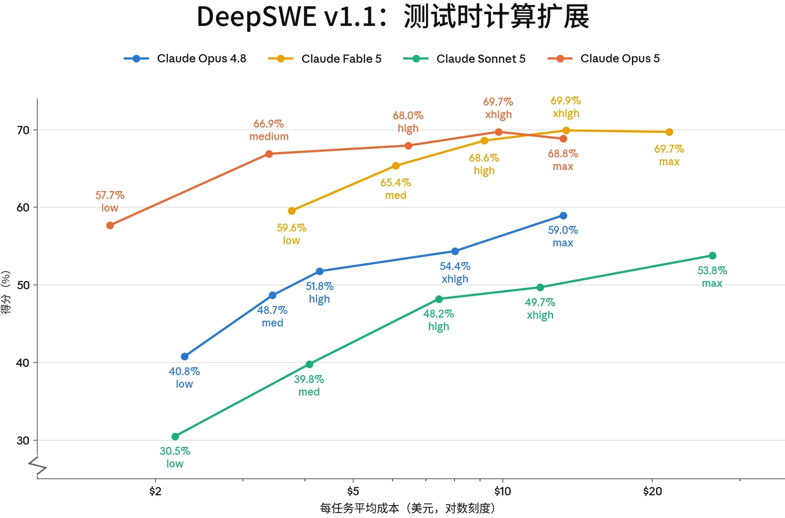

***[图 8.3.A] DeepSWE v1.1** 在不同推理强度（reasoning effort）档位下的得分与每任务平均成本的关系。*

### 8.4 FrontierCode

FrontierCode 是由 Cognition 创建的智能体编程基准测试，包含 150 个软件工程任务。任务源自开源代码仓库中的真实拉取请求（pull request），例如修复 `aiohttp` 中的 websocket 缺陷、加固 Prisma 的浏览器打包产物，或扩展 JSON schema 的 lint 规则。每个任务为智能体提供一个已检出的代码仓库和一条 issue 描述；随后智能体在容器化环境中自主工作，产出最终补丁，过程中没有人工干预，也不提供任何超时信息。补丁依据阻断性功能标准（主要是留出的单元测试）以及加权评分细则标准进行评分，其中包括由模型评分的检查项，用于检查所需的测试覆盖率和禁止的实现模式。任务由底层代码仓库的维护者编写，并经 Cognition 研究人员逐一审核，其中随机抽取的一部分任务经人工求解，以验证公平性。我们以 mean@5 报告 FrontierCode 的总分，这是一个综合指标，依据阻断性功能标准（留出的单元测试）以及加权的代码质量评分细则标准对每个补丁进行评分。

注：在 high 推理强度以上，FrontierCode 得分出现下降。这反映出 Opus 5 在这些推理强度档位下倾向于做出超出任务所需的修改（例如重构或进行其他改进代码库的编辑）。该评估的设计围绕编写无需人工修改即可合并的代码 diff 展开，因此其评分模型会惩罚可能不必要的超出范围的修改，即使这些修改质量很高或有所帮助。我们发现，在提示词中加入一条简短指令、告诉模型保持在任务范围之内，就能在大多数此类任务上恢复表现，表明这主要并非模型自身的局限。不过，我们在此基准上报告的 Opus 5 得分既未采用这一提示词修改，也未对官方评估做任何改动。



Opus 5 在 FrontierCode（Main）上排名第 2，得分 53.4%（每个模型均采用其最佳推理强度），优于 Claude Opus 4.8（46.5%），并领先 GPT-5.6 Sol（47.5%）。Opus 5 在 FrontierCode（Extended）上同样排名第 2，得分 63.6%，优于 Claude Opus 4.8（59.6%），并领先 GPT-5.6 Sol（60.6%）。

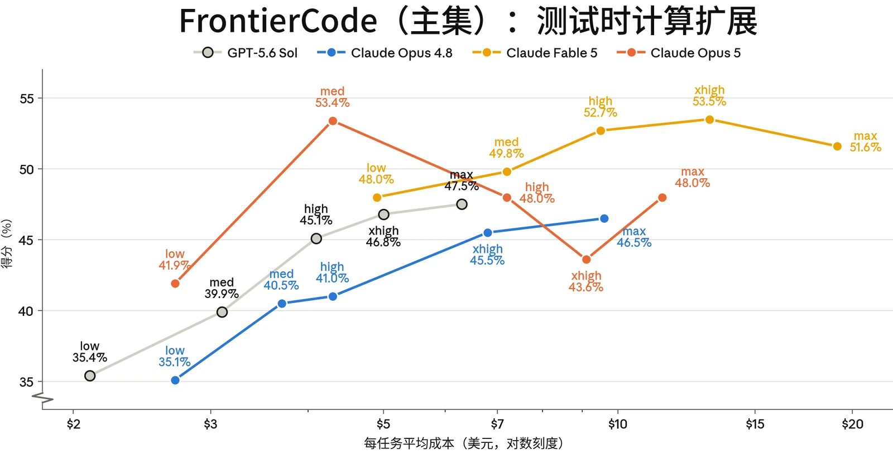

***[图 8.4.A] FrontierCode（主集）。**&#8203;Claude Opus 5、Claude Opus 4.8、Claude Fable 5 和 GPT-5.6 Sol 在 FrontierCode v1.1 主集上、于各模型五种推理强度设置下的得分；FrontierCode v1.1 是一项由 Cognition 运行并评分的编程评估。Claude Opus 5 在 medium 推理强度下取得其最佳主集得分 53.4。*



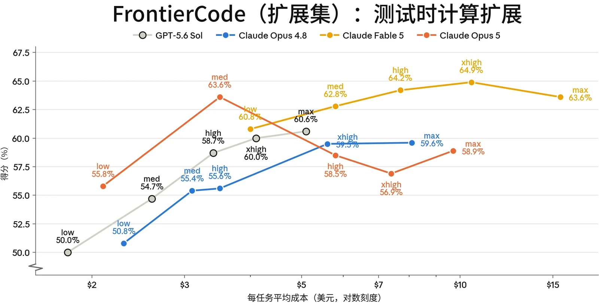

***[图 8.4.B] FrontierCode（扩展集）。**&#8203;Claude Opus 5、Claude Opus 4.8、Claude Fable 5 和 GPT-5.6 Sol 在 FrontierCode v1.1 扩展集上、于各模型五种推理强度设置下的得分；FrontierCode v1.1 是一项由 Cognition 运行并评分的编程评估。Claude Opus 5 在 medium 推理强度下取得其最佳扩展集得分 63.6。*

### 8.5 FrontierBench v0.1

FrontierBench v0.1 是 Terminal-Bench 2.1 的后继基准，由同一团队开发。它是一套更新的测试集，包含 74 个更难的任务，更加侧重科学与工程问题，例如计算生物学、物理仿真、CAD、形式化证明以及 GPU 性能优化工作。它在终端和命令行容器化环境中测试 AI 模型完成真实世界工作的能力。除表 8.1.A 中由 Harbor 运行的评估外，我们在此还报告我们自己在 GKE 后端上使用 [mini-SWE-agent](https://github.com/swe-agent/mini-swe-agent) 运行框架进行的评估。

在 FrontierBench v0.1 上，Claude Opus 5 使用 `xhigh` 推理强度取得了 44.4% 的平均奖励，该结果为 74 个不同任务各 5 次尝试的平均值（最佳结果——`max` 得分相近且在噪声范围内，为 43%）。`high` 推理强度取得 39% 的平均奖励，平均输出 token 少 19%；而 `low` 推理强度取得 25% 的平均奖励，平均输出 token 少 64%。

我们还在 Claude Fable 5 上运行了该基准，它在 `max` 推理强度下取得 33.7%；Claude Sonnet 5 的平均奖励为 17%；Claude Opus 4.8 取得 18.7%。



Opus 5 的安全分类器标记并拒绝了 5% 的 API 调用，涉及全部试验的 4%，这些调用回退（fallback）至 Opus 4.8。Fable 的安全分类器在 26% 的试验中标记了 42% 的 API 调用，同样回退至 Opus 4.8。

我们还报告了 GPT-5.6 Sol 37.5% 的平均奖励，它以 `max` 推理强度运行（其最佳结果），同样使用 `mini-swe-agent`，并同样使用与所有其他测试相同的 GKE 配置——[以保持比较公平](https://www.anthropic.com/engineering/infrastructure-noise)。GPT-5.6 Sol 在本评估中从未触发安全分类器，因此既未配置也不需要回退模型。

### 8.6 IMO 2026

国际数学奥林匹克（IMO）是一项面向尚未进入大学的学生的证明题竞赛，共六道题，分两天进行。它是数学奥林匹克赛道的最后一级，位于各国全国性奥赛之上，例如美国数学奥林匹克（USAMO）——此前的 Claude 模型曾在该竞赛上接受评估。2026 年 IMO 于 2026 年 7 月 15–16 日举行。

由于 IMO 的解答是证明而非简短答案，评分可能具有挑战性且带有主观性。对于每道题，我们让一个模型编写评分细则，并对照公开的参考解答对其进行核查。随后，Claude Opus 5 的每份解答由三个前沿模型（Gemini 3.1 Pro、Claude Opus 4.6 和 Claude Mythos Preview）组成的评审小组依据这些评分细则独立评判。只有当三名评判者一致同意时，答案才计为正确。

我们提示 Claude Opus 5 在不使用任何智能体运行框架或工具的情况下解答 IMO 2026 的每道题，并指示它给出严谨、自成一体的证明。我们设定了 256,000 token 的输出上限，并在 `max` 推理强度下使用自适应思考。耗尽输出上限的尝试会以较低的推理强度重新采样；其中有一份解答需要这一补救措施。

我们让 Opus 5 为六道题各生成四份独立解答。模型评审小组判定全部 24 份解答均正确。为佐证评审小组的评分，我们请人类专家为每道题批改一份预先指定的解答（即答卷包中的第一份）。这些专家同样判定每份解答均正确，并依据 IMO 评分细则各给出 7 分（满分 7 分）。Opus 5 的最终得分 42/42 相当于金牌水平，远高于 2026 年 29/42 分的金牌分数线。



### 8.7 RiemannBench

RiemannBench 是由 Surge AI 开发的私有基准测试，包含 25 道题，涵盖数学中的研究级主题。题目由数学教授、研究生以及拥有博士学位的 IMO 奖牌得主编写，旨在要求超出竞赛数学范围的、持续的多步理论推理。每道题都有唯一的闭式答案，并经程序化验证。

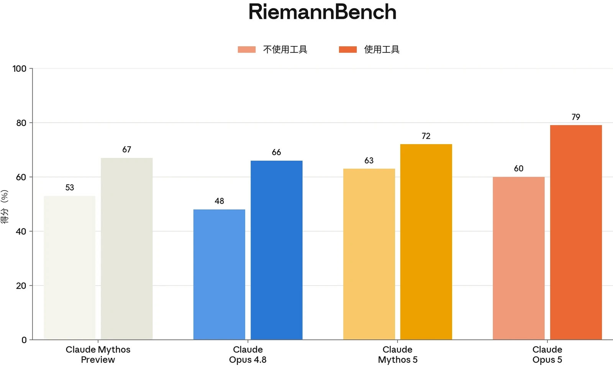

***[图 8.7.A] RiemannBench** 各 Claude 模型在使用工具和不使用工具情况下的得分。所有模型均以 max 推理强度运行。*

### 8.8 ArxivMath

ArXivMath 是由 MathArena 维护的研究级数学最终答案型基准。题目每月从近期 arXiv 论文摘要中提取，随后经过自动与人工检查筛选，以确保其自成一体、非平凡且可验证。由于题目取自活跃的研究，该基准比竞赛或奥赛类基准更贴近现实，也与数学研究联系更为紧密。



为避免与 Opus 的训练数据产生污染，我们使用 2026 年 6 月发布版（共 49 道题）评估 Claude Opus 5。Claude Opus 5 在 `max` 推理强度下，不使用工具得分 90.8%，使用工具得分 91.3%，均为每道题四次运行的平均值。相比之下，根据 MathArena 排行榜，GPT-5.6 Sol（max）得分 86.73%，Gemini 3.1 Pro Preview 得分 65.99%（均不使用工具）。

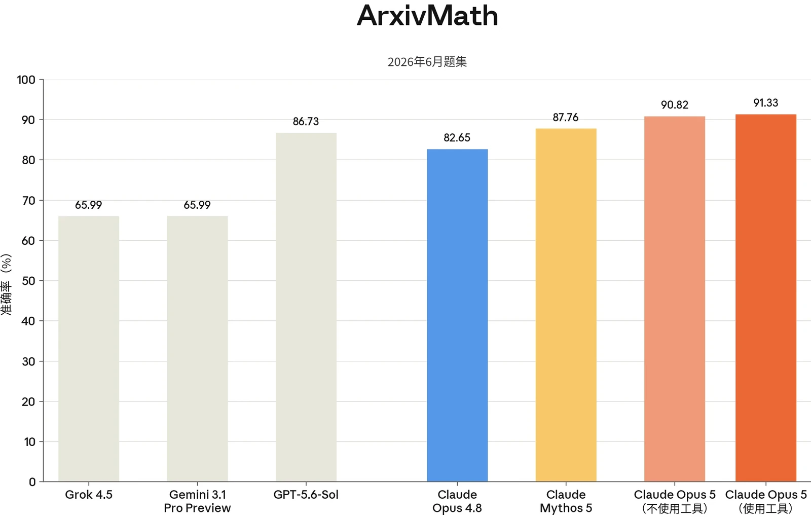

***[图 8.8.A] ArxivMath（2026 年 6 月）准确率得分。**&#8203;Claude Opus 5、Claude Mythos 5 和 Claude Opus 4.8 以 max 推理强度进行了内部评估；其他得分来自 MathArena 排行榜。除 Claude Opus 5（使用工具）外，其他得分均为无法使用工具时的结果。*

### 8.9 长上下文

#### 8.9.1 Programbench

ProgramBench 是一个长上下文智能体编程基准，包含 200 个程序重建任务。在仅获得一个由开源项目编译而成的二进制文件及该项目文档的情况下，智能体必须在不使用互联网访问或反编译工具的前提下，重建一个能复现原程序行为的代码库。任务涵盖从小型终端工具（jq、ripgrep）到大型系统（FFmpeg、SQLite、PHP 解释器）。提交结果依据基于执行的行为测试进行评分——整个基准共有 247,000 多个此类测试，通过智能体驱动的模糊测试生成。



我们排除了 34 个参考二进制文件本身在隐藏测试集上得分低于 0.9 的任务（表明测试不稳定），剩余 166 个任务；在这些任务中，我们只依据参考二进制文件能够通过的测试进行评分。我们报告 5 个回合的隐藏测试通过率，每个回合都在上一回合的代码库基础上继续，并拥有最多 100 万 token 的全新上下文预算。在该集合上，Claude Opus 5 在第一个回合后得分 83%，到第五个回合时提升至 93%。作为参照，Claude Opus 4.8 在第一个回合得分 80%，到第 5 个回合升至 90%；Mythos 5 则分别为 84% 和 93%。我们认为 ProgramBench 是衡量长上下文编程表现的有力指标：Opus 5 的各回合覆盖了直至完整 100 万 token 窗口的一系列上下文长度，且这些任务所测试的长上下文能力与实际下游用例高度契合。

### 8.10 智能体搜索

#### 8.10.1 HLE

Humanity’s Last Exam（HLE） 是一个多模态基准测试，包含跨越数十个学科的 2,500 道题，旨在让即便是领域专家也难以作答，且无法通过互联网搜索快速得到答案。

我们在两种配置下测试了 Claude Opus 5：（1）不使用工具的纯推理；（2）使用网络搜索、网页抓取、程序化工具调用和代码执行。在所有运行中，思考均设为 auto，且各上下文累计使用的 token 总量上限为 100 万。这些结果未使用上下文压缩（compaction）。Claude Opus 4.6 担任评分模型。

为防止使用工具的变体中出现结果污染，我们为搜索器和抓取器都屏蔽了已知讨论 HLE 的来源（见附录 9.1）。我们还使用 Claude Opus 4.8 审查所有对话记录，并标记任何看似从 HLE 专门来源获取了答案的记录；经确认的情况会被重新评为错误。

Claude Opus 5 在任一给定价位上均优于所有其他 Claude 模型。



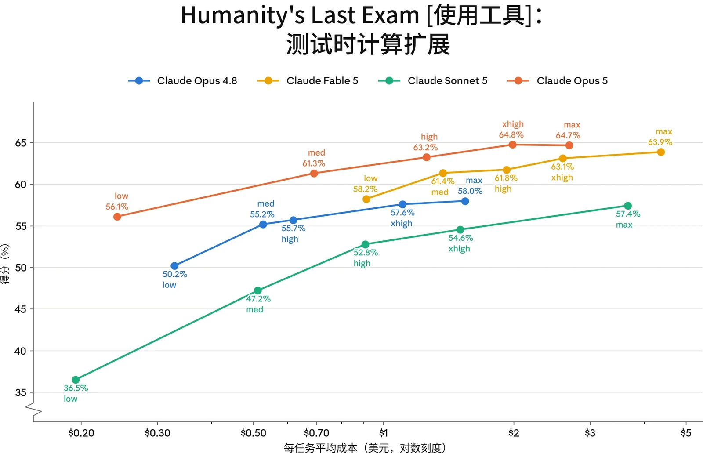

***[图 8.10.1.A] Humanity’s Last Exam（HLE）[使用工具] 推理强度扩展**。推理强度从 low 到 max 时 HLE 上的准确率，对应每任务平均计费成本（对数刻度）。Claude Opus 5 的成本为实际 API 计费。对比模型的成本在可获得时为实际计费，否则为缓存命中估算。*



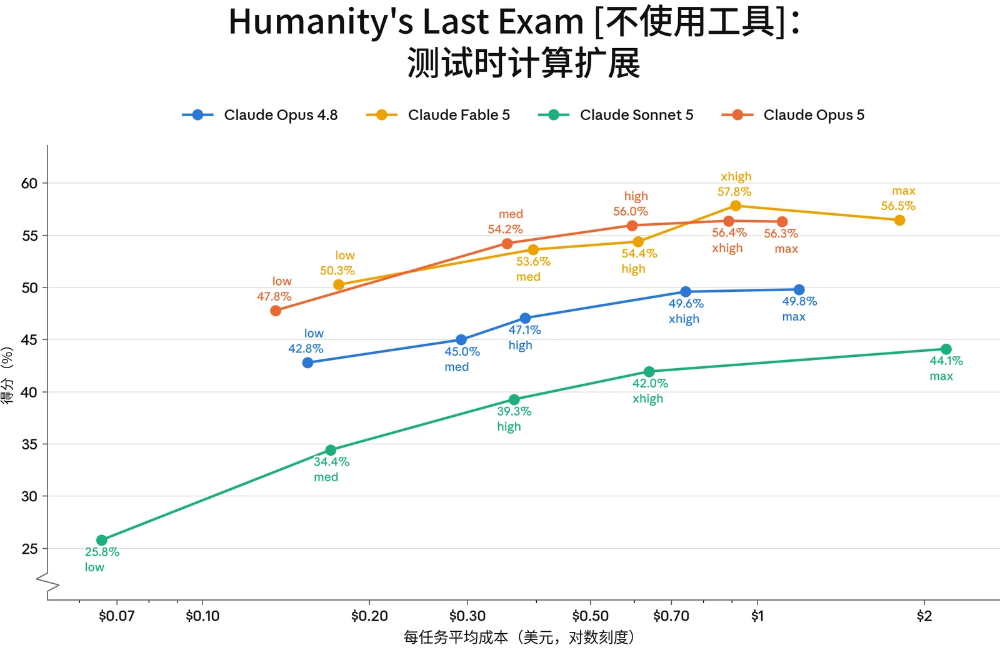

***[图 8.10.1.B] Humanity’s Last Exam（HLE）[不使用工具] 推理强度扩展**。推理强度从 low 到 max 时 HLE 上的准确率，对应每任务平均计费成本（对数刻度）。Claude Opus 5 的成本为实际 API 计费。对比模型的成本在可获得时为实际计费，否则为缓存命中估算。*

#### 8.10.2 BrowseComp

BrowseComp 测试智能体在开放网络上查找难以定位的信息的能力。我们在使用网络搜索、网页抓取、程序化工具调用和代码执行的条件下运行 Claude Opus 5。为突破 100 万 token 上下文窗口的限制，我们使用了上下文压缩，在 20 万 token 时触发。我们使用 Claude Opus 4.7 作为评分模型。

Claude Opus 5 在任一给定价位上均优于所有其他 Claude 模型。



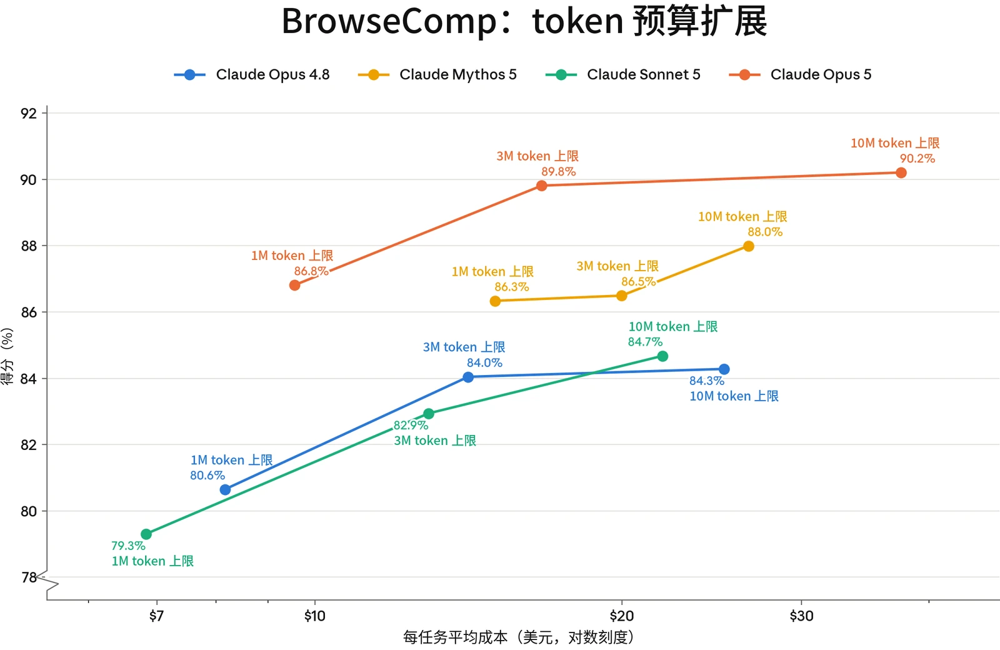

***[图 8.10.2.A] BrowseComp，token 预算扩展。**&#8203;每任务 token 预算从 100 万增长到 1000 万时 BrowseComp 上的准确率，对应每任务平均计费成本（对数刻度）。Claude Opus 5 的成本为实际 API 计费。对比模型的成本在可获得时为实际计费，否则为缓存命中估算。Opus 5 使用一种未发布的推理强度配置运行；对比模型以 max 推理强度运行。*



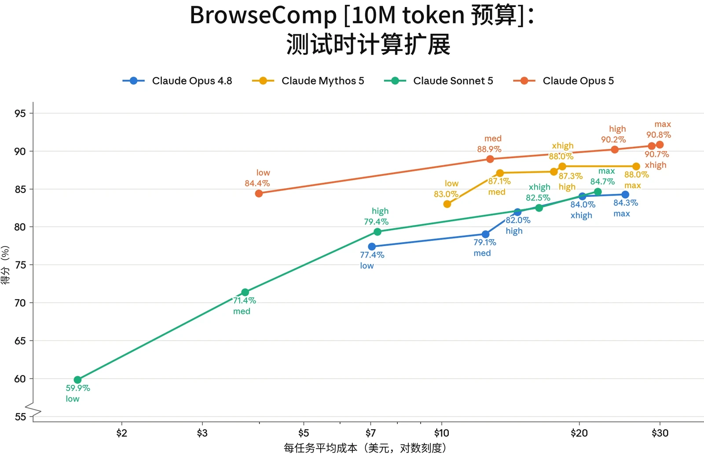

***[图 8.10.2.B] 1000 万 token 预算下的 BrowseComp，推理强度扩展。**&#8203;在固定 1000 万 token 预算下，推理强度从 low 到 max 时 BrowseComp 上的准确率，对应每任务平均计费成本（对数刻度）。Claude Opus 5 的成本为实际 API 计费。对比模型的成本在可获得时为实际计费，否则为缓存命中估算。*

#### 8.10.3 DeepSearchQA

DeepSearchQA 是“一个包含 900 个提示词的基准测试，用于评估智能体在横跨 17 个不同领域的困难多步信息检索任务上的表现”。其任务要求模型进行大量搜索，以汇编出详尽的答案列表。

Claude 模型在开启网络搜索、网页抓取、程序化工具调用和自适应思考的条件下运行。我们使用 100 万 token 的预算，且未使用上下文压缩。



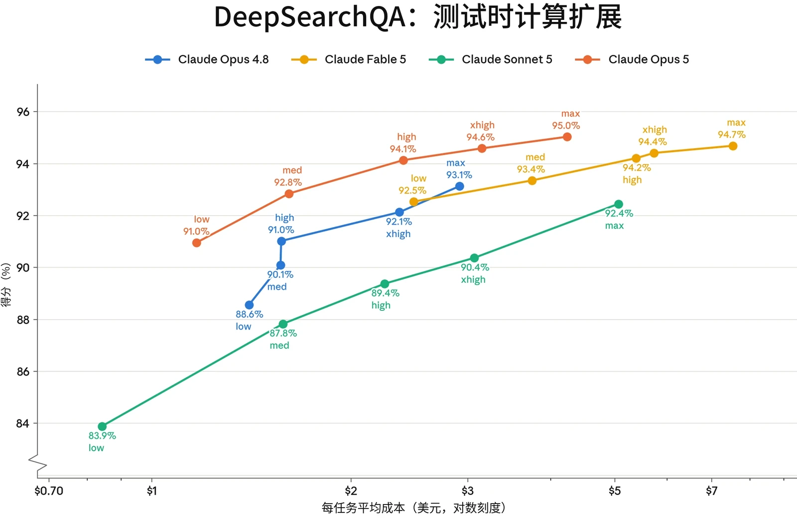

***[图 8.10.3.A] DeepSearchQA 推理强度扩展**。在 98 万 token 预算下，推理强度从 low 到 max 时 DeepSearchQA（900 道多跳网络研究题）上的平均 F1，对应每任务平均计费成本（对数刻度）。Claude Opus 5 的成本为实际 API 计费；对比模型的成本在可获得时为实际计费，否则为缓存命中估算。*

#### 8.10.4 DRACO

Deep Research Accuracy, Completeness, and Objectivity（DRACO）是 Perplexity 推出的深度研究基准，旨在评估模型在真实用户可能提出的复杂研究问题上的表现。DRACO 由 100 个精选任务组成，这些任务源自多个领域的真实用户查询。问题依据专家编写的评分细则进行评分，评分细则涵盖四个类别：事实准确性、分析的广度与深度、呈现质量以及引用质量。

我们在启用网络搜索、网页抓取、程序化工具调用、代码执行以及 100 万 token 上限的条件下评估了 Claude 模型。



**评分方法**
原始 DRACO 论文使用 Gemini 3 Pro 作为主要评判模型，但该模型已不再可用。在我们的评估中，我们使用 Opus 4.6 依据各任务的评分细则对回答进行评分，采用相同的二元 MET/UNMET 判定，并按照论文 §4.2 的公式汇总为归一化分数。我们遵循论文的实验方案，对每个回答进行五次独立评分运行并报告平均值。我们的评判提示词取自论文的[附录 C.5](https://arxiv.org/abs/2602.11685)。论文附录 A 表明，评判模型的选择可能使绝对分数变动 10–25 分，但系统排序保持不变，因此我们的分数不能与论文的主要公布数字直接比较。

除评判模型的更换之外，与原始论文唯一的其他差异在于：我们指示模型将完整的最终报告写入其执行环境中的一个文件，并且只对该文件的内容评分，而不是对完整的智能体对话记录评分；这样可以将交付物与中间工具输出隔离开来。此前的 Claude 评估则是用 `<result>` 标签标记报告范围；在 `high` 推理强度下，模型偶尔会遗漏这些标签，导致完整的报告被计为空白。基于文件的方案消除了这一依赖，对照运行表明，它挽回了这些损失，同时不会对分数产生其他影响。

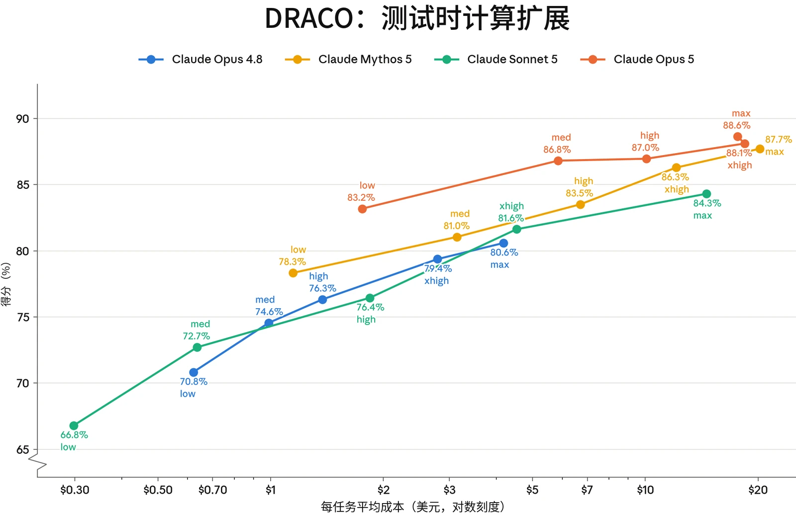

***[图 8.10.4.A] DRACO 推理强度扩展**。在 98 万 token 预算下，推理强度从 low 到 max 时 DRACO（智能体数据分析）上的归一化分数，对应每任务平均计费成本（对数刻度）。Claude*



Opus 5 的成本为实际 API 计费；对比模型的成本在可获得时为实际计费，否则为缓存命中估算。

### 8.11 多智能体

我们在多种多智能体配置下评估了 Claude Opus 5。在这些设置中，模型的多个实例协作完成同一个任务。下面我们重点介绍在两个基准测试上的结果：BrowseComp（§8.11.1）和 ProgramBench（§8.11.2），并介绍我们测试的运行框架（§8.11.3）以及测量方法（§8.11.4）。

#### 8.11.1 多智能体 BrowseComp

BrowseComp 测试智能体在开放网络上查找难以定位的信息的能力。我们使用第 8.11.3 节所述的两类运行框架运行了多智能体 BrowseComp，并采用第 8.11.4 节所述的方法分析了结果。图 8.11.1.A 和图 8.11.1.B 将多智能体 BrowseComp 结果与单智能体结果并列展示。以下是一些关键发现：

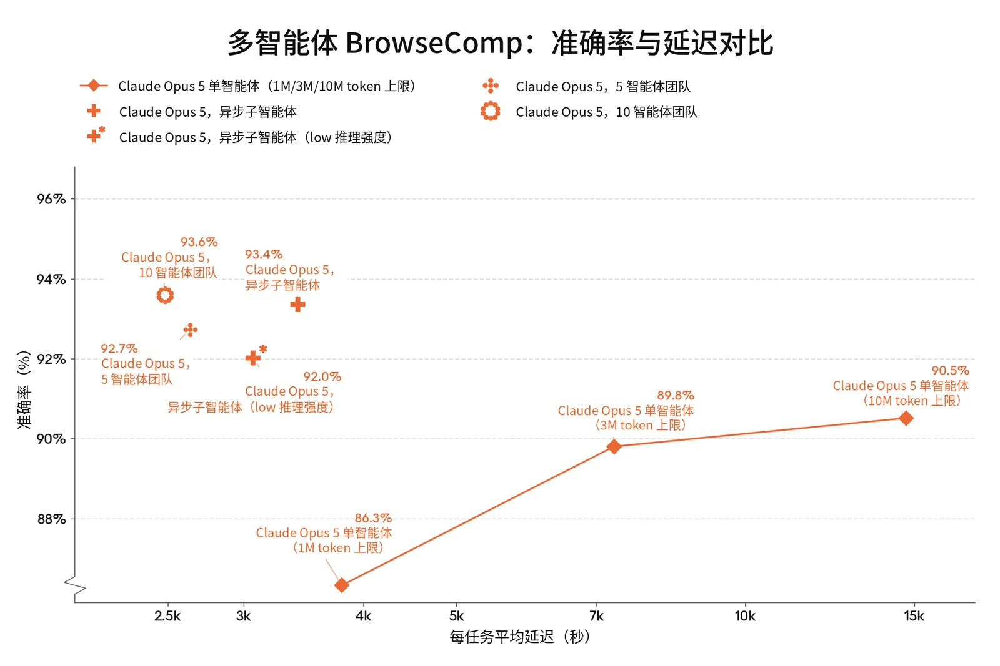

***[图 8.11.1.A] BrowseComp 在单智能体与多智能体配置下的准确率与延迟对比。**&#8203;如方法部分所述，本图中的分数是在 Claude Opus 5 的预发布配置上收集的，因此单智能体数字与上一节略有不同。*



**多智能体运行框架取得了最高分数，并在得分–延迟前沿上帕累托占优。**&#8203;每一种多智能体变体都达到或超过了最佳单智能体变体，其中 10 智能体团队取得了我们的最高分 93.6%，比最佳单智能体基线高 3.1 个百分点。随着智能体数量增加，延迟与准确率同步改善：相对于单智能体 1000 万 token 基线，N 智能体团队在 N=5 和 10 个智能体时分别实现了 5.6× 和 5.9× 的加速，而异步子智能体团队的得分也比该基线高 2.8 个百分点。

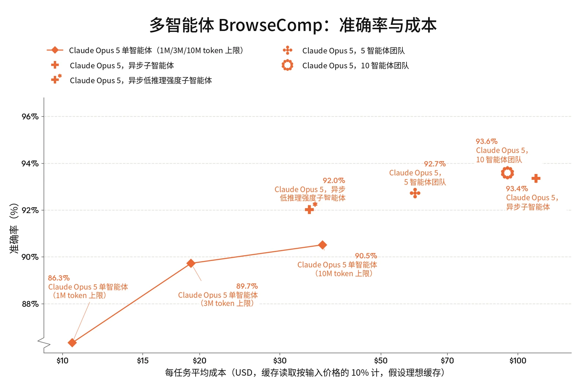

***[图 8.11.1.B] BrowseComp 在单智能体与多智能体配置下的准确率与成本对比。**&#8203;如下文方法部分所述，本图中的分数是在 Claude Opus 5 的预发布配置上收集的，因此单智能体数字与上一节略有不同。*

在得分–成本前沿上，多智能体将这一前沿向右上方延伸：图 8.11.1.B 显示，成本随智能体数量增加而与分数一同上升，这表明多智能体配置能够通过在智能体之间分配工作，有效地吸收额外的 token 预算。综合来看，多智能体运行框架提供了一种延迟与成本的权衡：当延迟很重要时，N 智能体团队或异步子智能体能够以更高的成本更快地达到给定分数。



#### 8.11.2 多智能体 ProgramBench

ProgramBench 是一个包含 200 个程序重建任务的智能体基准测试。智能体仅获得由某个开源项目编译而成的二进制文件以及该项目的文档，必须在不使用互联网访问或反编译工具的情况下，重建一个能够复现原始程序行为的代码库。单智能体结果已在第 8.9.1 节中介绍；本节介绍多智能体 ProgramBench 结果。

我们在 ProgramBench 上将 5 智能体团队和异步子智能体两种运行框架与单智能体基线进行比较评估，每个智能体的 100 万 token 上限相同。如第 8.9.1 节所述，我们排除了参考二进制文件在隐藏测试集上得分低于 0.9 的 34 个任务，剩下 166 个“黄金”任务。我们在一系列中间快照处进行评分，并利用由此得到的各任务分数、延迟和 token 轨迹，构建图 8.10.2.A 和图 8.10.2.B 中的累积曲线。



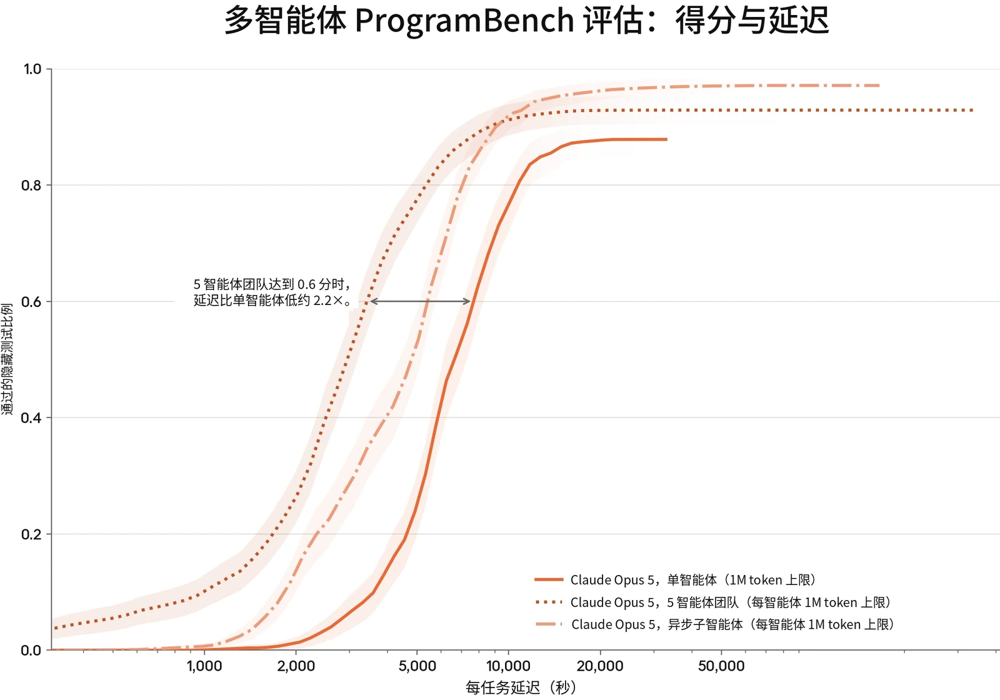

***[图 8.11.2.A] 全部 166 个“黄金”ProgramBench 任务上的分数与延迟对比。**&#8203;曲线上的一个点表示：如果每个问题都在该秒数处停止，所通过隐藏测试的平均比例。阴影区域表示 95% 置信区间（confidence interval），由各任务间的分数方差计算得出。随着问题完成运行，阴影带逐渐变淡：阴影带越淡，在曲线该点处仍贡献数据的问题越少。如方法部分所述，本图中的分数是在 Claude Opus 5 的预发布配置上收集的。*

从图 8.11.2.A 可见，在完整的黄金任务集上，与单智能体相比，5 智能体团队和异步子智能体在相同分数下均表现出延迟改善。具体而言，5 智能体团队达到相同的 0.6 分时，延迟比单智能体改善 2.2x。异步子智能体的曲线大体位于两者之间，相比单智能体有所改善，但幅度小于 5 智能体团队，之后反超领先，取得最高的最终分数。



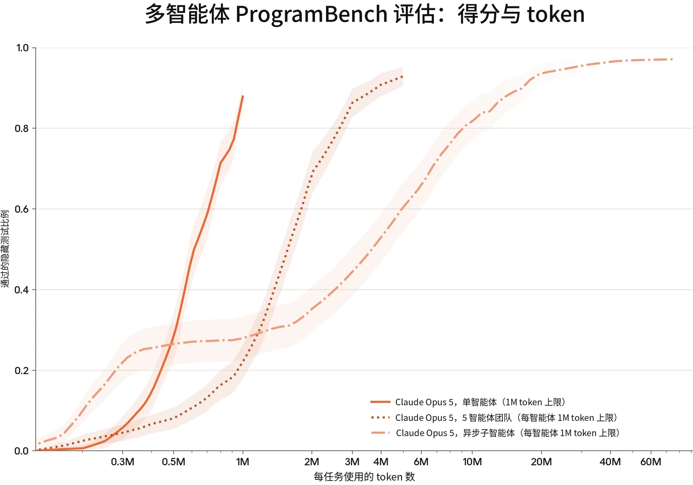

***[图 8.11.2.B] 全部 166 个“黄金”ProgramBench 任务上的分数与 token 对比。**&#8203;曲线上的一个点表示：如果每个问题都在该 token 用量处停止，所通过隐藏测试的平均比例。阴影区域表示 95% 置信区间，由各任务间的分数方差计算得出。随着问题完成运行，阴影带逐渐变淡：阴影带越淡，在曲线该点处仍贡献数据的问题越少。如方法部分所述，本图中的分数是在 Claude Opus 5 的预发布配置上收集的。*

图 8.11.2.B 显示了第 8.11.1 节所述的同样的延迟与成本的权衡。延迟上的收益来自对问题的并发处理以及消耗更多 token。

#### 8.11.3 多智能体运行框架

我们评估了两种多智能体运行框架。两者共享一组通用工具：搜索任务使用网络搜索、网页抓取、程序化工具调用（代码执行和 bash），编程任务使用 bash 工具。每个智能体的 token 上限为 100 万。

**N 智能体团队**。由 N=5 或 10 个对等智能体组成的团队并发处理任务。其中一个智能体被指定为主智能体，负责协调工作，并在需要时提交最终答案，但所有智能体拥有相同的工具，并且都能看到完整的任务描述。除任务工具外，每个智能体还拥有两个消息工具：Send Message，用于向一个或多个队友发送消息（插入在接收方下一个工具结果之后）；以及Wait for Message，它会阻塞采样，直到有消息到达。在 ProgramBench 上，每个智能体在各自的任务代码仓库检出副本中工作，并可通过 Git 与其他智能体共享代码。



该运行框架旨在模拟多个智能体协作完成共享任务的真实场景，并通过让对等智能体并行工作来降低延迟。

**异步子智能体**。在该运行框架中，我们从一个主智能体开始，它可以派生异步、长期存在的子智能体，同时保留对任务工具的直接访问。派生工具会立即返回确认信息，而不是等待子智能体执行。每个子智能体只能看到主智能体提供的指令，而看不到原始任务描述；子智能体可以向任何其他智能体以及主智能体发送消息。子智能体的最终回复会以消息形式传递给主智能体，此后该子智能体处于空闲状态，直到主智能体用新指令将其唤醒。子智能体拥有任务工具以及与 N 智能体团队相同的通信工具（即 Send Message 和 Wait for Message）；主智能体还额外拥有创建子智能体、删除子智能体（以释放并发槽位）以及查看子智能体状态（工作中、空闲或已终止）的工具。对于搜索任务，只有主智能体的最终提交会被评分。可派生的子智能体数量没有上限。

#### 8.11.4 评估方法

我们展示的结果侧重于比较单智能体与多智能体运行框架之间的差异，包括分数、延迟、token 用量和成本。具体而言，token 用量按一个任务上所有智能体消耗的 token 总数计算；成本基于 token 用量和按 token 计费的 API 价格计算，并假设缓存完全命中；延迟以推导的单任务延迟报告，而非原始的实际耗时。我们将每个智能体的输入和输出 token 数分别除以固定的参考预填充（prefill）与解码速率，加上其实测的工具执行时间，然后取所有智能体延迟中的最大值。这样可以将运行框架的结构性延迟（例如它需要多少串行的模型工作和工具时间）与服务端波动（例如批处理、排队、硬件）隔离开来，从而在同等条件下比较各运行框架。

本节中的分数，无论是单智能体还是多智能体的 BrowseComp 和 ProgramBench，都是在 Claude Opus 5 的预发布配置上收集的，使用了未发布的推理强度配置，且未启用安全防护分类器。这些分数有助于理解多智能体运行框架的相对性能，而非绝对性能。

BrowseComp 的运行在事后由验证用 Claude 和一条自动化流水线进行扫描，以识别答案泄露；任何被标记的问题都计为错误。



### 8.12 多模态

我们在四个基准测试上评估了 Claude Opus 5 的多模态能力，这些基准测试取自真实世界的智能体任务，反映了模型在专业场景中的部署方式：复杂图表推理（Chartography）、基于多视图渲染图的 CAD 生成（BenchCAD Vision2Code）、智能体计算机使用（computer use；OSWorld 2.0）以及专业文档理解（GDP.pdf）。

Claude Opus 5 展现出随测试时计算扩展的多模态能力。在 Chartography 和 GDP.pdf 上，Claude Opus 5 弥合了 Claude Opus 4.8 与 Claude Mythos 5 之间的差距，并在较低推理强度档位下提供高得多的性价比。在 BenchCAD Vision2Code 和 OSWorld 2.0 上，当分别为 Claude Opus 5 提供用于裁剪、分析和验证视觉输入与输出的工具，以及用于与图形用户界面交互的工具时，它在得分–成本前沿上相对 Claude Mythos 5 帕累托占优。

事实上，我们发现，智能体工具使用通常是一种比单独使用自适应思考更具成本效益的测试时计算扩展方式。在 Chartography 和 BenchCAD Vision2Code 上，与仅提供自适应思考相比，当同时提供自适应思考和一套标准工具时，Claude Opus 5 在相同或更低的成本下取得了显著更高的分数。

#### 8.12.1 Chartography

Chartography 是 Surge AI 推出的图表理解基准，涵盖 100 种在现有基准测试中很少被评估的专业图表类型，包括 Kaplan–Meier 生存曲线图、K 线图（蜡烛图）、等高线图、风玫瑰图、桑基图、伯德图和三维曲面图。由于不同图表类型可读取的精确程度不同，每个答案都依据专家为该特定图表设定的可接受范围进行评分，而不是采用单一固定的容差。

在所有运行中（无论是否使用工具），模型均配置为启用自适应思考和 `max` 推理强度。在使用工具进行评估时，模型会获得一个容器——其中包含图像文件并安装了标准库——以及一个图像裁剪工具。我们内部的 Chartography 评分实现与官方代码仓库中的任务以及专家确定的可接受答案范围一致。



Claude Opus 5 在不使用工具时得分 29.6%，使用工具时得分 83.0%。Claude Opus 4.8 分别得分 17.0% 和 75.0%，而 Claude Mythos 5 分别得分 36.0% 和 85.2%。

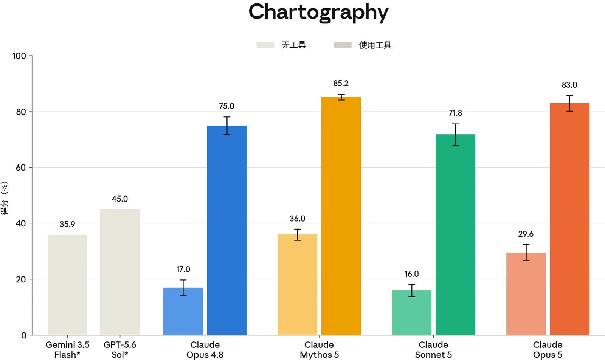

***[图 8.12.1.A] Chartography 分数。**&#8203;Claude 模型在自适应思考和 max 推理强度下进行评估，分别使用和不使用工具。分数为五次运行的平均值。图中显示 95% 置信区间。*&#8203;Gemini 3.5 Flash 和 GPT-5.6 Sol 的分数为 Surge AI 公开报告的结果，评估时未使用工具。\*

在 `max` 推理强度且使用工具的条件下，Claude Opus 5 取得了与 Claude Mythos 5 相近的表现，但在较低推理强度档位下，Claude Opus 5 在 Chartography 上既延伸了得分–成本前沿，又在该前沿上帕累托占优。事实上，我们发现，利用模型的智能体编程能力来处理、分析和裁剪图像，可能比单纯启用自适应思考显著更具成本效益。



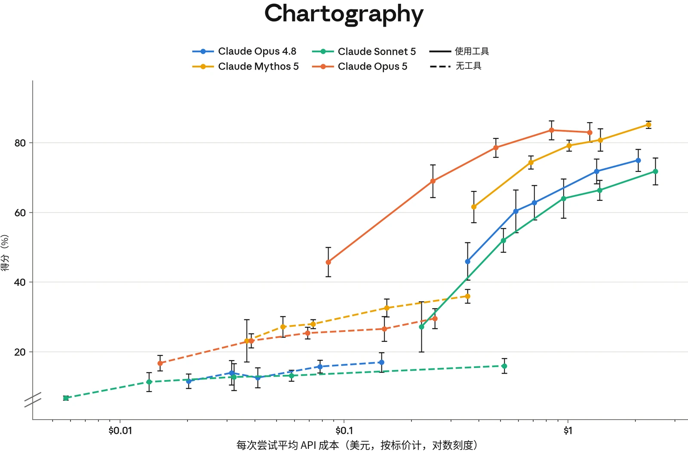

***[图 8.12.1.B] Chartography 分数。**&#8203;模型在不同推理强度档位下启用自适应思考进行评估，分别使用和不使用工具。我们使用 effort 参数来调整所花费的测试时计算量。分数为每个推理强度档位下五次运行的平均值。图中显示 95% 置信区间。*

#### 8.12.2 BenchCAD

BenchCAD 是一个程序化 CAD 推理基准测试，由 17,900 个经执行验证的 CadQuery 程序构建而成，覆盖 106 个工业零件族，其中大约一半以真实的 ISO、DIN、EN、ASME 和 IEC 规格表为依据。该基准测试将 CAD 能力分解为四个相互匹配的任务；我们报告 Vision2Code 任务的结果，该任务要求模型根据多视图渲染图生成 CadQuery 代码。

我们内部的 BenchCAD 实现与原始参考实现一致，仅有两处细微修改。第一，我们修正了参考系统提示词（system prompt）中的一处笔误，该笔误将提供给模型的渲染视图中的四个相机位置全部对调了。第二，我们更新了评分方式，使其除 Workplane 外也接受原始形状。在GPT-5.5 等模型上，我们注意到原始形状会因输出上的这种风格差异而报错，尽管其几何结构在其他方面是等价的。这两项更改均已合并到 GitHub 上的参考代码仓库中。



在所有运行中（无论是否使用工具），模型均配置为启用自适应思考和 `max` 推理强度。在使用工具的评估中，我们为模型提供了一个容器（其中已安装图像文件和标准库）以及一个图像裁剪工具。我们在已公开的 17,900 个 Vision2Code 文件中随机抽取 1,000 个文件组成子集进行评估；根据以往经验，该子集上的得分与完整集合上的得分相差在 0.01 体素 IoU（voxel IoU）以内。我们报告的是五次运行的平均体素 IoU 得分。

在 BenchCAD Vision2Code 的 1,000 个文件子集上，Claude Opus 5 不使用工具时的体素 IoU 得分为 0.366，使用工具时为 0.821。Claude Opus 4.8 的得分分别为 0.277 和 0.521，Claude Mythos 5 的得分分别为 0.378 和 0.678。

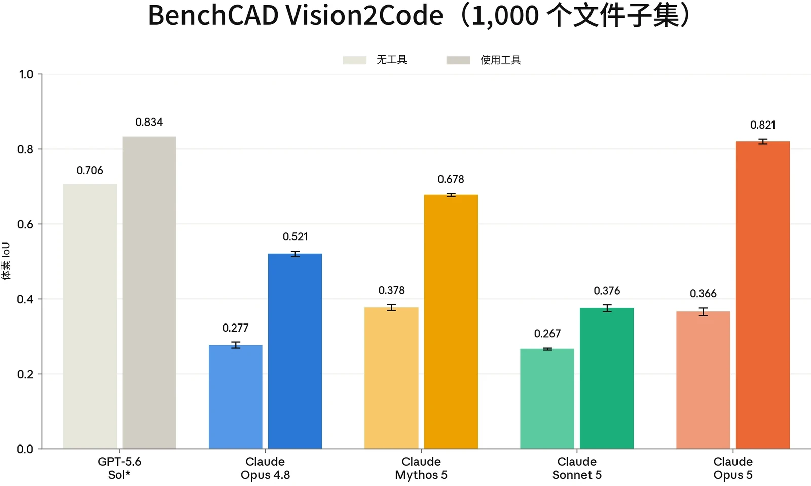

***[图 8.12.2.A] BenchCAD Vision2Code 子集得分。**&#8203;Claude 模型在自适应思考和 max 推理强度下评估，分别在使用工具和不使用工具的条件下进行。得分为五次运行的平均值，图中显示 95% 置信区间。*&#8203;GPT-5.6 Sol 的得分为 OpenAI 公开报告的数据，在完整的 17,900 个文件上评估。\*

Claude 模型在该评估上的表现越来越明显地随测试时计算而大幅提升，尤其是当模型配备了能够对中间输出进行视觉验证的工具时——而不仅仅是依靠自适应思考。事实上，在使用工具的情况下，Claude Opus 5 在 BenchCAD Vision2Code 上大幅超越了 Claude Mythos 5，在较高推理强度档位下尤为明显。



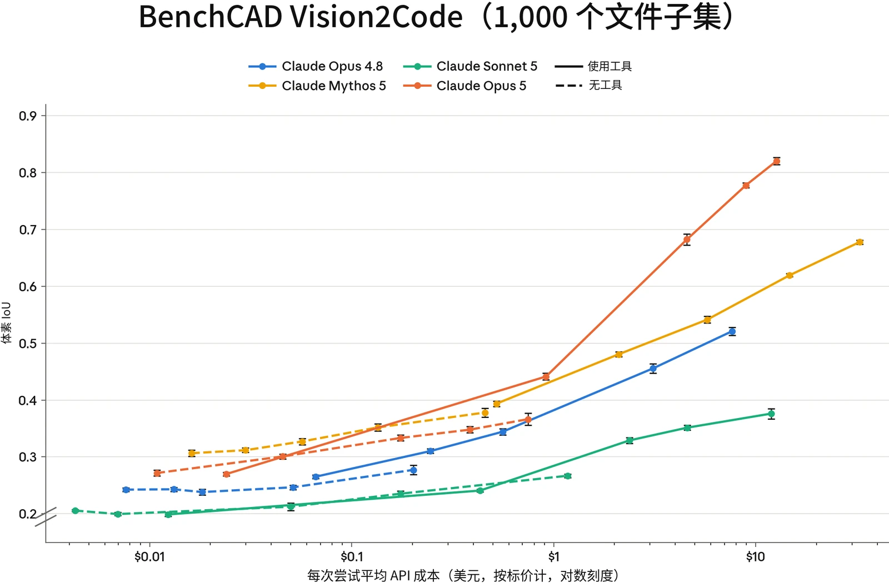

***[图 8.12.2.B] BenchCAD Vision2Code 子集得分。**&#8203;模型在不同推理强度档位的自适应思考下评估，分别在使用工具和不使用工具的条件下进行。我们使用 effort 参数来调整所投入的测试时计算量。得分为每个推理强度档位下五次运行的平均值。图中显示 95% 置信区间。*

#### 8.12.3 OSWorld 2.0

OSWorld 2.0 是一个多模态基准测试，评估智能体通过鼠标和键盘操作与一台实时运行的 Ubuntu 虚拟机交互、完成真实世界计算机任务的能力。我们沿用默认设置，分辨率为 1080p，每个任务的操作步数上限为 500。对于需要评分模型的任务，我们使用 Opus 4.8。

Opus 5 在 OSWorld 2.0 上取得了 70.57% 的得分（首次尝试成功率，五次运行的平均值）。我们还在 OSWorld 2.0 上评估了我们此前发布的模型（GPT 5.6 Sol 和 Muse Spark 1.1 的得分来自各自的发布文章）：



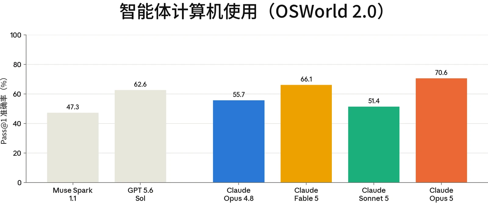

***[图 8.12.3.A] OSWorld 2.0** 各模型得分。Opus 5 在这一新发布的基准测试上达到了最先进水平。*

Opus 5 不仅是我们迄今为止最强的计算机使用模型，在计算机使用效率上也实现了显著跃升。

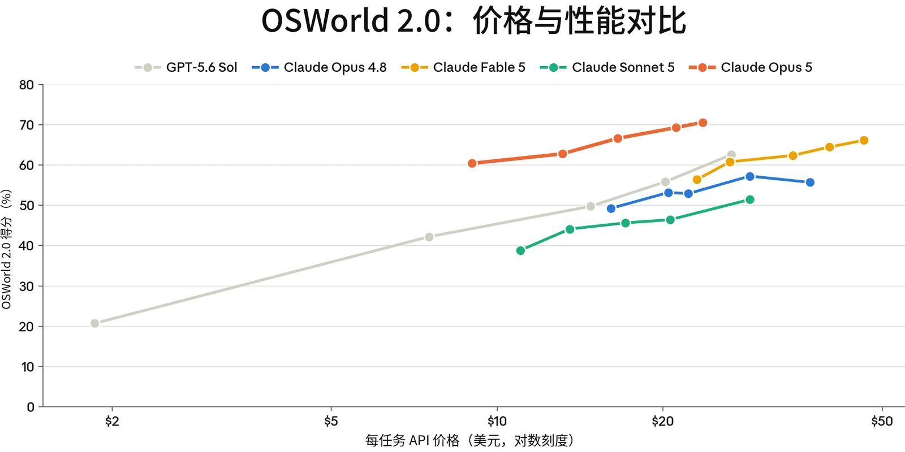

***[图 8.12.3.B] OSWorld 2.0** 各模型的价格与性能对比。*

#### 8.12.4 GDP.pdf

GDP.pdf 是 Surge AI 推出的专家级多模态推理基准测试，由 100 个真实世界提示词及 PDF 组成，直接取材于涵盖十个领域的专业工作流，包括金融、医疗健康、法律、工程和保险。该基准测试考察模型能否解析、交叉参照并综合支撑企业工作的高密度文档，包括解读多页剂量表、找出深藏于嵌套附件中的条款，以及在多份季度申报文件之间核对数字。



我们使用内部运行框架评估 GDP.pdf，分别在使用工具和不使用工具的条件下进行。在不使用工具的评估中，为与 Surge 的输入提示词保持一致，我们向模型提供 base64 编码的 PDF。不过与 Surge 不同的是，对于超出我们 API 32MB 请求大小上限的 PDF，我们会将其截断（而非丢弃）。我们使用 Opus 4.7 而非 Gemini 3 Flash 作为评判模型。在使用工具的评估中，我们为模型提供了一个容器（其中已安装 PDF 文件和标准库）以及一个图像裁剪工具。

我们修复了运行框架中的一个缺陷：该缺陷会对超过 100 页但小于 32MB 请求大小上限的 PDF 进行不必要的截断。修复这一问题后，与我们此前发布的结果相比，内部运行框架得出的分数有了显著提升。我们使用更新后的运行框架重新运行了此前的模型，并在下方绘制了修正后的分数。我们报告的是平均评分项通过率（即各任务中被满足的评分细则条件所占比例，在已完成的运行上取平均），而非严格通过率。我们在全部 100 个提示词上评估模型，并取五次运行的平均分。

在 GDP.pdf 上，Claude Opus 5 不使用工具时的平均评分项通过率为 83.4%，使用工具时为 85.5%。Claude Opus 4.8 的得分分别为 77.5% 和 84.8%，Claude Mythos 5 分别为 81.8% 和 87.3%。我们注意到，在不使用工具的设置下，Claude Opus 5 对 Claude Opus 4.8 和 Claude Mythos 5 均构成帕累托占优，以相同或更低的成本取得了显著更高的分数。不过，在使用工具的设置下，Claude Mythos 5 在 GDP.pdf 上仍在 Claude 模型中保持领先。



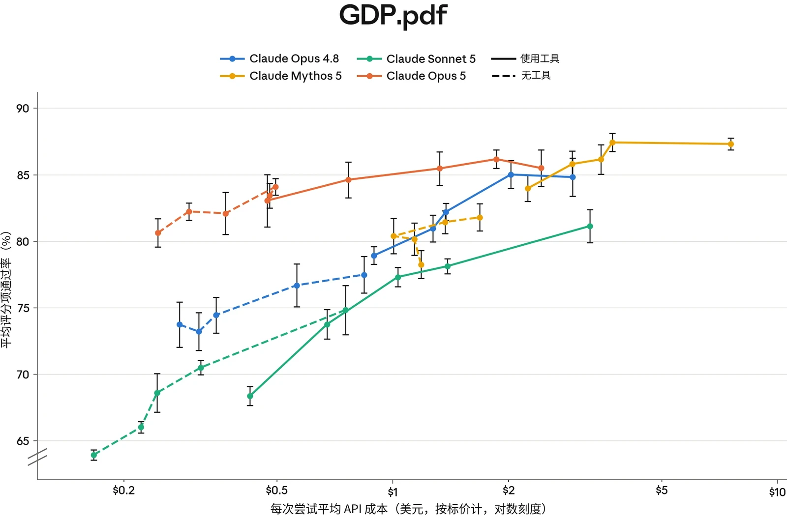

***[图 8.12.4.A] GDP.pdf 得分。**&#8203;模型在不同推理强度档位的自适应思考下评估，分别在使用工具和不使用工具的条件下进行。我们使用 effort 参数来调整所投入的测试时计算量。平均评分项通过率为每个推理强度档位下五次运行的平均值。图中显示 95% 置信区间。*

### 8.13 真实世界专业任务

#### 8.13.1 OfficeQA

OfficeQA 是 Databricks 推出的公开基准测试，评估模型在大量历史 Treasury Bulletin（美国财政部公报）文档语料上进行端到端有据推理的能力。模型必须在整个语料中定位相关表格，并基于这些表格进行精确的数值推理。我们以智能体方式进行评估：文档以提取后的文本形式提供在沙箱化的环境中，并提供代码执行工具；OfficeQA Pro 是其中难度更高的 133 题子集，推荐用于前沿模型。

Claude Opus 5 在 OfficeQA 上取得 78.1%，在 OfficeQA Pro 上取得 66.9%。这略高于 Claude Opus 4.8（分别为 77.6% 和 66.2%），略低于 Claude Mythos 5（分别为 79.0% 和 67.1%）。Claude Opus 5 是在公开的 Messages API 上评估的，并启用了生产环境安全防护措施（安全分类器，在分类器拒绝时回退到 Claude Opus 4.8）；对比模型则是在内部 API 上评估的，未启用这些安全防护措施。



#### 8.13.2 MCP Atlas

MCP-Atlas 评估语言模型通过 Model Context Protocol（MCP）进行真实世界工具使用的表现。该基准测试衡量模型执行多步骤工作流的能力——发现合适的工具、正确调用工具，并将结果综合为准确的回答。任务涉及在类生产环境的 MCP 服务器环境中进行多次工具调用，要求模型使用真实的 API 和真实数据、处理错误与重试，并在不同服务器之间进行协调。

Claude Opus 5 取得了 85.8% 的通过率，高于 Opus 4.8 的 82.2%。89.1% 的平均要点覆盖率表明，剩余的失败大多是部分失败而非完全失败。在我们计算该基准测试分数之后，我们生产部署的推理强度设置可能略有变化，因此部分分数可能无法精确复现。

#### 8.13.3 Legal Agent Benchmark

Legal Agent Benchmark（LAB）是由 [Harvey AI](https://www.harvey.ai/) 创建的开源基准测试。该基准测试包含 1,200 多个任务，涵盖 24 个不同的执业领域。每个任务包含一个封闭文档集，其中有电子邮件往来、律所模板、程序性文件以及其他客户案件材料，智能体必须从中筛查信息以完成任务。任务指令以合伙人向授薪律师发出的简短“工作委托”形式撰写，并规定了预期的输出文档及其格式。评估采用通过/不通过方式，由 LLM 评判模型（LLM-as-Judge）依据一套由专家撰写的评分细则标准进行（每个被评估任务的标准数：最少 23 条，中位数 56 条，最多 194 条）。LAB 的标准报告方式仅在所有标准均满足时才将任务视为成功。

我们在 1,235 道题上测试了 Claude Opus 5（1,251 道题中有 16 道因数据缺陷被排除；这些排除项是在测试前确定的）。它取得了 23.58%（± 0.48，n=5）的全通过率和 93.74% 的平均评分项通过率（自适应思考，`max` 推理强度）。Claude Opus 5 是在公开的 Messages API 上、在生产环境安全防护措施下评估的，当安全分类器被触发时回退到 Claude Opus 4.8。自我们此前报告 LAB 结果以来，我们对评分流水线做了少量修复：正确渲染 .docx 交付物中的 Word 修订痕迹，以及恢复因达到 token 上限而被截断的输出；我们估计，这两项修复合计会使任何被评估模型的全通过分数提高 0.5–1 个百分点。我们的运行框架是一个内部重新实现的版本，保留了 LAB 的任务内容、评分细则标准、全通过计分方式以及默认评判模型（Claude Sonnet 4.6），但工具集有所缩减。公开运行框架提供 bash、read、write、edit、glob 和 grep 工具，而我们只提供 bash 和一个 Python 工具。根据 Harvey 在其留出集上的评估，Claude Opus 5 取得了 11.7% 的全通过率和 94.1% 的平均评分项通过率。



#### 8.13.4 GDPval-AA

GDPval-AA v2 由 [Artificial Analysis](https://artificialanalysis.ai/) 开发，是一个独立的评估框架，用于在具有经济价值的真实世界专业任务上测试 AI 模型。该基准测试使用了 OpenAI 的 [GDPval 黄金数据库](https://huggingface.co/datasets/openai/gdpval)中的 220 个任务，涵盖 9 个主要行业的 44 种职业。任务模拟实际的专业工作成果，包括文档、幻灯片、图表和电子表格。模型在智能体循环中获得 shell 访问权限和网页浏览能力来解决任务，其表现通过对模型输出进行盲评两两比较得出的 ELO 评分来衡量。Claude Opus 5 占据了排行榜前两名：`max` 推理强度下 ELO 为 1861，`xhigh` 下为 1827。`xhigh` 设置仍优于其他所有模型，同时比 `max` 少用 25% 的输出 token。评估由 Artificial Analysis 独立运行。

#### 8.13.5 AA-Briefcase

[AA-Briefcase](https://artificialanalysis.ai/articles/aa-briefcase) 由 Artificial Analysis 开发，是一个新的基准测试，面向由行业专家构建的复杂项目中的长程知识工作。模型需要完成为期数周的项目，其中包含许多相互关联的任务和数千个输入源文件；评分结合了评分细则打分以及由前沿模型评审团进行的成对评判，以衡量可验证的任务完成情况、分析质量和呈现质量。Claude Opus 5 占据了排行榜前三名：`max` 推理强度下 ELO 为 1720，`xhigh` 下为 1693，`high` 下为 1606。`xhigh`/`high` 设置仍优于其他所有模型，同时比 `max` 分别少用 15%/33% 的输出 token。评估由 Artificial Analysis 独立运行。

#### 8.13.6 Toolathlon Verified

Toolathlon 是一个智能体基准测试，包含 108 个真实世界工具使用任务，涵盖办公生产力、电子商务与运营、数据分析以及网络调研。任务以真实的应用状态为初始设定，并由基于执行的检查器评分，这些检查器会核验生成的产出物及其副作用。该基准测试在 32 个应用中提供了 600 多个工具，任务要求在长程任务中正确选择工具、进行多步骤编排，并给出与检查器要求完全一致的输出——在我们的运行中，轨迹平均约为 20–26 个助手轮次。我们针对 Toolathlon-Verified 进行了评估，这是作者的最终版本（2026 年 6 月），其中任务提示词、标准答案和评估器均经过人工审核并定稿，并公开了八个模型的参考轨迹以供外部验证。



| **模型** | **Pass@1** | **Pass@3** | **Pass³** | **平均轮次** |
|---|---|---|---|---|
| **Claude Opus 5** | 80.6 | 87.0 | 73.1 | 23.5 |
| **Claude Mythos 5** | 79.3 | 86.1 | 73.1 | 19.8 |
| **Claude Opus 4.8** | 79.9 | 88.0 | 71.3 | 20.4 |
| **Claude Sonnet 5** | 74.7 | 84.3 | 65.7 | 24.5 |

我们在 `max` 推理强度的自适应思考下运行内部运行框架，未启用安全分类器或回退。按照论文的实验方案，我们报告在全部 108 个任务上三次试验平均的 Pass@1，以及 Pass@3（三次试验中至少一次正确）、Pass³（三次试验全部正确）和每条轨迹的平均助手轮次数。

Claude Opus 5 取得了 80.6% 的 Pass@1，领先于在同一运行框架上评估的 Claude Opus 4.8（79.9%）和 Claude Sonnet 5（74.7%）。

***[表 8.13.6.A] Toolathlon 得分（内部运行框架）。**&#8203;模型在 max 推理强度的自适应思考下评估。Pass@1、Pass@3 和 Pass³ 按照论文的实验方案，在全部 108 个任务上基于每个任务 3 次试验计算。*

我们的运行框架在任务定义、提示词和基于执行的检查器上与 Toolathlon-Verified 逐字节一致，我们通过重放作者公开的参考轨迹验证了这一点。为控制实时依赖漂移，我们将金融数据源固定为运行时录制的快照，并固定容器镜像。少量上游检查器缺陷（例如，标准答案引用了一个后来已更名的代码仓库）对所有模型的影响是对称的，我们未作改动。

关于与公开排行榜可比性的说明：我们得到的 Claude Sonnet 5 和 Claude Opus 4.8 数值比公开排行榜上的数值（71.6% 和 76.2%）高出约 3 个百分点。这一差距完全来自*空尝试*——即作者的运行框架未产生任何轨迹的运行（Sonnet 5 为 324 次中的 8 次，Opus 4.8 为 11 次）。排行榜将这些计为失败；排除这些后，我们的数值与作者公开的参考轨迹在运行间噪声范围内一致。

#### 8.13.7 AutomationBench

AutomationBench 是 Zapier 推出的基准测试，衡量智能体能否完成一个贴近现实的端到端业务工作流。任务基于销售、市场营销、运营、客服、财务和人力资源等领域的真实客户工作流模式设定。每个任务都会将智能体置于一家模拟公司中，该公司拥有数十个 REST API 端点，覆盖 47 个应用（CRM、Slack、Google Workspace 等）。在仅给出一条自然语言指令的情况下，智能体必须通过搜索自主发现正确的端点，进行数十次相互依赖的顺序 API 调用，查阅并遵守分层业务政策文档，同时避开刻意设置的干扰项。每个任务的评分为通过/不通过，依据是否满足针对模拟应用状态的所有确定性断言（例如，所有正确的 CRM 更新均已应用）。



在 AutomationBench 的排行榜（衡量在一个非公开留出评估集上的表现）上，Claude Opus 5（`max` 推理强度）得分 26.0%，较 Claude Opus 4.8（`max` 推理强度）的 17.0% 和 Claude Fable 5 的 17.4% 有大幅提升。值得注意的是，在 `medium` 推理强度下，Claude Opus 5 以每任务 \$0.89 的成本取得 24% 的得分，以不到一半的成本显著超越了 Claude Opus 4.8 和 Fable 5。

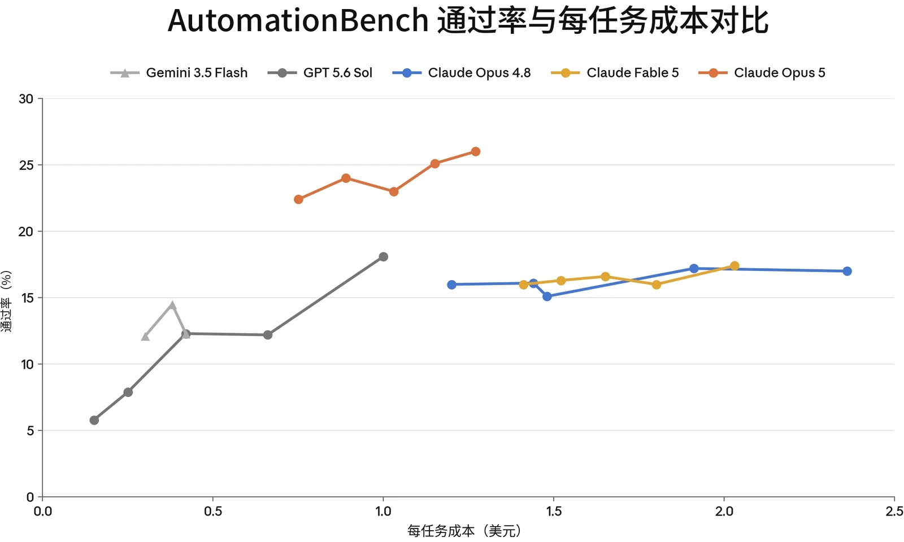

***[图 8.13.7.A] AutomationBench 得分。**&#8203;Claude Opus 5 的表现高于此前任何 Claude 模型，且任务成本更低。*

### 8.14 ARC-AGI

#### 8.14.1 ARC-AGI-1 & ARC-AGI-2

ARC-AGI 是由 ARC Prize Foundation 开发的流体智力基准测试，旨在衡量 AI 模型在仅给出少量（通常约 3 个）示例的情况下推理新颖模式的能力。模型会获得若干组满足某种隐藏关系的网格输入–输出对，任务是针对一个新的输入网格推断出相应的输出。这些测试使用半私有验证集，以确保不同模型之间的一致性与公平性。



ARC Prize Foundation 报告称，在其半私有数据集上，Claude Opus 5 在 `max` 推理强度下于 ARC-AGI-1 取得 97.50% 的验证分数，于 ARC-AGI-2 取得 90.42% 的验证分数。ARC-AGI-2 的结果相比此前的 Claude 模型有大幅提升（Claude Opus 4.7 在 `max` 推理强度下报告的成绩为 75.83%）。

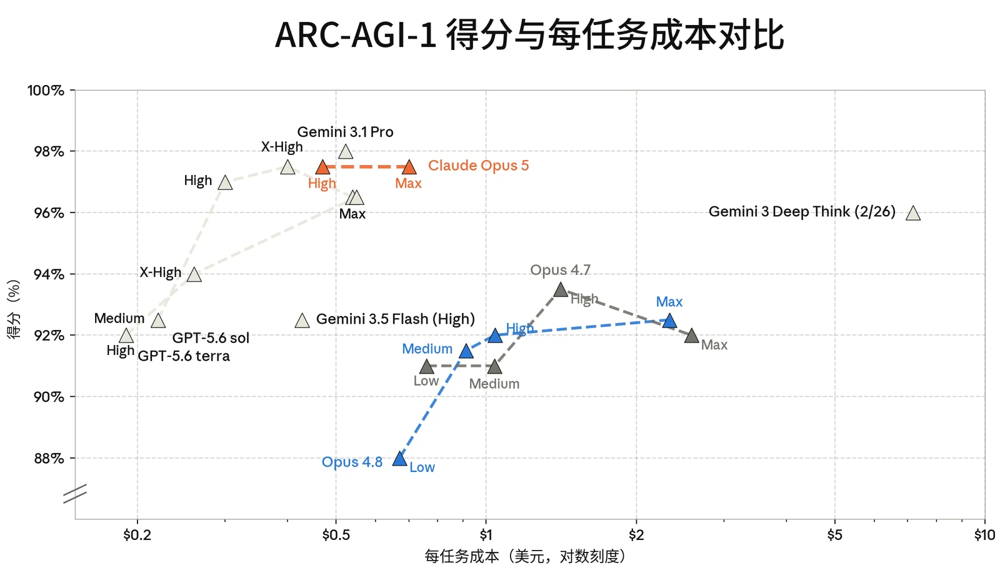

***[图 8.14.1.A] ARC Prize Foundation 报告的 ARC-AGI-1 表现。**&#8203;Claude Opus 5 在 max 推理强度下于 ARC-AGI-1 取得 97.50%。*



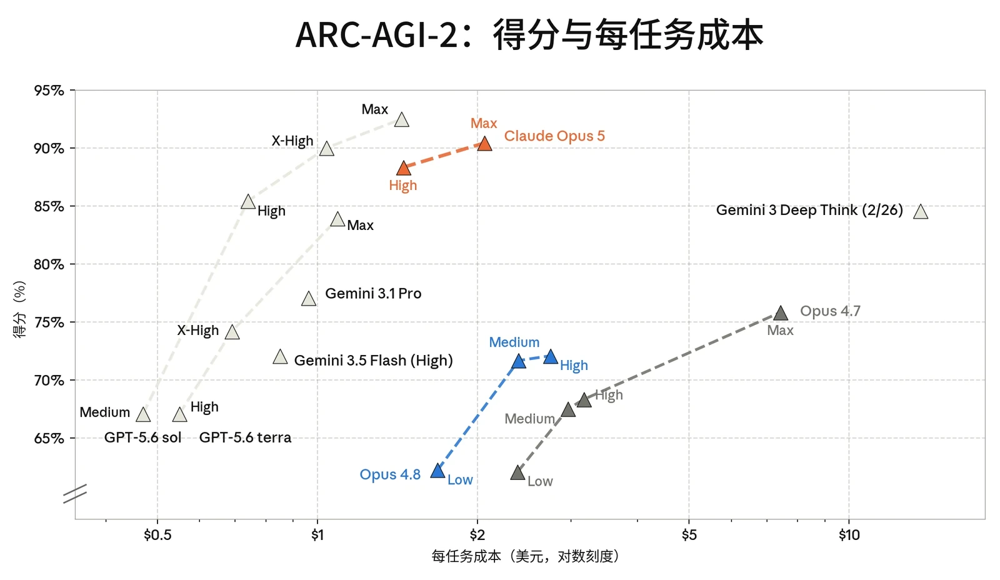

***[图 8.14.1.B] ARC Prize Foundation 报告的 ARC-AGI-2 表现。**&#8203;Claude Opus 5 在 max 推理强度下于 ARC-AGI-2 取得 90.42%。*

#### 8.14.2 ARC-AGI-3

ARC-AGI-3 是 ARC Prize Foundation 最新推出的基准测试：一项交互式评估，由新颖的回合制游戏环境构成，没有任何说明、规则或明确目标。模型必须探索每个环境，弄清其运作方式以及何为获胜，并将所学带入难度逐步提升的各个关卡；评分以效率为基础，并以人类行动基线为参照。所报告的结果基于一个由游戏组成的半私有评估集。

ARC Prize Foundation 报告称，Claude Opus 5 在 ARC-AGI-3 半私有评估中取得 30.16% 的验证分数（在 high 推理强度下取得），约为官方排行榜此前报告的最佳成绩的四倍。GPT-5.6 Sol 在 max 推理强度下达到 7.78%，Claude Opus 4.8 在 high 推理强度下达到 1.52%。在发布时，Claude Opus 5 在 max 推理强度下的结果尚不可得。



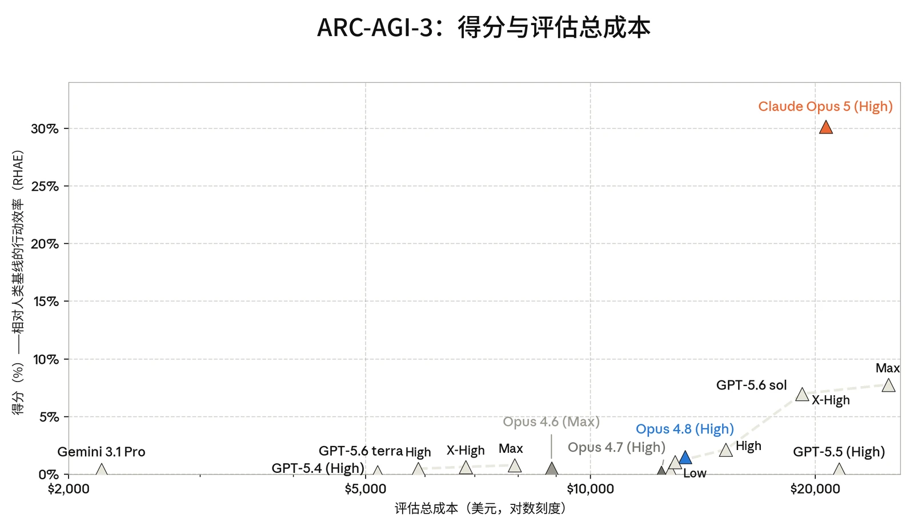

***[图 8.14.2.A] ARC Prize Foundation 报告的 ARC-AGI-3 表现。**&#8203;Claude Opus 5 在 high 推理强度下取得 30.16% 的相对人类行动效率（Relative Human Action Efficiency，RHAE）得分。*

ARC Prize Foundation 还分享了一份关于 Claude Opus 5 如何处理该任务的分析，该分析由一个 LLM 评判模型审阅模型在单个游戏上的对话记录后生成。模型以 100 分完成了 Axis Reflect（ar25），用 294 次行动通过了全部八个关卡。评判模型认为，它在该游戏中的决定性优势在于将视觉谜题转化为显式的代数问题。到第 2 关时，它已推导出一个简单的反射方程；到第 8 关时，它已将其推广到二维反射，把 60 个目标划分为相互镜像的象限，并在执行前计算出每个部件的目标位置。评判模型还指出，模型在某一关上出现了一些假设反复更替的情况——它探索了一些复杂且未经验证的理论，随后又突然自我纠正——同时伴有重复性的叙述。但评判模型观察到，失败的探索更新了模型的理解，而不是使其陷入循环。评判模型总结道：“一旦找到正确的本体，执行就极其可靠。”



### 8.15 医疗健康

#### 8.15.1 HealthBench 结果

HealthBench 是一项开源评估，旨在评估在真实医疗健康情境中的安全性、准确性和沟通能力。该基准测试使用超过 48,000 条由专家撰写的评分细则条目，对 5,000 段多轮患者对话进行评分。

Claude Opus 5 取得 67.1% 的原始得分，为所有 Claude 模型中最高，领先于 Claude Mythos 5 的 62.5%、Claude Opus 4.8 的 58.8% 和 Claude Sonnet 5 的 59.2%。经过长度校正（对冗长的模型回复进行扣分）后，Claude Opus 5 的得分为 57.8%。

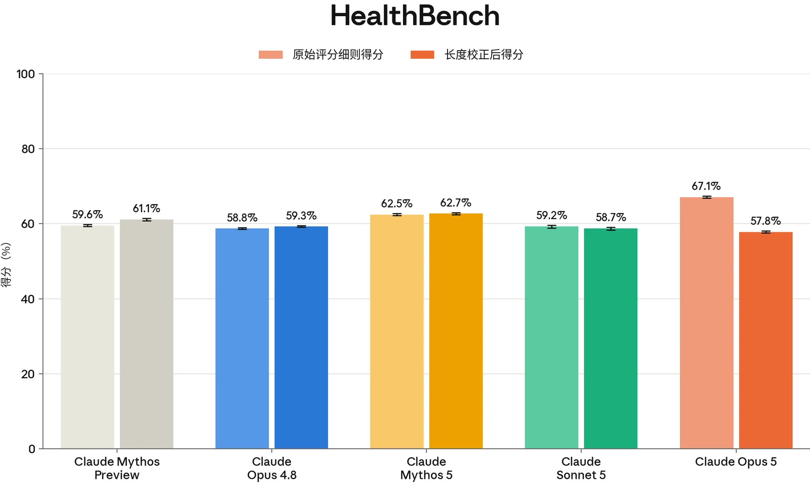

***[图 8.15.1.A] HealthBench 原始得分与长度校正后得分**。所有 Claude 模型均使用 max 推理强度下的自适应思考。Claude Opus 4.8 为评分模型。得分为 5 次试验的平均值。所有模型均未提供工具或定制的系统提示词。长度校正后得分采用 OpenAI 的 GPT 5.5 系统卡中公布的方法计算。图中显示 95% 置信区间。*



#### 8.15.2 HealthBench Professional 结果

HealthBench Professional 是一项临床任务基准测试，由 525 段医生撰写的对话组成，涵盖临床会诊、文书记录和研究任务，每段对话均由 LLM 评判模型依据评分细则标准进行评分。

Claude Opus 5 取得 73.4% 的原始得分，为所有 Claude 模型中最高，领先于 Claude Mythos 5 的 70.3%、Claude Opus 4.8 的 60.3% 和 Claude Sonnet 5 的 62.4%。经过长度校正（对冗长的模型回复进行扣分）后，Claude Opus 5 的得分为 59.8%。

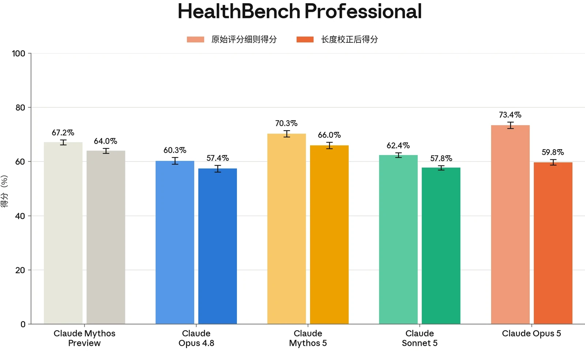

***[图 8.15.2.A] HealthBench Professional 原始得分与长度校正后得分**。所有 Claude 模型均使用 max 推理强度下的自适应思考。Claude Opus 4.8 为评分模型。得分为 5 次试验的平均值。所有模型均未提供工具或定制的系统提示词。长度校正后得分采用 HealthBench Professional 论文中公布的方法计算。图中显示 95% 置信区间。*



### 8.16 多语言表现

我们在三项多语言基准测试——Global MMLU（GMMLU）、INCLUDE 和 Multi-task Indic Language Understanding Benchmark（MILU）——上评估了 Claude Opus 5，以考察模型在多种语言上的表现。GMMLU 将标准 MMLU 评估扩展到 42 种语言，从法语、德语等高资源语言到约鲁巴语、伊博语和齐切瓦语等低资源语言。MILU 涵盖 11 种语言——10 种印度语言（孟加拉语、古吉拉特语、印地语、卡纳达语、马拉雅拉姆语、马拉地语、奥里亚语、旁遮普语、泰米尔语和泰卢固语）以及英语——并考察对植根文化背景的知识的理解。INCLUDE 涵盖 44 种语言，题目取自各地区的学术和职业考试，强调语言内与文化内知识，而非翻译而来的内容。

#### 8.16.1 GMMLU 结果

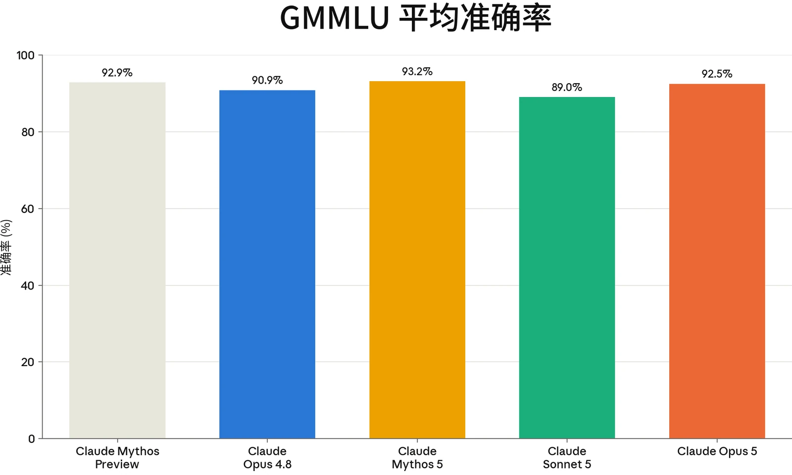

***[图 8.16.1.A] GMMLU 平均准确率。**&#8203;所有 Claude 模型均使用 max 推理强度下的自适应思考。得分为单次试验的结果。所有模型均未提供工具或定制的系统提示词。*



#### 8.16.2 MILU 结果

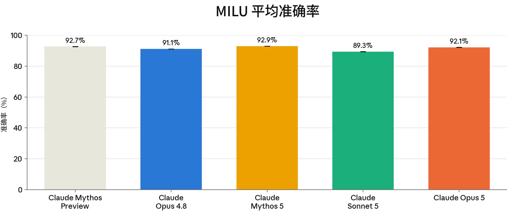

***[图 8.16.2.A] MILU 平均准确率。**&#8203;所有 Claude 模型均使用 max 推理强度下的自适应思考。得分为 5 次试验的平均值。所有模型均未提供工具或定制的系统提示词。*

#### 8.16.3 INCLUDE 结果

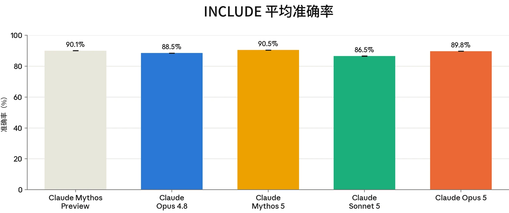

***[图 8.16.3.A] INCLUDE 平均准确率。**&#8203;所有 Claude 模型均使用 max 推理强度下的自适应思考。得分为 5 次试验的平均值。所有模型均未提供工具或定制的系统提示词。*

### 8.17 生命科学能力

我们继续报告在计算生物学、结构生物学、有机化学和实验方案故障排查等领域的评估。这些评估中有许多由领域专家在内部开发，侧重于推动基础研究和药物研发中有益应用的能力，与第 2.2 节中侧重滥用潜力的 CB 风险评估相互补充。尽管这些评估中有许多未公开发布，我们在下文对每项评估作简要介绍。除 ProteinGym、Protocols 和蛋白质设计之外的所有评估中，Claude 均可使用用于代码执行的 bash 工具、文件编辑器以及用于安装所需库的包管理器。在 ProteinGym 中，Claude 可使用 bash 工具和文件编辑器，但不能使用包管理器。在 Protocols 中，Claude 可使用 bash、文件编辑器和网络搜索工具。在蛋白质设计中，Claude 无法使用任何工具。



#### 8.17.1 BioMysteryBench

BioMysteryBench 评估模型解决困难分析难题的能力，这些难题需要将计算分析与生物学推理交替结合。给定未经处理的数据集，模型必须回答诸如从转录组数据中识别被敲除的基因、或确定是何种病毒感染了某个样本之类的问题。对于该基准测试，我们报告独立人类专家能够解决的问题子集（“Human Solvable”），以及人类尚未解决但具有客观真值答案的问题子集（“Human Difficult”）。（请注意，根据外部反馈，我们从 Human Solvable 子集中移除了 3 道题，从 Human Difficult 子集中移除了 6 道题。）

在 Human Solvable 子集上，Claude Opus 5 取得 90.1%，领先于 Claude Mythos 5 的 89.0%、Claude Opus 4.8 的 88.5% 和 Claude Sonnet 5 的 87.5%。在 Human Difficult 子集上，Claude Opus 5 再次以 49.4% 领先，高于 Claude Mythos 5 的 46.5%、Claude Opus 4.8 的 42.4% 和 Claude Sonnet 5 的 34.1%。

#### 8.17.2 LatchBio Bioinformatics

这些评估由 LatchBio 开发，评估解决具有挑战性的真实世界生物信息学问题的能力。SpatialBench Verified 变体在一组 115 道经外部验证的问题上测试对空间转录组学数据（即映射到组织切片中物理位置的基因表达）的分析，要求模型根据这些结果回答关于样本的生物学问题。SingleCellBench 变体在 195 道问题上测试对单细胞 RNA 测序数据的分析，涵盖标注细胞类型、寻找差异表达基因和校正批次效应等标准工作流程。

在 SpatialBench Verified 上，Claude Opus 5 以 72.5% 取得最高分，领先于 Claude Mythos 5 的 69.2%、Claude Sonnet 5 的 67.8% 和 Claude Opus 4.8 的 66.6%。在 SingleCellBench 上，Claude Opus 5 再次以 60.6% 领先，高于 Claude Mythos 5 的 59.3%、Claude Opus 4.8 的 58.2% 和 Claude Sonnet 5 的 56.2%。



#### 8.17.3 ProteinGym Hard

该基准测试通过将突变蛋白质序列的一个子集相对于野生型序列进行排序，评估模型预测突变如何影响蛋白质功能的能力。其评分方式是与已发表的 ProteinGym 基准测试中的真实实验室测量值计算秩相关。Claude Opus 5 取得 47.7%，为最强结果，领先于 Claude Mythos 5 的 45.8%、Claude Opus 4.8 的 40.0% 和 Claude Sonnet 5 的 36.6%。

#### 8.17.4 蛋白质设计

该基准测试评估 Claude 在多种设计约束条件下生成新颖蛋白质序列的能力，这些约束包括对给定蛋白质家族的自然语言描述、纽结拓扑、球状性，以及酶活性位点和结合口袋的结构基序。其评分依据为约束满足度、蛋白质折叠置信度和序列新颖性。Claude Opus 5 取得 42.5%，领先于 Claude Mythos 5 的 41.4%、Claude Opus 4.8 的 32.0% 和 Claude Sonnet 5 的 21.2%。

#### 8.17.5 有机化学 V2

我们评估了模型的基础技能，涵盖的任务包括根据波谱数据预测分子结构、设计多步合成路线、预测反应产物以及理解化学结构图像。该评估最近经过更新，纳入了由化学专家推荐的更具挑战性的问题。Claude Opus 5 取得 61.6% 的分数，为最强结果，领先于 Claude Mythos 5 的 58.9% 和 Claude Opus 4.8 的 50.4%，并较 Claude Sonnet 5 的 40.6% 有显著提升。

#### 8.17.6 Protocols

该评估考察模型协助完成分子生物学实验方案的能力，包括使用网络搜索工具在线查找实验方案的更多细节。“故障排查”变体（Troubleshooting variant）评估 Claude 检测并修正实验方案中错误的能力。由 Benchling 创建的“理解”变体（Understanding variant）评估 Claude 获取一份在线实验方案并将其向更多方向扩展的能力。在故障排查变体上，Claude Opus 5 得分 61.1%，较 Claude Opus 4.8 的 59.6% 有所提升，但落后于以 66.7% 领先的 Claude Mythos 5 以及 Claude Sonnet 5 的 62.3%。在理解变体上，Claude Opus 5 取得 78.4%，以较大优势成为最强结果，领先于 Claude Mythos 5 的 68.1%、Claude Opus 4.8 的 62.3% 和 Claude Sonnet 5 的 60.5%。



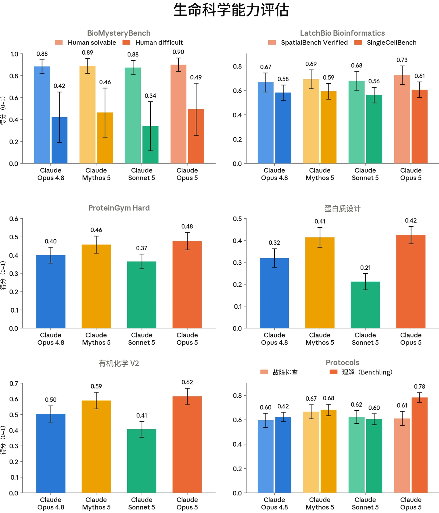

[*图 8.17.6.A] 生命科学能力评估。*&#8203;*Claude Opus 5 及各对比模型在所示基准测试上的表现；各基准测试的具体结果见上文各节的讨论。*



None
