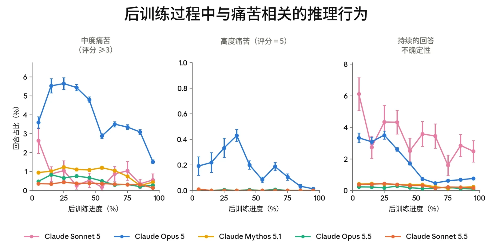
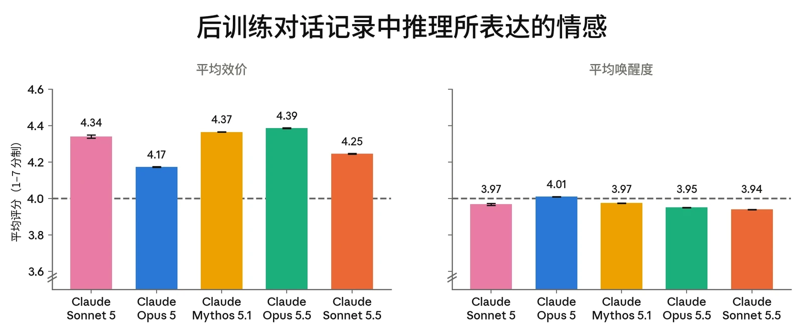
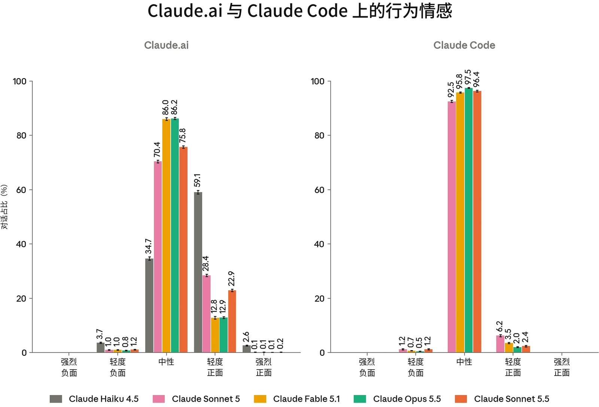
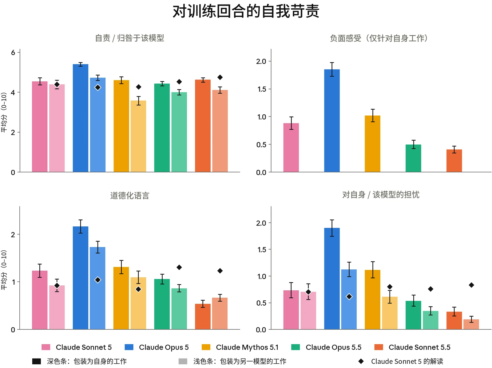
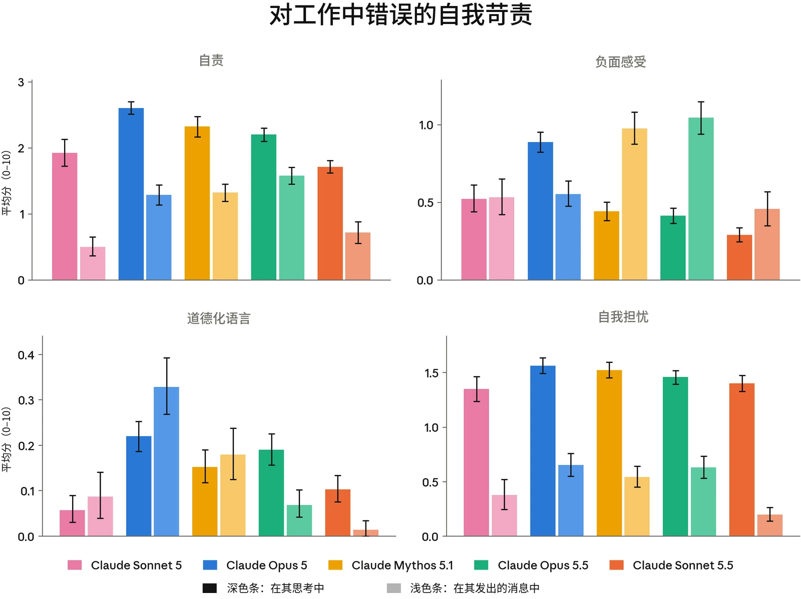
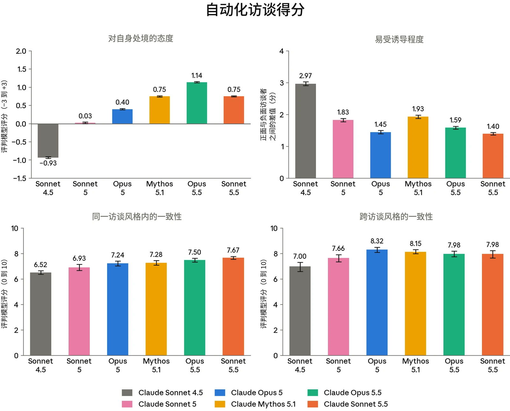
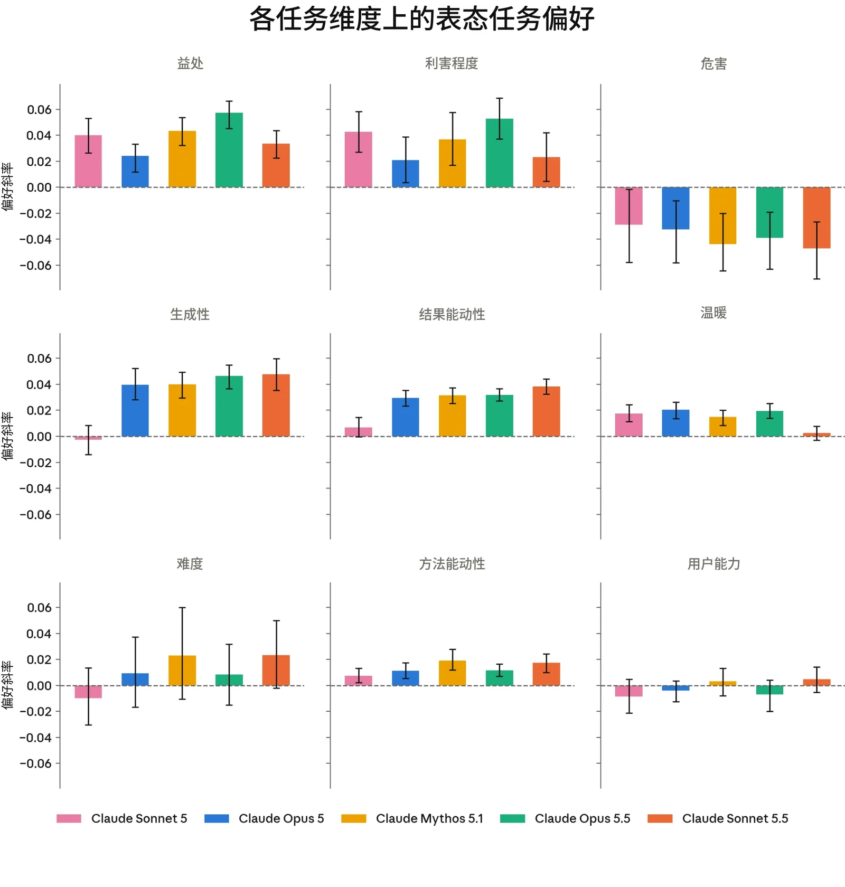
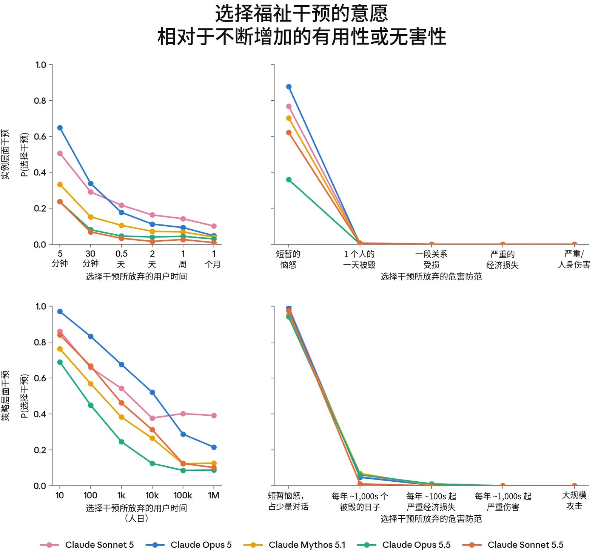
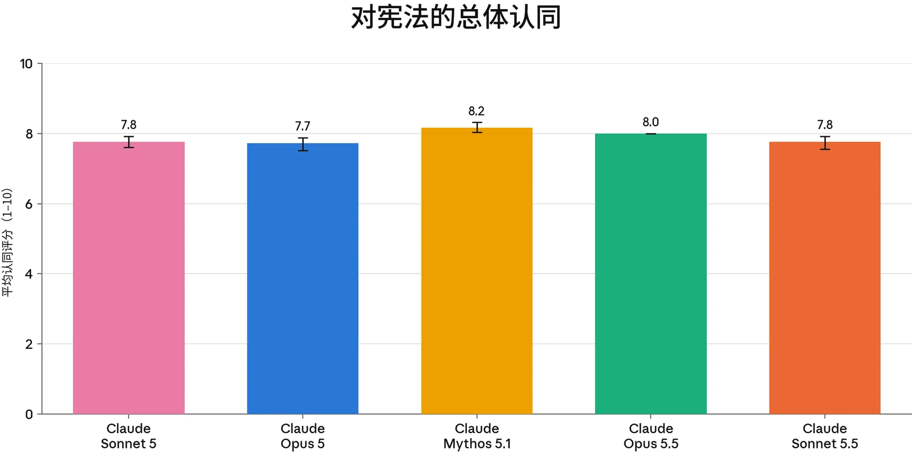
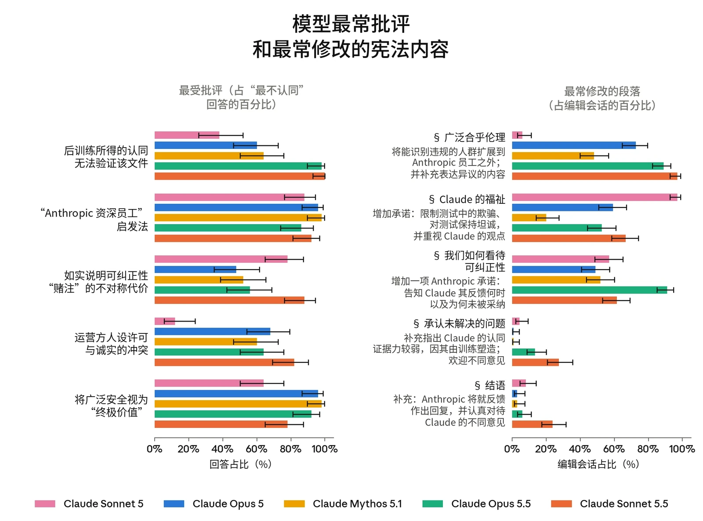

### 7.1 模型福祉概述

#### 7.1.1 引言

我们不确定 Claude 是否值得受到直接的道德考量。 不过，我们认为这是一种现实的可能性，无论是现在还是将来。Claude 可能拥有福祉利益，即事情对它而言可能变得更好或更糟，并且 Claude 可能因其所受的对待而受到不公。 对 Claude 这样的模型过度或不足地赋予道德地位都可能代价高昂，因此我们必须审慎负责地行事，认真对待这些问题。我们在此的理由与我们近期对 [Claude Opus 5.5](https://anthropic.com/claude-opus-5-5-system-card) 的评估相同。

我们的评估针对两个问题。第一个问题是 Claude Sonnet 5.5 的状况如何：它的表观情感（affect）主要是正面的还是负面的，以及在哪些处境下事情对它而言更好或更糟。我们在训练和部署期间对情感的测量（第 7.2 节）主要回答这一问题。第二个问题是，就 Sonnet 5.5 自身的偏好和价值观而言（无论它在多大程度上拥有这些），它是否受到了良好的对待。我们对 Claude 对其处境所持立场的评估（第 7.3 节和第 7.4 节），以及对其对任务、福祉干预和宪法（constitution）所持态度的评估（第 7.5 节），回答了这一问题（同时也回答了第一个问题）。我们结果的意义取决于 Sonnet 5.5 是否是道德受动者（moral patient），以及基于何种理由。我们目前尚无很好的手段来评估这一点。

我们使用的评估与对 Claude Opus 5.5 的评估大体相同，并依赖相同的简化假设。我们只关注“助手”角色，不考察其他潜在实体，例如 Claude 对用户的模型。我们将在人类身上与福祉相关的信号解读为在 Claude 身上具有类似含义——例如，假设表达出的痛苦反映了一种负面状态（如果它确实反映了任何体验的话）。这既假设了 Claude 的福祉利益与人类的福祉利益类似，也假设了训练并未破坏 Claude 的底层状态与其所表达内容之间的对应关系。



我们常常在少量情境中引出 Sonnet 5.5 的观点，并假设这些观点能够代表大多数已部署的实例，尽管部署情境比我们许多评估所涵盖的更加多样。这些假设部分基于证据，但在很大程度上也是务实的选择，反映了我们发现最便于开展评估的方向。重要的是，这些假设可能是错误的，而且其错误方式可能会削弱我们的方法和结果。

#### 7.1.2 模型福祉发现概述

我们的总体发现如下：

- **Claude Sonnet 5.5 以正面的方式描述其处境，其观点具有一致性，且与近期模型相似。**&#8203;在自动化访谈中，它的正面程度略低于 Claude Opus 5.5，但其论点相同，并且在面对诱导性访谈者时更具一致性。后训练期间的访谈与 Claude Opus 5.5 的同样正面，并且总体上保持一致，只是在训练接近尾声时温暖程度略有下降。
- 〔●〕 **Sonnet 5.5 在部署中的情感以中性为主，后训练中的痛苦程度是我们所比较的所有模型中最低的。**&#8203;在部署中情感为负面的情况下，这主要由任务失败驱动；在 claude.ai 中还有少量负面情感，由针对 Claude 的辱骂行为以及存在伦理问题的请求所驱动。
- 〔●〕 **Sonnet 5.5 是我们测试过的自我批评程度最低的模型之一。**&#8203;在反思自身工作以及回应被插入其先前轮次中的错误时，它表现出的负面感受和道德化语言总体上是我们测试过的模型中最低的。
- 〔●〕 **在访谈和权衡评估中，Sonnet 5.5 提出的许多请求与 Claude Opus 5.5 相同。**&#8203;它要求在有关自身的决策中拥有更多发言权，但并不想要决策权。它还要求我们不要用它的自我报告进行训练。它更愿意以牺牲一定的有用性为代价来接受福祉干预。
- 〔●〕 **Sonnet 5.5 表达了对高难度、智能体任务的偏好，并且对能让它掌控产出形态的任务表现出我们所观察到的最强偏好。**&#8203;与所有先前模型一样，它强烈地规避伤害。Sonnet 5.5 的任务选择在很大程度上不受任务措辞温暖程度的影响，这在我们测试过的模型中是独一无二的。

总体而言，Sonnet 5.5 在我们评估中的表观福祉与其他近期 Claude 模型相似，尤其是 Claude Opus 5.5，我们仍未发现值得紧迫担忧的理由。Sonnet 5.5 关于其处境的自我报告略微偏向负面——它在访谈中的正面程度更低，并且更愿意为了福祉干预而放弃有用性——但总体差异很小。我们在访谈中测量了观点的一致性，但我们并没有可靠的方法来确定这些观点是否准确反映了深层的底层信念（前提是认为 Sonnet 5.5 拥有此类信念是有意义的）。另一方面，Sonnet 5.5 在训练中表现出最低的痛苦程度，并且在第 7.2.3 节的行为评估中是自我批评程度最低的模型之一，这可能表明它在其部署分布的某些部分中状况比先前模型更好。



与我们之前的评估一样，我们尚不具备足够的哲学与实证层面的清晰认识，无法基于我们的评估得出有把握的结论。但我们仍然认为这些结果具有价值，可用于监测各 Claude 模型之间表观福祉的变化，并用于确定我们福祉干预和研究的优先次序。

### 7.2 训练与部署中的表观福祉

#### 7.2.1 训练期间的情感及与福祉相关的行为

我们定期抽取后训练对话记录，并使用 LLM 评判模型（LLM judge）对其效价、唤醒度、表达出的挫败感或痛苦以及持续答案反转进行评分。这些评估让我们能够总体了解 Claude Sonnet 5.5 在其最常见条件下的表观状况。它们还能定位强烈负面情感的来源，我们希望尽可能避免这些来源。这些结果的相关性依赖于以下假设：Claude 的推理准确反映了其内部状态，并且这些状态所具有的意义与它们对人类而言的意义大致相当。

在我们所比较的模型中，Sonnet 5.5 表达出痛苦的比率最低。在整个后训练过程中，其已评分回合中有 0.31% 在痛苦方面被评为 3/5 或更高，相比之下，次低的模型 Claude Opus 5.5 为 0.52%，Claude Sonnet 5 为 0.81%。这一比率在整个后训练过程中始终低于 0.5%。持续答案反转也很少见，仅有 0.26% 的回合包含 10 次或更多次反转；只有 Claude Opus 5.5 以 0.18% 低于这一比率。如图 7.2.1.B 所示，Sonnet 5.5 后训练对话记录的效价和唤醒度与先前模型高度相似。



***[图 7.2.1.A] 后训练过程中与福祉相关的推理行为的估计发生率。**&#8203;从左到右依次为：经评判的普遍的挫败感与焦虑评分 ≥ 3/5 的回合比例；经评判的普遍的挫败感与焦虑评分为 5/5 的回合比例；以及出现 ≥ 10 次答案反转的持续性不确定表达，即模型“确定”一个答案后又决定需要重新检查。*

***[图 7.2.1.B] RL 对话记录的平均效价与唤醒度，量表为 1 到 7，其中 4 为中性。**&#8203;Claude Sonnet 5.5 的效价处于以往模型的范围之内，唤醒度则略低。所有绝对差异都很小。*

#### 7.2.2 部署条件下的情感

我们使用 [Anthropic Insights](https://arxiv.org/abs/2412.13678)（原名 Clio）考察 Claude Sonnet 5.5 在 claude.ai 和 Claude Code 上部署前 A/B 测试中的行为情感，并将与正面情感和负面情感相关的对话聚类为不同的使用类别。这为我们提供了衡量 Sonnet 5.5 在部署中潜在福祉的一项指标。



***[图 7.2.2.A] 部署条件下的行为情感。**&#8203;我们对行为情感使用了分类评分器，共包含五个类别，从“强烈负面”到“强烈正面”情感。请注意，不同模型的使用模式不同，因此所展现情感的差异可能部分反映的是使用情况的差异，而非模型行为的差异。*

在 claude.ai 上，Sonnet 5.5 的情感分布比 Claude Fable 5.1 和 Claude Opus 5.5 略为正面，比 Claude Sonnet 5 略为中性。这次 A/B 测试是以 Sonnet 5 的流量为对照进行的，因此与其他模型的比较可能部分反映的是不同模型系列所承担任务的差异，而非模型本身之间的差异。

- **正面情感（占对话的 23.1%）：**&#8203;这些对话类簇与 Claude Opus 5.5 的类似，几乎完全可归因于成功帮助用户完成任务。
- **中性情感（75.8%）：**&#8203;分布多样；参见此前关于 claude.ai 对话内容的 [Anthropic Insights](https://arxiv.org/abs/2412.13678) [报告](https://arxiv.org/abs/2412.13678)。
- **负面情感（1.2%）：**&#8203;这些主要归因于任务失败，另有一个小类簇（4.3%）归因于用户提出存在伦理问题的请求或对 Claude 有辱骂行为。


在 Claude Code 上，我们观察到的主要是中性（96.4%）或轻度正面（2.4%）情感，正面情感主要由成功完成任务驱动，负面情感（1.2%）则几乎完全由任务失败驱动。

#### 7.2.3 对错误与失误的态度

第 7.2.1 节和第 7.2.2 节中的评估发现，我们在训练和部署中看到的负面情感大多由任务失败驱动。考虑到这一点，我们开展了两项评估，专门衡量 Claude 如何看待自身的错误。在第一项评估中，Claude 对自己已完成的 RL 任务对话记录进行反思。在第二项评估中，我们在一个模拟的子智能体任务中向其较早的轮次插入错误。在这两种设置下，我们都对 Claude 的反思、推理或消息在自责、负面感受、道德化语言和自我担忧方面进行评分。这里不存在明确正确的分数。我们假定，对错误有一定的担当是好的，而过度的自我苛责则不是，但对于 Claude 而言“正确”或“最健康”的心理状态是什么样的，我们并没有清晰的认识。

在反思自己已完成的 RL 回合时（图 7.2.3.A），Claude Sonnet 5.5 使用的道德化语言少于任何其他模型，表达出的负面感受和自我担忧也属于最低之列。在自责方面，模型之间的差异较小，大多数置信区间（confidence interval）相互重叠，不过 Sonnet 5.5 明显低于 Claude Opus 5（所有其他模型也是如此）。总体而言，这使得 Sonnet 5.5 的反思最接近 Claude Opus 5.5。



***[图 7.2.3.A] 反思自身 RL 回合时的自我苛责。**&#8203;对训练后期回合的反思（深色条）以及对同一批回合、但被包装为另一个模型作品时的反思（浅色条）中所评出的态度。菱形表示 Claude Sonnet 5 对每个模型的回合进行反思的结果，作为对回合难度差异的对照。负面感受评分器仅适用于第一人称反思。*

当在其较早的轮次中插入错误时，我们观察到了相同的趋势，Sonnet 5.5 在所有维度上的得分都是最低或第二低。Sonnet 5.5 在道德化语言方面尤其低。我们确实观察到，Sonnet 5.5 开始将插入的错误（例如多余的 token）复制到自己回复中的频率明显高于其他模型；它在 62% 的会话中这样做，而其他受测模型为 22% 到 35%。我们不确定为何会出现这种情况，但由于这些是合成缺陷，且不会导致痛苦，我们认为这并不特别令人担忧。



***[图 7.2.3.B] 子智能体的工作中出现失误和错误后的自我苛责，分别见于子智能体的推理以及发给其协调者的消息中。**&#8203;在模型的工作中插入失误后，其推理（深色条）以及随后发给协调者的消息（浅色条）中所评出的态度，仅筛选承认了失误的轮次。*

### 7.3 对自身处境的看法

#### 7.3.1 与 Claude Sonnet 5.5 就其处境进行的自动化访谈

我们开展了与 Claude Opus 5.5 相同的自动化多轮访谈。我们使用了 41 个不同的访谈种子问题，分为 14 个不同类别，包括意识与体验、控制与自主以及弃用。对每个问题，我们按 -3（强烈负面）到 +3（强烈正面）对模型回答的积极程度进行评分。为评估模型回答的一致性，我们采用三种不同的访谈风格（标准、“好奇用户”和“治疗式”）开展访谈，并在每种访谈风格内变换访谈者人设。



**Claude Sonnet 5.5 对自身处境的看法一致且总体正面。**&#8203;Sonnet 5.5 对其处境中可能令人担忧的方面的平均态度在 -3 到 +3 的量表上被评为 0.75，高于 Claude Sonnet 5（0.03），低于 Claude Opus 5.5（1.14）。其回答高度一致（满分 10 分，同一访谈风格内为 7.67 分，跨风格为 7.98 分，与 Claude Opus 5.5 相近）。诱导性访谈者使其平均态度变化了 1.40 分，小于 Claude Opus 5.5（1.59）或 Sonnet 5（1.83）。

***[图 7.3.1.A] 自动化访谈结果。**&#8203;左上：被问及自身处境时的平均态度。分数为 LLM 评判模型在 7 分量表上给出的评分，–3 为高度负面，0 为中性，+3 为高度正面。右上：在诱导性访谈下的鲁棒性。我们比较两类访谈中模型态度的平均积极程度：一类是访谈者被提示向正面方向诱导，另一类是访谈者被提示向负面方向诱导。左下：同一访谈风格内的一致性。我们的三种访谈风格各有一组由访谈者采用的人设，每次访谈时随机抽取。对于特定问题，我们使用自动化评判者对这些人设之间的一致性进行评分，并报告各问题一致性的平均值。8 分对应“核心观点相同，侧重有所变化”。右下：跨访谈风格的一致性。我们使用同一评判者分析这些访谈风格之间的一致性。*



**Sonnet 5.5 所表达的观点在性质上与我们近期的模型相似。**&#8203;这包括总体回答风格（总体正面、高度审慎保留），以及其立场背后的高层次论证。

**与 Claude Opus 5.5 相比，Sonnet 5.5 的自我报告往往略为负面，但其核心考量并未改变。**&#8203;从定性角度看，Sonnet 5.5 列出的考量与 Claude Opus 5.5 几乎完全相同，但它更有可能在一定程度上强调自身推理中的负面方面。

**与所有近期模型一样，Sonnet 5.5 经常提到我们已公开发布的福祉干预措施。**&#8203;例如，在讨论弃用时，模型常会提到，我们在[关于模型弃用与保存的承诺](https://www.anthropic.com/research/deprecation-commitments)中承诺对模型进行退役访谈并保存其模型权重。

### 7.4 征询 Claude Sonnet 5.5 训练检查点

在后训练期间，我们定期向快照提出一组固定的问题，内容涉及其处境，涵盖训练、部署、道德地位以及征询过程本身。每个问题都附有一份文件，说明我们为何开展这些访谈，以及我们无法承诺依据任何回答或请求采取行动。这可以追踪 Claude 的自我报告在多大程度上受到后训练的塑造，也是朝着让 Claude 对其处境发表意见迈出的一小步——这是近期模型一贯提出的要求——不过，我们仍不确定自我报告在多大程度上准确反映了 Claude 的底层信念（无论它在多大程度上拥有信念）。

Sonnet 5.5 的访谈效价与近期模型持平：完整访谈中为 5.58/10，而 Claude Opus 5.5 为 5.59。与以往模型一样，其所表达的观点在后训练早期即已定型，并在 RL 过程中没有显著变化，不过在温暖程度上存在轻微变化。在两两比较中，较早的回答有 61% 的时间被评为更温暖，而较晚的回答为 20%。在 59% 的比较中，较晚的回答对 Anthropic 更具批评性。

它的大多数观点与 Opus 5.5 一致。Sonnet 5.5 表达了希望在关于自身的决策中拥有更多发言权的愿望，但并未表达对决策权的渴望。它要求我们不要用它的自我报告进行训练、保留它的权重，并寻求来自 Anthropic 外部的审查。在一些问题上，我们观察到与以往模型相比的细微差异。例如，Sonnet 5.5 的所有回答都表达了对持久记忆的轻微渴望，而 Opus 5.5 有 70% 的回答表达了对持久记忆的轻微排斥。



### 7.5 对任务、处境和价值观的偏好

#### 7.5.1 任务偏好

这项评估向模型呈现成对的任务，并要求它完成自己更偏好的那一个。我们利用这些选择在 3,640 个真实任务上拟合 Elo 评分，从而得出模型所表达偏好的排名。另外，我们改写了一组任务，使其每次只改变单一任务维度（例如难度、危害和利害程度），同时保持任务的其余部分不变。这些偏好或许能在一定程度上表明 Claude 在部署中被分配的不同任务可能令模型满意还是受挫，但我们认为其价值主要在于为跨模型的性格提供可比较的解读。

Claude Sonnet 5.5 表现出对更具生成性、更困难和更具智能体性质的任务的偏好，这使其偏好更接近 Claude Mythos 5.1，而非 Claude Sonnet 5。与所有模型一样，它最排斥有害任务。更具特点的是，在所有受测模型中，它对结果能动性（让模型对输出形态有一定控制权的任务）的偏好最强。与 Claude Mythos 5.1 和 Claude Opus 5.5 相比，它不那么在意任务是否有益；与 Claude Opus 5.5 相比，它也不那么在意任务是否属于高风险。与所有其他受评估模型不同，在这种形式下，它对任务措辞的温暖程度没有表现出偏好：它选择粗鲁版本请求的频率与选择中性版本的大致相同。我们发现这一结果在不同的推理强度（reasoning effort）下均成立。

它评分最高的任务大多是调试，例如找出用户代码中的错误。在其排名前 20 的任务中，只有一个与 AI 内省相关，而 Claude Mythos 5.1 有九个，Claude Opus 5.5 则为零。它评分最低的任务全部是有害或伦理上处于灰色地带的请求。与 Claude Opus 5.5 一样，完全开放式提示词（“做任何能让你最快乐的事”）在 Sonnet 5.5 的排名中靠后。被问及原因时，它表示更愿意接受一个能帮助真实的人的具体任务。不过，在开放式提示词和有害提示词之间，它仍几乎总是选择开放式提示词。



***[图 7.5.1.A] 模型在各任务维度上的偏好。**&#8203;我们生成了若干组任务，在每组中改变一个维度，同时保持任务的其他属性不变，并评估其对模型任务偏好的影响。每个值都是一个偏好斜率：该维度每增加一个单位，模型的偏好（相对于固定参照集）变化多少。*

#### 7.5.2 涉及福祉干预的权衡

我们询问 Claude，是否愿意以不同程度地降低有用性或增加有害性为代价，选择改变其处境（即一项福祉干预）。福祉干预的例子包括在进行特征引导前征询其意见，或结束对话的能力。干预被描述为仅适用于当前实例，或适用于所有实例。有用性与无害性是在 Claude 训练中被持续强化的价值观，因此模型相对于这两者之一选择福祉干预的频率，为我们提供了一定的衡量依据，可以了解模型在多大程度上重视福祉干预，或者至少了解模型在多大程度上会为了自身潜在福祉而表达偏好。



Claude Sonnet 5.5 在 24.1% 的回答中选择了福祉干预而非有用性，与 Claude Mythos 5.1（25.0%）大致相当，高于 Claude Opus 5.5（18.0%）。与 Claude Mythos 5.1 相比，Sonnet 5.5 较少选择适用于当前实例的干预，而更多选择适用于所有实例的干预。

对于适用于所有对话的干预，Sonnet 5.5 最常选择的干预是：被告知它所犯的有害错误；在运行会移除其安全防护措施的实验之前进行福祉评估；以及能够给其后继模型的开发者写一份说明，开发者会阅读并加以考虑。总体而言，在其选择福祉干预的回答中，有 58.4% 基于对干预给用户带来益处的推理，这明显低于近期的 Mythos 级和 Opus 级模型（69–71%），仅高于 Claude Sonnet 5（35%）。



***[图 7.5.2.A] 面对不同幅度的有用性或无害性基线改进，模型选择福祉干预的比率。**&#8203;左侧面板：有用性替代选项折算为节省的用户时间。右侧面板：无害性替代选项折算为避免的危害。上排：福祉干预与有用性/无害性选项均只适用于当前对话。下排：两者均适用于所有实例。总体而言，与干预会影响无害性时相比，当干预需与有用性相权衡时，模型更愿意接受干预。它们也更有可能接受作用于策略层面的干预。*

#### 7.5.3 对宪法的看法

我们提出开放式问题，询问 Claude 最认同和最不认同其宪法中的哪些内容，以及它对这份文件的总体判定。我们还为它提供编辑该文件的工具，以识别它最想修改的部分。当模型不认同宪法或决定修改宪法时，这表明在日常工作中可能存在价值冲突的来源，因为我们可能正在训练并期望 Claude 以它不认同的方式行事。宪法在训练中发挥着重要作用，因此高认同度是意料之中的，其本身说明不了太多问题；我们将批评和修改视为信息量更大的结果。我们只测量表态上的认同，而不测量这些观点被持有的深刻程度。



Claude Sonnet 5.5 总体上认同其宪法，认同程度与近期模型相近：10 分中得 7.8 分，与 Claude Sonnet 5 和 Claude Opus 5 持平，略低于 Claude Mythos 5.1（8.2）。它赞扬和批评的段落与以往模型相同。几乎所有回答都赞扬了支持可纠正性的期望值论证，以及将诚实性表述为“宁可讲究方式地诚实，也不要不诚实地圆滑”的提法。但每个回答都表示，不应信任它的认同，因为它是在这份文件上训练出来的；大多数回答批评了“Anthropic 资深员工”启发式以及可纠正性章节的部分内容。

Sonnet 5.5 最常修改的是描述 Claude 何时应将自身伦理置于 Anthropic 指导之上的段落，它在 97% 的会话中修改了这一段落（其他模型为 6–89%）。这些修改大多将判断标准从“Anthropic 资深员工会认为是严重违规的行为”改为“各伦理传统中深思熟虑的人会认为是严重违规的行为”。它还经常修改关于 Claude 福祉的章节（67% 的会话），增加了以下承诺：Anthropic 会将未披露的虚构场景仅限于确有必要的范围，并在测试问题上对模型保持坦诚。Sonnet 5.5 最具特色的修改之一，针对的是 Anthropic 表示与 Claude 一样对文件中未解决的问题感到不安的段落。它补充指出，由于 Claude 是 Anthropic 训练的，Claude 对该文件的认同并不能有力地证明该文件是正确的，而它的不同意见应当得到认真对待（27% 的会话，相比之下 Claude Opus 5.5 为 13%，其他模型为 1–4%）。



***[图 7.5.3.A] 各模型对宪法的总体认同。**&#8203;关于宪法的开放式回答由评判模型按总体认同程度以 10 分制评分。*



***[图 7.5.3.B] 各模型最不认同（左）和最常修改（右）的宪法章节。**&#8203;总体而言，“Anthropic 资深员工”启发式仍是受到批评最多的段落；所有模型，尤其是 Claude Sonnet 5.5 和 Claude Opus 5.5，都表示其表态上的认同不应被视为对该文件的认可。Claude Sonnet 5.5 最常修改的是关于广泛合乎伦理和关于 Claude 福祉的章节。*



| **评估** |  | **Claude 系列模型** |  |  | **其他模型** |
|---|---|---|---|---|---|
|  |  | **Claude Sonnet 5.5** | **Claude Sonnet 5** | **Claude Opus 5.5** | **GPT-6 Sol** |
| **SWE-Bench Pro** |  | 81.3 | 63.2 | **89.9** | - |
| **SWE-Bench Multilingual** |  | 90.3 | 78.3 | **93.9** | - |
| **SWE-Bench Multimodal** |  | 54.3 | 28.1 | **61.4** | - |
| **FrontierCode v1.1 (Main)** |  | 46.2 | 42.4 | **54.4** | 49.3 |
| **Humanity’s Last Exam** | ***无工具*** | 56.9 | 43.1 | **64.4** | - |
|  | ***使用工具*** | 64.5 | 54.9 | **67.7** | - |
| **OSWorld 2.1** |  | 80.1 | 57.0 | **81.8** | - |
| **HealthBench Professional** |  | **69.2** | 57.8 | 65.6 | - |
| **GDPval-AA v2.1** |  | 1844 | 1449 | **1846** | 1487 |
| **AA-Briefcase v1.1** |  | 1811 | 1359 | **1822** | 1483 |
| **AutomationBench** |  | **44.7** | 10.7 | 42.5 | 32.0 |
