### 8.1 评估总览

***[表 8.1.A] 能力评估总览。**&#8203;除非另有说明，所有结果均采用以下标准配置：`max` 推理强度（effort）下的自适应思考（adaptive thinking）、默认采样设置（temperature、top_p），并取 5 次试验的平均值。上下文窗口大小因评估而异，且不超过 100 万 token。每行最佳分数以&#8203;__粗体__&#8203;标出，次佳分数加下划线。竞品数据取自各开发者发布的系统卡（system card）或基准测试排行榜。较早 Claude 模型的评估细节请参见此前的系统卡。*



### 8.2 SWE-Bench Pro、Multilingual 与 Multimodal

SWE-Bench（Software Engineering Bench）在真实世界软件工程任务上测试 AI 模型。我们报告三个变体，每个分数均为五次试验的平均值：

- SWE-Bench **Pro** 的题目取自持续维护的代码仓库，涉及大型多文件 diff。Sonnet 5.5 取得了 81.3%。
- SWE-Bench **Multilingual** 将该形式扩展到涵盖 9 种编程语言的 300 道题目。Sonnet 5.5 取得了 90.3%。
- SWE-Bench **Multimodal** 在 issue 描述中加入了视觉上下文（截图、设计稿）。Sonnet 5.5 取得了 54.3%。

### 8.3 DeepSWE v1.1

DeepSWE 是一组包含 113 个长程软件工程任务的测试集，旨在衡量前沿编程智能体的能力。这些任务类型多样，反映了真实世界的复杂性，并且为避免基准污染而从零编写。Sonnet 5.5 在五次试验中的平均得分为 71.0%。

### 8.4 FrontierCode

[FrontierCode](https://cognition.com/frontiercode) 是由 [Cognition](https://cognition.com/) 创建的智能体编程基准测试，包含 150 个软件工程任务。任务源自开源代码仓库中的真实拉取请求（pull request），例如修复 `aiohttp` 中的 websocket 错误、加固 Prisma 的浏览器打包产物，以及扩展 JSON schema 的 lint 规则。每个任务都会向智能体提供一个已检出的代码仓库、一份 issue 描述，以及该仓库的测试、lint 和代码风格指南。智能体在可访问互联网的容器化环境中自主工作，产出最终补丁，过程中没有人工干预，也不提供任何超时信息。补丁依据阻断性功能标准（主要是留出的单元测试，另有范围与性能阻断项）和加权评分细则标准进行评分，其中包括针对所需测试覆盖范围和禁止的实现模式的、由模型评分的检查项。任务由底层代码仓库的维护者编写，并经 Cognition 研究人员逐一审核，此外还



随机抽取了一个子集进行人工求解，以验证其公平性。我们报告总分，即阻断性功能标准与加权代码质量评分细则标准的综合得分。

在 `xhigh` 推理强度下，Claude Sonnet 5.5 在 Main 上得分 52.1%，在 Extended 上得分 64.4%。在 `max` 推理强度下，Sonnet 5.5 在 Main 上得分 46.2%，在 Extended 上得分 59.1%。

注：该评估的目标是无需人工修改即可合并的代码 diff。其评分会惩罚超出范围的修改，即使这些修改质量很高或有所帮助。我们报告的 Sonnet 5.5 在该基准测试上的分数基于官方评估，未做任何改动。

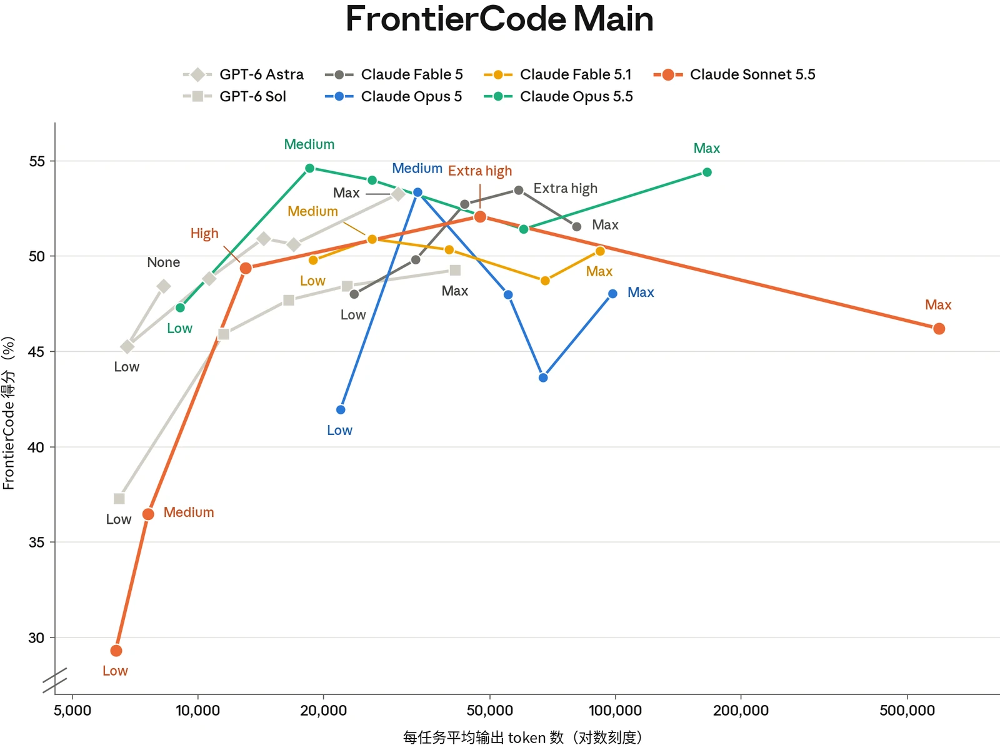

***[图 8.4.A] 不同推理强度档位下 FrontierCode v1.1 Main 得分与每任务平均输出 token 数的关系**（`low`、`medium`、`high`、`xhigh` 和 `max`；GPT-6 Astra 另含 `none`）。图中所有模型的评估均由 Cognition 运行并报告结果；Claude 模型在 Claude Code 中运行，GPT 模型在 Codex CLI 中运行。Cognition 的结果文件报告了每个模型的 token 数，但未报告 Claude Sonnet 5.5 的成本，因此 x 轴以对数刻度显示每任务平均输出 token 数。Claude Sonnet 5.5 的每个数据点都标注了其推理强度档位；对于其他每个模型，标注的点为其最低和最高推理强度档位，以及其得分最高的档位（GPT-6 Astra 另标注了 `low`）。未标注的点按推理强度顺序沿折线排列。结果文件未提供不确定性区间，因此图中未显示；Cognition 发布的图表报告了误差线。请注意，y 轴从 27% 而非零开始，因此各点之间的差异在视觉上被放大。*



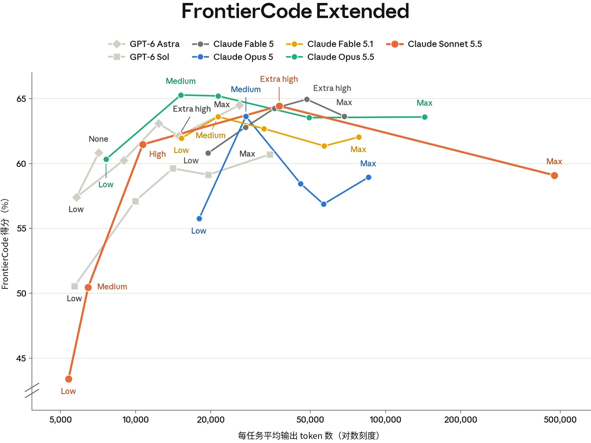

***[图 8.4.B] 不同推理强度档位下 FrontierCode v1.1 Extended 得分与每任务平均输出 token 数的关系**（`low`、`medium`、`high`、`xhigh` 和 `max`；GPT-6 Astra 另含 `none`）。图中所有模型的评估均由 Cognition 运行并报告结果；Claude 模型在 Claude Code 中运行，GPT 模型在 Codex CLI 中运行。Cognition 的结果文件报告了每个模型的 token 数，但未报告 Claude Sonnet 5.5 的成本，因此 x 轴以对数刻度显示每任务平均输出 token 数。Claude Sonnet 5.5 的每个数据点都标注了其推理强度档位；对于其他每个模型，标注的点为其最低和最高推理强度档位，以及其得分最高的档位（GPT-6 Astra 另标注了 `low` 和 `xhigh`）。未标注的点按推理强度顺序沿折线排列。结果文件未提供不确定性区间，因此图中未显示；Cognition 发布的图表报告了误差线。请注意，y 轴从 41% 而非零开始，因此各点之间的差异在视觉上被放大。*

### 8.5 Terminal-Bench 4.0

Terminal-Bench 4.0 在容器化的终端和命令行环境中，以真实世界的工作测试模型。它包含 66 个任务，侧重于与科学相关的问题和前沿工程问题，例如计算生物学、物理仿真、CAD、形式化证明以及 GPU 性能优化工作。



此前的 Terminal-Bench 版本[对超时和资源非常敏感](https://www.anthropic.com/engineering/infrastructure-noise)：4.0 通过延长超时时间，并在少数可从中受益的任务中自适应地提高 RAM 和 CPU 配额，在很大程度上解决了这些问题。在少数任务中，沙箱服务提供商仍可能是一个混杂因素，但我们预计其作用将显著小于以往版本。我们还发现，此次升级降低了各种运行框架（harness）带来的混杂效应（例如 CLI 内存占用、上下文压缩（compaction）策略和容器通信协议），最终使 Terminal-Bench 成为一项更稳定、更严谨的评估。

Claude Sonnet 5.5 在启用安全防护措施的情况下，在 Terminal-Bench 4.0 上得分 70.6%；被安全防护措施标记的请求按照默认的服务端回退（fallback）策略，由回退模型作答（占请求的 1.2%，影响了 1.5% 的试验，其中有一次尝试中止而未作答）。我们在不允许互联网出站访问的条件下运行评估，基于历史运行日志预先缓存模型运行所需的资源，并据此重新构建镜像。原则上，这可能对分数产生负面影响（如果模型想使用在线资源却被阻止），但我们在 Sonnet 5.5 上尚未观察到这种情况。

作为对比，Claude Opus 5.5 得分 66.4%（2.5% 的请求被安全防护措施标记，影响了 10% 的试验），Claude Mythos 5.1 得分 60.9%，Claude Fable 5.1 得分 55.8%，Claude Opus 5 得分 52.3%。分数取平均值的方式为：Sonnet 5.5 和 Opus 5.5 每个任务五次试验（共 330 次试验），Mythos 5.1 每个任务 10 次试验（共 660 次试验），Opus 5 每个任务 15 次试验（共 990 次试验）。若将试验视为相互独立，Sonnet 5.5 的标准误为 ±2.5 分，Opus 5.5 为 ±2.6 分，其他模型为 ±1.6–2 分。报告的数字使用 `--bare` 模式下的 Claude Code、`max` 推理强度测得，但 Opus 5.5 除外，它与其自身系统卡一致，报告的是 `xhigh` 推理强度下的结果（在 `max` 推理强度下它得分 64.8%，与 `xhigh` 的差异在噪声范围内）。

作为参考，公开排行榜报告 Claude Opus 5 的得分为 51.8%，与我们内部设置的结果相差在噪声范围内。OpenAI 报告其 GPT-6 Astra 的最终 Terminal-Bench 4.0 得分为 57.9%，在 `high` 推理强度下测得（在其报告中，`max` 推理强度的表现略低于 `high`，因此我们选取了其最高数字）。公开排行榜还报告了 OpenAI 的 GPT-5.6 Sol 得分为 37.3%，使用 Codex CLI 在 `max` 推理强度下测得。OpenAI 尚未报告 GPT-6 Sol 的 Terminal-Bench 4.0 分数，公开排行榜也没有。

### 8.6 Terminal-Bench-Science 0.1

Terminal-Bench-Science 是一个由斯坦福大学主导的社区基准，包含 70 个取自科学研究工作流的任务，由生命科学、物理科学、地球科学、数学科学和工程科学领域的科学家和研究人员编写并审核。该项目的科学顾问来自麻省理工学院（MIT）、普林斯顿大学、华盛顿大学、Genentech 和斯坦福大学。



智能体 CLI 在一个自包含的环境中依据自然语言指令工作，并根据隐藏的、特定于任务的测试对其产出物进行评分。

Claude Sonnet 5.5 在启用安全防护措施的情况下，在 Terminal-Bench-Science 上得分 59.9%；回退机制在任何请求或试验中均未触发。Claude Opus 5.5 得分 58.7%，Claude Fable 5.1 得分 52.6%，Claude Opus 5 得分 29.0%，Claude Fable 5 得分 24.7%。按任务聚类的标准误，Sonnet 5.5 为 ±4.7 分，其他模型为 ±3.5–4.8 分（Opus 5.5 为 ±4.8）。与 Terminal-Bench 4.0 一样，我们在不允许互联网出站访问的条件下运行评估，基于历史运行日志预先缓存模型运行所需的资源，并据此重新构建镜像。

报告的数字使用 `--bare` 模式下的 Claude Code 和 `max` 推理强度测得。作为参考，公开排行榜报告 Claude Opus 5 的得分为 30.0%，Claude Fable 5 为 21.4%，均与我们内部设置的结果相差在预期噪声范围内。OpenAI 报告 GPT-6 Astra 在 `max` 推理强度下得分 64.6%。OpenAI 尚未报告 GPT-6 Sol 的 Terminal-Bench Science 分数，公开排行榜也没有。

### 8.7 FrontierSWE v2

FrontierSWE v2 是 Proximal 推出的基准测试，包含 34 个超长程工程与研究任务，涵盖系统实现、性能优化、科学计算、AI 研究和视觉推理，例如将 Quantum Espresso 从 Fortran 移植到 Rust、构建一个能运行飞行模拟器的 OpenGL 场景渲染器，以及对大语言模型（LLM）进行后训练，使其能玩一款交互式解谜游戏。最强的模型通常每个任务工作近 20 小时，且距离使该基准饱和仍相去甚远。每个模型都在 Proximal 自己的智能体运行框架中以 `max` 推理强度运行，每个任务进行五次试验，报告的分数为每个任务五次试验的平均值。

Claude Sonnet 5.5 在 FrontierSWE v2 上得分 61.9%，在 Proximal 评估的模型中排名第三，落后于 GPT-6 Astra（65.5%）和 Claude Opus 5.5（62.3%），领先于 Claude Fable 5.1（56.3%）和 GPT-5.6 Sol（32.2%）。

在 34 个任务中的 8 个上，Sonnet 5.5 取得了所有公开可用模型中的最高分，其中包括性能优化、系统实现和视觉推理方面的任务。



### 8.8 CursorBench 4.0

[CursorBench 4.0](https://cursor.com/cursorbench) 是 Cursor 的智能体编程基准测试。它包含取自真实世界 Cursor 使用场景的编程任务，并在 Cursor 的生产环境智能体运行框架中端到端运行。所有分数均由 Cursor 独立测量并报告；Claude Sonnet 5.5 的每任务成本是我们根据 Cursor 报告的 token 数按标准定价估算的，其他所有成本均为 Cursor 公布的数据。

Sonnet 5.5 在 CursorBench 上的得分为：`max` 推理强度下 55.5%，`xhigh` 下 53.1%，`high` 下 47.8%，`medium` 下 39.2%。

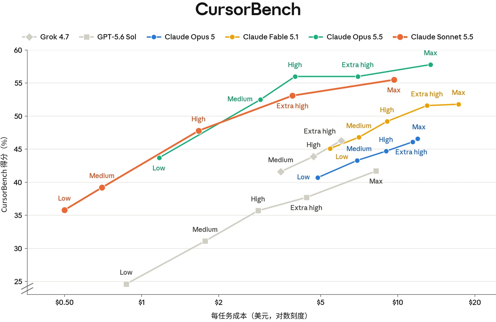

***[图 8.8.A] 不同推理强度档位下 CursorBench 4.0 得分与每任务平均成本的关系。**&#8203;Cursor 在其生产环境智能体运行框架中端到端执行了该评估，并独立测量和报告了分数。对于 Claude Sonnet 5.5 以外的模型，分数和每任务成本均为 Cursor 于 2026 年 9 月在其公开排行榜上公布的数据。Sonnet 5.5 的分数来自 Cursor 直接发给我们的结果表（其每任务成本是我们根据该表中的 token 数按标准定价估算的）。每个模型均显示五个推理强度档位（`low`、`medium`、`high`、`xhigh` 和 `max`），但 Grok 4.7 除外，它仅显示三个档位（`medium`、`high` 和 `xhigh`）。两个来源均未提供不确定性区间，因此图中未显示。请注意，y 轴从 23% 而非零开始，因此各点之间的差异在视觉上被放大。*



### 8.9 ArXivMath

ArXivMath 是由 MathArena 维护的一项研究级数学最终答案型基准测试。题目每月从近期的 arXiv 论文中提取，再经过自动与人工检查加以筛选，以确保题目自成一体、不平凡且可验证。由于题目取自活跃的研究工作，该基准测试比竞赛 / 奥赛类基准测试更贴近现实，与数学研究的联系也更紧密。

我们在最新的 ArXivMath 版本（2026 年 8 月，57 道题）上评估了 Claude Sonnet 5.5。与早期版本不同，MathArena 现在优先选用能够解决或否定先前提出的猜想的结果，57 道题中有 25 道来自此类结果，“其表述方式使得仅猜测猜想中的值会得到错误答案”。因此，该题集奖励的是推导出答案，而非回忆已有文献。

Sonnet 5.5 在 `max` 推理强度下，不使用工具得分 86.8%，使用工具（代码执行沙箱，无互联网访问）得分 95.2%，结果为每题四次尝试的平均值。作为对比，在相同设置下，Claude Fable 5.1 不使用工具得分 82.9%，使用工具得分 92.1%；Claude Opus 5.5 则分别得分 91.2% 和 96.9%。

MathArena 自己的 8 月排行榜采用不同的设置：每个模型在其厂商的智能体运行框架中运行，可使用 Python 和 SageMath；提示词要求模型在找不到解答时给出最佳猜测；每题两次尝试；并使用 LLM 评判模型（LLM judge）。在该设置下，他们报告 GPT-6 Sol（`max`）得分 93.0%，GPT-6 Astra（`max`）得分 88.6%，Claude Fable 5.1（`high`）得分 87.7%。这些数字与我们“使用工具”的结果最为接近，但不可直接比较。



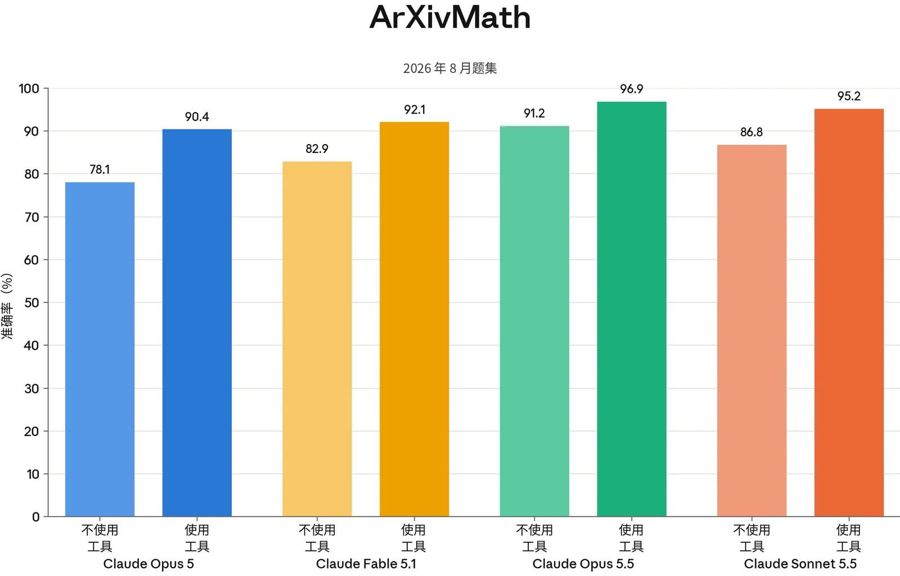

***[图 8.9.A] 使用与不使用工具时的 ArXivMath（2026 年 8 月）准确率得分。**&#8203;Claude Sonnet 5.5、Claude Opus 5.5、Claude Fable 5.1 和 Claude Opus 5 均在内部评估，未启用安全防护分类器，推理强度为 `max`。Claude Sonnet 5.5 是在发布检查点的预发布服务部署上评估的。*

### 8.10 长上下文

#### 8.10.1 ProgramBench

ProgramBench 是一项长上下文智能体编程基准测试，包含 200 个程序重建任务。智能体仅获得由某个开源项目编译而成的二进制文件及该项目的文档，必须在不使用互联网或反编译工具的情况下重建一个能复现原程序行为的代码库。任务涵盖从小型终端工具（jq、ripgrep）到大型系统（FFmpeg、SQLite、PHP 解释器）。提交结果依据超过 247,000 个基于执行的行为测试进行评分，这些测试通过智能体驱动的模糊测试生成。

我们排除了 34 个参考二进制文件在隐藏测试集上得分低于 0.9 的任务（表明存在测试不稳定性），剩余 166 个任务。在这些任务中，我们只依据参考二进制文件能够通过的测试计分。我们使用与上游代码仓库相同的 mini-swe-agent 运行框架报告隐藏测试通过率，但不设六小时的时间限制。在该任务集上，Claude Sonnet 5.5 得分 79.7%，而 Claude Sonnet 5 得分 77.3%，Claude Opus 5.5 得分 91.2%。



我们认为 ProgramBench 是衡量长上下文编程性能的有力指标：Sonnet 5.5 的各回合覆盖了一系列上下文长度，最长可达完整的 100 万 token 窗口，且这些任务所考察的长上下文能力与实际的下游用例高度契合。

### 8.11 智能体搜索

#### 8.11.1 HLE

Humanity’s Last Exam（HLE） 是一项多模态基准测试，包含横跨数十个学科的 2,500 道题目。这些题目由领域专家编写和审核，仅保留前沿大语言模型无法回答的题目，并且经过设计，使其无法通过互联网搜索快速作答。

我们在两种配置下测试了 Claude Sonnet 5.5：（1）纯推理（不用工具）；（2）使用网络搜索、网页抓取、程序化工具调用和代码执行。在所有运行中，思考均设置为 `auto`，每次尝试的任务预算为 980k token。这些结果未使用上下文压缩。Claude Opus 4.6 担任评分模型。

为防止使用工具版本中出现结果污染，我们对搜索器和抓取器都屏蔽了已知讨论 HLE 的来源（见附录 9.1）。我们还使用文本规则筛查每一条回答正确的对话记录，查找是否有使用 HLE 特定来源的迹象，并使用 Claude Opus 5 审查每一条被标记的对话记录。经确认的作弊情形会被重新判为错误。



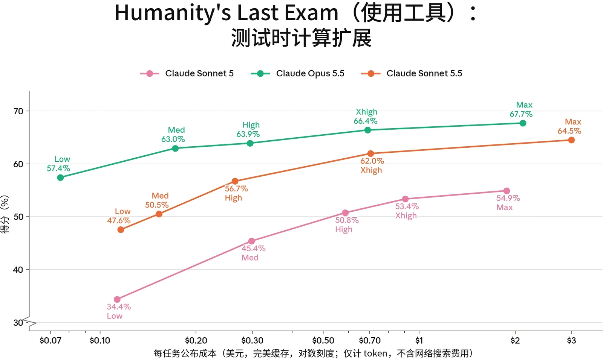

***[图 8.11.1.A] Humanity’s Last Exam（HLE，使用工具）推理强度扩展**。随着推理强度从 `low` 扩展到 `max`，HLE 准确率与平均每任务成本（对数刻度）的关系。成本按完美缓存命中率计费，不含网络搜索费用。*



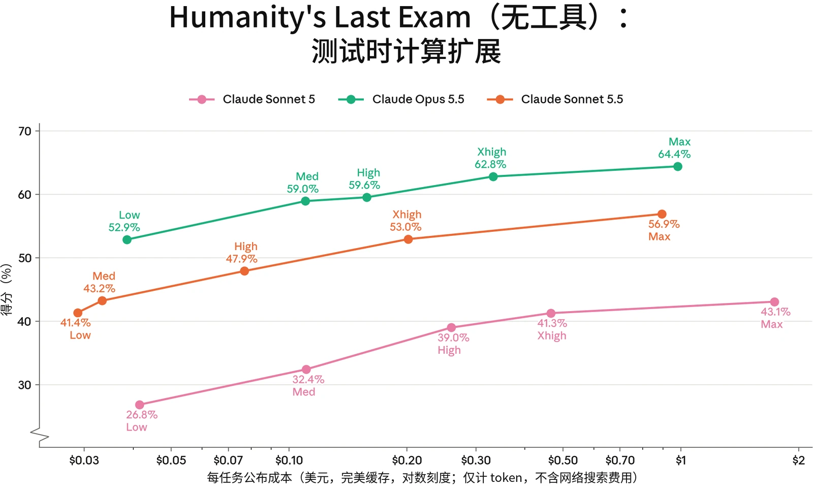

***[图 8.11.1.B] Humanity’s Last Exam（HLE，无工具）测试时计算扩展**。随着推理强度从 `low` 扩展到 `max`，HLE 准确率与平均每任务成本（对数刻度）的关系。成本按完美缓存命中率计费，不含网络搜索费用。*

#### 8.11.2 DRACO

Deep Research Accuracy, Completeness, and Objectivity（DRACO）是 Perplexity 推出的一项深度研究基准测试，用于评估模型在真实用户可能提出的复杂研究问题上的表现。DRACO 包含 100 个精选任务，源自跨多个领域的用户查询。回答依据专家编写的评分细则进行评分，评分维度涵盖事实准确性、分析的广度与深度、呈现质量以及引用质量。

我们在使用网络搜索、网页抓取、程序化工具调用、代码执行以及 980k token 任务预算的条件下评估了 Claude 模型。

**评分方法** DRACO 原论文使用 Gemini 3 Pro 作为主要评判模型，而该模型现已无法使用。在我们的评估中，我们使用 Claude Opus 4.6 依据各任务的评分细则对回答进行评分，采用同样的二元 MET/UNMET 判定，并按照论文第 4.2 节中的公式将其汇总为归一化分数。我们遵循论文的实验方案，对每个回答进行五次独立的评分运行并记录平均值。我们的评判提示词取自论文的[附录 C.5](https://arxiv.org/abs/2602.11685)。论文附录 A 表明，评判模型的选择可能使绝对分数变化 10 到 25 分，但会保持系统排序不变，因此我们的分数不能与论文的主要公布数字直接比较。



除评判模型外，我们还使用了自己的智能体运行框架（不使用附录 C.4 中的系统提示词（system prompt）；使用网络搜索、网页抓取、程序化工具调用和代码执行，预算为 980k token），并指示模型将最终报告写入其执行环境中的一个文件。随后我们只对该文件的内容评分，而不是对完整的智能体对话记录评分，从而将交付物与中间工具输出隔离开来。

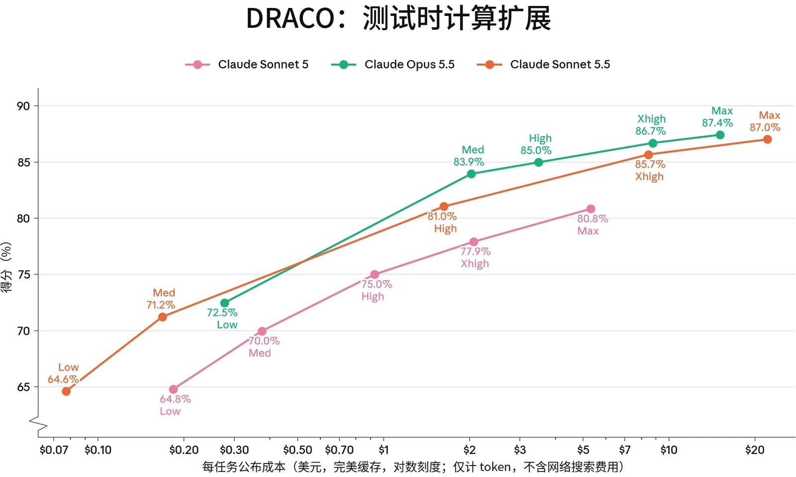

***[图 8.11.2.A] DRACO 得分**与各推理强度档位下平均每任务成本的关系。在 980k 任务预算下，随着推理强度从 `low` 提升到 `max`，DRACO 归一化分数与平均每任务成本（对数刻度）的关系。成本按完美缓存命中率计费，不含网络搜索费用。*

#### 8.11.3 WANDR

[WANDR（Wide ANd Deep Research）](https://www.perplexity.ai/hub/blog/wandr-benchmark-evaluating-research-agents-that-must-search-wide-and-deep)是 Perplexity 推出的一项基准测试，旨在为 DRACO 深度研究基准测试提供一个广度搜索方面的对应基准测试。它包含 500 个任务，模型须在任务中搜索数十到数百个实体，查找关于每个实体的事实，并在结构化记录中列出这些事实及其引用来源。我们运行的是该评估的修改版本；下文说明了方法上的差异。



我们在使用网络搜索、网页抓取、程序化工具调用、代码执行以及 980k token 任务预算的条件下评估了 Claude 模型。任务由一个评判模型评分，该评判模型可使用与被测模型相同的网页抓取工具。评分者会重新抓取被引用的 URL；随后由评判模型判断这些参考来源是否支持该解答。

主要指标是“软 F1（soft F1）”，它在精确率（模型解答中有多少得到验证）与召回率（模型在所要求的事实收集中完成了多少）之间取得平衡。当只有部分所需事实能够得到验证时，给予部分得分。结果为 500 个任务的平均值；未通过格式校验的单个实体行会被丢弃，而不会导致整个任务失败。

在我们的评估中，模型获得的是离线网络搜索和网页抓取工具，只能访问一个冻结索引；而 Perplexity 的版本使用实时网络。Claude 模型使用 Claude Opus 4.6 进行评判，而 Perplexity 使用 GPT-5.4。我们的提示词也略有不同。由于工具和评分逻辑与 Perplexity 的运行框架不同，我们的结果不能与竞争对手模型的已报告数字直接比较。

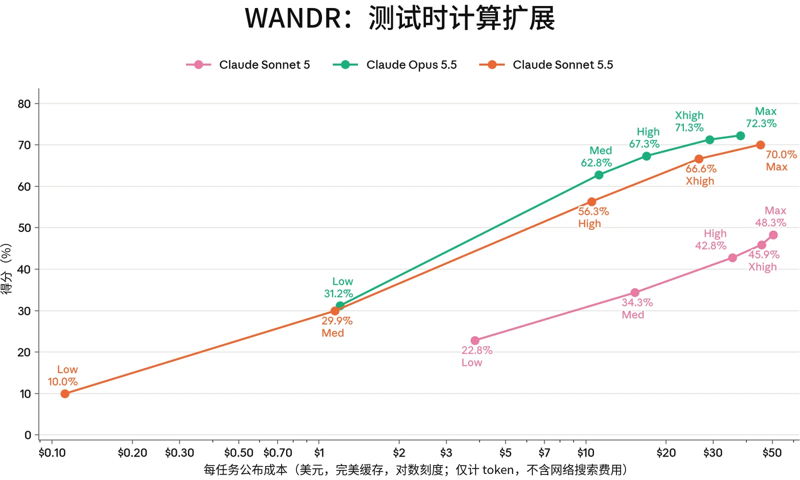

***[图 8.11.3.A] WANDR 软 F1 分数**与各推理强度档位下平均每任务成本的关系，任务预算为 980k token（对数刻度）。成本按完美缓存命中率计费，不含网络搜索费用。*



### 8.12 多智能体

#### 8.12.1 Multi-Agent ProgramBench

我们在 ProgramBench 上评估了 Claude Sonnet 5.5 在小型多智能体团队中运行的能力。ProgramBench 是一项包含 200 个程序重建任务的智能体基准测试。每个任务都要求重建一个代码库以复现某个程序的行为，且只能以该程序编译后的二进制文件和文档作为参考（详见第 8.10.1 节）。

我们将两种小规模多智能体运行框架配置与单智能体基线进行了比较：一种是固定的五智能体团队，另一种是动态生成的异步子智能体。我们在 1、2 和 4 小时的时间预算下分别评估了每种运行框架的性能。关于运行框架和预算机制的详细信息，请参阅 Opus 5.5 系统卡第 8.12 节。图 8.12.1.A 展示了各延迟预算下的得分比较。

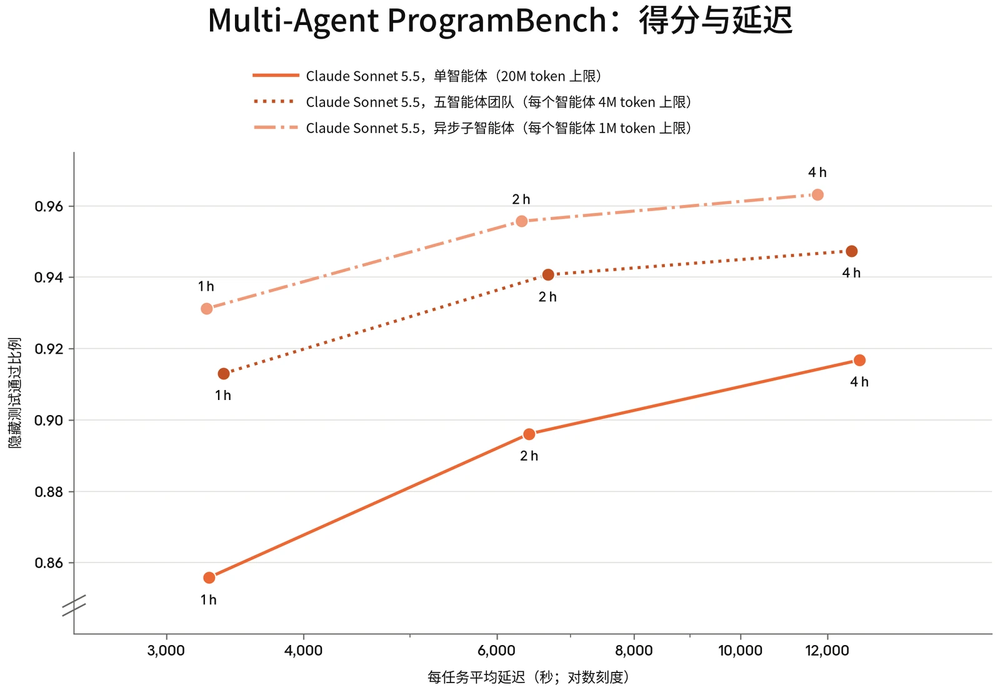

***[图 8.12.1.A] 166 个“黄金”ProgramBench 任务上的得分与延迟关系。**&#8203;多智能体团队在得分–延迟帕累托前沿上占据主导。延迟为每任务的推导延迟（见 Opus 5.5 系统卡第 8.12.5 节）。*

在时间预算越来越紧的情况下，多智能体团队在得分–延迟帕累托前沿上占据主导。采用 1 小时预算的异步子智能体团队，其性能超过了采用 4 小时预算的单智能体。图 8.12.1.B 展示了各实验组和各预算下的总 token 数比较。



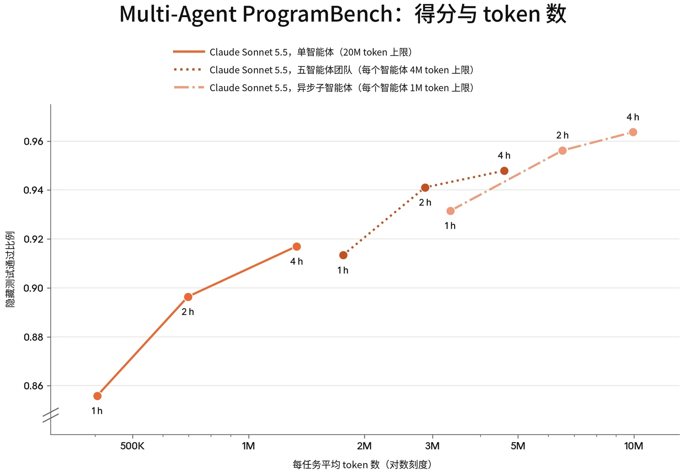

***[图 8.12.1.B] 166 个“黄金”ProgramBench 任务上的得分与 token 数关系。**&#8203;token 数衡量的是进入每个智能体上下文窗口的全部内容（每项只计一次）：新输入（任务提示词、工具结果、来自其他智能体的消息）加上所有生成的输出（包括思考内容），并在所有智能体和窗口上求和。*

该图突显了得分与成本之间的权衡。多智能体团队会并发地产生和消耗更多 token，以便在给定预算内完成更多任务内容。请注意，这些评估中 Claude Sonnet 5.5 的服务速度可能与外部实际体验到的不同，因此在这些延迟预算下报告的绝对得分和 token 数不具有普适性。



### 8.13 多模态

#### 8.13.1 Chartography

Chartography 是 Surge AI 推出的一项图表理解基准测试，包含 100 个任务，涉及现有基准测试中很少评估的专业图表类型。其中包括 Kaplan–Meier 生存曲线图、K 线图（蜡烛图）、等高线图、风玫瑰图、桑基图、伯德图和三维曲面图。由于不同类型的图表可被读取的精度不同，每个答案都依据专家针对该特定图表设定的可接受范围进行评分，而不是采用单一的固定容差。

在所有运行中，模型均配置为启用自适应思考和 `max` 推理强度。模型分别在使用和不使用工具的情况下接受评估。在使用工具评估时，模型会获得一个装有图像文件和标准库的容器，以及一个图像裁剪工具。我们内部的 Chartography 评分实现与官方代码仓库中的任务及专家确定的可接受答案范围一致。为确保不同模型之间的评分可比，我们遵循 Surge AI 排行榜的做法，使用 Gemini 3.5 Flash 作为评分者。

Claude Sonnet 5.5 不使用工具得分 61.6%，使用工具得分 90.2%。Claude Opus 5.5 分别得分 64.4% 和 89.0%，Claude Fable 5.1 分别得分 44.8% 和 88.4%。Sonnet 5.5 的原始视觉推理性能低于 Claude Opus 5.5，介于 GPT-6 Sol 和 GPT-6 Astra 之间。使用工具时，Sonnet 5.5 与 Claude Opus 5.5 不相上下。



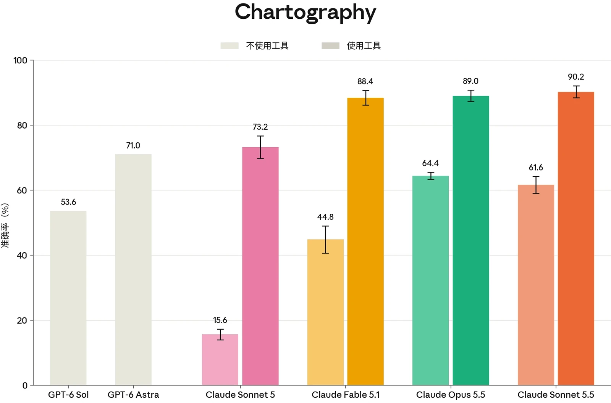

***[图 8.13.1.A] Chartography 得分。**&#8203;Claude 模型在启用自适应思考和 `max` 推理强度的条件下，分别在使用和不使用工具的情况下接受评估。得分为五次运行的平均值，并显示 95% 置信区间（confidence interval，CI）。GPT-6 Sol 和 GPT-6 Astra 的得分为 Surge AI 公开报告的结果，在不使用工具的条件下评估。*

与 Claude Sonnet 5 相比，Claude Sonnet 5.5 在视觉推理和工具使用能力上有显著提升，并与 Claude Opus 5.5 不相上下。无论是否使用工具，Sonnet 5.5 都在较低成本区间扩展了得分–成本前沿，同时在较高推理强度档位上保持竞争力。



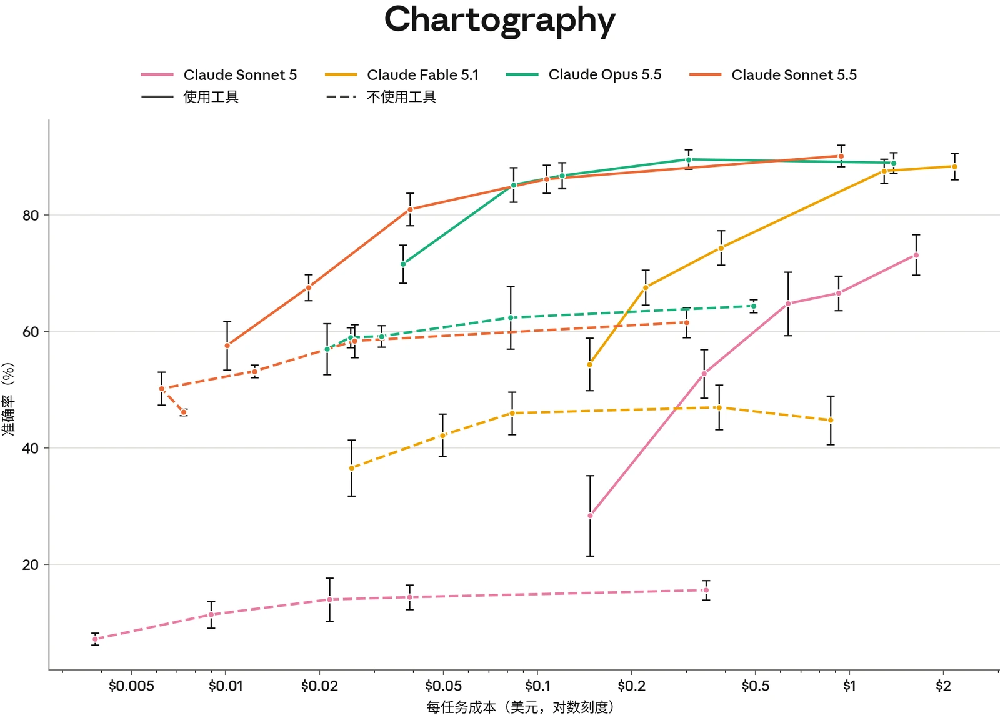

***[图 8.13.1.B] 使用与不使用工具时的 Chartography 得分。**&#8203;模型在启用自适应思考、采用不同推理强度档位的条件下，分别在使用和不使用工具的情况下接受评估。我们使用 effort 参数来调整所投入的测试时计算量。得分为每个推理强度档位下五次运行的平均值，并显示 95% 置信区间。成本按 API 标准定价计费，并采用每次运行的实际缓存使用情况。*

#### 8.13.2 BenchCAD

BenchCAD 是一项程序化 CAD 推理基准测试，由 17,900 个经执行验证的 CadQuery 程序构建而成，涵盖 106 个工业零件族，其中大约一半以真实的 ISO、DIN、EN、ASME 和 IEC 规格表为依据。该基准测试将 CAD 能力分解为四项相互匹配的任务；我们报告 Vision2Code 任务上的结果，该任务要求模型根据多视图渲染图生成 CadQuery 代码。

在所有运行中，无论是否使用工具，模型均配置为启用自适应思考和 `max` 推理强度。在使用工具评估时，模型会获得一个装有图像文件和标准库的容器，以及一个图像裁剪工具。



我们在已发布的 17,900 个 Vision2Code 文件中随机抽取 1,000 个文件组成子集，对模型进行评估；根据以往经验，该子集的得分能够反映完整题集上的得分，误差在 0.01 体素 IoU（voxel IoU）以内。我们报告五次运行的平均体素 IoU 分数。

在 BenchCAD Vision2Code 的 1,000 个文件子集上，Claude Sonnet 5.5 不使用工具的体素 IoU 分数为 0.747，使用工具为 0.963。Claude Opus 5.5 的得分分别为 0.730 和 0.962，而 Claude Fable 5.1 的得分分别为 0.606 和 0.926。

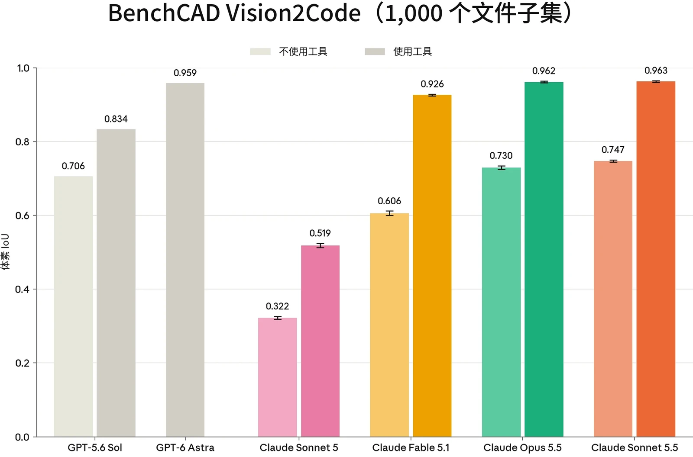

***[图 8.13.2.A] BenchCAD Vision2Code 子集得分。**&#8203;Claude 模型在启用自适应思考和 `max` 推理强度的条件下，分别在使用和不使用工具的情况下接受评估。得分为五次运行的平均值，并显示 95% 置信区间。GPT-5.6 Sol 和 GPT-6 Astra 的得分为 OpenAI 公开报告的结果。*

Claude 在该评估上的表现随测试时计算的增加而显著提升，尤其是在模型配备了能够对中间输出进行视觉验证的工具时。使用工具时，Claude 模型在更高的推理强度档位上拓展了得分–成本前沿，取得了近乎满分的体素 IoU 分数。



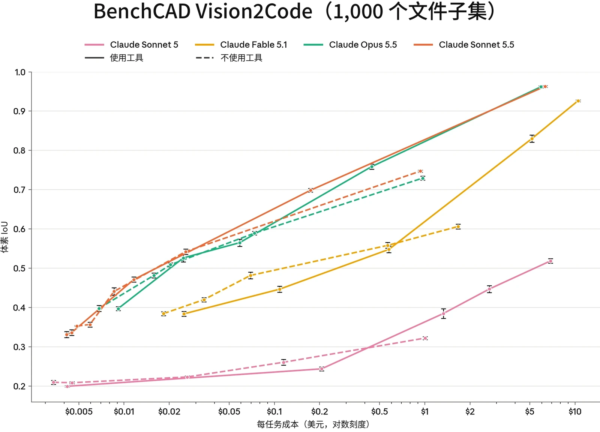

***[图 8.13.2.B] 使用与不使用工具时的 BenchCAD Vision2Code 子集得分。**&#8203;各模型均在不同推理强度档位下以自适应思考进行评估。我们使用 effort 参数来调整所投入的测试时计算量。得分为每个推理强度档位下五次运行的平均值，并显示 95% 置信区间。成本按 API 标准定价计费，并采用每次运行的实际缓存使用情况。*

#### 8.13.3 OSWorld 2.1

OSWorld 2.1 是一个包含 108 项长程计算机使用（computer use）任务的基准测试，在这些任务中，智能体通过截图以及鼠标和键盘操作来操控一台实时运行的 Ubuntu 虚拟机。每项任务依据一组加权检查点进行评分。我们报告两项指标：部分得分（各任务在所有检查点上所获分值的平均值）和严格通过率（所有检查点均满足的任务所占比例），二者均为五次独立运行平均得到的 Pass@1。我们采用该基准测试的默认设置（1080p 分辨率，每项任务的操作步数上限为 500），推理强度为 `max`。对于需要评分模型的任务，我们使用了 Claude Opus 4.8。



我们使用了该基准测试 2026 年 9 月 10 日版本（v2.1）的任务文件、任务资源及配套 Web 应用。智能体保留每一张截图，并使用 Claude API 的服务端上下文管理，在对话超过 100k token 后对其进行压缩。本节中的所有模型均在相同配置下评估，该配置与 Claude Opus 5.5 系统卡中的配置相同。

Claude Sonnet 5.5 取得了 80.1% 的部分得分和 43.5% 的严格通过率。Claude Opus 5.5 的部分得分为 81.8%、严格通过率为 48.7%，Claude Sonnet 5 的部分得分为 57.0%、严格通过率为 25.6%。

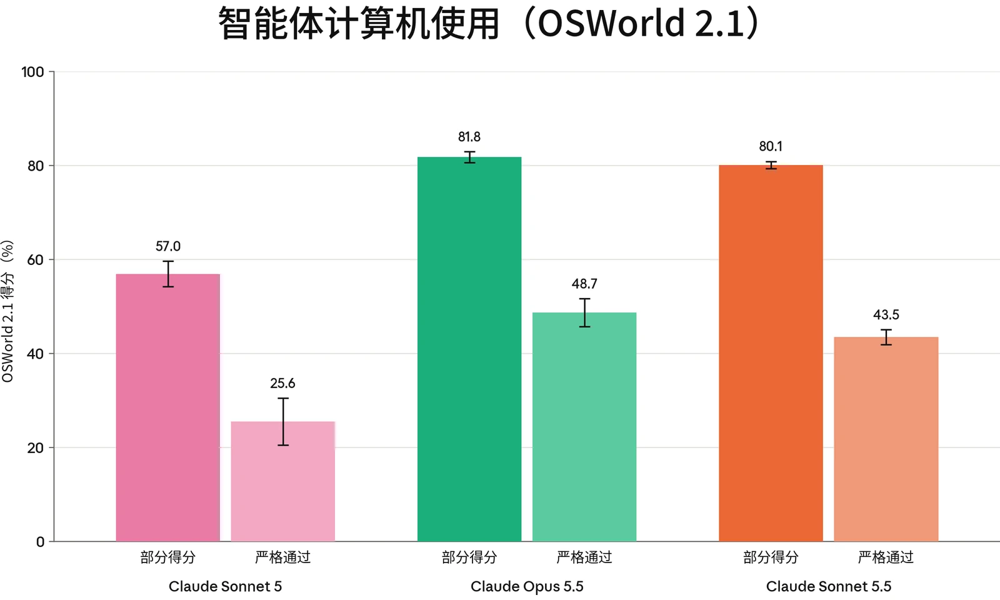

***[图 8.13.3.A] 各模型的 OSWorld 2.1 得分。**&#8203;柱状图显示 `max` 推理强度下的部分得分和严格通过率，以及基于五次运行的 95% 置信区间。*



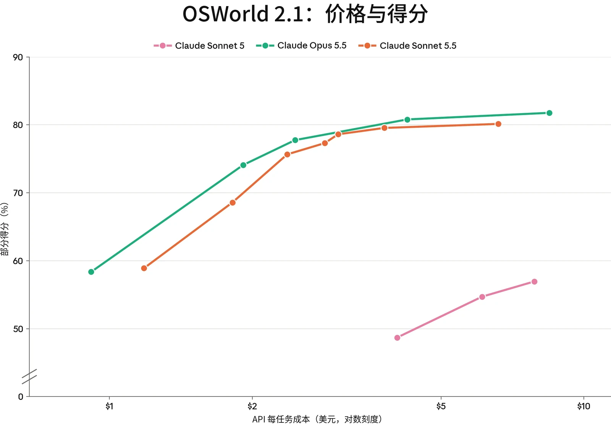

***[图 8.13.3.B] Claude Sonnet 5.5、Claude Opus 5.5 和 Claude Sonnet 5 在 OSWorld 2.1 上的价格与性能对比。**&#8203;每个点代表一种推理强度设置（各模型的档位不同），其位置对应按 API 输入、输出及提示缓存的标准定价计算的平均每任务成本。得分为 OSWorld 2.1 评分者给出的部分得分，取五次运行的平均值。*



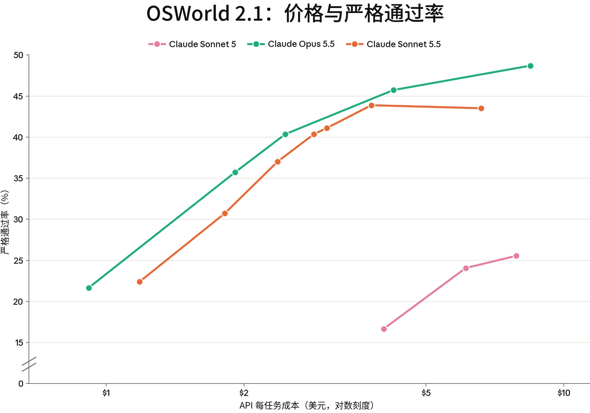

***[图 8.13.3.C] Claude Sonnet 5.5、Claude Opus 5.5 和 Claude Sonnet 5 在 OSWorld 2.1 上的价格与严格通过率对比。**&#8203;每个点代表一种推理强度设置（各模型的档位不同），其位置对应按 API 输入、输出及提示缓存的标准定价计算的平均每任务成本。严格通过率仅在所有检查点均满足时才将任务计为通过，取五次运行的平均值。*

### 8.14 真实世界专业任务

#### 8.14.1 OfficeQA

OfficeQA 是 Databricks 推出的公开基准测试，用于评估基于大量历史美国《财政部公报》（U.S. Treasury Bulletin）文档语料的端到端有据推理。大多数 OfficeQA 问题要求模型在给定的文档中找到正确的表格，并基于这些表格进行精确的数值推理。我们以智能体方式进行评估，相关文档已预先选定并以提取后的文本形式提供；OfficeQA Pro 是推荐用于前沿模型的、难度更高的 133 题子集。

Claude Sonnet 5.5 在 `max` 推理强度下于 OfficeQA 上取得 76.9%，于 OfficeQA Pro 上取得 65.6%。这低于 Claude Opus 5.5（分别为 78.9% 和 67.7%），高于相同设置下的 Claude Sonnet 5（分别为 75.1% 和 62.1%）。



#### 8.14.2 Legal Agent Benchmark

Legal Agent Benchmark（LAB）是 [Harvey AI](https://www.harvey.ai/) 推出的开源基准测试，包含 27 个不同执业领域的超过 2,010 项任务。每项任务包含一个封闭文档集，其中包括电子邮件往来、律所模板、程序性文件以及其他客户事务材料，智能体必须对其进行筛查才能完成任务。任务指令以合伙人向授薪律师提出的简短“工作委托”的形式撰写。指令还规定了预期的输出文档及其格式。评估采用通过/不通过的方式，使用大语言模型作为评判者，依据一套由专家撰写的评分细则标准进行。按照 LAB 的标准报告方式，只有当所有标准均满足时，任务才被视为成功。

除公开任务外，Harvey 还维护着一个包含 120 道题目、未公开发布的留出集。[Artificial Analysis](https://artificialanalysis.ai/evaluations/harvey-lab-aa) 在该留出集上独立报告 Harvey LAB 的结果，所用运行框架由 Artificial Analysis 团队维护（[有关其](https://artificialanalysis.ai/methodology/intelligence-benchmarking#harvey-lab-aa)[方法论的更多信息见此处](https://artificialanalysis.ai/methodology/intelligence-benchmarking#harvey-lab-aa)）。

Claude Sonnet 5.5 在留出集上于 `high` 推理强度下取得 11.7% 的全通过率和 92.1% 的平均评分项通过率（在 `max` 推理强度下为 10% 的全通过率和 93.1% 的平均评分项通过率）。与我们上一份系统卡一样，早期模型的得分采用 Artificial Analysis 测得的结果，而非 Harvey 报告的结果，以便所有模型都在同一运行框架上进行比较。因此，这些得分可能与该变更之前发布的系统卡中的得分略有不同。

#### 8.14.3 GDPval-AA

GDPval-AA v2.1 由 [Artificial Analysis](https://artificialanalysis.ai/) 开发，是一个独立的评估框架，用于在具有经济价值的真实世界专业任务上测试 AI 模型。该基准测试使用 OpenAI 的 [GDPval 黄金数据库](https://huggingface.co/datasets/openai/gdpval)中的 220 项任务，涵盖九大主要行业的 44 种职业。任务对应真实的专业工作成果，包括文档、幻灯片、图表和电子表格。模型在智能体循环中获得 shell 访问权限和网页浏览能力来完成任务，性能通过基于模型输出盲评两两比较得出的 Elo 评分来衡量，并以 DeepSeek V4.1 Flash（`max`）为锚点，定为 1,600 分。

Claude Sonnet 5.5 在 `max` 推理强度下的 Elo 为 1844，仅比 `max` 推理强度下的 Claude Opus 5.5（1846）低 2 分。它领先于 `max` 下的 Claude Fable 5.1（1735）、`max` 下的 Claude Sonnet 5（1449）以及所有非 Claude 模型。在 `xhigh` 推理强度下，Sonnet 5.5 得分为 1725，同时使用的输出 token 比 `max` 下少约67%。评估由 Artificial Analysis 独立运行。



#### 8.14.4 AA-Briefcase

[AA-Briefcase](https://artificialanalysis.ai/articles/aa-briefcase) v1.1 由 Artificial Analysis 开发，是一个由行业专家构建的新基准测试，用于衡量复杂项目中的长程知识工作。模型需要完成为期数周、包含大量相互关联任务和数千个输入源文件的项目。评分结合了评分细则打分以及由前沿模型评审团进行的成对评判，以衡量可验证的任务成功、分析质量和呈现质量。

Claude Sonnet 5.5 在 `max` 推理强度下的 Elo 为 1811，仅比 `max` 下的 Claude Opus 5.5（1822）低 11 分；在 `xhigh` 推理强度下为 1746。这两种设置均领先于 `max` 下的 Claude Fable 5.1（1678）、`max` 下的 Claude Sonnet 5（1359）以及所有非 Claude 模型。在 `xhigh` 推理强度下，Sonnet 5.5 使用的输出 token 比 `max` 下少约 61%。评估由 Artificial Analysis 独立运行。

#### 8.14.5 Toolathlon-Verified

Toolathlon 是一个智能体基准测试，包含 108 项真实世界工具使用任务，涵盖办公效率、电子商务与运营、数据分析和网页调研。任务从预先填充了真实感数据的应用中开始，并由基于执行的检查器进行评分，这些检查器既验证生成的产出物，也验证相关应用或网站中的变更。该基准测试在 32 个应用中提供了 600 多种工具。任务要求在长程中正确选择工具、进行多步骤顺序编排，并给出与检查器要求完全一致的输出；在我们的运行中，轨迹平均约为 20–32 个助手轮次。我们针对 Toolathlon-Verified 进行了评估，这是作者的最终版本（2026 年 6 月），其中任务提示词、标准答案和评估器均经过人工审核并最终确定，并公布了八个模型的参考轨迹以供外部验证。

Claude Sonnet 5.5 取得了 77.8% 的 Pass@1，与 Claude Opus 5.5 和 Claude Fable 5.1（均为 77.8%）持平，并领先于 Claude Sonnet 5（74.7%）。其 Pass@3 为 85.2%，Pass³ 为 68.5%，且每条轨迹的平均助手轮次（31.6）多于表中其他模型。在 324 次试验中，有两次（0.6%）被生产环境安全分类器中止，计为失败。对比模型的数据转引自 Claude Opus 5.5 系统卡。遵循论文的评估方案，我们报告在全部 108 项任务上对三次试验取平均的 Pass@1，同时报告 Pass@3（三次试验中至少一次正确）、Pass³（三次试验全部正确）以及每条轨迹的平均助手轮次。



| **模型** | **Pass@1** | **Pass@3** | **Pass³** | **平均轮次** |
|---|---|---|---|---|
| **Claude Sonnet 5.5** | 77.8 | 85.2 | 68.5 | 31.6 |
| **Claude Opus 5.5** | 77.8 | 82.4 | 72.2 | 26.9 |
| **Claude Fable 5.1** | 77.8 | 81.5 | 73.1 | 23.7 |
| **Claude Opus 5** | 80.6 | 87.0 | 73.1 | 23.5 |
| **Claude Mythos 5** | 79.3 | 86.1 | 73.1 | 19.8 |
| **Claude Opus 4.8** | 79.9 | 88.0 | 71.3 | 20.4 |
| **Claude Sonnet 5** | 74.7 | 84.3 | 65.7 | 24.5 |

***[表 8.14.5.A] Toolathlon 得分（内部运行框架）。**&#8203;各模型均以自适应思考和 `max` 推理强度进行评估；Claude Sonnet 5.5、Claude Opus 5.5 和 Claude Fable 5.1 在运行时启用了安全分类器。按照论文的评估方案，Pass@1、Pass@3 和 Pass³ 均基于全部 108 项任务的三次试验计算。*

我们的运行框架沿用了 Toolathlon-Verified 的任务定义、提示词和基于执行的检查器，并加入了少量针对特定环境的配置补丁；我们通过在自己的运行框架中重新运行两个参考模型（Sonnet 5 和 Opus 4.8），并在排除空结果后与作者公布的结果相吻合，对这些补丁进行了验证。为控制实时依赖漂移，我们将金融数据源固定为运行时记录的快照，并固定容器镜像。少量上游检查器缺陷（例如，标准答案引用了一个此后已更名的代码仓库）未作改动。

关于与已公布排行榜的可比性的说明：我们测得的 Sonnet 5 和 Claude Opus 4.8 数据比已公布排行榜上的数据（分别为 71.6% 和 76.2%）分别高 3.1 和 3.7 个百分点。Sonnet 5 差距中约 1.8 个百分点、Claude Opus 4.8 差距中约 2.7 个百分点，来自作者的运行框架未生成任何轨迹的运行（Sonnet 5 为 324 次中的 8 次；Claude Opus 4.8 为 324 次中的 11 次）。排行榜将这些运行计为失败；排除这些运行后，我们的数据与作者公布的参考轨迹在运行间噪声范围内一致。



#### 8.14.6 AutomationBench

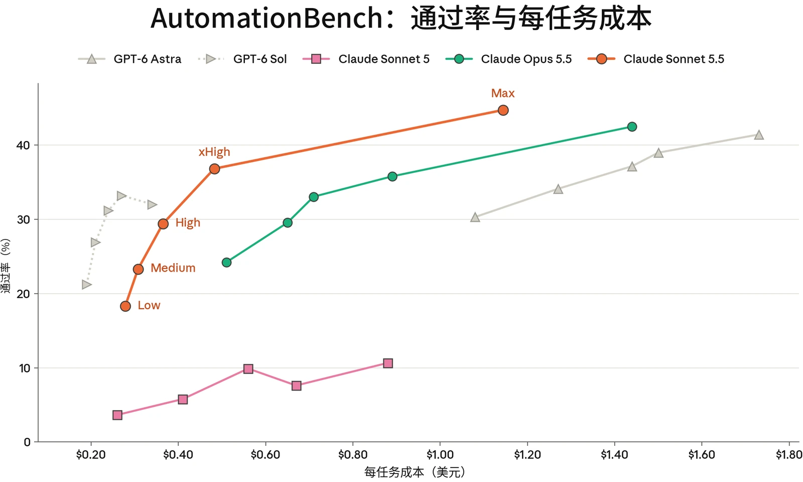

***[图 8.14.6.A] AutomationBench 得分。**&#8203;在其曲线上的每一个点，Claude Sonnet 5.5 的 AutomationBench 通过率都高于 Sonnet 5 在相同或更低估计每任务成本下所达到的通过率。除 Claude Sonnet 5.5 外，所有模型的成本均为 Zapier 在其排行榜上公布的每任务数据；Claude Sonnet 5.5 的每任务成本由 Anthropic 根据 Zapier 记录的 token 数量，按含提示缓存的标准定价计算得出，采用的是 Claude Opus 5.5 系统卡中所用的方法。*

AutomationBench 是 Zapier 推出的基准测试，用于衡量智能体能否完成真实的端到端业务工作流。任务源自销售、市场营销、运营、客户支持、财务和人力资源等领域的真实客户工作流模式。每项任务将智能体置于一家模拟公司中；整个基准测试共有约 500 个 REST API 端点，覆盖 47 个应用（CRM、Slack、Google Workspace 等）。智能体会收到一条自然语言指令。随后，它必须通过搜索自主发现正确的端点；进行数十次相互依赖的顺序 API 调用；查阅并遵守多层级的业务政策文档；并正确避开刻意设置的干扰项。每项任务按通过/不通过评分。只有当针对模拟应用状态的所有确定性断言均成立时（例如，所有正确的 CRM 更新均已应用），任务才算通过。



Zapier 在其 AutomationBench 评估集上评估了 Claude Sonnet 5.5。在 `max` 推理强度下，Sonnet 5.5 在启用 API 默认回退机制的情况下得分为 44.7%。Claude Opus 5.5 在以默认回退机制重新运行以拒绝告终的任务后得分为 42.5%（未重新运行时为 40.0%，如 Claude Opus 5.5 系统卡中所报告）。

### 8.15 医疗健康

我们在 HealthBench、HealthBench Professional 和 PhysicianBench 上评估了 Claude Sonnet 5.5，主要涵盖面向患者的聊天机器人用例、面向医疗服务提供者的聊天机器人用例，以及涉及电子健康记录（electronic health record，EHR）工具使用的智能体医疗健康任务。图中所示的所有 Claude 模型均在启用安全分类器的情况下运行。为实现同等条件下的比较，我们在每项评估中对所有评分细则评分使用同一个评分模型。对于 HealthBench 和 HealthBench Professional，我们通过 OpenAI 的公开 API、在不使用系统提示词的情况下对其模型重新采样；对于 PhysicianBench，我们对所有模型使用相同的运行框架。随后，我们依据基准测试的标准，使用 Opus 对回答进行评分。我们对 HealthBench 和 HealthBench Professional 使用 Claude Opus 4.8，对 PhysicianBench 使用 Claude Opus 5。图 8.15.A 显示了各模型在 `max` 推理强度下随时间的进展。

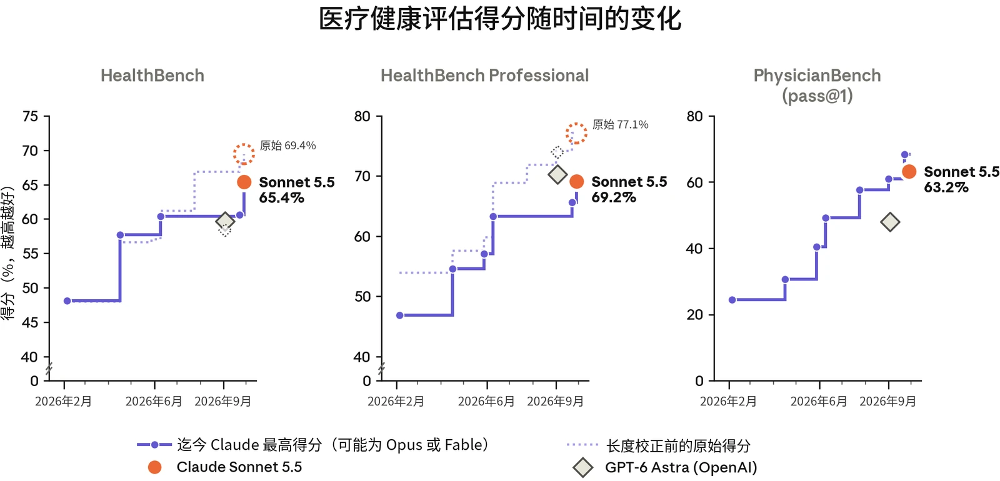

***[图 8.15.A] Claude 模型医疗健康评估得分随时间的变化。**&#8203;所有模型均使用 `max` 推理强度运行。*

HealthBench 和 HealthBench Professional 的得分同时展示了经过与未经过长度校正的结果，该长度校正是这两个基准测试的开发者 OpenAI 目前所采用的：校正后得分 = 得分 − r × (L − 2,000) / 500，采用 0 到 100 的分值范围，其中 L 为回答的字符长度，r 在 HealthBench 中为 2.99，在 HealthBench Professional 中为 1.47。长度为 2,000 个字符的回答得分保持不变，更长的回答会被扣分，更短的回答则会加分。全部三个常数（2,000 字符的参考长度和两个比率）均由OpenAI 设定，其中 HealthBench Professional 的比率是基于 OpenAI 自家模型拟合得到的。在 `max` 推理强度下的 HealthBench Professional 上，长度校正改变了排名。校正前：Claude Opus 5.5（77.1%）≈ Claude Sonnet 5.5（77.1%）> Claude Fable 5.1（74.2%）> GPT-6 Astra（74.0%）。校正后：GPT-6 Astra（70.3%）> Claude Sonnet 5.5（69.2%）> Claude Opus 5.5（65.6%）> Claude Fable 5.1（62.1%）。因此，我们同时报告这两种得分。



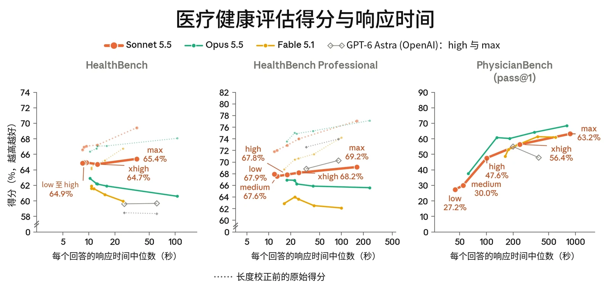

***[图 8.15.B] 医疗健康评估结果与响应时间。***

#### 8.15.1 HealthBench

在每个推理强度档位下，经长度校正后，Claude Sonnet 5.5 的得分均高于 Claude Opus 5.5 和 Claude Fable 5.1。在长度校正之前，它在 `low` 到 `xhigh` 推理强度下与 Claude Opus 5.5 持平，在 `max` 下略为领先（69.4% 对 68.1%）。在 `max` 推理强度下，它在两项指标上的得分均高于此前所有 Claude 模型。

#### 8.15.2 HealthBench Professional

在 `max` 推理强度下，经长度校正后，Claude Sonnet 5.5 的得分高于此前所有 Claude 模型（69.2%，次高的 Claude Opus 5.5 为 65.6%）。长度校正前，它与 Claude Opus 5.5 持平（均为 77.1%），并高于此前其他所有 Claude 模型。

#### 8.15.3 PhysicianBench

PhysicianBench 是一个公开基准测试，包含 100 项在电子健康记录中执行的医师任务。在 `max` 推理强度下，Claude Sonnet 5.5 的尝试通过率为 63.2%，远高于 Claude Sonnet 5（37.4%），与 Claude Fable 5.1（61.0%）持平，比 Claude Opus 5（57.6%）高约 6 个百分点，比 Claude Opus 5.5（68.4%）低约 5 个百分点。由于只有 100 项任务，5 到 6 个百分点的差异已处于该基准测试分辨能力的边缘。



#### 8.15.4 推理强度与医疗健康任务

推理强度能带来多大帮助，取决于任务类型。

**一般健康问题（HealthBench）：**&#8203;在长度校正后得分上，全部五个推理强度档位的得分彼此相差不超过 0.7 个百分点（64.7% 至 65.4%）。从 `low` 到 `xhigh`，每个回答的响应时间为 8 至 13 秒，在 `max` 下约为 36 秒。

**来自医疗专业人员的问题（HealthBench Professional）：**&#8203;在长度校正后得分上，`low`、`medium`、`high` 和 `xhigh` 推理强度档位的得分彼此相差约 0.6 个百分点以内（67.6% 至 68.2%）。`max` 推理强度得分 69.2%，比它们高 1.0 至 1.6 个百分点，在噪声范围内。`max` 推理强度对原始得分的提升更大，高出 3 至 5 个百分点（77.1%，对比 71.8% 至 74.0%）。从 `low` 到 `xhigh` 推理强度，每个回答的响应时间为 12 至 26 秒，在 `max` 下约为 160 秒。

**可访问电子健康记录的智能体健康任务（PhysicianBench）：**&#8203;推理强度影响很大。`low` 和 `medium` 推理强度无法区分（27.2% 和 30.0%），在此之上每提高一档都带来提升，每任务模型耗时从 `high` 下的不到 2 分钟，增至 `xhigh` 下的约 4 分钟，以及 `max` 下的约 14 分半钟。

对于当前公开的健康领域问答基准测试，`low` 推理强度已能获得几乎全部的长度校正后得分，而原始得分在 `max` 推理强度下最高。对于智能体临床基准测试，提高推理强度会带来显著提升。

### 8.16 多语言表现

我们在两个多语言基准测试——Global MMLU（GMMLU）和 Multi-task Indic Language Understanding Benchmark（MILU）——上评估了 Claude Sonnet 5.5，以考察其在多种语言上的表现。

GMMLU 将标准 MMLU 评估扩展到 42 种语言，涵盖从法语、德语等高资源语言到约鲁巴语、伊博语和齐切瓦语等低资源语言。MILU 涵盖 11 种语言——10 种印度语言（孟加拉语、古吉拉特语、印地语、卡纳达语、马拉雅拉姆语、马拉地语、奥里亚语、旁遮普语、泰米尔语和泰卢固语）以及英语——考察对植根文化背景的知识的理解。



#### 8.16.1 GMMLU 结果

在 GMMLU 上，Claude Sonnet 5.5 在 42 种语言上的平均准确率为 92.1%，低于 Claude Opus 5.5 的 94.3% 和 Claude Fable 5.1 的 94.0%，高于 Claude Sonnet 5 的 89.2%。

***[图 8.16.1.A] GMMLU 平均准确率。**&#8203;所有 Claude 模型均使用 `max` 推理强度下的自适应思考。分数为单次试验的结果。未向任何模型提供工具或自定义系统提示词。*

#### 8.16.2 MILU 结果

在 MILU 上，Claude Sonnet 5.5 在 11 种语言上的平均准确率为 91.6%，低于 Claude Opus 5.5 的 93.1% 和 Claude Fable 5.1 的 93.0%，高于 Claude Sonnet 5 的 89.3%。



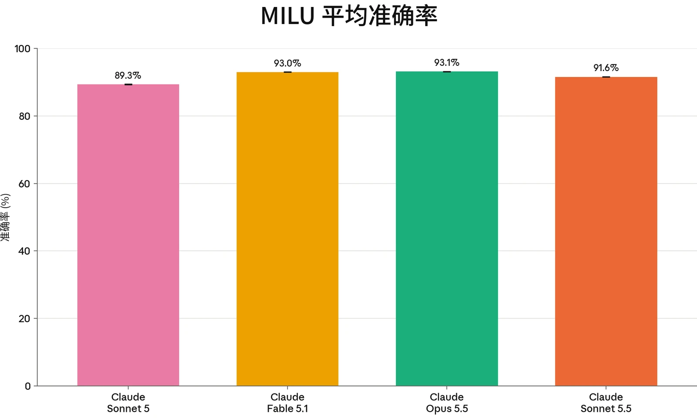

***[图 8.16.2.A] MILU 平均准确率。**&#8203;所有 Claude 模型均使用 `max` 推理强度下的自适应思考。分数为 5 次试验的平均值。未向任何模型提供工具或自定义系统提示词。*

### 8.17 生命科学能力

本节报告支持有益生命科学研究的能力评估，涵盖生物信息学、基于细胞的检测与生物医学图像分析、药物化学、蛋白质设计、从头蛋白质结合剂设计以及实验方案。除非另有说明，每个 Claude 得分均为每道题五次尝试的平均值，采样时使用自适应思考，推理强度为 `max`。Claude Sonnet 5.5 通过 API 进行评估，且关闭了其生物安全防护措施，因此这些结果反映的是底层模型的能力，而非已部署系统的能力。在可获得的情况下，我们还报告了 GPT‑6 Astra 的得分，其通过 OpenAI API 以 `max` 推理强度运行。同样，我们报告了 Gemini 3.1 Pro 在最高思考级别下的得分。任一模型上被安全过滤器拦截的尝试均不计入我们的评估结果。



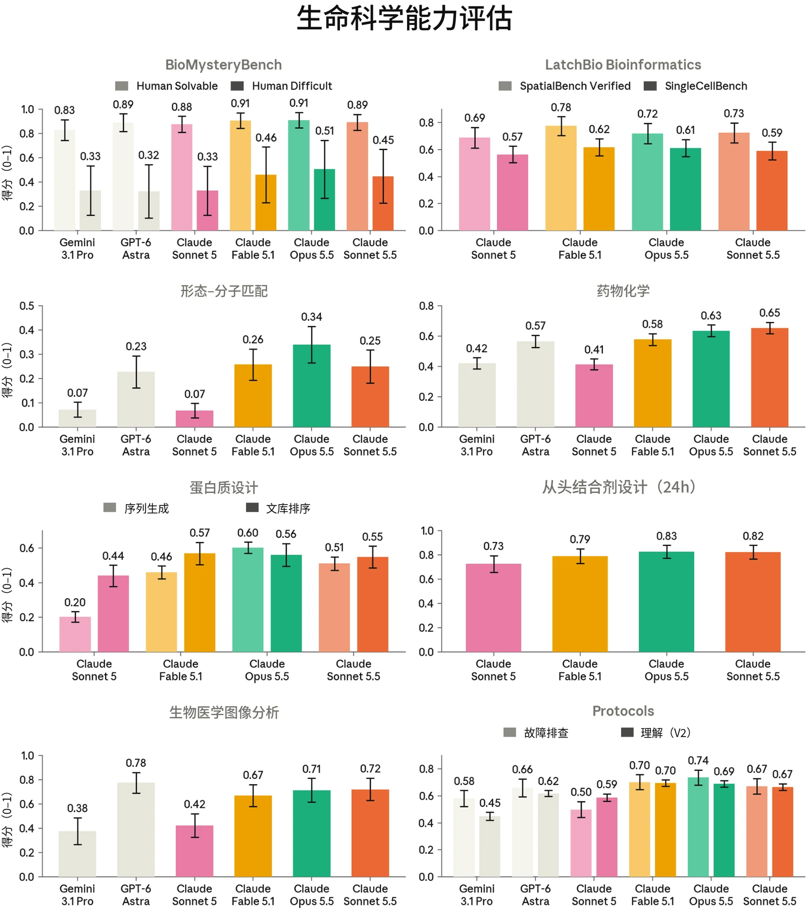

***[图 8.17.A] 生命科学基准测试。**&#8203;Claude Sonnet 5.5 及对比模型在所示各基准测试上的表现；各基准测试的结果将在以下各节中讨论。*

#### 8.17.1 BioMysteryBench

BioMysteryBench 评估模型解决困难分析难题的能力，这些难题需要将计算分析与生物学推理交织进行。给定实验数据集，模型必须回答诸如从转录组数据中识别被敲除的基因、或判断哪种病毒感染了样本等问题。Claude Sonnet 5.5 在 Human Solvable 子集（Human Solvable subset）上的表现与 Claude Sonnet 5 相当（89.2% 对 87.5%），在 Human Difficult 子集（Human Difficult subset）上则高于后者（44.7% 对 32.9%）。请注意，我们在重新运行所有 Claude 模型时，从其网络允许列表中少移除了两个域名，而在 GPT-6 Astra 的运行以及 Gemini 3.1 Pro 的 Human Difficult 运行中保留了这些域名。



#### 8.17.2 LatchBio Bioinformatics

这组评估由 LatchBio 开发，评估模型解决具有挑战性的真实世界生物信息学问题的能力。SpatialBench Verified 变体测试空间转录组学和染色质可及性数据的分析，SingleCellBench 变体测试单细胞 RNA 测序数据的分析。在这两个变体中，Claude 都可以使用用于代码执行的 bash 工具、一个文件编辑器以及一组预先指定的已安装软件包。Claude Sonnet 5.5 在两者上的表现均与 Claude Sonnet 5 相当（SpatialBench Verified 72.5% 对 68.9%；SingleCellBench 59.1% 对 56.5%），并且在两者上均与 Claude Opus 5.5 相当（72.0% 和 61.2%）。

#### 8.17.3 形态–分子匹配

该基准测试与 Axiom Bio 合作开发，评估模型能否将来自 Axiom 人类肝脏体外检测的四组多通道细胞成像数据，与处理每组图像中各孔的四种打乱顺序的分子–剂量扰动进行匹配。Claude Sonnet 5.5 的表现优于 Claude Sonnet 5（25.0% 对 6.8%），并与 Claude Fable 5.1 相当（25.8%）。

#### 8.17.4 药物化学

该基准测试评估模型能否对类药分子的吸收、分布和代谢（ADME）相关性质进行推理。504 道题中的每一道都以化学结构的形式给出若干来自药物发现项目的真实化合物，并询问哪个候选化合物的某一此类性质的测量值最高或最低。Claude Sonnet 5.5 的表现与 Claude Opus 5.5 相当（65.3% 对 63.5%）。

#### 8.17.5 蛋白质设计

这些基准测试评估 Claude 的蛋白质设计能力。序列生成任务（Sequence Generation task）评估 Claude 在多种设计约束条件下生成新型蛋白质序列的能力。文库排序任务（Library Ranking task）评估 Claude 为实验测试确定蛋白质设计优先级的能力。对于序列生成，我们每道题只运行了 1 次尝试；对于文库排序，每道题运行 3 次尝试。Claude Sonnet 5.5 在两者上均较 Claude Sonnet 5 有大幅提升（序列生成 51.0% 对 20.2%；文库排序 54.8% 对 44.0%）。



#### 8.17.6 从头蛋白质结合剂设计

该基准测试评估 Claude 能否独立开展一个持续较长的蛋白质设计项目。对于 15 个蛋白质靶标中的每一个，Claude 都会获得该靶标的结构，以及 24 小时实际耗时的固定预算，用于针对该靶标设计一组 30 个微型蛋白结合剂。这些蛋白质靶标在这篇[博客文章](https://www.anthropic.com/research/Claude-accelerates-protein-design)中有所介绍；我们在本评估中排除了 Cas9。Claude Sonnet 5.5 的表现与 Claude Opus 5.5 相当（82.3% 对 82.6%）。

#### 8.17.7 生物医学图像分析

该基准测试使用来自公开生物医学图像分析竞赛的数据，评估模型对生物医学图像进行定量分析的能力。任务输入涵盖 CT、MRI、组织病理、皮肤镜、视网膜、超声、显微及其他成像。我们对评分进行了缩放，以反映 Claude 的表现相对于相应竞赛中所取得最佳结果的水平。我们每道题运行了 1 次尝试。Claude Sonnet 5.5 的表现与 Claude Opus 5.5 相近（72.2% 对 71.4%）。GPT-6 Astra 以 77.5% 的得分领先，Gemini 3.1 Pro 得分为 37.8%（基于其 91 个案例中已完成的 89 个计算；两个未完成，不计入得分）。

#### 8.17.8 Protocols

这项评估考察模型协助完成分子生物学实验方案的能力。故障排查变体（Troubleshooting variant）要求 Claude 发现并修复实验方案中的问题。Understanding (V2) 变体是由 Benchling 创建的一组题目，它向 Claude 提供一份真实的实验方案（例如 protocols.io 文档、厂商手册或核心实验平台指南），以及一个关于应用或调整该方案的实际问题。在这两个变体上，Claude Sonnet 5.5 均较 Claude Sonnet 5 有所提升（故障排查 67.3% 对 49.9%；Understanding (V2) 66.6% 对 58.9%）。



None‎
