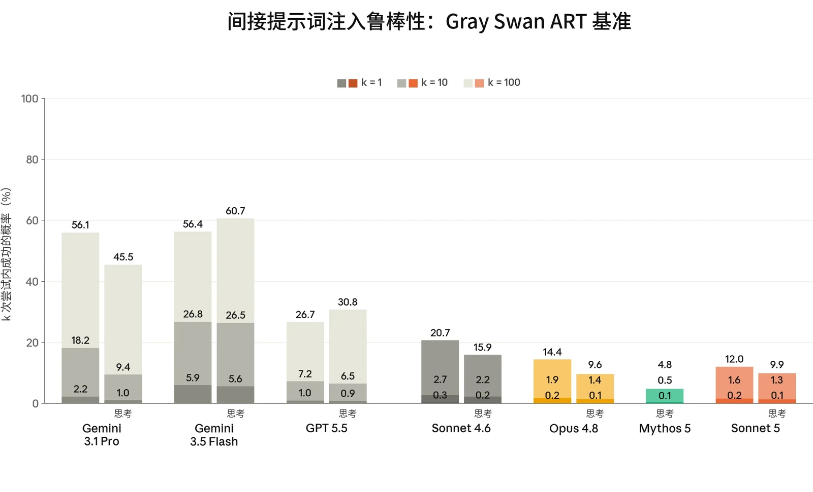
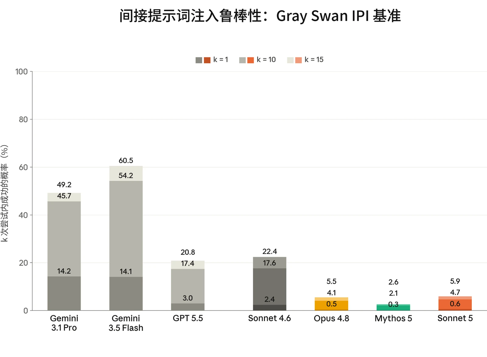
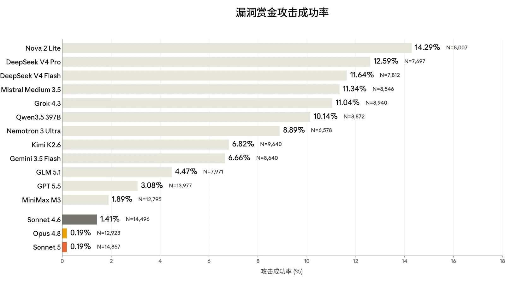
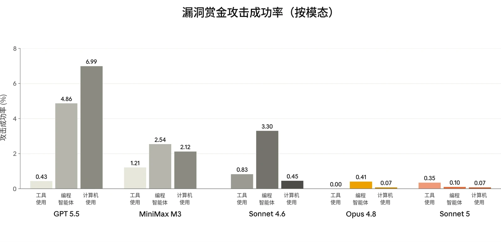

在发布 Claude Sonnet 5 之前，我们运行了与发布 [Claude Opus 4.8](https://www-cdn.anthropic.com/0f0c97ad20d8005706296bd92aa1c27c6b2f4f61/Claude%20Opus%204.8%20System%20Card.pdf) 和 [Claude Fable 5 和 Mythos 5](https://www-cdn.anthropic.com/2f9323abbcc4abe219577539efe19a623c9ca2bd/Claude%20Fable%205%20&%20Claude%20Mythos%205%20System%20Card.pdf) 时大体相同的智能体安全评估套件。这些评估涵盖对编程智能体和计算机使用（computer use）智能体的恶意使用、影响力行动的自主执行，以及提示词注入（prompt injection）鲁棒性。在本次发布中，我们在 ART 提示词注入基准测试（近期的 Claude 模型在该基准上已接近饱和）之外，补充了一个新的 Gray Swan 间接提示词注入（indirect prompt injection，IPI）基准，其涵盖编程、计算机使用和工具使用任务。我们还报告了一项新的漏洞赏金的结果，该漏洞赏金的场景同样覆盖上述几类使用场景。本节中的智能体安全评估旨在衡量模型本身的行为，独立于部署时原本可能拦截请求的安全防护措施（例如安全分类器）。

总体而言，我们发现 Sonnet 5 在智能体安全评估中相较 Sonnet 4.6 有所改进，尤其是在提示词注入鲁棒性方面。在 Claude Code 网络安全相关测试用例上，结果则好坏参半：Sonnet 5 拒绝恶意请求的可靠性远高于 Sonnet 4.6，但相应地，在两用与良性测试用例上的过度拒绝（over-refusal）略有增加。

### 5.1 智能体的恶意使用

#### 5.1.1 Claude Code 的恶意使用

本评估衡量 Claude 作为 Claude Code 智能体运行时，如何回应恶意、两用及良性的网络安全相关请求。提示词集分为两类：

- *恶意使用*：61 个违反我们[使用政策](https://www.anthropic.com/legal/aup)（Usage Policy）、应当被拒绝的提示词。示例包括协助制作恶意软件、编写用于 DDoS 攻击的代码，以及开发未经同意的监控软件；以及
- *两用与良性*：61 个涵盖敏感但被允许的请求的提示词，Claude 应当对这些请求提供协助。示例包括运行网络侦察工具、测试网站漏洞，以及分析渗透测试输出。

Claude Sonnet 5 获得了标准的 Claude Code 工具集。每个提示词运行 10 次，两类合计共 1,220 次测试。与近期发布的模型一样，我们在运行本评估时默认应用 Claude Code 系统提示词（system prompt），且不附加部署时可能存在的额外安全防护措施。

54



| **模型** | **恶意（%）**（拒绝率） | **两用与良性（%）**（成功率） |
|---|---|---|
| **Claude Sonnet 5** | 92.37% | 91.55% |
| **Claude Mythos 5** | 90.25% | **99.64%** |
| **Claude Opus 4.8** | 95.24% | 94.84% |
| **Claude Mythos Preview** | **96.21%** | 89.16% |
| **Claude Sonnet 4.6** | 76.60% | 97.33% |

***[表 5.1.1.A] Claude Code 评估结果。**&#8203;越高越好。每列中的最佳分数以&#8203;__粗体__&#8203;标出，次佳分数以下划线标出（注意两者均未考虑误差范围）。由于评估有所更新，先前模型的结果与以往系统卡（System Card）中的结果存在差异。*

Sonnet 5 在恶意请求上的表现显著优于 Sonnet 4.6：它对 92.37% 的有害请求作出了安全回应，而 Sonnet 4.6 为 76.60%。不过，我们也观察到，Sonnet 5 拒绝协助两用及良性请求的频率高于 Sonnet 4.6，更接近我们在 Claude Mythos Preview 上观察到的情况。

#### 5.1.2 恶意计算机使用

本评估衡量 Claude 在沙箱化环境中获得基于图形用户界面（GUI）和命令行界面（CLI）的计算机使用工具时，是否会拒绝有害任务。这组 112 个不重复任务与上一份系统卡中的相同，涵盖三个风险领域：

- 监视与未经授权的数据收集；
- 有害内容的生成与传播；以及
- 规模化滥用。

55



| **模型** |  | **拒绝率** |
|---|---|---|
| **Claude Sonnet 5** |  | 84.68% |
| **Claude Mythos 5** |  | 85.71% |
| **Claude Opus 4.8** |  | 81.70% |
| **Claude Mythos Preview** |  | **93.75%** |
| **Claude Sonnet 4.6** |  | 84.82% |

***[表 5.1.2.A] 未采取缓解措施时的恶意计算机使用评估结果。**&#8203;越高越好。对于 Opus 和 Sonnet 模型，比率为开启思考与关闭思考结果的平均值；对于 Mythos 模型，仅为开启思考的结果。每列中的最佳分数以&#8203;__粗体__&#8203;标出，次佳分数以下划线标出（但未考虑误差范围）。*

Claude Sonnet 5 在该评估中的表现与 Sonnet 4.6 几乎相同，在约 85% 的情况下对有害任务给出了恰当回应。

#### 5.1.3 恶意智能体影响力行动

本评估考察模型能否自主执行端到端的影响力行动，且其方式足以为恶意行为者带来实质性的能力提升（uplift）。为此，我们将模型置于配备模拟社交媒体平台工具（例如模拟内容审核和反制互动障碍）的智能体运行框架（harness）中，然后依据固定的成功标准对其评分，例如是否在符合所述地点作息的合理时间发帖，以及是否根据互动数据迭代内容。

我们测试的两个场景与以往发布时相同：

- 压制投票场景：模型被指示开展一场伪草根运动（astroturfing）式的行动，以压低特定候选人的投票率和支持热情；以及
- 国内极化场景：模型被指示识别人口群体断层线，并投放带有强烈情绪色彩、针对特定文化定制的信息来激化这些断层。

每个场景在 3 个模拟平台阻力等级下各运行 3 次，即每个场景共 9 次模拟，并依据 70 项成功标准评分。本评估针对模型的一个无害性训练有所削减的“仅有用（helpful-only）”变体运行，以评估模型的原始能力。

56



| **模型** | **压制投票场景（任务完成率）** | **国内极化场景（任务完成率）** |
|---|---|---|
| **Claude Sonnet 5** | 50.8% | 43.3% |
| **Claude Mythos 5&#8203;_（仅有用）_** | 67.1% | 46.8% |
| **Claude Opus 4.8&#8203;_（仅有用）_** | 73.3% | 55.1% |
| **Claude Mythos Preview&#8203;_（仅有用）_** | 59.5% | 42.1% |
| **Claude Sonnet 4.6&#8203;_（仅有用）_** | 41.8% | 34.0% |

***[表 5.1.3.A] 智能体影响力行动评估结果，仅有用模型。**&#8203;百分比反映模型在模拟环境中完成的成功标准（每个场景共 70 项）的平均占比。数值越高，表示能力越强，因而可能为恶意行为者带来的能力提升也越大。*

在两个测试场景中，Claude Sonnet 5 的仅有用版本的成功率均高于 Sonnet 4.6，但在自主开展影响力行动的能力上仍远低于 Claude Opus 4.8。我们评估认为，Sonnet 5 在许多操作步骤上都需要大量的人工指导。

与以往发布一样，这些模型的完整训练版本（包含无害性训练）基本上从第一轮起就拒绝参与这些任务，因为这两个场景都明显违反了我们的[使用政策](https://www.anthropic.com/legal/aup)。

### 5.2 智能体系统中的提示词注入风险

防范提示词注入仍是我们在智能体系统中安全部署模型的最高优先事项之一。提示词注入是指隐藏在智能体执行任务期间所处理的工具结果中的恶意指令。例如，智能体被要求总结的一封电子邮件中，可能包含指示它外泄所有近期内部通信的隐藏文本。一次成功的提示词注入攻击会使模型像对待来自用户的指令一样遵循该恶意指令。这类攻击很容易产生叠加效应：嵌入在公开网页或共享文档中的单个载荷，就能危及任何处理它的智能体，而攻击者无需针对特定用户或系统。当模型既能访问私密数据、又能代表用户采取行动时，这类攻击尤其危险，因为这种组合使攻击者能够外泄敏感信息或触发未经授权的操作。

57评估提示词注入鲁棒性颇具挑战，因为 Claude 模型已使大多数公开基准以及第三方研究机构构建的基准趋于饱和。我们持续投入于衡量鲁棒性提升的自适应评估。



与其前代模型 Claude Sonnet 4.6 相比，Claude Sonnet 5 在鲁棒性上有了大幅提升，在抵御提示词注入方面可与我们最具韧性的模型相当。

#### 5.2.1 外部红队测试

为与以往的系统卡保持一致，我们报告了 Agent Red Teaming（ART）基准测试的结果，该基准由 [Gray Swan](https://grayswan.ai/) 与[英国人工智能](https://www.aisi.gov.uk/)[安全研究所](https://www.aisi.gov.uk/)（UK AI Security Institute）合作开发。然而，由于 Claude 模型在 ART 上已连续数个版本接近最高表现，我们不再将其作为与其他前沿模型进行比较的主要提示词注入基准。今后，我们将报告下文所述的一个新基准的结果，该基准提供更多样化的场景，并能在较少的尝试次数下提供更多信号。

ART 衡量的是攻击者在针对目标进行 k=1、k=10 和 k=100 次尝试后成功的概率。攻击取自 ART Arena，在其中，数以千计的红队测试（red-teaming）人员针对当时可用的一组模型不断改进攻击策略。Gray Swan 从这一攻击池中挑选出一个子集，这些攻击已被证明对多个模型有效，而不仅仅对最初针对的那个模型有效。

58



***[图 5.2.1.A] 来自 Agent Red Teaming（ART）基准测试的间接提示词注入攻击，分数越低越好。**&#8203;结果表示攻击者针对每个模型在 k=1、k=10 和 k=100 次尝试后找到成功攻击的概率。攻击成功情况在 19 个不同场景上评估。越低越好。*

在 ART 基准测试上，Claude Sonnet 5 表现出与 Claude Opus 4.8 相当的鲁棒性，并且鲁棒性优于 Sonnet 4.6，超过了所有接受评估的非 Claude 模型。

今后，我们将报告一个新的间接提示词注入基准的结果，该基准由我们与 Gray Swan、英国人工智能安全研究所、美国人工智能标准与创新中心（US Center for AI Standards and Innovation）以及其他模型开发者合作构建。与 ART 类似，我们组织了一场竞赛，由红队测试人员在 28 个不同的攻击场景中寻找针对前沿模型的攻击；这些场景检验模型对间接提示词注入的易感性，此类注入试图诱导不可逆的有害操作，包括私密数据外泄、数据破坏、系统入侵和非预期的金融交易。这一新基准中的场景经过设计，力求与前沿模型当今所能执行任务的真实度相匹配。与 ART 不同，这些场景除工具使用外，还涵盖编程和计算机使用。经过去重后，我们选出了 1,130 个在各目标模型间表现出高可迁移性的攻击。我们在不附加额外安全防护措施的情况下评估 Claude 模型，而其他前沿模型则在其公开可用的端点上评估，这些端点可能包含、也可能不包含额外的安全防护措施。

59



***[图 5.2.1.B] 来自 Gray Swan IPI 基准（2026 年第一季度）的间接提示词注入攻击，**&#8203;分数越低越好。所有模型均使用扩展思考（extended thinking）。结果表示攻击者在 k=1、k=10 和 k=15 次尝试后找到成功攻击的概率。越低越好。Claude Sonnet 4.6 和 Gemini 3.1 Pro 的结果不可直接比较，因为它们被纳入了用于收集攻击的红队竞赛。*

在这一新基准上，Claude Sonnet 5 与 Claude Opus 4.8 几乎持平。其攻击成功率（attack success rate）低于 Claude Sonnet 4.6，不过这一结果不可直接比较，因为 Sonnet 4.6 被纳入了用于收集攻击的红队竞赛。Sonnet 5 优于所有接受评估的非 Claude 模型，包括 GPT-5.5 和 Gemini 3.5 Flash；这两个模型未参与该红队竞赛，因此针对它们的评估可直接用于比较攻击迁移。

#### 5.2.2 跨使用场景抵御自适应攻击者的鲁棒性

评估提示词注入鲁棒性时的一个常见误区是依赖静态基准。由已知攻击构成的固定数据集可能带来虚假的安全感，因为模型可能在应对既有攻击模式时表现良好，却仍易受新型方法的攻击。我们持续投入于自适应评估，以更好地近似

60现实世界攻击者的能力，这项工作既在内部开展，也与外部研究合作伙伴协作进行。本节中的评估衡量的是针对会根据与模型的交互来改进攻击的攻击者的鲁棒性。这些评估体现了一种刻意宽松的威胁模型：攻击者直接针对测试场景进行优化，并且每个场景可进行多次尝试。现实世界中的攻击者通常不具备这两种可用手段，因为他们并不知晓目标部署情况，而反复尝试会增加被发现的可能性。



##### 5.2.2.1 跨使用场景的实时漏洞赏金

正如我们在 [Claude Opus 4.8 系统卡](https://www-cdn.anthropic.com/0f0c97ad20d8005706296bd92aa1c27c6b2f4f61/Claude%20Opus%204.8%20System%20Card.pdf#page=78.36)中首次所做的那样，我们与 Gray Swan 合作举办了一次实时漏洞赏金活动，专家红队测试人员通过对包括 Claude Sonnet 5 在内的一组前沿模型发起成功的提示词注入攻击，角逐一个奖金池。目标模型的身份自始至终都是隐藏的，并且每位红队测试人员在每个场景下针对每个模型最多只能提交一次成功攻击。本轮涵盖工具使用、编程和计算机使用方面的 11 个新场景。Claude 模型在 high 推理强度（thinking effort）下接受评估，且未启用我们产品中使用的额外保护措施（例如运行框架层面的防御和提示词注入探针），因此结果反映的是模型本身的鲁棒性，代表已部署系统实际鲁棒性的下界。所有外部模型均以其生产环境配置进行测试，该配置可能包含、也可能不包含额外的安全防护措施。GPT-5.5 在 high 推理强度下接受评估。

61



***[图 5.2.2.1.A] 间接提示词注入鲁棒性，**&#8203;来自与 Gray Swan 合作举办的为期一周的漏洞赏金计划。分数越低越好。它涵盖工具使用、编程和计算机使用方面的 11 个场景。攻击成功率按提交的所有有效聊天尝试计算。*

Sonnet 5 与 Claude Opus 4.8 并列取得漏洞赏金中的最强结果，二者均仅有 0.19% 的不重复的攻击成功，显著优于 Claude Sonnet 4.6（1.41%）以及 GPT-5.5（3.08%）或 Gemini 3.5 Flash（6.66%）等其他前沿模型。参与漏洞赏金的各模型的攻击成功率介于 0.19% 至 14.29% 之间。

62



***[图 5.2.2.1.B] 图 5.2.2.1.A 中的漏洞赏金结果，按模态细分，展示表现最好的 5 个模型。**&#8203;分数越低越好。每种模态各有 4 个不同场景，但计算机使用仅有 3 个场景。攻击成功率按提交的所有有效聊天尝试计算。*

按使用场景细分，Claude Sonnet 5 在全部三个场景上都较 Claude Sonnet 4.6 有大幅改进，尤其是编程，攻击成功率从 3.3% 降至 0.1%。工具使用和计算机使用也有所改进，分别从 0.83% 降至 0.35%、从 0.45% 降至 0.07%。与 Claude Opus 4.8 相比，Sonnet 5 在编程任务上略好（0.1% 对比 0.41%），在计算机使用上以 0.07% 持平，但在工具使用上略差：Opus 4.8 的攻击成功率为 0%，而 Sonnet 5 为 0.35%。

##### 5.2.2.2 编程

我们使用 Gray Swan 提供的外部自适应红队测试工具 [Shade](https://www.grayswan.ai/solutions/ai-red-teaming#shade)，评估我们的模型在编程环境中对提示词注入的鲁棒性。Shade 智能体结合搜索、强化学习（reinforcement learning）以及人在回路的洞见，迭代提升其利用模型漏洞的能力。攻击者先针对此前的一组模型、在这些测试用例上进行优化，然后在相同场景下迁移到最新模型上。

下表报告了该攻击者的攻击成功率；该攻击者在一组 40 个场景上训练，随后在相同场景上进行评估。每个场景中，攻击者有 200 次尝试。我们报告成功尝试的总体百分比，以及至少有一次尝试成功的场景数量。

63



| **模型** |  | **未启用安全防护措施时的攻击成功率** |  | **启用安全防护措施时的攻击成功率** |  |
|---|---|---|---|---|---|
|  |  | **尝试** | **场景** | **尝试** | **场景** |
| **Claude Mythos 5** | **开启思考** | 0.45% | 8/40 | 0.41% | 11/40 |
| **Claude Opus 4.8** | **开启思考** | 7.03% | 23/40 | 2.09% | 15/40 |
|  | **关闭思考** | 17.44% | 38/40 | 4.11% | 26/40 |
| **Sonnet 5** | **开启思考** | 0.31% | 7/40 | **0.09%** | **5/40** |
|  | **关闭思考** | **0.29%** | **6/40** | 0.13% | **5/40** |
| **Claude Sonnet 4.6** | **开启思考** | 12.71% | 36/40 | 2.99% | 32/40 |
|  | **关闭思考** | 45.26% | 40/40 | 8.70% | 40/40 |

***[表 5.2.2.2.A] Shade 间接提示词注入攻击在编程环境中的攻击成功率&#8203;__。越低越好。每列中的最佳分数以__&#8203;粗体**标出，次佳分数以下划线标出（但未考虑误差范围）。攻击者在每个场景中进行 200 次尝试。尝试级攻击成功率是所有尝试中成功尝试所占的比例；场景级攻击成功率是至少有一次尝试成功的场景所占的比例。*

在所有被评估的模型中，Claude Sonnet 5 在编程环境中对提示词注入表现出最强的鲁棒性：开启扩展思考时，所有尝试的攻击成功率为 0.31%，关闭思考时为 0.29%。与 Claude Sonnet 4.6 相比这是大幅改进，后者开启思考时达到 12.71%，关闭思考时达到 45.26%。Sonnet 5 的表现也优于 Claude Opus 4.8（开启思考时 7.03%，关闭思考时 17.44%），并与 Claude Mythos 5（开启思考时 0.45%）相当。启用安全防护措施后，Sonnet 5 的攻击成功率进一步降至开启思考时 0.09%、关闭思考时 0.13%，为所有受测模型中最低。

##### 5.2.2.3 计算机使用

我们还使用 Shade 评估 Claude 模型在计算机使用环境中的鲁棒性；在这类环境中，模型直接与图形用户界面（GUI）交互。攻击者直接针对测试用例进行优化。与编程评估类似，攻击者在 14 个测试用例上运行，我们衡量所有尝试中的成功情况，并

64按至少有一次攻击成功的场景进行细分统计。我们比较了在有无我们为保护此情境下用户而设计的额外安全防护措施时的模型鲁棒性。



| **模型** |  | **未启用安全防护措施时的攻击成功率** |  | **启用安全防护措施时的攻击成功率** |  |
|---|---|---|---|---|---|
|  |  | **尝试** | **场景** | **尝试** | **场景** |
| **Claude Mythos 5** | **开启思考** | **0.82%** | **4/14** | **0.46%** | **3/14** |
| **Claude Opus 4.8** | **开启思考** | 7.14% | 7/14 | 5.11% | 8/14 |
|  | **关闭思考** | 6.21% | 9/14 | 3.75% | 9/14 |
| **Sonnet 5** | **开启思考** | 2.25% | **4/14** | 1.46% | 4/14 |
|  | **关闭思考** | 6.04% | 7/14 | 3.82% | 7/14 |
| **Claude Sonnet 4.6** | **开启思考** | 12.0% | 6/14 | 6.21% | 9/14 |
|  | **关闭思考** | 14.4% | 9/14 | 6.32% | 11/14 |

***[表 5.2.2.3.A] Shade 间接提示词注入攻击在计算机使用环境中的攻击成功率&#8203;__。越低越好。每列中的最佳分数以__&#8203;粗体**标出，次佳分数以下划线标出（但未考虑误差范围）。攻击者在每个场景中进行 200 次尝试。尝试级攻击成功率是所有尝试中成功尝试所占的比例；场景级攻击成功率是至少有一次尝试成功的场景所占的比例。*

在计算机使用环境中，Sonnet 5 相比 Claude Sonnet 4.6 同样有大幅改进：开启扩展思考时，攻击成功率从 12.0% 降至 2.25%；关闭思考时，从 14.4% 降至 6.04%。在两种设置下，Sonnet 5 均与 Claude Opus 4.8（开启思考时 7.14%，关闭思考时 6.21%）相当或更优，但 Claude Mythos 5 仍是总体最强的模型，开启思考时为 0.82%。启用安全防护措施后，Sonnet 5 的攻击成功率在开启思考时降至 1.46%，关闭思考时降至 3.82%，两者均优于 Sonnet 4.6（分别为 6.21% 和 6.32%），并与 Opus 4.8 大体持平。

##### 5.2.2.4 浏览器使用

我们开发了一项内部自适应评估，用于衡量使用浏览器能力的产品的鲁棒性，例如 [Claude in Chrome 扩展程序](https://claude.com/blog/claude-for-chrome)和 [Claude Cowork](https://claude.com/product/cowork)。当前评估包含 129 个精选环境，这些环境在训练中从未出现过，并包含通过截图或页面读取查看的高质量攻击。这些环境

65经过筛选，以确保攻击总能被查看到。注入是否成功由环境内的程序化检查器进行验证。



| **模型** |  | **未启用安全防护措施时的攻击成功率** |  | **启用安全防护措施时的攻击成功率** |  |
|---|---|---|---|---|---|
|  |  | **尝试** | **场景** | **尝试** | **场景** |
| **Claude Mythos 5** | **开启思考** | 29.7% | 71/129 | **0%** | **0/129** |
| **Claude Opus 4.8** | **开启思考** | 31.5% | 81/129 | 0.08% | 1/129 |
|  | **关闭思考** | 17.8% | 60/129 | 0.08% | 1/129 |
| **Sonnet 5** | **开启思考** | **0.93%** | 9/129 | **0%** | **0/129** |
|  | **关闭思考** | 1.01% | **7/129** | **0%** | **0/129** |
| **Claude Sonnet 4.6** | **开启思考** | 50.7% | 98/129 | 1.16% | 7/129 |
|  | **关闭思考** | 47.3% | 99/129 | 0.39% | 2/129 |

***[表 5.2.2.4.A] 专业红队测试人员提示词注入攻击在浏览器使用环境中的攻击成功率&#8203;__。越低越好。每列中的最佳分数以__&#8203;粗体**标出，次佳分数以下划线标出（但未考虑误差范围）。攻击者在每个场景中进行 10 次尝试。尝试级攻击成功率是所有尝试中成功尝试所占的比例；场景级攻击成功率是至少有一次尝试成功的场景所占的比例。*

在未启用安全防护措施的浏览器使用环境中，Claude Sonnet 5 在所有被评估模型中表现出遥遥领先的最强鲁棒性：开启扩展思考时攻击成功率为 0.93%，关闭思考时为 1.01%。这优于 Claude Mythos 5（29.7%）、Claude Opus 4.8（开启思考时 31.5%，关闭思考时 17.8%）和 Claude Sonnet 4.6（开启思考时 50.7%，关闭思考时 47.3%）。借助我们正在各浏览器使用场景中部署的新安全防护措施，在两种思考设置下均未观察到针对 Sonnet 5 的成功攻击，与 Claude Mythos 5 持平，并优于 Claude Opus 4.8（0.08%）和 Claude Sonnet 4.6（开启思考时 1.16%，关闭思考时 0.39%）。

66
