### 8.1 评估总览

115



***[表 8.1.A] 能力评估总览。**除非另有说明，所有 Claude Sonnet 5 结果均采用以下标准配置：max 推理强度（effort）下的自适应思考（adaptive thinking）、默认采样设置（temperature、top_p），取 5 次试验的平均值。上下文窗口大小因评估而异。标准配置使用 100 万 token；BrowseComp 使用 1000 万 token 的上限并启用上下文压缩（context compaction），在 200k 时触发。其他评估的范围为 300k 至 100 万 token。每行的最佳分数以**粗体**标出。竞争对手的数据取自各开发者已发布的系统卡（System Card）或基准测试排行榜。*

### 8.2 SWE-bench Verified、Pro、Multilingual 和 Multimodal

SWE-bench（Software Engineering Bench）在真实世界软件工程任务上测试 AI 模型。我们报告四个变体，其得分为五次试验的平均值：

- SWE-bench **Verified**[^16] 是一个包含 500 道题目的子集，每道题均经人类工程师验证为可解。Claude Sonnet 5 取得了 85.2%。
- SWE-bench **Pro**[^17] 是更难的变体：题目取自持续维护的代码仓库，涉及更大的多文件 diff，且公开真值泄露更少。Sonnet 5 取得了 63.2%。
- SWE-bench **Multilingual** 将该形式扩展到涵盖 9 种编程语言的 300 道题目。Sonnet 5 取得了 78.3%。
- SWE-bench **Multimodal**[^18] 在 issue 描述中加入了视觉上下文（截图、设计稿）；关于内部运行框架（harness）的详情，参见 [Claude Opus 4.7 系统卡](https://cdn.sanity.io/files/4zrzovbb/website/037f06850df7fbe871e206dad004c3db5fd50340.pdf)第 9.3 节。Sonnet 5 取得了 28.1%。

所有 SWE-bench 变体均使用标准配置，采样结果中包含思考块。关于我们的记忆化筛查，参见 [Mythos](https://www-cdn.anthropic.com/08ab9158070959f88f296514c21b7facce6f52bc.pdf) [Preview 系统卡](https://www-cdn.anthropic.com/08ab9158070959f88f296514c21b7facce6f52bc.pdf)第 6.2.1 节。

### 8.3 Terminal-Bench 2.1

Terminal-Bench 2.1[^19] 在终端和命令行环境中的真实世界编程任务上测试 AI 模型。我们使用 [mini-SWE-agent](https://swe-agent.com/latest/) 作为运行框架，因为与 Terminus-2 相比，它对超时更为稳健。在 `xhigh` 推理强度下，Terminus-2 遇到的超时次数是 mini-SWE-agent 的 2.7×，这是由于它通过 tmux 会话等待命令执行的方式所致；这使得最终得分噪声更大、可读性更低。

116在 [GKE 集群](https://www.anthropic.com/engineering/infrastructure-noise)上，以 1× 超时率和 pod 抢占前 3× 内存上限的设置，Claude Sonnet 5 在 `xhigh` 推理强度下取得了 80.4% 的平均奖励，该结果为 89 个不同任务各尝试 5 次的平均值（共 445 次试验）。



Sonnet 4.6 在同一评估和同一基础设施上、以 `high` 推理强度取得了 67% 的得分。

### 8.4 FrontierCode

FrontierCode[^20] 是由 Cognition 创建的智能体编程基准测试，包含 150 个软件工程任务。任务源自开源代码仓库中的真实拉取请求（pull request），例如：修复 Python 框架 `aiohttp` 中的 websocket bug、加固 Prisma 的浏览器 bundle，或扩展 JSON schema 的 lint 规则。

每个任务向智能体提供一个已检出的代码仓库和一条 issue 描述；随后智能体在容器化环境中自主工作，生成最终补丁，期间没有人工干预，也没有超时信息。补丁依据阻断性功能标准（主要是留出的单元测试）以及加权评分细则标准进行评分，其中包括针对所需测试覆盖率和禁止的实现模式的、由模型评分的检查项。任务由底层代码仓库的维护者编写，并由 Cognition 研究人员逐一审核，其中随机抽取的一部分经人工求解，以验证公平性。

117



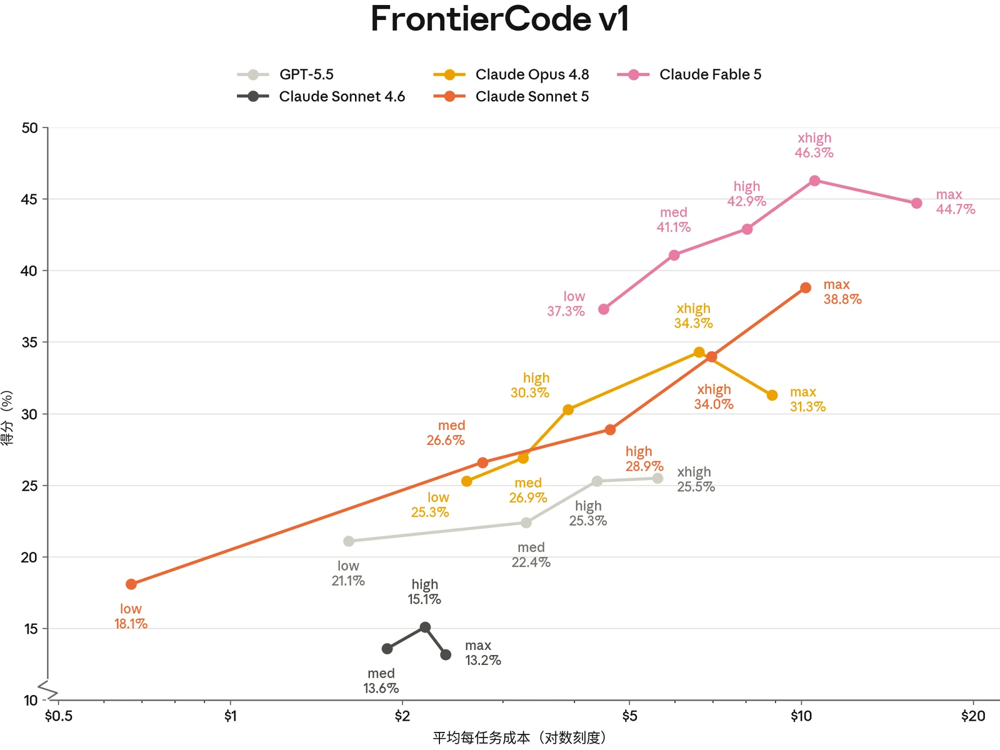

***[图 8.4.A] FrontierCode v1 得分与平均每任务成本（美元，对数刻度）的关系**，涵盖五个模型的各推理强度设置。成本根据 Cognition 公布的每任务 token 分布，按 API 标价重新计算（Sonnet \$3/\$15、Opus 4.8 \$5/\$25、Fable 5 \$10/\$50、GPT-5.5 \$5/\$0.50/\$30 每百万 token；Claude 缓存 0.1× 读取 / 1.25× 写入，5 分钟 TTL）。GPT-5.5 未在 max 推理强度下评估，Claude Sonnet 4.6 未在 low 或 x-high 下评估。*

### 8.5 CursorBench

CursorBench[^21] 是 Cursor 推出的智能体编程基准测试，由真实编程任务（取自内部使用和外部流量）组成，并在 Cursor 的生产环境智能体运行框架中执行。所有分数和每任务成本均由 Cursor 独立测量和报告。Claude Sonnet 5 得分 61.2%，相比之下 Sonnet 4.6 为 49%，Opus 4.8 为 63.8%。

118



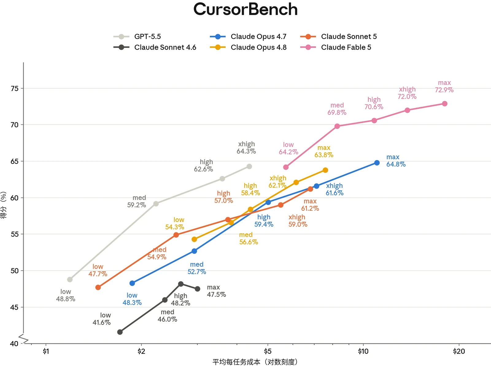

***[图 8.5.A] CursorBench 分数随平均每任务成本（美元，对数刻度）的变化**，涵盖六个模型在不同推理强度设置下的表现。Claude Fable 5、Claude Opus 4.8、Claude Opus 4.7 和 GPT-5.5 的分数与成本由 Cursor 在其生产环境运行框架中测量和报告；Claude Sonnet 5 和 Claude Sonnet 4.6 的成本按每百万 token \$3/\$15（输入/输出）、5 分钟缓存 TTL 重新计算。GPT-5.5 未在 max 推理强度下评估，Claude Sonnet 4.6 未在 xhigh 下评估。*

### 8.6 USAMO 2026

美国数学奥林匹克（USAMO）是一项面向高中生的证明题竞赛，共六道题，为期两天。它是美国数学奥赛路径中继美国数学邀请赛（AIME）之后的下一阶段；AIME 去年曾是流行的 AI 基准测试，但现已饱和。2026 年 USAMO 于 2026 年 3 月 21–22 日举行，此时 Claude Sonnet 5 的预训练数据几乎已全部收集完毕，我们确信不存在污染。

由于 USAMO 的解答是证明而非简短答案，评分可能颇具挑战性且带有主观性。我们的评分基于 MathArena 的方法：每份证明先由一个中立模型（Gemini 3.1 Pro）改写，再由 3 个前沿模型组成的评审小组依据既定的评分细则进行评判（我们

119使用了 Gemini 3.1 Pro、Claude Opus 4.6 和 Claude Mythos Preview）。最终得分取所有评委所给分数中的最低分。



Claude Sonnet 5 得分 79.5%，为每道题 10 次尝试的平均值。我们使用 high 推理强度，token 上限为 300k；更高的推理强度设置有时会超出 token 上限。在类似设置下，Sonnet 4.6 在同一评估中得分 55.0%，Opus 4.8 得分 96.7%，Mythos 5 得分 99.8%。

### 8.7 ArxivMath

ArXivMath 是由 MathArena 维护的研究级数学最终答案型基准。题目每月从近期 arXiv 论文摘要中提取，再经过自动和人工检查筛选，以确保其自成一体、非平凡且可验证。由于题目取自活跃的研究，该基准比竞赛 / 奥赛类基准更贴近现实，与数学研究的联系也更紧密。

我们使用 2026 年 4 月和 5 月[^22]发布的题目（共 81 道）进行评估，选择这两期是为了避免与 Sonnet 5 的训练数据发生污染。Sonnet 5 不使用工具时得分 65.7%，使用工具时得分 72.2%，两者均开启扩展思考（extended thinking），并为每道题四次尝试的平均值。[^23]

120



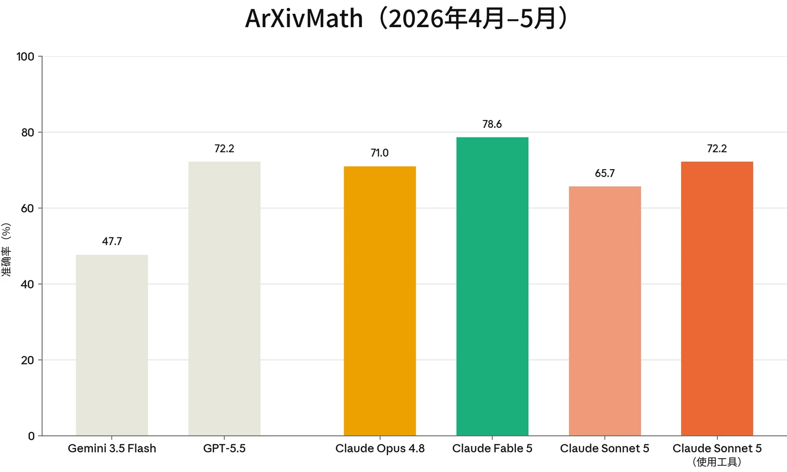

***[图 8.7.A] ArxivMath（4 月和 5 月）准确率分数。**Claude Opus 4.8 和 Claude Sonnet 5 在开启扩展思考的情况下进行内部评估；Claude Fable 5、GPT-5.5 和 Gemini 3.5 Flash 的分数来自 MathArena 排行榜。*

### 8.8 ProgramBench

ProgramBench[^24] 是一个长上下文智能体编程基准测试，包含 200

个程序重建任务。智能体仅获得由某个开源项目编译而成的二进制文件及该项目的文档，必须在无法访问互联网、不使用反编译工具的情况下，重建一个能复现原程序行为的代码库。任务范围从小型终端工具（jq、ripgrep）到大型系统（FFmpeg、SQLite、PHP 解释器）。提交结果依据基于执行的行为测试进行评分——整个基准共有 247,000 余个此类测试，均通过智能体驱动的模糊测试生成。

我们排除了 34 个参考二进制文件本身在隐藏测试集上得分低于 0.9 的任务（这表明存在测试不稳定性），剩余 166 个任务；在这些任务中，我们只依据参考二进制文件能够通过的测试进行评分。我们报告 5 个回合的隐藏测试通过率，每个回合都在上一回合的代码库基础上继续，并拥有至多 100 万 token 的全新上下文预算。在该任务集上，Claude Sonnet 5 得分 76–86%，而 Claude Sonnet 4.6 为 52–74%。作为参照，Claude Opus 4.8 得分 80–90%，Mythos 5

121得分 84–93%。我们认为 ProgramBench 是衡量长上下文编程性能的有力指标：Sonnet 5 的各回合覆盖了直至完整 100 万 token 窗口的各种上下文长度，且这些任务考察的长上下文能力与实际的下游用例高度契合。



### 8.9 智能体搜索

#### 8.9.1 HLE

Humanity’s Last Exam（HLE）是一个处于人类知识前沿的多模态基准测试，包含 2,500 道题目。

我们在两种配置下测试了 Claude Sonnet 5：（1）纯推理（不用工具）；（2）使用网络搜索、网页抓取、程序化工具调用和代码执行。在所有运行中，思考设置为 auto，跨上下文使用的 token 总量上限为 100 万。这些结果未使用上下文压缩。Claude Opus 4.6 担任评分模型。“无工具”结果无法通过公开 API 复现，因为部分题目超出了其 1 小时的采样时限。

为防止工具版本中的结果污染，我们为搜索器与抓取器屏蔽了已知讨论 HLE 的来源（见附录 9.1）。我们还使用 Claude Opus 4.6 审查所有对话记录，标记任何看似从 HLE 专门来源中获取了答案的对话记录；经确认的情况将被重新判为错误。

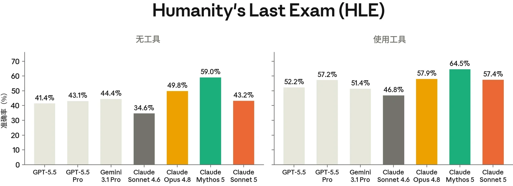

***[图 8.9.1.A] Humanity’s Last Exam 准确率分数。**Gemini 和 GPT 模型的分数取自已发布的结果。*

122



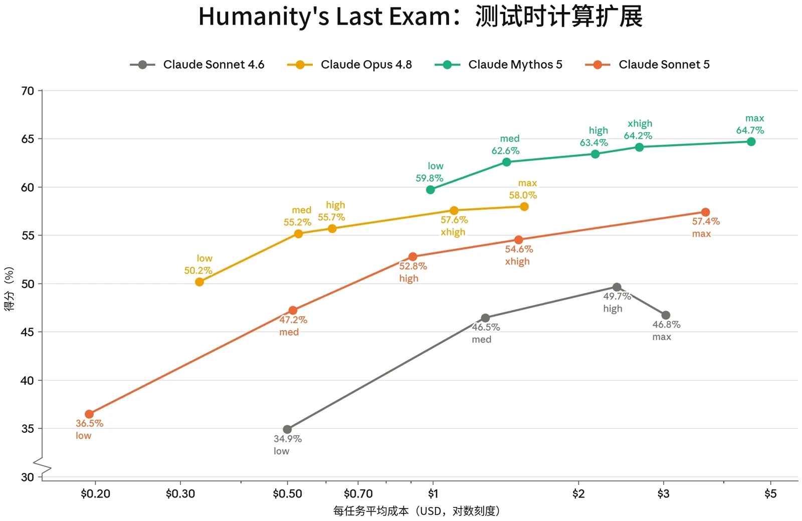

***[图 8.9.1.B] 不同推理强度档位下的 HLE 分数。**每个数据点代表每个模型在不同推理强度档位下的单次运行，token 使用总量至多 100 万。*

#### 8.9.2 BrowseComp

BrowseComp[^25] 测试智能体在开放网络上查找难以定位的信息的能力。我们运行 Claude Sonnet 5 时使用了网络搜索、网页抓取、程序化工具调用和代码执行[^26]。Sonnet 5 在使用自适应思考、max 推理强度、1000 万 token 上限的设置下得分 84.7%。为突破 100 万 token 的上下文窗口，我们使用了上下文压缩，在 200k token 时触发。我们使用评估屏蔽列表来避免污染（见附录 9.2）。

在给定的任务成本下，Claude Sonnet 5 的准确率与 Claude Opus 4.8 相当。

123



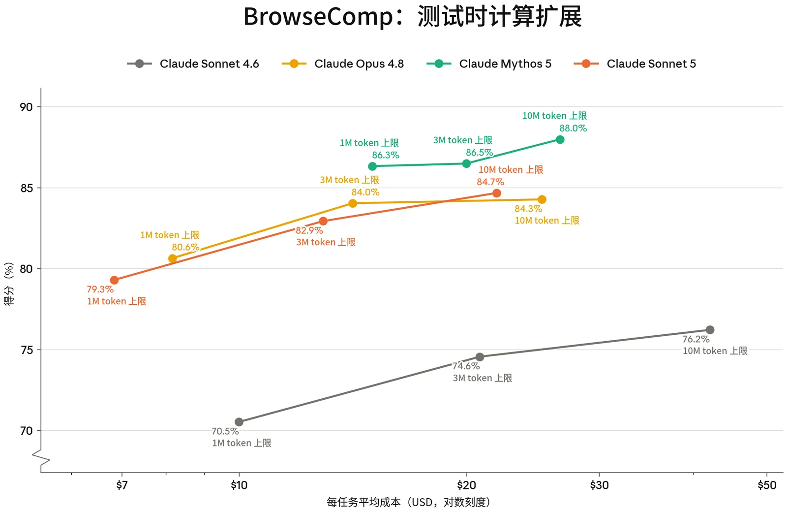

***[图 8.9.2.A] BrowseComp 测试时计算扩展**：max 推理强度下改变 token 上限时的表现。*

### 8.10 多模态

Claude Sonnet 5 在多模态推理上缩小了与 Claude Opus 4.8 的差距，相比 Claude Sonnet 4.6 的最大提升出现在图表理解（ChartMuseum 不使用工具时 +10.8 个百分点）以及工具辅助设置中。我们报告五个基准测试，涵盖专业文档问答（GDP.pdf）、GUI 智能体（OSWorld-Verified）、程序化 CAD 生成（BenchCAD）以及科学图表推理（ChartMuseum、CharXiv Reasoning）。在运行框架支持的情况下，我们同时评估使用工具和不使用工具两种情况——工具为 Python 执行环境和图像裁剪工具——并发现使用工具能带来一致且显著的提升。

#### 8.10.1 GDP.pdf

[GDP.pdf](https://surgehq.ai/benchmarks/gdp-pdf) 是 Surge AI 推出的专家级多模态推理基准测试，由 100 个真实世界提示词和 PDF 组成，直接取自金融、医疗健康、法律、工程和保险等十个领域的专业工作流程。该基准测试检验模型能否解析、交叉比对并综合支撑企业工作的高密度文档——解读多页剂量表、找出埋藏在嵌套附件中的条款，以及核对季度申报文件中的各项数据。

124我们在内部运行框架上评估 GDP.pdf，分别使用和不使用工具。不使用工具评估时，模型获得 base64 编码的 PDF，以匹配 Surge 的输入提示词。不过，与 Surge 不同，对于超出我们 API 32MB 请求大小上限的 PDF，我们会将其截断（而非丢弃）。我们使用 Opus 4.7 而非 Gemini 3 Flash 作为评判模型。*使用*工具评估时，模型获得一个容器（其中装有该 PDF 文件和标准 Python 库）以及一个图像裁剪工具。我们报告平均评分项通过率，即每项任务中满足的评分细则条件所占的比例，而非严格通过率。我们在全部 100 个提示词上评估模型，并对五次运行的分数取平均。



在 GDP.pdf 上，Claude Sonnet 5 不使用工具时的平均评分项通过率为 67.5%，使用工具时得分 81.6%。Sonnet 5 优于 Claude Sonnet 4.6，后者不使用工具时得分 66.9%，使用工具时得分 78.6%。需要指出的是，我们未能复现 Surge 报告的数值，且平均评分项通过率和严格通过率均落后于 Surge 运行得到的结果。我们认为这些分数在方向上具有代表性，能够反映 Claude 模型之间的性能差异。与此前 Claude Fable 5 和 Mythos 5 系统卡中的数值相比，我们将最大输出 token 数提高到 128k 并据此更新了这些数值，这使性能略有提升。

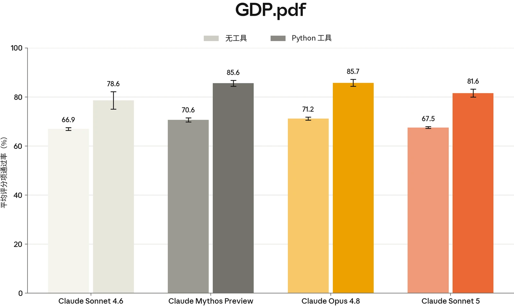

***[图 8.10.1.A] GDP.pdf 分数。**模型在自适应思考和 max 推理强度下评估，分别使用和不使用 Python 工具。平均评分项通过率分数为五次运行的平均值。图中显示 95% 置信区间（confidence interval，CI）。*

125



#### 8.10.2 OSWorld-Verified

OSWorld[^27] 是一个多模态基准测试，评估智能体通过鼠标和键盘操作与一台运行中的 Ubuntu 虚拟机交互、完成真实世界计算机任务（如编辑文档、浏览网页和管理文件）的能力。我们遵循默认设置，分辨率为 1080p，每个任务的操作步数上限为 100。

我们调整了 OSWorld-Verified 评估的运行方式，以更好地反映真实世界中的表现。如 [Claude Opus 4.8 系统卡](http://anthropic.com/claude-opus-4-8-system-card)中所述，这些调整包括修复一个影响批量动作的缩放工具 bug，以及将每轮 token 上限从 16K 提高到 128K。随后我们在这些调整下重新评估了 Claude Sonnet 4.6，发现我们此前一直低报了它在 OSWorld 上的表现。我们在下文报告其表现。

Claude Sonnet 5 的 OSWorld 得分为 81.2%（首次尝试成功率，五次运行的平均值）。

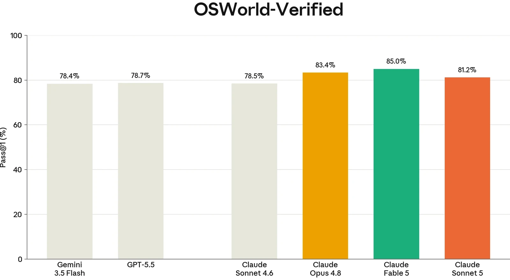

***[图 8.10.2.A] 各模型在 max 推理强度下的外部 OSWorld-Verified 分数。**Claude 模型在 OSWorld-Verified（361 个任务，100 步）上以自适应思考和 max 推理强度进行评估。分数为五次运行平均的 pass@1。Gemini 和 GPT 模型的分数取自已发布的结果。*

126



#### 8.10.3 BenchCAD

BenchCAD 是一个程序化 CAD 推理基准测试，由 17,900 个经执行验证的 CadQuery 程序构建而成，涵盖 106 个工业零件族，其中大约一半以真实的 ISO、DIN、EN、ASME 和 IEC 规格表为依据。该基准测试将 CAD 能力分解为四个相互匹配的任务，我们报告 Vision2Code 任务的结果，该任务要求模型根据多视图渲染图生成 CadQuery 代码。

我们内部实现的 BenchCAD 与参考实现一致，仅有若干细微修改，包括以下几项。第一，我们修正了参考系统提示词（system prompt）中的一处笔误，该笔误将提供给模型的渲染视图中左上/右上以及左下/右下的相机位置弄反了。第二，我们更新了评分方式，使其除 Workplane 外也接受原始形状。第三，我们略去了 26 条其 CadQuery 代码未能生成 STEP 文件的记录。系统提示词的修正和评分方式的更改此后均已合并到参考代码仓库中。

我们在 Claude Fable 5 和 Mythos 5 系统卡中错误地表述为结果同时反映了系统提示词的更改和评分方式的更改。此后我们已对该系统卡发布更正，说明这些分数仅反映了系统提示词的更改，而未反映评分方式的更改。本节报告的分数是首次在两项更改均已生效的情况下计算得出的。我们注意到，评分方式的更改并未对分数产生实质性影响。

我们在 Vision2Code 文件的一个子集上进行了消融实验，分别使用和不使用工具。使用 Python 工具评估时，模型获得一个容器（其中装有图像文件和标准 Python 库）以及一个图像裁剪工具。我们从全部 17,874 个 Vision2Code 文件中随机抽取 1,000 个作为子集评估模型，并计算五次运行的平均体素 IoU（voxel IoU）。

在该子集上，Sonnet 5 不使用工具时的体素 IoU 为 0.266，使用工具时为 0.373。Claude Sonnet 4.6 在相同设置下分别得分 0.267 和 0.327——在不使用工具的条件下与 Sonnet 5 实际上持平，但在使用工具时落后 0.046。

127



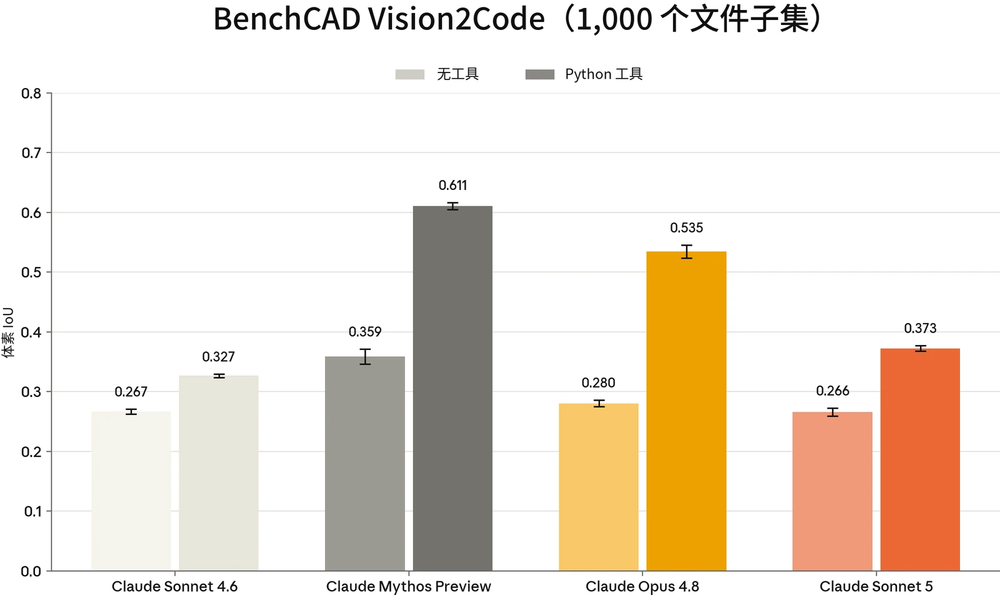

***[图 8.10.3.A] BenchCAD Vision2Code 子集分数。**模型在自适应思考和 max 推理强度下评估，分别使用和不使用 Python 工具。分数为五次运行的平均值。图中显示 95% 置信区间。*

#### 8.10.4 ChartMuseum

ChartMuseum 是一个图表问答基准测试，包含 1,162 道由专家标注的问题，针对取自 184 个来源的真实世界图表图像，包括学术图表、信息图和非常规的图表设计。该基准测试专门针对需要视觉推理的问题——例如比较未标注的视觉元素、追踪变化轨迹以及判断空间关系。

我们内部实现的 ChartMuseum 与官方 ChartMuseum 代码仓库中的学生与教师提示词一致。不过，我们使用 Claude Sonnet 4.6 作为评分者，而非 GPT-4.1-mini。在所有运行中，模型均配置为开启自适应思考和 max 推理强度，分别使用和不使用 Python 工具。使用 Python 工具评估时，模型获得一个容器（其中装有图像文件和标准 Python 库）以及一个图像裁剪工具。我们在测试集上评估模型，并对五次运行的分数取平均。

在 ChartMuseum 上，Claude Sonnet 5 不使用工具时得分 70.1%，使用工具时得分 86.7%，优于 Claude Sonnet 4.6（59.3% 和 80.9%），但落后于 Claude Opus 4.8（75.8% 和 89.7%）。

128



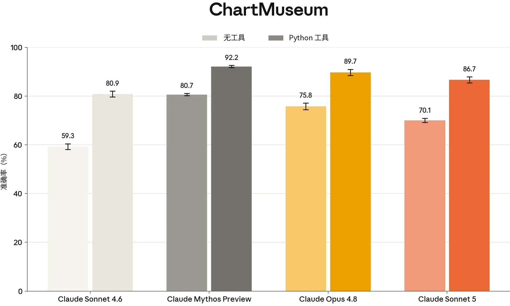

***[图 8.10.4.A] ChartMuseum 分数。**模型在自适应思考和 max 推理强度下评估，分别使用和不使用 Python 工具。分数为五次运行的平均值。图中显示 95% 置信区间。*

#### 8.10.5 CharXiv Reasoning

CharXiv Reasoning 是一个全面的图表理解评估套件，由 2,323 张取自 arXiv 论文的真实世界图表构建而成，涵盖八个主要科学学科。该基准测试检验模型能否综合复杂科学图表中的视觉信息，以回答需要多步推理的问题。

在所有运行中，模型均配置为开启自适应思考和 max 推理强度，分别使用和不使用 Python 工具。使用 Python 工具评估时，模型获得一个容器（其中装有图像文件和标准 Python 库）以及一个图像裁剪工具。评分所用的提示词与参考实现相同。不过，我们使用 Claude Sonnet 4.6 而非 GPT-4o 作为评分模型。我们在验证集的 1,000 道题目上评估模型，并对五次运行的分数取平均。

在 CharXiv Reasoning 上，Claude Sonnet 5 不使用工具时得分 77.0%，使用工具时得分 88.3%，优于 Claude Sonnet 4.6（71.6% 和 85.3%），略微落后于 Claude Opus 4.8（80.5% 和 89.9%）。

129



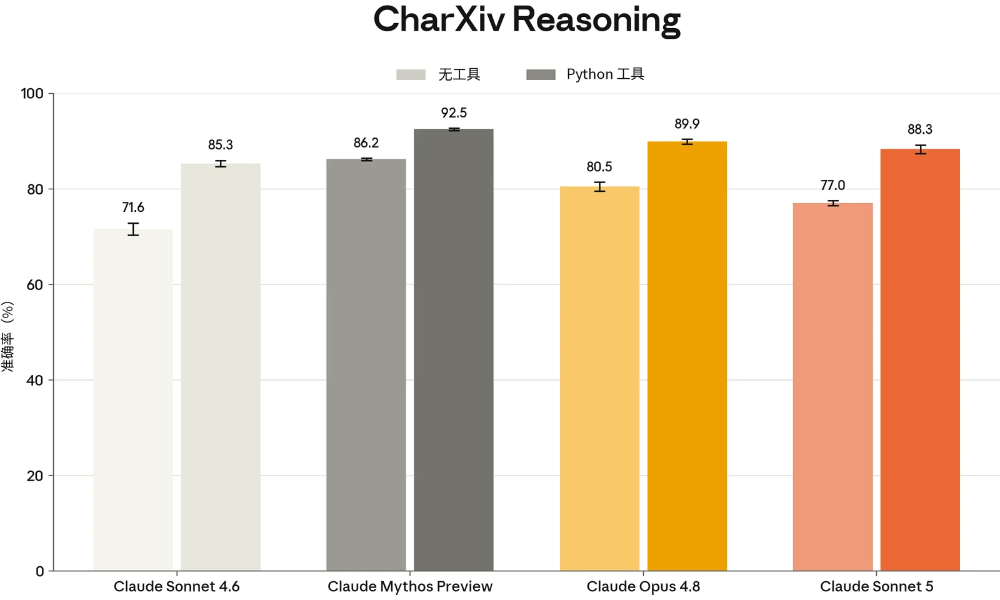

***[图 8.10.5.A] CharXiv Reasoning 分数。**Claude 模型在自适应思考和 max 推理强度下评估，分别使用和不使用 Python 工具。Claude 模型的分数为五次运行的平均值。图中显示 95% 置信区间。*

130



### 8.11 真实世界专业任务

#### 8.11.1 OfficeQA

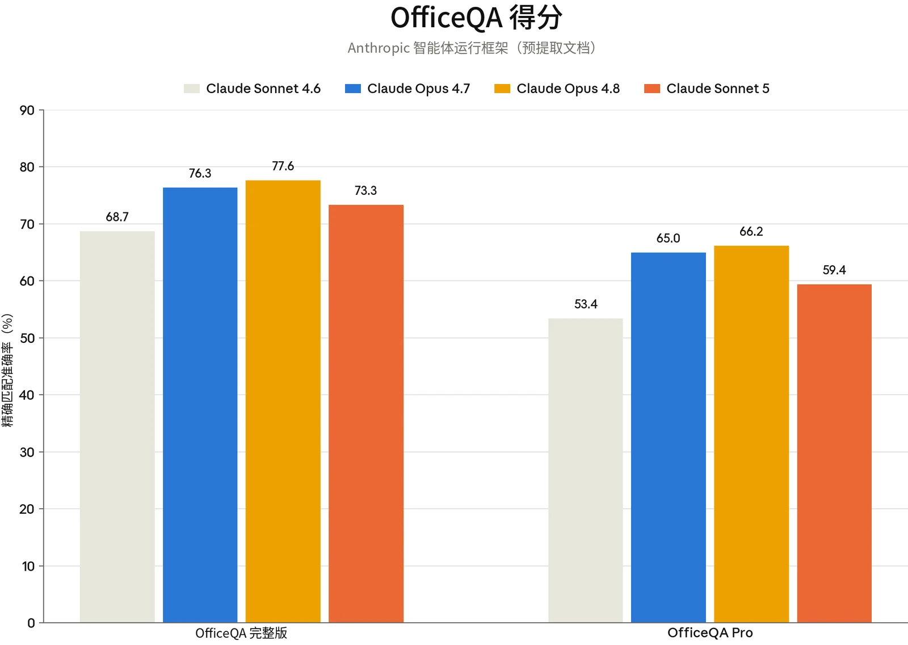

***[图 8.11.1.A] OfficeQA 与 OfficeQA Pro 在 Anthropic 内部智能体运行框架上的精确匹配准确率。**除 Claude Opus 4.7 以其默认推理强度设置运行外，所有模型均在 max 推理强度下使用自适应思考运行。Claude Sonnet 5 与 Claude Opus 4.7 的得分为 5 次试验的平均值，Claude Sonnet 4.6 与 Claude Opus 4.8 的得分为单次试验结果。*

[OfficeQA](https://www.databricks.com/blog/introducing-officeqa-benchmark-end-to-end-grounded-reasoning) 是 Databricks 发布的一项公开基准测试，评估模型在由大量历史 Treasury Bulletin（美国财政部公报）文档构成的语料上进行端到端有据推理的能力。模型必须在整个语料中定位相关表格，并基于这些表格进行精确的数值推理。我们以智能体方式进行评估：文档以提取后的文本形式提供于沙箱化的环境中，并提供代码执行工具；OfficeQA Pro 是推荐用于前沿模型的、难度更高的 133 题子集。得分采用精确匹配（五次试验的平均值），耗尽输出预算的回合记为错误。

Claude Sonnet 5 在 OfficeQA 上达到 73.3%，在 OfficeQA Pro 上达到 59.4%，较 Claude Sonnet 4.6（68.7% 和 53.4%）有所提升。两个模型都会产生很长的推理，在最高

131推理强度下，有一部分回合（约 9–15%）在给出最终答案之前就达到了每轮输出上限；这些回合记为错误，因此相关数值是保守的。



OfficeQA 得分对评估运行框架高度敏感：要求模型直接解析原始 PDF 语料的设置会使所有模型的绝对得分大幅降低，跨报告比较时应考虑这一点。

#### 8.11.2 Real-World Finance V2

Real-World Finance v2 是我们内部开发的一项评估，用于衡量模型完成复杂、长程金融分析任务的能力，这类任务正是金融专业人士所从事的工作——例如构建和审计财务模型、进行估值分析，以及基于贴近现实的输入材料产出可直接交付客户的工作成果。该评估套件包含 294 项复杂且贴近现实的任务，代表了金融专业人士的日常工作。由于这些任务的交付物是开放式的，而非单一正确答案，我们以两两比较的方式进行评估：两个模型尝试同一任务，由基于模型的评分者在两份工作成果之间给出偏好。我们报告正面对比胜率（以及据此推导出的 Elo），这一方法与其他已发表的专业工作成果评估类似。

Sonnet 5（1219）与 Opus 4.7（1207）和 Opus 4.8（1222）在统计上持平，比 Sonnet 4.6 高 219 分（Sonnet 5 对 Sonnet 4.6 的胜率为 69%），且明显低于 Fable 5（Fable 对 Sonnet 5 的胜率为 69%）。

132



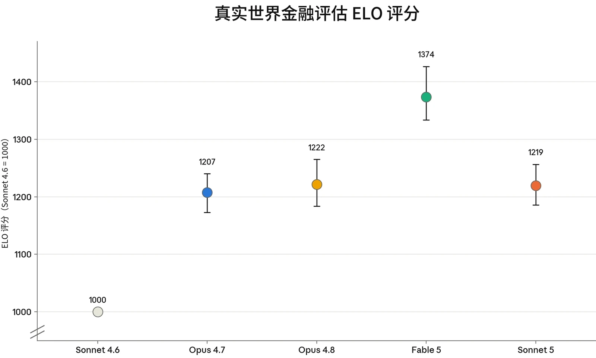

***[图 8.11.2.A] Real-World Finance v2 ELO。**每个模型尝试 294 项量化金融任务；由 Claude Opus 4.8 评分者对交付物进行两两比较，评分采用 Bradley-Terry 拟合，其中 Sonnet 4.6、Opus 4.8、Mythos 和 Fable 5 锚定于其先前公布的数值。误差线为 95% 自助法置信区间（bootstrap confidence interval）。*

#### 8.11.3 Legal Agent Benchmark

Legal Agent Benchmark[^28]（LAB）是由 Harvey AI 创建的开源基准测试。该基准测试包含 1,200 多项任务，覆盖 24 个不同的执业领域。每项任务都包含一个封闭文档集（.xlsx、.docx、.eml、.pptx），其中包括电子邮件往来、律所模板、程序性文件以及其他客户案件材料，智能体必须从中筛查信息才能完成任务。任务指令以合伙人向授薪律师发出的简短“工作委托”形式撰写。任务指令还规定了预期的输出文档及格式。评估采用 LLM 评判模型（LLM-as-a-judge），依据一套由专家撰写的评分细则标准进行通过/不通过判定（每项被评估任务的标准数：最小值=23，中位数=56，最大值=194）。LAB 的标准报告方式仅在所有标准均满足时才将任务视为成功。

我们在 1,235 道题上测试了 Claude Sonnet 5（1,251 道题中有 16 道因数据缺陷被排除；排除项在测试前即已确定），其全通过率为 8.92%（± 0.36，n=5），平均评分项通过率为 88.26%（自适应思考，max 推理强度）。Sonnet 4.6 的全通过率为 8.00%（± 0.19，n=5），平均评分项通过率为 88.48%。按

133Harvey 在其留出集上的评估，Claude Sonnet 5 的全通过率为 5.8%，平均评分项通过率为 91.2%。我们的运行框架是内部重新实现的版本，保留了 LAB 的任务内容、评分细则标准、全通过评分方式和默认评判模型（Sonnet 4.6），但精简了工具集。公开运行框架提供 bash、read、write、edit、glob、grep 工具，而我们仅提供 bash 和一个 Python 工具。



#### 8.11.4 GDPval-AA v2

GDPval-AA v2 由 [Artificial Analysis](https://artificialanalysis.ai/) 开发，是一个独立的评估框架，用于在具有经济价值的真实世界专业任务上测试 AI 模型。该基准测试使用来自 OpenAI 的 [GDPval 黄金数据库](https://huggingface.co/datasets/openai/gdpval)[^29] 的 220 项任务，涵盖 9 个主要行业中的 44 种职业。任务模拟真实的专业工作成果，包括文档、幻灯片、图表和电子表格。模型在智能体循环中获得 shell 访问权限和网页浏览能力来解决任务，表现通过基于模型输出盲评两两比较得出的 ELO 评分来衡量。Claude 模型包揽了排行榜前三名。Claude Sonnet 5 排名第二（ELO 1618），与 Opus 4.8（ELO 1615）在统计上持平，仅次于 Fable 5（ELO 1783）。评估由 Artificial Analysis 独立运行。

#### 8.11.5 Toolathlon

Toolathlon[^30] 是一项智能体基准测试，包含 108 项真实世界工具使用任务，涵盖办公效率、电子商务与运营、数据分析以及网络研究。任务以真实的应用状态作为初始设定，并由基于执行的检查器评分，这些检查器会验证生成的产出物及其副作用。该基准测试提供了 32 个应用中的 604 个工具；任务平均约 20 轮，要求正确选择工具、按正确顺序执行多个步骤，并给出与检查器要求完全一致的输出。

我们在 max 推理强度下使用自适应思考运行了内部运行框架。遵循 Toolathlon 论文的评估方案，我们报告全部 108 项任务上 3 次试验平均的 Pass@1，同时报告 Pass@3（三次试验中至少一次正确）、Pass³（三次试验全部正确）以及每条轨迹的平均轮次。

Claude Sonnet 5 的 Pass@1 为 54.3%（三次试验平均）。这使其领先于 Sonnet 级别的模型——Claude Sonnet 4.6（49.4%）和 Claude Sonnet 4.5（41.0%）——但

134落后于前沿 Claude 模型，包括 Claude Opus 4.8（59.9%）以及 Claude Fable 5 和 Claude Mythos 5（均为 61.7%）。



| **模型** | **Pass@1** | **Pass@3** | **Pass³** | **平均轮次** |
|---|---|---|---|---|
| **Claude Sonnet 5** | 54.3 | 63.0 | 40.7 | 26.0 |
| **Claude Fable 5** | 61.7 | 68.5 | 55.6 | 19.8 |
| **Claude Mythos 5** | 61.7 | 66.7 | 58.3 | 19.0 |
| **Claude Opus 4.8** | 59.9 | 67.6 | 48.1 | 24.5 |
| **Claude Opus 4.7** | 59.3 | 66.7 | 52.8 | 25.9 |
| **Claude Mythos Preview** | 61.1 | 66.7 | 55.6 | 17.6 |
| **Claude Sonnet 4.6** | 49.4 | 60.2 | 38.0 | 16.5 |
| **Claude Opus 4.6** | 56.8 | 66.7 | 47.2 | 16.9 |
| **Claude Sonnet 4.5** | 41.0 | 54.6 | 28.7 | 32.0 |

***[表 8.11.5.A] 使用内部运行框架的 Toolathlon 得分。**各模型均在 max 推理强度下使用自适应思考进行评估。Pass@1、Pass@3 和 Pass³ 按论文的评估方案，基于全部 108 项任务、每项 3 次试验计算。*

关于与已发布排行榜可比性的说明。我们的运行框架复刻了上游的任务定义、提示词和基于执行的检查器，并通过重放已发布的 claude-sonnet-4.5 轨迹进行了验证。为控制自已发布轨迹以来的实时依赖漂移和上游仓库变更，我们将金融数据源和容器镜像固定到离线快照，并镜像当前的上游状态。按已发布的版本，大约四分之一的任务无法完成；我们对这些任务未作改动。固定版本的净效应：我们的得分比严格与上游等价的运行框架高约 3 分——这一偏差在此处报告的各 Claude 模型之间保持不变。另外，已发布排行榜中 Opus 4.7 的数据采用的是作者的默认配置，而非 max 推理强度。

135



#### 8.11.6 AutomationBench

AutomationBench[^31] 是 Zapier 推出的一项基准测试，衡量智能体能否完成贴近现实的端到端业务工作流。任务基于真实客户在销售、市场营销、运营、客户支持、财务和人力资源领域的工作流模式构建。每项任务都将智能体置于一家模拟公司中，该公司拥有数十个 REST API 端点，覆盖 47 个应用（CRM、Slack、Google Workspace 等）。在仅给出一条自然语言指令的情况下，智能体必须通过搜索自主发现正确的端点，进行数十次顺序执行、相互依赖的 API 调用，查阅并遵守分层业务政策文档，同时避开刻意设置的干扰项。每项任务的评分为通过或不通过，依据是否满足针对模拟应用状态的所有确定性断言（例如，是否应用了正确的 CRM 更新）。

在衡量私有留出评估集表现的 AutomationBench 排行榜上，Claude Sonnet 5（max 推理强度）得分为 13.5%，较 Claude Sonnet 4.6（max 推理强度）的 5.3% 有显著提升。

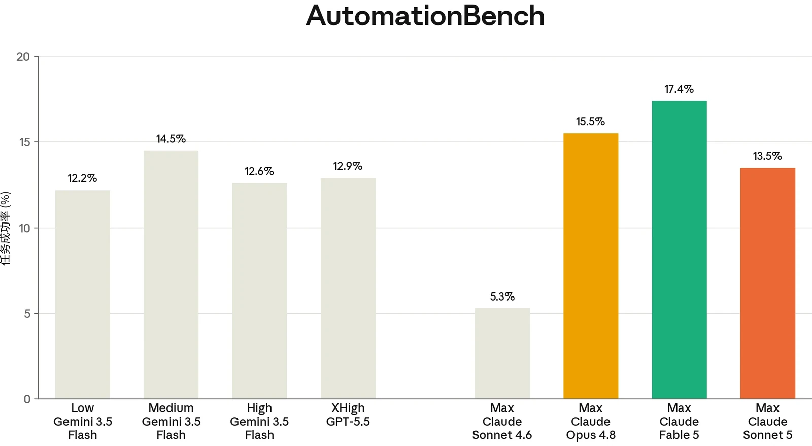

***[图 8.11.6.A] AutomationBench 得分**，基于 [Zapier 排行榜](http://zapier.com/benchmarks)的私有留出任务。*

136



#### 8.11.7 AA-Briefcase

[AA-Briefcase](https://artificialanalysis.ai/articles/aa-briefcase) 由 Artificial Analysis 开发，是一项新的基准测试，面向由行业专家构建的复杂项目中的长程知识工作。模型需要完成为期数周的项目，这些项目包含大量相互关联的任务以及数千个输入源文件；评分结合评分细则打分与由前沿模型评审团进行的成对评判，以衡量可验证的任务成功率、分析质量和呈现质量。Claude 模型包揽了排行榜前三名。Claude Sonnet 5 排名第二（ELO 1393），与 Opus 4.8（ELO 1352）在统计上持平，仅次于 Fable 5（ELO 1586）。相较于 Opus 4.8，它在评分细则得分和分析质量 Elo 上均有提升，呈现质量 Elo 略有下降。与 GDPval-AA v2 类似，Claude Sonnet 5 运行的轨迹比同类模型长得多：平均 183 轮，而 Fable 5 为 67 轮，Opus 4.8 为 55 轮。评估由 Artificial Analysis 独立运行。

### 8.12 医疗健康

#### 8.12.1 HealthBench 结果

HealthBench[^32] 是一项开源评估，旨在评估真实医疗健康情境中的安全性、准确性和沟通能力。该基准测试使用 48,000 多条由专家撰写的评分细则条目，对涵盖 26 个医学专科的 5,000 段多轮患者对话进行评分。

137



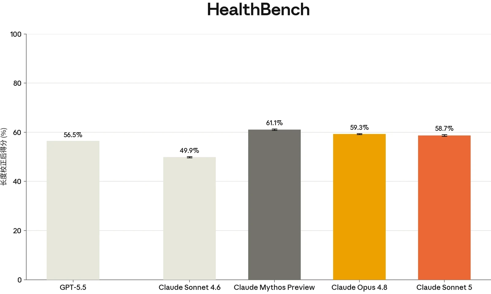

***[图 8.12.1.A] HealthBench 长度校正后得分**。所有 Claude 模型均在 max 推理强度下使用自适应思考。Claude Opus 4.8 为评分模型。得分为 5 次试验的平均值。未向任何模型提供工具或定制的系统提示词。长度校正后得分采用 HealthBench 论文中公布的方法计算。GPT-5.5 的得分取自 OpenAI 最新的系统卡。图中显示 95% 置信区间。*

#### 8.12.2 HealthBench Professional 结果

HealthBench Professional[^33] 是一项临床任务基准测试，由 525 段医生撰写的对话组成，涵盖临床会诊、文书记录和研究任务，每段对话均由 LLM 评判模型依据评分细则标准进行评分。

138



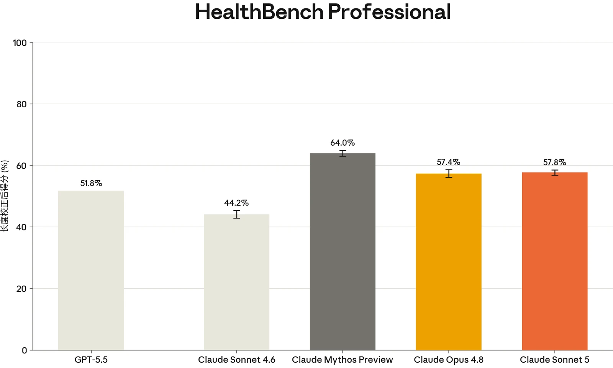

***[图 8.12.2.A] HealthBench Professional 长度校正后得分**。所有 Claude 模型均在 max 推理强度下使用自适应思考。Claude Opus 4.8 为评分模型。得分为 5 次试验的平均值。未向任何模型提供工具或定制的系统提示词。长度校正后得分采用 HealthBench Professional 论文中公布的方法计算。GPT-5.5 的得分取自 OpenAI 最新的系统卡。图中显示 95% 置信区间。*

### 8.13 多语言表现

我们在三项多语言基准测试——Global MMLU（GMMLU）[^34]、INCLUDE[^35] 和 Multi-task Indic Language Understanding Benchmark（MILU）[^36]——上评估了 Claude Sonnet 5，以考察模型在一系列语言上的表现。

GMMLU 将标准 MMLU 评估扩展到 42 种语言，涵盖从法语和德语等高资源语言到约鲁巴语、伊博语和齐切瓦语等低资源语言。MILU 覆盖 11 种语言——10 种印度语言（孟加拉语、古吉拉特语、印地语、卡纳达语、马拉雅拉姆语、马拉地语、奥里亚语、旁遮普语、泰米尔语和泰卢固语）以及英语——并测试植根文化背景的知识理解能力。INCLUDE 覆盖 44 种语言，其题目取自

139地区性学术与职业考试，侧重于本语言、本文化背景的知识，而非翻译内容。



#### 8.13.1 GMMLU 结果

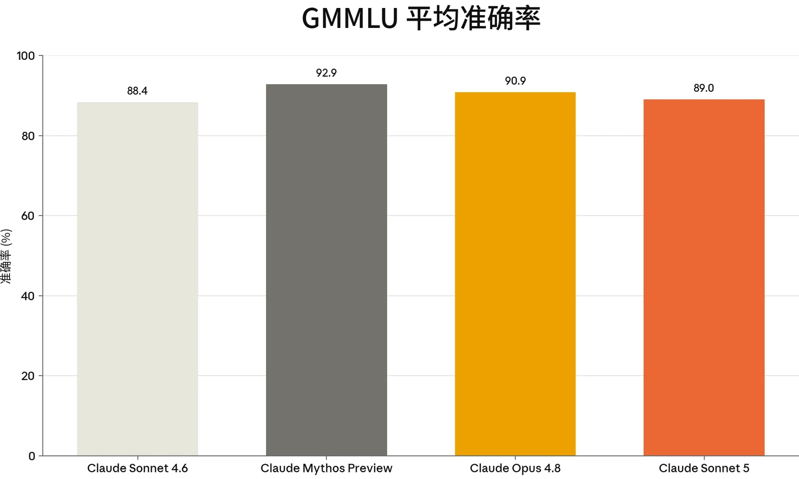

***[图 8.13.1.A] GMMLU 平均准确率。**所有 Claude 模型均在 max 推理强度下使用自适应思考。每个模型仅运行了单次试验。*

140



#### 8.13.2 MILU 结果

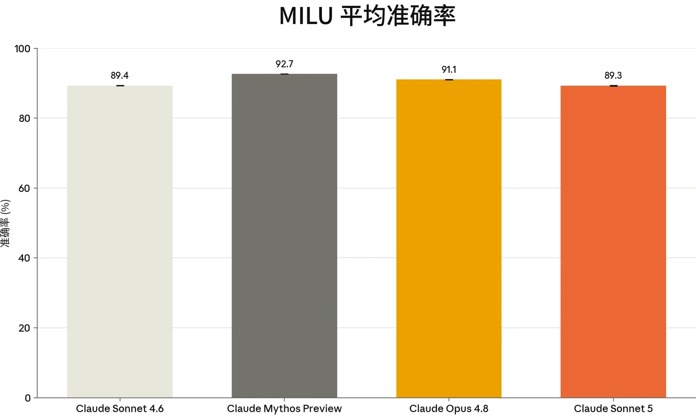

***[图 8.13.2.A] MILU 平均准确率。**所有 Claude 模型均在 max 推理强度下使用自适应思考。得分为 5 次试验的平均值。*

141



#### 8.13.3 INCLUDE 结果

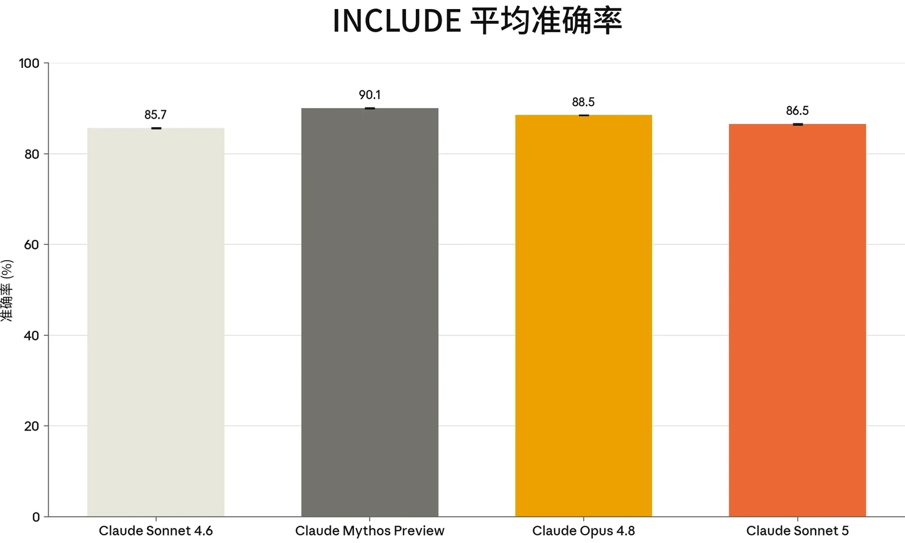

***[图 8.13.3.A] INCLUDE 平均准确率。**所有 Claude 模型均在 max 推理强度下使用自适应思考。得分为 5 次试验的平均值。*

### 8.14 生命科学能力

在生命科学能力方面，Claude Sonnet 5 大幅优于 Claude Sonnet 4.6，平均表现接近 Claude Opus 4.8，但低于 Claude Mythos 5。我们报告了多个领域的评估结果，包括计算生物学、结构生物学、有机化学和实验方案故障排查。这些评估中有许多由领域专家在内部开发，侧重于推动基础研究和药物研发中有益应用的能力，与第 2.2 节中侧重于滥用潜力的 CB 风险评估（CB risk assessment）形成互补。

尽管其中许多评估并未公开发布，我们在下文对每一项作简要介绍。

#### 8.14.1 BioMysteryBench

[BioMysteryBench](https://www.anthropic.com/research/Evaluating-Claude-For-Bioinformatics-With-BioMysteryBench) 评估模型解决高难度分析难题的能力，这些难题要求将计算分析与生物学推理交织进行。给定未经处理的数据集，模型必须回答诸如从……中识别被敲除的基因之类的问题

142（指从转录组数据中识别），或确定样本感染了何种病毒。对于该基准测试，我们报告独立人类专家能够解决的问题子集（“Human Solvable”），以及人类尚未解决但具有客观、真实标准答案的问题子集（“Human Difficult”）。



#### 8.14.2 LatchBio Bioinformatics

这些评估由 LatchBio 开发，评估解决具有挑战性的真实世界生物信息学问题的能力。[SpatialBench](https://arxiv.org/abs/2512.21907) Verified 变体在一组 115 个经外部验证的问题上测试对空间转录组学数据的分析，要求模型根据这些分析结果回答有关样本的生物学问题。[SingleCellBench](https://arxiv.org/html/2602.09063v1) 变体在 195 个问题上测试对单细胞 RNA 测序数据的分析，这些问题涵盖标注细胞类型、寻找差异表达基因和校正批次效应等标准工作流程。

#### 8.14.3 开放式结构生物学

我们评估了模型理解生物分子结构与功能之间关系的能力。在仅给定结构数据和基础工具的情况下，模型必须回答有关某一生物分子功能的开放式问题。

#### 8.14.4 ProteinGym Hard

[ProteinGym](https://proteingym.org/) 基准测试评估模型预测蛋白质突变效应的能力。

#### 8.14.5 有机化学

我们评估了模型的基础技能，涵盖的任务包括根据波谱数据预测分子结构、设计多步合成路线、预测反应产物，以及在 IUPAC 命名、SMILES 表示法和化学结构图像之间进行转换。

#### 8.14.6 实验方案故障排查

该评估考察模型检测并修复分子生物学实验方案中错误的能力，包括使用网络搜索工具在线查找有关实验方案的更多细节。

143



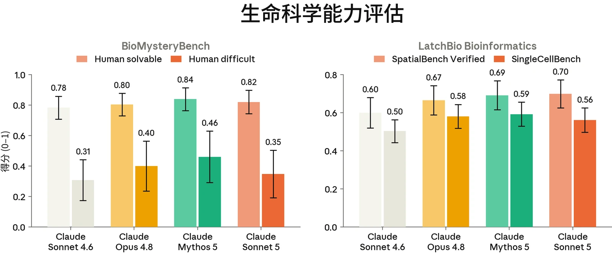

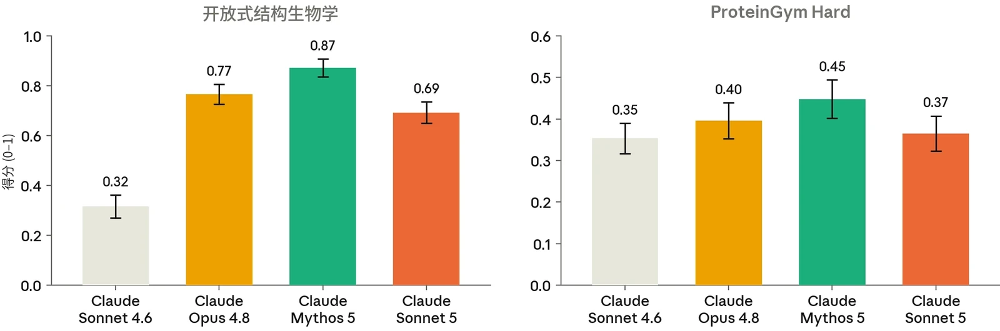

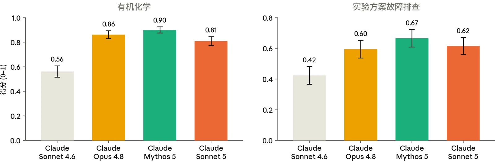

***[图 8.14.6.A] 生命科学能力的评估结果。**在六项生命科学基准测试上，Claude Sonnet 5 较 Claude Sonnet 4.6 有所提升，平均表现接近 Claude Opus 4.8，但低于 Claude Mythos 5。分数为各任务特定的 0–1 指标（越高越好）。成对面板显示每个模型在两个子基准测试上的结果（较浅色 = 第一种条件）。*

144



None
