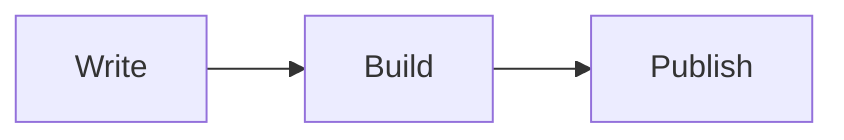

A paragraph with **bold**, *italic*, `inline code` and a [link](https://example.com). Line height and letter spacing should stay stable.

## Second-level heading

- First bullet
- Second bullet with a nested list
  - Nested item
1. Ordered list
2. Second item

### Third-level heading

| Col A | Col B | Col C |
| --- | :---: | ---: |
| Left | Center | 123 |
| Text | Text | 4.56 |

```go
package main

import "fmt"

func main() {
	fmt.Println("Hello, world")
}
```

> [!NOTE]
> This is a note.

> [!WARNING]
> This is a warning.

> A plain quote.

## Math and diagrams

Inline math $E = mc^2$, and a block:

$$
\int_0^\infty e^{-x^2}\,dx = \frac{\sqrt{\pi}}{2}
$$



## Image


The last paragraph.
