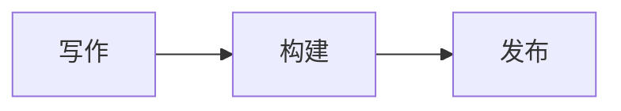
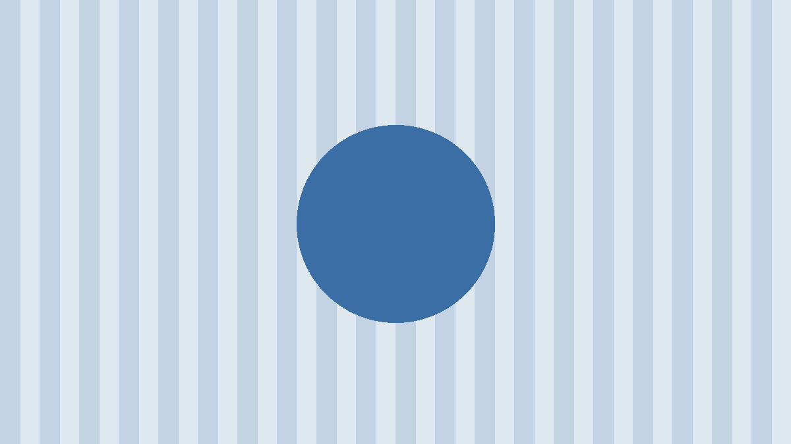

这是一段正文，混排 **粗体**、*斜体*、`行内代码` 和 [链接](https://example.com)。中文与 English 混排时，行高和字距都应保持稳定。

## 二级标题

- 无序列表第一项
- 第二项，带一个嵌套列表
  - 嵌套项
1. 有序列表
2. 第二项

### 三级标题

| 列 A | 列 B | 列 C |
| --- | :---: | ---: |
| 左对齐 | 居中 | 123 |
| 文本 | 文本 | 4.56 |

```go
package main

import "fmt"

func main() {
	fmt.Println("你好，世界")
}
```

> [!NOTE]
> 这是注意。

> [!TIP]
> 这是提示。

> [!IMPORTANT]
> 这是重要。

> [!WARNING]
> 这是警告。

> [!CAUTION]
> 这是小心。

> 普通引用。

## 公式与图表

行内公式 $E = mc^2$，块级公式：

$$
\int_0^\infty e^{-x^2}\,dx = \frac{\sqrt{\pi}}{2}
$$



## 图片



最后一段文字。
